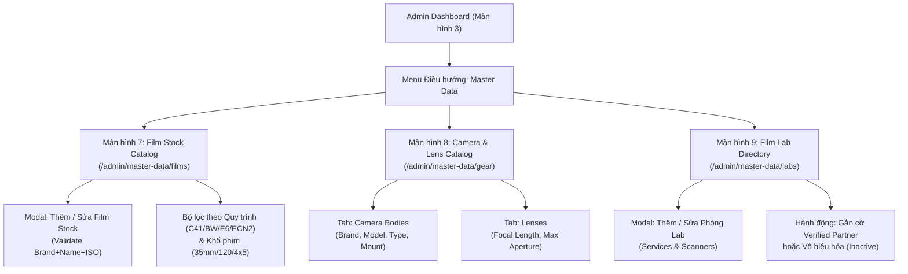

# TÀI LIỆU ĐẶC TẢ YÊU CẦU PHẦN MỀM (SRS) - CHUYÊN ĐỀ DỮ LIỆU DANH MỤC GỐC ẢNH PHIM
**Hệ thống:** AI-powered Film Photography Contest Management Platform (FilmContest-AI)  
**Tài liệu:** Analog_Master_Data.md  
**Phiên bản:** 1.0  
**Vai trò phụ trách:** Technical Writer & Software Architect  

---

## 1. Tổng quan Master Data trong Nhiếp ảnh Analog (Master Data Overview)

### 1.1 Định nghĩa & Phạm vi Chuẩn hóa Dữ liệu Gốc
Khác biệt hoàn toàn với các cuộc thi ảnh kỹ thuật số thông thường (nơi siêu dữ liệu EXIF được máy ảnh số nhúng tự động vào tệp ảnh), ảnh phim analog đòi hỏi quá trình ghi nhận và thẩm định hoàn toàn dựa trên các thuộc tính vật lý của vật liệu quang hóa và thiết bị cơ học.

Dữ liệu danh mục gốc (Analog Master Data) trong nền tảng **FilmContest-AI** đóng vai trò là "nguồn chân lý duy nhất" (Single Source of Truth), thiết lập bộ tiêu chuẩn dữ liệu toàn diện bao gồm:
1. **Danh mục Cuộn phim / Loại phim (Film Stocks):** Hãng sản xuất, tên thương mại của phim, độ nhạy sáng danh định (Box Speed ISO), quy trình tráng hóa chất quang hóa chuẩn (C-41, B&W, E-6, ECN-2) và các khổ phim vật lý hỗ trợ (35mm/135, 120 Medium Format, 4x5 Large Format).
2. **Danh mục Thân máy ảnh & Ống kính (Cameras & Lenses):** Hệ thống thân máy cơ khí/điện tử (SLR, Rangefinder, TLR, Point & Shoot, View Camera) và hệ thống ống kính quang học tương ứng.
3. **Danh bạ Phòng Lab tráng & quét phim (Film Labs Directory):** Danh sách các cơ sở xử lý phim chuyên nghiệp, quy trình tráng hỗ trợ, danh mục thiết bị quét phim công nghiệp (Noritsu, Fuji Frontier, Hasselblad Flextight, DSLR Scan rig) và chứng nhận đối tác tin cậy (Verified Partner Lab).

```
+--------------------------------------------------------------------------+
|                     ANALOG MASTER DATA REPOSITORY                        |
|                                                                          |
|  +--------------------+  +--------------------+  +--------------------+  |
|  | Film Stock Catalog |  | Camera & Lens Lib  |  | Film Lab Directory |  |
|  | - Brand / Maker    |  | - Camera Body/Type |  | - Lab Profile/City |  |
|  | - Film Name & ISO  |  | - Lens Mount/Focal |  | - Dev Chemistry    |  |
|  | - Chemistry Process|  | - Max Format Size  |  | - Scanner Hardware |  |
|  | - Formats (35/120) |  |                    |  | - Partner Status   |  |
|  +---------+----------+  +---------+----------+  +---------+----------+  |
+------------|-----------------------|-----------------------|-------------+
             |                       |                       |
             +-----------------------+-----------------------+
                                     | (Tham chiếu & Chọn nhanh)
                                     ▼
        +---------------------------------------------------------+
        |  Participant Submissions & Personal Film Roll Logbook   |
        |  (UC-35 Film Log, UC-37 Contest Submission, Metadata)   |
        +----------------------------+----------------------------+
                                     |
                                     ▼
        +---------------------------------------------------------+
        |  AI Integrity Verification & Negative Proof Inspection  |
        |  (BR-05 Unique Frame, BR-06 Negative Proof, BR-22 Spec) |
        +---------------------------------------------------------+
```

---

### 1.2 Ý nghĩa Nghiệp vụ & Ràng buộc Kỹ thuật Cốt lõi
- **Chống sai lệch thông tin:** Loại bỏ hoàn toàn tình trạng nhập liệu tự do gây phân mảnh dữ liệu (ví dụ: cùng một dòng phim nhưng bị nhập thành *Portra400, Kodak 400 Portra, portra-400*), giúp chuẩn hóa cơ sở dữ liệu phân tích và hiển thị.
- **Tối ưu hóa Trải nghiệm Thí sinh (UX):** Cho phép thí sinh chọn nhanh từ menu gợi ý khi ghi chép sổ tay cuộn phim (UC-35) hoặc nộp bài thi (UC-37), tiết kiệm tối đa thời gian khai báo.
- **Cơ sở Đối chiếu Bằng chứng Vật lý (Negative Proof Validation):** Dữ liệu Master Data về Hãng phim, Khổ phim và Loại phim là căn cứ pháp lý để Ban tổ chức đối chiếu với mã vạch phim (Rebate Edge/Barcode) trên ảnh dải phim âm bản gốc theo quy tắc BR-06 và BR-22.
- **Kho lưu trữ số & Thống kê Chuyên sâu:** Phục vụ bộ lọc chuyên sâu trên Kho lưu trữ tác phẩm số (UC-43 Digital Archive) và tổng hợp biểu đồ thống kê xu hướng sử dụng phim/máy ảnh của cộng đồng.

---

## 2. Các Use Cases Liên quan đến Master Data (Mục 2.2)

### 2.1 Bảng Tổng hợp Use Cases Master Data

| Mã Use Case | Tên Use Case | Tác nhân (Actors) | Mô tả Tóm tắt Chức năng (SRS Section 2.2.2) |
| :---: | :--- | :--- | :--- |
| **UC-06** | **Manage Film Stock Catalog** | Administrator | Quản lý danh mục các loại phim chuẩn hóa trên toàn cầu (Hãng phim, Tên film stock, ISO danh định, Loại phim màu C-41 / Đen trắng B&W / Dương bản E-6 / Điện ảnh ECN-2, Khổ phim hỗ trợ). |
| **UC-07** | **Manage Camera & Lens Catalog** | Administrator | Quản lý danh mục thiết bị nhiếp ảnh bao gồm thân máy ảnh phim (Camera Bodies) và ống kính (Lenses) phục vụ gợi ý khi nộp bài. |
| **UC-08** | **Manage Film Lab Directory** | Administrator | Quản lý danh bạ các phòng Lab tráng và quét phim uy tín trong cộng đồng, dịch vụ hóa chất và thiết bị máy quét sở hữu. |

---

### 2.2 Mô tả Chi tiết Từng Use Case Master Data

#### UC-06: Manage Film Stock Catalog
- **Tác nhân chính:** Administrator (C-R-U-D). Các vai trò khác: Organizer, Judge, Participant (Read-only).
- **Mục tiêu:** Cung cấp danh mục các loại phim nhiếp ảnh hoàn chỉnh, chính xác và đồng nhất cho toàn hệ thống.
- **Tiền điều kiện:** Quản trị viên đã đăng nhập và có quyền `Analog Master Data Management`.
- **Luồng sự kiện chính:**
  1. Admin truy cập màn hình danh mục Film Stocks (`/admin/master-data/films`).
  2. Hệ thống tải danh sách các loại phim kèm các chỉ số thống kê tổng quan theo nhóm hóa chất.
  3. **Thêm loại phim mới:**
     - Admin nhập: Hãng sản xuất (Brand), Tên dòng phim (Film Name), ISO danh định (Box Speed ISO: 50, 100, 160, 400, 800...), Nhóm quy trình tráng (C-41, B&W, E-6, ECN-2), Khổ phim hỗ trợ (Multi-select: 35mm, 120, 4x5, 8x10), Mô tả đặc tính hạt và màu sắc (Description).
     - Hệ thống kiểm tra tính duy nhất: Bộ 3 thuộc tính `[Brand + Film Name + Box Speed ISO]` không được trùng lặp với bản ghi đã có (BR-02).
     - Lưu bản ghi với trạng thái mặc định `ACTIVE`.
  4. **Cập nhật loại phim:** Admin chỉnh sửa thông tin mô tả, khổ phim bổ sung hoặc chuyển trạng thái sang `DISCONTINUED` (Ngừng sản xuất).
  5. **Xóa loại phim:** Nếu Admin chọn hành động xóa, hệ thống kích hoạt cơ chế Xóa mềm (**Soft Delete** theo BR-03). Cột `is_deleted` được đánh dấu `TRUE`, ẩn khỏi các danh sách lựa chọn của thí sinh mới nhưng vẫn bảo toàn nguyên vẹn trên các bài dự thi và cuộn phim lịch sử.

#### UC-07: Manage Camera & Lens Catalog
- **Tác nhân chính:** Administrator (C-R-U-D). Các vai trò khác (Read-only).
- **Mục tiêu:** Xây dựng cơ sở dữ liệu phong phú về máy ảnh cơ và ống kính cổ điển/hiện đại.
- **Luồng sự kiện chính:**
  1. Admin truy cập màn hình danh mục Camera & Lens (`/admin/master-data/gear`).
  2. Hệ thống phân chia thành 2 tab quản lý:
     - **Tab Camera Bodies:** Quản lý Hãng sản xuất (Leica, Hasselblad, Nikon, Canon, Olympus, Pentax, Mamiya, Rolleiflex...), Dòng máy (Model), Phân loại cấu trúc (35mm Rangefinder, 35mm SLR, Medium Format SLR, TLR, Point & Shoot, Large Format), Ngàm ống kính (Lens Mount), Khổ phim hỗ trợ tối đa.
     - **Tab Lenses:** Quản lý Hãng sản xuất, Tên ống kính, Tiêu cự (Focal Length - mm), Khẩu độ tối đa (Max Aperture - f/stop), Chuẩn ngàm tương thích.
  3. Hỗ trợ thao tác Thêm mới, Cập nhật thông tin hoặc Vô hiệu hóa thiết bị theo nguyên tắc kiểm tra trùng lặp và Soft Delete (BR-02, BR-03).

#### UC-08: Manage Film Lab Directory
- **Tác nhân chính:** Administrator (C-R-U-D). Các vai trò khác (Read-only).
- **Mục tiêu:** Quản lý mạng lưới các phòng Lab xử lý phim nhằm giúp thí sinh khai báo nguồn gốc tráng/scan và hỗ trợ xác thực bài thi.
- **Luồng sự kiện chính:**
  1. Admin truy cập màn hình danh bạ phòng Lab (`/admin/master-data/labs`).
  2. Hệ thống hiển thị danh sách phòng Lab phân loại theo Quốc gia, Thành phố.
  3. **Thêm mới phòng Lab:**
     - Admin nhập: Mã định danh Lab, Tên phòng Lab, Địa chỉ, Thành phố, Quốc gia, Website/Fanpage, Email liên hệ.
     - Chọn danh mục Dịch vụ tráng (Developing Services): C-41 (Color Negative), B&W (Manual/Machine), E-6 (Slide), ECN-2 (Remjet removal).
     - Chọn danh mục Dòng máy quét phim (Scanner Models): Noritsu (HS-1800, LS-600), Fuji Frontier (SP-3000, SP-500), Hasselblad Flextight (X1, X5), Flatbed (Epson V850), DSLR Scan Rig.
     - Thiết lập cờ chứng nhận: `is_verified_partner` (True/False).
  4. **Cập nhật & Đánh giá Đối tác:** Cho phép chuyển đổi trạng thái giữa `Active`, `Inactive` hoặc gắn huy hiệu `Verified Partner Lab` cho các phòng lab uy tín có ký kết thỏa thuận hỗ trợ kiểm tra âm bản gốc.

---

## 3. Luồng Giao diện & Mô tả Màn hình Quản trị (Admin Screen Flow - Mục 3.1.2)

### 3.1 Sơ đồ Điều hướng Màn hình Master Data (Admin Navigation Flow)



---

### 3.2 Bảng Mô tả Chi tiết Màn hình Quản trị Master Data (Mục 3.1.2)

| # | Nhóm Chức năng (Feature) | Tên Màn hình (Screen Name) | Mô tả Chi tiết Giao diện & Tác vụ Nghiệp vụ (SRS Section 3.1.2) |
| :-: | :--- | :--- | :--- |
| **7** | **Master Data** | **Film Stock Catalog** | **Giao diện quản lý danh mục phim chuẩn hóa toàn cầu:**<br>- Hiển thị thanh thẻ tóm tắt (Cards): Tổng số loại phim, Số phim C-41, B&W, E-6, ECN-2.<br>- Bảng dữ liệu (Data Grid): Mã phim, Tên phim, Hãng sản xuất, ISO danh định, Khổ phim hỗ trợ (35mm/120/4x5), Quy trình tráng, Trạng thái hoạt động.<br>- Bộ lọc đa chiều: Lọc theo hãng, nhóm hóa chất, khổ phim và tìm kiếm nhanh.<br>- Tác vụ: Nút `+ Thêm Film Stock`, nút `Chỉnh sửa`, nút `Đổi trạng thái (Active/Discontinued)` và nút `Xóa mềm (Soft Delete)`. |
| **8** | **Master Data** | **Camera & Lens Catalog** | **Giao diện quản lý cơ sở dữ liệu thiết bị máy ảnh và ống kính:**<br>- Hệ thống 2 Tab chuyển đổi linh hoạt: Thân máy ảnh (Bodies) và Ống kính (Lenses).<br>- Tab Camera: Hiển thị Hãng, Model, Loại máy (SLR/Rangefinder/TLR/Large Format), Khổ phim nhận diện, Ngàm ống kính.<br>- Tab Lens: Hiển thị Hãng, Tên lens, Tiêu cự (mm), Khẩu độ lớn nhất (f-number), Chuẩn ngàm.<br>- Bộ tìm kiếm nhanh tự động gợi ý (Autocomplete) phục vụ kiểm thử dữ liệu giúp thí sinh khai báo thuận tiện. |
| **9** | **Master Data** | **Film Lab Directory** | **Giao diện quản lý danh bạ phòng Lab tráng và quét phim:**<br>- Bảng dữ liệu hiển thị: Mã phòng Lab, Tên Lab, Thành phố, Quốc gia, Các dịch vụ tráng cung cấp, Các loại máy scan sở hữu.<br>- Cột trạng thái: Huy hiệu `Verified Partner Lab` (Màu xanh neon nổi bật) hoặc `Standard Lab`.<br>- Tác vụ: Đánh dấu xác thực đối tác, vô hiệu hóa lab dừng nhận xử lý phim, xem thống kê số lượng bài thi sử dụng dịch vụ của lab. |

---

## 4. Đặc tả Kỹ thuật Chi tiết: Quản lý Dữ liệu gốc Ảnh Phim (Functional Specification)

### 4.1 Chi tiết Mục 3.2.2.1: View & Manage Film Stock Catalog

#### A. Kích hoạt Chức năng (Function Trigger)
Quản trị viên (System Admin) chọn mục **"Master Data" > "Film Stocks"** trên thanh điều hướng chính của trang Quản trị.

#### B. Tác nhân & Quyền hạn (Actors & Permissions)
- **System Administrator:** Toàn quyền thao tác Tạo, Xem, Sửa, Xóa mềm (C-R-U-D).
- **Contest Organizer, Judge, Participant:** Quyền Xem / Đọc (Read-only) thông qua các API công khai hoặc bảng danh mục gợi ý khi nộp bài.

#### C. Mục đích (Purpose)
Quản lý danh mục chuẩn hóa các loại phim nhiếp ảnh trên thế giới nhằm đảm bảo tính đồng nhất dữ liệu khi thí sinh khai báo bài thi và phục vụ thống kê phân tích chuyên sâu cho nền tảng.

#### D. Luồng Xử lý Dữ liệu Chi tiết (Data Processing Pipeline)
Quá trình hiển thị và thao tác trên danh mục phim gồm 4 bước kỹ thuật:

```
[Admin truy cập /admin/master-data/films]
               │
               ▼
[Bước 1: Tính toán & Render 5 Thẻ Thống kê]
  ├── Total Films
  ├── Color Negative (C-41)
  ├── Black & White (B&W)
  ├── Color Reversal / Slide (E-6)
  └── Motion Picture / Cine (ECN-2)
               │
               ▼
[Bước 2: Hiển thị Bảng Dữ liệu Film Stocks (Data Table)]
  (FILM_CODE, Brand, Film Name, Box Speed ISO, Supported Formats, Chemistry, Status)
               │
               ├──────────────────────────────────────────┐
               ▼                                          ▼
     [Bước 3: Thêm mới / Cập nhật]                [Bước 4: Thao tác Xóa]
     ├── Kiểm tra Unique Constraint               └── Áp dụng Soft Delete (BR-03)
     │   (Brand + Film Name + ISO) (BR-02)            ├── UPDATE is_deleted = TRUE
     ├── Nếu trùng: Báo lỗi Validation                ├── UPDATE status = 'INACTIVE'
     └── Nếu hợp lệ: INSERT / UPDATE DB               └── Tuyệt đối không DELETE vật lý
```

1. **Hiển thị Thẻ Thống kê (Metrics Cards):**  
   Hệ thống chạy các truy vấn tổng hợp tức thời (Aggregate Queries) hiển thị 5 chỉ số lên đầu trang:
   - **Tổng số loại phim trong hệ thống** (`Total Active Film Stocks`).
   - **Phim âm bản màu** (*Color Negative - Quy trình C-41*): Ví dụ Kodak Portra 160/400/800, Kodak Ultramax 400, Fuji Pro 400H, CineStill 50D/400D.
   - **Phim đen trắng** (*Black & White - B&W Process*): Ví dụ Ilford HP5 Plus 400, Kodak Tri-X 400, Fomapan 100/200/400, Kentmere Pan 400.
   - **Phim dương bản / Đảo sắc** (*Color Reversal / Slide - Quy trình E-6*): Ví dụ Fujifilm Provia 100F, Velvia 50/100, Kodak Ektachrome E100.
   - **Phim điện ảnh** (*Motion Picture / Cine Film - Quy trình ECN-2 có lớp than Remjet*): Ví dụ Kodak Vision3 50D (5203), 250D (5207), 500T (5219).

2. **Hiển thị Danh sách Bảng Chi tiết (Data Grid):**  
   Hệ thống truy vấn cơ sở dữ liệu và hiển thị danh sách dạng bảng phân trang:
   - **Mã phim (FILM_CODE):** Khóa định danh chuẩn hóa hệ thống (Ví dụ: `FLM-KOD-POR400`, `FLM-ILF-HP5400`).
   - **Tên thương mại của phim (Film Name):** Tên đầy đủ được phát hành chính thức.
   - **Hãng sản xuất (Brand):** Kodak, Fujifilm, Ilford Photo, Harman Technology, CineStill, Foma Bohemia, Rollei, Lomography, Silberra, Lucky.
   - **Độ nhạy sáng danh định (Box Speed ISO):** Chỉ số ISO gốc của nhà sản xuất (25, 50, 100, 160, 200, 250, 400, 500, 800, 1600, 3200).
   - **Khổ phim hỗ trợ (Supported Formats):** Danh sách mảng khổ phim hỗ trợ: `135 (35mm)`, `120 (Medium Format)`, `4x5 (Large Format Sheet)`, `8x10 (Sheet)`.
   - **Trạng thái (Status):** `ACTIVE` (Đang lưu hành bình thường) hoặc `DISCONTINUED` (Đã ngừng sản xuất thương mại nhưng vẫn chấp nhận dự thi nếu còn phim lưu kho/hết hạn).

3. **Xử lý Thêm mới hoặc Cập nhật (Add/Edit Processing):**  
   - Khi Admin gửi biểu mẫu tạo mới hoặc chỉnh sửa, tầng Backend thực thi quy tắc kiểm tra tính duy nhất (**Unique Constraint Check** theo BR-02):  
     $$\text{Unique Key} = \text{LOWER}(\text{Brand}) + \text{"\_"} + \text{LOWER}(\text{Film Name}) + \text{"\_"} + \text{ISO}$$  
   - Nếu phát hiện trùng lặp bộ ba thông số trên với một bản ghi đang hoạt động (`is_deleted = FALSE`), hệ thống lập tức từ chối và trả về thông báo lỗi hợp lệ hóa (Validation Error).

4. **Xử lý Xóa mềm (Soft Delete Mechanism - BR-03):**  
   - Khi Admin kích hoạt lệnh "Xóa" một loại phim, hệ thống **tuyệt đối không thực thi câu lệnh SQL DELETE vật lý** khỏi bảng cơ sở dữ liệu.
   - Hệ thống tự động chuyển trạng thái bản ghi:
     ```sql
     UPDATE film_stocks 
     SET is_deleted = TRUE, 
         status = 'INACTIVE', 
         updated_at = NOW() 
     WHERE id = :film_stock_id;
     ```
   - *Mục đích bảo toàn:* Giúp giữ vẹn toàn toàn bộ các bản ghi lịch sử trong quá khứ bao gồm: Sổ tay cuộn phim (Film Rolls), Khung hình (Frames), Bài dự thi (Submissions), và Kho lưu trữ số (Digital Archive) mà không bao giờ bị lỗi khóa ngoại (Foreign Key Integrity Violation).

#### E. Các Quy tắc Nghiệp vụ Liên quan (Business Rules)
- **BR-02 (Kiểm soát Phân quyền RBAC):** Chỉ có tài khoản Administrator mới có quyền Create, Update, Delete trên Master Data. Các vai trò khác bị chặn nếu cố tình gửi request ghi dữ liệu.
- **BR-03 (Quy tắc Xóa mềm - Soft Delete):** Dữ liệu quan trọng (Cuộc thi, Bài dự thi, Danh mục Film Stock, Lịch sử chấm điểm) không bao giờ bị xóa vật lý khỏi cơ sở dữ liệu mà chỉ chuyển trạng thái sang Inactive hoặc Archived.
- **BR-07 (Quy chuẩn Tệp Scan):** Tệp ảnh scan dự thi tương ứng với phim phải có định dạng JPEG/JPG hoặc TIFF, cạnh ngắn nhất tối thiểu 2000px, dung lượng tối đa 25MB, và không chứa chữ ký cá nhân (Watermark).

---

### 4.2 Chi tiết Mục 3.2.2.2: View & Manage Film Lab Directory

#### A. Kích hoạt Chức năng (Function Trigger)
Quản trị viên (System Admin) chọn mục **"Master Data" > "Film Labs"** trên thanh điều hướng.

#### B. Tác nhân & Quyền hạn (Actors & Permissions)
- **System Administrator:** Toàn quyền quản trị danh bạ phòng lab (C-R-U-D).

#### C. Mục đích (Purpose)
Quản lý danh mục các phòng Lab tráng và quét phim chuyên nghiệp nhằm giúp thí sinh liên kết nguồn gốc xử lý hậu kỳ của tác phẩm, đồng thời xây dựng mạng lưới phòng lab đối tác phục vụ công tác xác minh tính xác thực của phim âm bản gốc khi có nghi vấn gian lận.

#### D. Luồng Xử lý Dữ liệu Chi tiết (Data Processing Pipeline)
1. **Lưu trữ Cấu trúc Thông tin Lab:**  
   Hệ thống thiết lập bản ghi chi tiết cho từng cơ sở bao gồm:
   - **Mã phòng Lab (LAB_CODE):** Mã duy nhất tự sinh theo chuẩn `LAB-ISO-XXXX` (Ví dụ: `LAB-VN-0001`).
   - **Tên phòng Lab (Lab Name):** Tên thương hiệu của phòng Lab (Ví dụ: LLab, Croplab, AEG Lab, Nadar Lab, Carmencita Film Lab, The Darkroom...).
   - **Địa bàn hành chính:** Địa chỉ chi tiết, Thành phố, Quốc gia.
   - **Thông tin liên lạc chính thức:** Email, Số điện thoại hỗ trợ, Website, Liên kết Mạng xã hội.
   - **Dịch vụ Kỹ thuật Quang hóa Cung cấp (Developing Services - Multi-select):**
     * `DEV_C41`: Tráng phim âm bản màu chuẩn công nghiệp.
     * `DEV_BW`: Tráng phim đen trắng thủ công (Manual inversion) hoặc bằng máy quay (Rotary processor như Jobo).
     * `DEV_E6`: Tráng phim đảo sắc/dương bản (Slide film) 3 bước hoặc 6 bước nhiệt độ chuẩn xác 38°C.
     * `DEV_ECN2`: Tráng phim điện ảnh với bồn tẩy lớp muội than bảo vệ (Remjet Removal Bath) chuyên biệt.
   - **Dòng Máy Quét Phim Sở Hữu (Scanner Hardware Catalog - Multi-select):**
     * `SCAN_NORITSU`: Dòng máy quét công nghiệp Noritsu (HS-1800, LS-600, LS-1100) cho dải màu trung tính, độ tương phản mượt mà, độ sắc nét cao.
     * `SCAN_FRONTIER`: Dòng máy quét Fuji Frontier (SP-3000, SP-500) nổi tiếng với tông màu da ngả ấm, xử lý sắc xanh dương/đỏ đặc trưng của phim Fujifilm.
     * `SCAN_FLEXTIGHT`: Máy quét ảo chất lượng bảo tàng Hasselblad Flextight (X1, X5) cho độ phân giải cực cao và chi tiết vùng tối tối đa.
     * `SCAN_DSLR`: Hệ thống sao chụp số hóa bằng máy ảnh số Full-frame kết hợp ống kính Macro chuyên dụng và nguồn sáng CRI > 95.

2. **Quản lý Trạng thái Đối tác & Vận hành:**  
   - **Cơ chế Verified Partner Lab:** Cho phép Admin kích hoạt huy hiệu "Đối tác xác thực" (`is_verified_partner = TRUE`). Các bài thi được tráng và quét tại Verified Partner Lab sẽ được hệ thống ưu tiên đánh giá độ tin cậy cao hơn trong mô-đun AI Integrity Check.
   - **Vô hiệu hóa hoạt động:** Chuyển trạng thái `INACTIVE` đối với các phòng lab tạm ngưng dịch vụ hoặc đóng cửa, ẩn khỏi menu lựa chọn của thí sinh mà không làm ảnh hưởng các bài thi đã liên kết trước đó (áp dụng quy tắc Soft Delete - BR-03).

#### E. Các Quy tắc Nghiệp vụ Liên quan (Business Rules)
- **BR-02 (Phân quyền):** Kiểm soát truy cập nghiêm ngặt; chỉ Admin được cấp quyền chỉnh sửa danh bạ Lab.
- **BR-03 (Soft Delete):** Xóa mềm phòng Lab để bảo toàn mối liên kết khóa ngoại với các bài thi cũ.

---

## 5. Mối Liên kết Thực thể & Ràng buộc Nghiệp vụ Toàn diện

Dữ liệu danh mục gốc Master Data không hoạt động cô lập mà là xương sống kết nối trực tiếp với quy trình nộp bài, ghi chép và chấm giải thông qua các mối liên kết thực thể (Entity Relationships) và quy tắc nghiệp vụ khắt khe:

### 5.1 Sơ đồ Thực thể Liên kết Master Data (ERD Relationships)

```
+-----------------------------------+
|            film_stocks            |
|-----------------------------------|
| PK  id: UUID                      |
|     film_code: VARCHAR(50) UNIQUE |
|     brand: VARCHAR(100)           |
|     name: VARCHAR(150)            |
|     box_iso: INT                  |
|     chemistry: ENUM               |
|     supported_formats: VARCHAR[]  |
|     is_deleted: BOOLEAN           |
+-----------------+-----------------+
                  | 1
                  |
                  | n (tham chiếu)
+-----------------v-----------------+          +-----------------------------------+
|         user_film_rolls           |          |             film_labs             |
|-----------------------------------|          |-----------------------------------|
| PK  id: UUID                      |          | PK  id: UUID                      |
| FK  user_id: UUID                 |          |     lab_code: VARCHAR(50) UNIQUE  |
| FK  film_stock_id: UUID           |          |     name: VARCHAR(200)            |
|     format: ENUM(35mm, 120, 4x5)  |          |     services: VARCHAR[]           |
|     shot_iso: INT                 |          |     scanners: VARCHAR[]           |
| FK  lab_id: UUID -----------------+--------> |     is_verified_partner: BOOLEAN  |
|     camera_body: VARCHAR(150)     |   1      |     is_deleted: BOOLEAN           |
+-----------------+-----------------+          +-----------------+-----------------+
                  | 1                                            | 1
                  |                                              |
                  | n                                            | n
+-----------------v-----------------+                            |
|       contest_submissions         |                            |
|-----------------------------------|                            |
| PK  id: UUID                      |                            |
| FK  contest_id: UUID              |                            |
| FK  user_id: UUID                 |                            |
| FK  film_roll_id: UUID            |                            |
| FK  film_stock_id: UUID           |                            |
| FK  lab_id: UUID -----------------+----------------------------+
|     frame_number: INT             |
|     camera_model: VARCHAR(150)    |
|     lens_model: VARCHAR(150)      |
|     negative_proof_url: VARCHAR   |
|     status: ENUM                  |
+-----------------------------------+
```

---

### 5.2 Ràng buộc Nghiệp vụ Trực tiếp từ Master Data đến Nộp bài Thi

| Mã Quy tắc | Tên Quy tắc Nghiệp vụ | Mô tả Chi tiết Ràng buộc Kỹ thuật |
| :---: | :--- | :--- |
| **BR-05** | **Chặn Trùng lặp Khung hình (Duplicate Frame Check)** | Trong cùng một cuộc thi, một thí sinh không được phép nộp hai tác phẩm có trùng đồng thời cả Mã cuộn phim (`film_roll_id`) và Số thứ tự khung hình (`frame_number`). Nếu vi phạm, hệ thống chặn gửi bài và báo lỗi `MSG012`. |
| **BR-06** | **Xác minh Ảnh Âm bản Gốc (Negative Proof Verification)** | Các tác phẩm lọt vào vòng Chung kết hoặc đạt Giải thưởng bắt buộc phải có ảnh chụp dải phim âm bản gốc (Negative Proof) hoặc Contact Sheet đã được Ban tổ chức đối chiếu khớp chính xác với thông số Film Stock và Khổ phim khai báo trước khi công bố kết quả. |
| **BR-22** | **Khai báo Đủ 5 Thông số Tối thiểu** | Mỗi bài dự thi hợp lệ bắt buộc phải khai báo đầy đủ 5 trường thông số kỹ thuật phim tối thiểu trích xuất từ Master Data: **(1) Film Stock, (2) Film Format, (3) Camera Body, (4) Frame Number, và (5) Developing Lab / Process.** |
| **BR-23** | **Giới hạn Vật lý Số Khung hình theo Khổ phim** | Số thứ tự khung hình (`frame_number`) khai báo không được vượt quá giới hạn vật lý của khổ phim tương ứng:<br>- **Khổ 135 (35mm):** Tối đa **39** khung hình (chuẩn cuộn 36 kiểu chụp rướn).<br>- **Khổ 120 (Medium Format 6x4.5):** Tối đa **16** khung hình.<br>- **Khổ 120 (Medium Format 6x6):** Tối đa **12** khung hình.<br>- **Khổ 120 (Medium Format 6x7):** Tối đa **10** khung hình.<br>Vi phạm giới hạn này sẽ bị chặn với mã lỗi `MSG010`. |

---

### 5.3 Danh mục Thông báo Hệ thống Tương ứng (Application Messages)

| Mã Thông báo | Loại Thông báo (Type) | Ngữ cảnh (Context) | Nội dung Thông báo Hiển thị (Content) |
| :---: | :---: | :---: | :--- |
| **MSG009** | Toast (Success) | Film Roll Log | Đã lưu thông tin cuộn phim "{roll_code}" vào sổ tay cá nhân. |
| **MSG010** | Inline (Red) | Frame Validation | Số thứ tự khung hình ({frame_no}) vượt quá giới hạn vật lý của khổ phim {format}. |
| **MSG011** | Toast (Error) | File Upload | Tệp ảnh tải lên vượt quá dung lượng tối đa 25MB hoặc độ phân giải thấp hơn 2000px. |
| **MSG012** | Toast (Error) | Duplicate Frame | Khung hình số {frame_no} thuộc cuộn phim này đã được nộp trong cuộc thi. |
