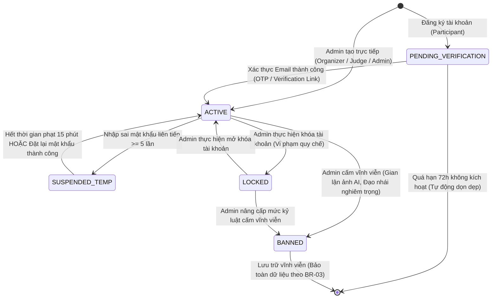
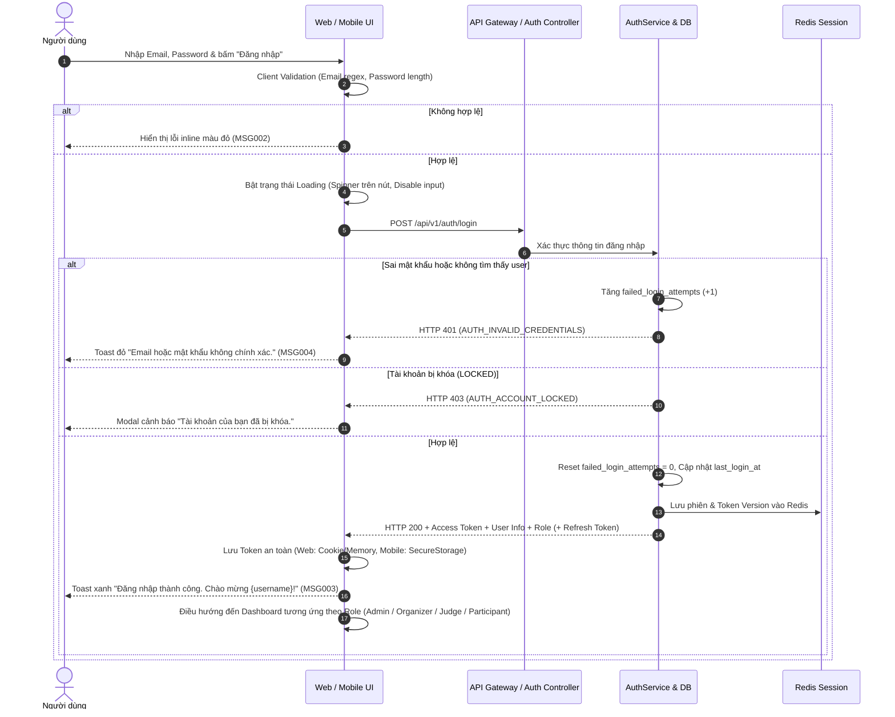

# Module Spec: 01-auth-and-rbac.md

> **Module Name**: Authentication & Role-Based Access Control (Xác thực & Phân quyền Người dùng)  
> **Status**: READY FOR CODE GENERATION  
> **Version**: 1.0.0  
> **Target Audience**: AI Coding Assistants (Cursor, Copilot), Backend Engineers, Frontend/Mobile Engineers  
> **Standard**: AI-First Spec (Explicit schemas, deterministic business logic, exhaustive error codes, Zero ambiguity)

---

## 1. Domain Entities & Database Mapping

Hệ thống cơ sở dữ liệu sử dụng **PostgreSQL 16+** (hỗ trợ native `UUIDv7` hoặc extension `pgcrypto`/`uuid-ossp`). Toàn bộ khóa chính (PK) được định dạng `UUID` nhằm đảm bảo tính phân tán và bảo mật ID. Thời gian được lưu trữ theo chuẩn `TIMESTAMPTZ` (UTC). Quy ước đặt tên bảng và cột theo chuẩn `snake_case`.

---

### 1.1 Bảng `roles`
Bảng danh mục định nghĩa 4 vai trò tác nhân cốt lõi trong toàn bộ hệ thống FilmContest-AI.
- **Table Name**: `roles`
- **Mô tả**: Lưu trữ danh mục vai trò (`ADMIN`, `ORGANIZER`, `JUDGE`, `PARTICIPANT`).

| Field Name | Data Type | Constraint | Default | Description |
| :--- | :--- | :--- | :--- | :--- |
| `id` | `UUID` | PK, Not Null | `gen_random_uuid()` | Khóa chính định danh vai trò |
| `code` | `VARCHAR(50)` | UQ, Not Null | *None* | Mã định danh vai trò: `ADMIN`, `ORGANIZER`, `JUDGE`, `PARTICIPANT` |
| `name` | `VARCHAR(100)` | Not Null | *None* | Tên hiển thị của vai trò (Quản trị viên, Ban tổ chức, Giám khảo, Thí sinh) |
| `description` | `TEXT` | Nullable | `NULL` | Mô tả chi tiết phạm vi trách nhiệm của vai trò |
| `is_system` | `BOOLEAN` | Not Null | `TRUE` | Cờ bảo vệ: `TRUE` nếu là vai trò hệ thống không được phép xóa |
| `created_at` | `TIMESTAMPTZ` | Not Null | `CURRENT_TIMESTAMP` | Thời điểm tạo bản ghi |
| `updated_at` | `TIMESTAMPTZ` | Not Null | `CURRENT_TIMESTAMP` | Thời điểm cập nhật bản ghi gần nhất |

---

### 1.2 Bảng `permissions`
Quản lý các đặc quyền truy cập chi tiết (granular permissions) theo mô hình Resource-Action.
- **Table Name**: `permissions`
- **Mô tả**: Danh mục quyền hạn chi tiết gắn với từng module và hành động trong hệ thống.

| Field Name | Data Type | Constraint | Default | Description |
| :--- | :--- | :--- | :--- | :--- |
| `id` | `UUID` | PK, Not Null | `gen_random_uuid()` | Khóa chính định danh quyền hạn |
| `code` | `VARCHAR(100)` | UQ, Not Null | *None* | Mã quyền duy nhất (VD: `users:read`, `contests:create`, `evaluations:submit`) |
| `resource` | `VARCHAR(50)` | Not Null | *None* | Tên tài nguyên (`auth`, `users`, `roles`, `master_data`, `contests`, `submissions`, `evaluations`, `archive`, `ai_engine`, `audit_logs`) |
| `action` | `VARCHAR(50)` | Not Null | *None* | Thao tác (`create`, `read`, `update`, `delete`, `approve`, `execute`, `lock`) |
| `description` | `VARCHAR(255)` | Not Null | *None* | Diễn giải chức năng nghiệp vụ của quyền |
| `created_at` | `TIMESTAMPTZ` | Not Null | `CURRENT_TIMESTAMP` | Thời điểm tạo bản ghi |

---

### 1.3 Bảng `role_permissions`
Bảng liên kết Nhiều - Nhiều (N-N) giữa Vai trò và Quyền hạn.
- **Table Name**: `role_permissions`
- **Mô tả**: Gán tập hợp các đặc quyền chi tiết cho từng vai trò cụ thể.

| Field Name | Data Type | Constraint | Default | Description |
| :--- | :--- | :--- | :--- | :--- |
| `role_id` | `UUID` | PK, FK, Not Null | *None* | Khóa ngoại tham chiếu `roles(id)` ON DELETE CASCADE |
| `permission_id` | `UUID` | PK, FK, Not Null | *None* | Khóa ngoại tham chiếu `permissions(id)` ON DELETE CASCADE |
| `assigned_at` | `TIMESTAMPTZ` | Not Null | `CURRENT_TIMESTAMP` | Thời điểm gán quyền |

> **Chỉ mục (Indexes)**:
> - `CREATE INDEX idx_role_permissions_role_id ON role_permissions(role_id);`
> - `CREATE INDEX idx_role_permissions_permission_id ON role_permissions(permission_id);`

---

### 1.4 Bảng `accounts`
Thực thể định danh trung tâm cho toàn bộ người dùng đăng nhập vào hệ thống FilmContest-AI.
- **Table Name**: `accounts`
- **Mô tả**: Lưu thông tin đăng nhập, trạng thái tài khoản và thông tin phục vụ cơ chế JWT Token Invalidation (`token_version`).

| Field Name | Data Type | Constraint | Default | Description |
| :--- | :--- | :--- | :--- | :--- |
| `id` | `UUID` | PK, Not Null | `gen_random_uuid()` | Khóa chính định danh tài khoản người dùng |
| `email` | `VARCHAR(255)` | UQ, Not Null | *None* | Địa chỉ email đăng nhập (chuẩn RFC 5322, viết thường - lowercase) |
| `phone_number` | `VARCHAR(20)` | UQ, Nullable | `NULL` | Số điện thoại liên hệ (chuẩn E.164, bắt buộc 10 số tại VN) |
| `password_hash` | `VARCHAR(255)` | Not Null | *None* | Mật khẩu băm an toàn (Argon2id hoặc BCrypt với cost factor >= 12) |
| `role_id` | `UUID` | FK, Not Null | *None* | Khóa ngoại tham chiếu `roles(id)` ON DELETE RESTRICT |
| `status` | `VARCHAR(30)` | Not Null | `'PENDING_VERIFICATION'` | Trạng thái: `PENDING_VERIFICATION`, `ACTIVE`, `SUSPENDED_TEMP`, `LOCKED`, `BANNED` |
| `token_version` | `INTEGER` | Not Null | `1` | Phiên bản Token. Tự động tăng (+1) khi đổi mật khẩu, đổi quyền hoặc bị khóa (BR-04) |
| `failed_login_attempts`| `SMALLINT` | Not Null | `0` | Số lần đăng nhập sai liên tiếp (Reset về 0 khi đăng nhập thành công) |
| `locked_until` | `TIMESTAMPTZ` | Nullable | `NULL` | Thời điểm hết hạn khóa tạm thời do nhập sai mật khẩu quá 5 lần |
| `email_verified_at`| `TIMESTAMPTZ` | Nullable | `NULL` | Thời điểm xác thực email thành công |
| `phone_verified_at`| `TIMESTAMPTZ` | Nullable | `NULL` | Thời điểm xác thực số điện thoại |
| `last_login_at` | `TIMESTAMPTZ` | Nullable | `NULL` | Thời điểm đăng nhập thành công gần nhất |
| `last_login_ip` | `VARCHAR(45)` | Nullable | `NULL` | Địa chỉ IP đăng nhập gần nhất (Hỗ trợ IPv4 và IPv6) |
| `created_at` | `TIMESTAMPTZ` | Not Null | `CURRENT_TIMESTAMP` | Thời điểm khởi tạo tài khoản |
| `updated_at` | `TIMESTAMPTZ` | Not Null | `CURRENT_TIMESTAMP` | Thời điểm cập nhật tài khoản gần nhất |
| `deleted_at` | `TIMESTAMPTZ` | Nullable | `NULL` | Thời điểm xóa mềm tài khoản (Soft delete theo quy tắc BR-03) |

> **Chỉ mục (Indexes)**:
> - `CREATE UNIQUE INDEX uq_accounts_email_active ON accounts(LOWER(email)) WHERE deleted_at IS NULL;`
> - `CREATE UNIQUE INDEX uq_accounts_phone_active ON accounts(phone_number) WHERE deleted_at IS NULL AND phone_number IS NOT NULL;`
> - `CREATE INDEX idx_accounts_role_id ON accounts(role_id);`
> - `CREATE INDEX idx_accounts_status ON accounts(status);`

---

### 1.5 Bảng `participant_profiles`
Lưu trữ thông tin chuyên biệt cho đối tượng Thí sinh / Nhiếp ảnh gia phim.
- **Table Name**: `participant_profiles`
- **Mô tả**: Mở rộng thông tin cá nhân nghệ thuật, phong cách chụp và portfolio ảnh phim (Quan hệ 1-1 với `accounts`).

| Field Name | Data Type | Constraint | Default | Description |
| :--- | :--- | :--- | :--- | :--- |
| `id` | `UUID` | PK, Not Null | `gen_random_uuid()` | Khóa chính hồ sơ thí sinh |
| `account_id` | `UUID` | UQ, FK, Not Null | *None* | Khóa ngoại tham chiếu `accounts(id)` ON DELETE CASCADE |
| `full_name` | `VARCHAR(150)` | Not Null | *None* | Họ và tên thật của thí sinh |
| `display_name` | `VARCHAR(100)` | Nullable | `NULL` | Nghệ danh / Tên hiển thị công khai trên Portfolio |
| `avatar_url` | `VARCHAR(500)` | Nullable | `NULL` | Đường dẫn CDN ảnh đại diện |
| `bio` | `TEXT` | Nullable | `NULL` | Giới thiệu ngắn về phong cách chụp ảnh phim / Tuyên ngôn nghệ thuật |
| `experience_level` | `VARCHAR(50)` | Not Null | `'AMATEUR'` | Trình độ: `NOVICE`, `AMATEUR`, `ENTHUSIAST`, `PROFESSIONAL` |
| `primary_film_format`| `VARCHAR(50)` | Nullable | `'35MM'` | Khổ phim sở trường: `35MM`, `120_MEDIUM_FORMAT`, `LARGE_FORMAT`, `MULTIPLE` |
| `favorite_film_stocks`| `JSONB` | Nullable | `'[]'::jsonb` | Mảng danh sách tên film stock ưa chuộng (VD: `["Kodak Portra 400", "Ilford HP5+"]`) |
| `portfolio_website`| `VARCHAR(255)` | Nullable | `NULL` | Đường dẫn trang web portfolio cá nhân |
| `instagram_handle` | `VARCHAR(100)` | Nullable | `NULL` | Tên tài khoản Instagram cá nhân |
| `address_country` | `VARCHAR(100)` | Not Null | `'Vietnam'` | Quốc gia cư trú |
| `address_city` | `VARCHAR(100)` | Nullable | `NULL` | Tỉnh / Thành phố cư trú |
| `created_at` | `TIMESTAMPTZ` | Not Null | `CURRENT_TIMESTAMP` | Thời điểm tạo hồ sơ |
| `updated_at` | `TIMESTAMPTZ` | Not Null | `CURRENT_TIMESTAMP` | Thời điểm cập nhật hồ sơ gần nhất |

---

### 1.6 Bảng `refresh_tokens` (Quản trị phiên & Token Rotation)
- **Table Name**: `refresh_tokens`
- **Mô tả**: Lưu trữ token làm mới phiên đăng nhập nhằm kiểm soát vòng đời phiên, phát hiện hành vi tái sử dụng token trái phép (Token Reuse Detection) và hỗ trợ thu hồi tức thì theo BR-04.

| Field Name | Data Type | Constraint | Default | Description |
| :--- | :--- | :--- | :--- | :--- |
| `id` | `UUID` | PK, Not Null | `gen_random_uuid()` | Khóa chính bản ghi phiên làm mới |
| `account_id` | `UUID` | FK, Not Null | *None* | Khóa ngoại tham chiếu `accounts(id)` ON DELETE CASCADE |
| `token_hash` | `VARCHAR(255)` | UQ, Not Null | *None* | Chuỗi băm SHA-256 của Refresh Token |
| `device_fingerprint` | `VARCHAR(255)` | Nullable | `NULL` | Dấu vân tay thiết bị (Browser / Mobile Device ID) |
| `user_agent` | `TEXT` | Nullable | `NULL` | Thông tin trình duyệt / hệ điều hành của client |
| `ip_address` | `VARCHAR(45)` | Nullable | `NULL` | Địa chỉ IP khởi tạo phiên |
| `expires_at` | `TIMESTAMPTZ` | Not Null | *None* | Thời điểm hết hạn (7 ngày kể từ lúc cấp) |
| `revoked_at` | `TIMESTAMPTZ` | Nullable | `NULL` | Thời điểm bị thu hồi (Do logout hoặc tài khoản bị khóa) |
| `replaced_by_token_id`| `UUID` | FK, Nullable | `NULL` | ID của refresh token mới thay thế (Cơ chế Token Rotation) |
| `created_at` | `TIMESTAMPTZ` | Not Null | `CURRENT_TIMESTAMP` | Thời điểm phát hành |

> **Chỉ mục (Indexes)**:
> - `CREATE INDEX idx_refresh_tokens_account_id ON refresh_tokens(account_id);`
> - `CREATE UNIQUE INDEX uq_refresh_tokens_token_hash ON refresh_tokens(token_hash);`

---

## 2. Business Rules & Logic Ràng Buộc

### 2.1 Trích xuất Business Rules từ SRS
Hệ thống xác thực và phân quyền RBAC kế thừa và tuân thủ chặt chẽ các quy định từ tài liệu SRS:

- **BR-01 (Định danh duy nhất)**: Mỗi người dùng (Admin, Organizer, Judge, Participant) chỉ sở hữu duy nhất một tài khoản định danh qua Email chuẩn RFC và Số điện thoại đã xác thực. Tuyệt đối không cho phép tạo nhiều tài khoản cùng một địa chỉ email hoặc cùng số điện thoại đang hoạt động.
- **BR-02 (Nguyên tắc Phân quyền RBAC)**: Người dùng chỉ được phép truy cập màn hình, menu và API tương ứng với Vai trò (`Role`) và Đặc quyền (`Permission`) đã được cấp phát. Tầng API Gateway / Backend Middleware bắt buộc kiểm tra phân quyền độc lập trên từng endpoint.
- **BR-03 (Bảo toàn dữ liệu - Soft Delete)**: Dữ liệu quan trọng (bao gồm tài khoản người dùng, nhật ký cuộn phim, lịch sử chấm điểm) không bao giờ bị xóa vật lý (`DELETE`) khỏi cơ sở dữ liệu mà chỉ chuyển trạng thái sang `LOCKED`, `BANNED` hoặc cập nhật trường `deleted_at`.
- **BR-04 (Thu hồi phiên tức thì khi khóa tài khoản)**: Phiên đăng nhập của Giám khảo, Quản trị viên và toàn bộ người dùng được bảo vệ bằng JWT. Khi một tài khoản bị khóa (`LOCKED`), cấm (`BANNED`), đổi mật khẩu hoặc điều chỉnh quyền:
  1. Trường `accounts.token_version` tự động tăng lên 1 đơn vị.
  2. Toàn bộ `refresh_tokens` thuộc tài khoản bị cập nhật `revoked_at = NOW()`.
  3. Giá trị `token_version` mới được đồng bộ tức thì lên Redis Cache.
  4. Middleware xác thực JWT sẽ đối chiếu `token_version` trong Payload của Access Token với giá trị lưu trên Redis. Nếu không khớp, từ chối ngay lập tức với mã lỗi `AUTH_TOKEN_REVOKED`, buộc chấm dứt phiên làm việc trên toàn bộ thiết bị ngay trong vòng < 1 giây mà không cần đợi token 15 phút hết hạn.
- **BR-21 (Kiểm soát Xung đột lợi ích - Conflict of Interest)**: Một tài khoản đã được phân công vai trò `JUDGE` hoặc `ORGANIZER` trong một cuộc thi cụ thể sẽ bị hệ thống chặn tự động không cho phép đăng ký làm `PARTICIPANT` (nộp bài dự thi) trong chính cuộc thi đó.

---

### 2.2 Bảng Ma trận Phân quyền (RBAC Permission Matrix)

Chi tiết quyền hạn giữa 4 Actor đối với toàn bộ các tài nguyên và hành động trong hệ thống FilmContest-AI:

| Tài nguyên (Resource) | Quyền hạn (Permission Code) | Admin | Organizer | Judge | Participant | Điều kiện ràng buộc & Ghi chú |
| :--- | :--- | :---: | :---: | :---: | :---: | :--- |
| **Authentication** | `auth:register` | ✗ | ✗ | ✗ | ✓ | Public endpoint chỉ dành cho Thí sinh tự do |
| | `auth:login` | ✓ | ✓ | ✓ | ✓ | Cả 4 Actor đăng nhập qua cổng tương ứng |
| | `auth:refresh` | ✓ | ✓ | ✓ | ✓ | Đổi Access Token mới khi Refresh Token còn hạn |
| | `auth:logout` | ✓ | ✓ | ✓ | ✓ | Thu hồi Refresh Token hiện hành |
| | `auth:recover_password` | ✓ | ✓ | ✓ | ✓ | Gửi liên kết đặt lại mật khẩu qua email |
| **User Profile** | `users:read_own_profile` | ✓ | ✓ | ✓ | ✓ | Đọc thông tin tài khoản và hồ sơ của chính mình |
| | `users:update_own_profile`| ✓ | ✓ | ✓ | ✓ | Cập nhật hồ sơ cá nhân và đổi avatar |
| | `users:change_password` | ✓ | ✓ | ✓ | ✓ | Đổi mật khẩu (yêu cầu mật khẩu cũ chính xác) |
| **User Management** | `users:read_all` | ✓ | ✗ | ✗ | ✗ | Xem danh sách toàn bộ người dùng và lọc theo role |
| | `users:create_internal` | ✓ | ✗ | ✗ | ✗ | Khởi tạo tài khoản Organizer, Judge, Admin nội bộ |
| | `users:lock_unlock` | ✓ | ✗ | ✗ | ✗ | Khóa / Mở khóa tài khoản (Kích hoạt BR-04) |
| | `users:soft_delete` | ✓ | ✗ | ✗ | ✗ | Đánh dấu xóa mềm tài khoản (BR-03) |
| **Role & RBAC** | `roles:manage` | ✓ | ✗ | ✗ | ✗ | Tạo, sửa vai trò và ma trận quyền hạn |
| **Master Data** | `master_data:create_update`| ✓ | ✗ | ✗ | ✗ | Quản lý danh mục Film Stock, Camera, Lens, Lab |
| | `master_data:read` | ✓ | ✓ | ✓ | ✓ | Đọc danh mục phục vụ chọn nhanh khi nộp bài |
| **Contest** | `contests:create_update` | ✗ | ✓ | ✗ | ✗ | Khởi tạo, cập nhật cấu hình cuộc thi (UC-11, UC-12) |
| | `contests:read_all` | ✓ | ✓ | ✓ | ✓ | Xem thông tin cuộc thi và thể lệ mở |
| | `contests:register` | ✗ | ✗ | ✗ | ✓ | Đăng ký tham gia cuộc thi (Kiểm tra chặn BR-21) |
| **Analog Logbook** | `film_logs:manage_own` | ✗ | ✗ | ✗ | ✓ | Tạo cuộn phim và ghi chú frame 1-36 (Chỉ tác giả) |
| **Submission** | `submissions:submit_entry` | ✗ | ✗ | ✗ | ✓ | Nộp ảnh scan kèm siêu dữ liệu kỹ thuật phim |
| | `submissions:upload_proof` | ✗ | ✗ | ✗ | ✓ | Tải ảnh dải phim âm bản đối chứng (BR-06, BR-19) |
| | `submissions:moderate_all` | ✗ | ✓ | ✗ | ✗ | Duyệt bài, Yêu cầu âm bản, Loại bài (BR-18) |
| | `submissions:blind_view` | ✗ | ✗ | ✓ | ✗ | Xem ảnh ở chế độ ẩn danh kép (Ẩn 100% PII - BR-12) |
| **Judging / Score**| `evaluations:score_entry` | ✗ | ✗ | ✓ | ✗ | Chấm điểm độc lập theo trọng số tiêu chí (BR-15) |
| | `evaluations:lock_sheet` | ✗ | ✗ | ✓ | ✗ | Khóa bảng điểm cá nhân vòng thi (BR-13) |
| | `evaluations:discrepancy` | ✗ | ✓ | ✗ | ✗ | Điều phối bài thi có độ lệch điểm > 30% (BR-14) |
| **AI Verification** | `ai:configure_thresholds` | ✓ | ✗ | ✗ | ✗ | Cấu hình ngưỡng xác suất $P_{AI}$ và pHash (UC-09) |
| | `ai:view_scan_reports` | ✓ | ✓ | ✗ | ✗ | Xem báo cáo nghi vấn ảnh AI và ảnh trùng lặp |
| **Audit Logs** | `audit_logs:read` | ✓ | ✗ | ✗ | ✗ | Tra cứu lịch sử thao tác nhạy cảm hệ thống (CR-04) |

---

### 2.3 Ràng buộc Xác thực Dữ liệu (Validation Constraints)

#### 1. Chính sách Mật khẩu (Password Policy)
- **Độ dài**: Tối thiểu 8 ký tự, tối đa 128 ký tự.
- **Quy tắc ký tự bắt buộc**:
  - Tối thiểu 1 chữ cái viết hoa (`A-Z`).
  - Tối thiểu 1 chữ cái viết thường (`a-z`).
  - Tối thiểu 1 chữ số (`0-9`).
  - Tối thiểu 1 ký tự đặc biệt (`!@#$%^&*()_+\-=\[\]{};':"\\|,.<>\/?`).
- **Ràng buộc an toàn**: Không được chứa chuỗi tên người dùng hoặc tiền tố email; không nằm trong danh sách 1.000 mật khẩu phổ biến nhất.

#### 2. Chuẩn hóa Email & Số điện thoại
- **Email**: Chuẩn RFC 5322. Tự động `trim()` khoảng trắng và chuyển toàn bộ sang chữ thường (`lowercase`) trước khi kiểm tra hoặc lưu Database.
  - *Regex chuẩn*: `^[a-zA-Z0-9.!#$%&'*+/=?^_`{|}~-]+@[a-zA-Z0-9](?:[a-zA-Z0-9-]{0,61}[a-zA-Z0-9])?(?:\.[a-zA-Z0-9](?:[a-zA-Z0-9-]{0,61}[a-zA-Z0-9])?)+$`
- **Số điện thoại**: Bắt buộc là số điện thoại di động Việt Nam (10 chữ số, chuẩn đầu số mạng Viettel, VinaPhone, MobiFone, Vietnamobile: `03, 05, 07, 08, 09` hoặc tiền tố quốc tế `+84`).
  - *Regex chuẩn*: `^(?:\+84|0)(?:3[2-9]|5[6|8|9]|7[0|6-9]|8[1-9]|9[0-9])[0-9]{7}$`

#### 3. Quy chuẩn Token JWT (JSON Web Token)
- **Thuật toán chữ ký**: `RS256` (Khuyến nghị Enterprise: Private Key lưu trong Vault/KMS để ký tại Auth Service, Public Key cấp cho các Service khác xác thực chữ ký offline) hoặc `HS256` với khóa bí mật tối thiểu 256-bit.
- **Access Token Specification**:
  - **Thời hạn sống (TTL)**: 15 phút (900 giây).
  - **Cấu trúc Payload chuẩn**:
    ```json
    {
      "sub": "b2c3d4e5-f6a7-48b9-bc01-23456789abcd",
      "email": "le.minh.tri@filmcontest.vn",
      "role": "ORGANIZER",
      "permissions": [
        "contests:create_update",
        "submissions:moderate_all",
        "evaluations:discrepancy"
      ],
      "token_version": 1,
      "iss": "filmcontest-ai-auth",
      "aud": "filmcontest-ai-api",
      "iat": 1730048400,
      "exp": 1730049300,
      "jti": "d5f3e9a1-7c8b-4a2e-9d1f-8e4a2c1b9f0d"
    }
    ```
- **Refresh Token Specification**:
  - **Thời hạn sống (TTL)**: 7 ngày (604,800 giây).
  - **Định dạng**: Chuỗi Cryptographic Random Opaque String (64 bytes hex-encoded, entropy cao).
  - **Lưu trữ**: Chỉ lưu mã băm `SHA-256(token)` trong bảng `refresh_tokens`.
  - **Lưu trữ phía Client**:
    - Web Browser: Lưu trong Cookie an toàn (`HttpOnly; Secure; SameSite=Strict; Path=/api/v1/auth; Max-Age=604800`).
    - Mobile App: Lưu trong Storage mã hóa phần cứng (`Flutter Secure Storage` - iOS Keychain / Android EncryptedSharedPreferences).
  - **Token Rotation & Anti-Reuse**: Mỗi lần gọi `/api/v1/auth/refresh`, Refresh Token cũ lập tức bị thu hồi (`revoked_at = NOW()`) và một cặp token mới được cấp phát. Nếu phát hiện một Refresh Token đã bị thu hồi được gửi lên, hệ thống kích hoạt cơ chế báo động "Token Reuse Attack", lập tức thu hồi toàn bộ các Refresh Token của tài khoản đó và vô hiệu hóa phiên ngay lập tức.

#### 4. Quy tắc Chặn Đăng nhập vét cạn (Brute-force Lockout)
- Nếu nhập sai mật khẩu 5 lần liên tiếp:
  - `accounts.failed_login_attempts = 5`.
  - `accounts.locked_until = NOW() + INTERVAL '15 minutes'`.
  - Từ chối mọi yêu cầu đăng nhập từ tài khoản này trong 15 phút với mã lỗi `AUTH_ACCOUNT_TEMPORARILY_LOCKED`.

---

## 3. State Machine & Lifecycle

### 3.1 Sơ đồ Chuyển đổi Trạng thái Tài khoản (Mermaid Diagram)



---

### 3.2 Bảng Đặc tả Chuyển đổi Trạng thái (State Transition Table)

| Current State | Event / Trigger Action | Next State | Allowed Actor | Guard Condition (Điều kiện tiên quyết) | Side Effects (Xử lý hệ thống & Hiệu ứng phụ) |
| :--- | :--- | :--- | :--- | :--- | :--- |
| `[*]` (None) | `REGISTER_SUBMIT` | `PENDING_VERIFICATION` | Guest (Public) | Email & SĐT chưa tồn tại (BR-01). Mật khẩu đạt Password Policy. | Tạo bản ghi `accounts` và `participant_profiles`. Sinh mã xác thực OTP gửi qua email. |
| `[*]` (None) | `ADMIN_CREATE_USER` | `ACTIVE` | Administrator | Actor có quyền `users:create_internal`. Role được gán hợp lệ (`ORGANIZER`, `JUDGE`, `ADMIN`). | Tạo tài khoản, sinh mật khẩu tạm thời ngẫu nhiên, gửi email kích hoạt tài khoản kèm hướng dẫn đổi mật khẩu. |
| `PENDING_VERIFICATION` | `VERIFY_EMAIL_SUCCESS` | `ACTIVE` | Guest / Participant | Mã OTP khớp, chưa quá hạn 15 phút và tài khoản chưa bị xóa. | Cập nhật `email_verified_at = NOW()`. Cho phép đăng nhập vào hệ thống. |
| `ACTIVE` | `LOGIN_FAILED_5_TIMES` | `SUSPENDED_TEMP` | System (Automated) | `failed_login_attempts >= 5`. | Đặt `locked_until = NOW() + 15m`. Gửi email cảnh báo bảo mật tới chủ tài khoản. |
| `SUSPENDED_TEMP` | `LOCKOUT_EXPIRED` | `ACTIVE` | System (Automated) | `NOW() > accounts.locked_until`. | Reset `failed_login_attempts = 0`, `locked_until = NULL`. |
| `SUSPENDED_TEMP` | `RESET_PASSWORD_SUCCESS`| `ACTIVE` | Guest / Owner | Xác minh liên kết khôi phục mật khẩu thành công qua email. | Cập nhật mật khẩu mới, tăng `token_version` + 1, thu hồi các phiên cũ. |
| `ACTIVE` | `ADMIN_LOCK_ACCOUNT` | `LOCKED` | Administrator | Actor có quyền `users:lock_unlock`. Không được tự khóa chính mình. Lý do khóa bắt buộc nhập >= 10 ký tự. | Tăng `token_version` + 1. Đặt `revoked_at = NOW()` cho toàn bộ refresh token. Đẩy cờ Redis Blacklist để hủy tức thì mọi phiên làm việc hiện hành (BR-04). Ghi AuditLog. |
| `LOCKED` | `ADMIN_UNLOCK_ACCOUNT` | `ACTIVE` | Administrator | Actor có quyền `users:lock_unlock`. Bắt buộc nhập lý do mở khóa. | Chuyển `status = 'ACTIVE'`, reset `failed_login_attempts = 0`. Ghi AuditLog. |
| `ACTIVE` hoặc `LOCKED` | `ADMIN_BAN_ACCOUNT` | `BANNED` | Administrator | Actor có quyền `users:lock_unlock`. Bắt buộc có biên bản xử lý vi phạm nghiêm trọng (Ảnh AI / Đạo nhái). | Khóa vĩnh viễn, tăng `token_version` + 1, hủy toàn bộ token, gỡ quyền tham gia các cuộc thi đang mở. Ghi AuditLog. |

---

## 4. Shared API Contracts (Dùng chung cho Web & Mobile)

Quy chuẩn kỹ thuật toàn hệ thống FilmContest-AI:
- **Base URL**: `https://api.filmcontest.vn/api/v1`
- **Content-Type**: `application/json; charset=utf-8`
- **Chuẩn Envelope thành công**:
  ```json
  {
    "success": true,
    "data": { ... },
    "meta": { "timestamp": "2026-10-27T16:00:00.000Z" }
  }
  ```
- **Chuẩn Envelope thất bại**:
  ```json
  {
    "success": false,
    "error": {
      "code": "ERROR_CODE_STRING",
      "message": "Human readable Vietnamese message",
      "details": []
    }
  }
  ```

---

### 4.1 Đăng ký tài khoản Thí sinh (Register Participant)
- **Endpoint**: `POST /api/v1/auth/register`
- **Quyền truy cập**: Public (Không cần Token)
- **Header Requirements**:
  ```http
  Content-Type: application/json
  X-Client-Platform: web | mobile
  ```

#### Request Payload:
```json
{
  "email": "nguyen.van.an@example.com",
  "password": "SecurePassword@2026",
  "fullName": "Nguyễn Văn An",
  "phoneNumber": "0912345678",
  "primaryFilmFormat": "35MM"
}
```

#### Validation Schema (Zod Rule):
```typescript
import { z } from 'zod';

export const RegisterRequestSchema = z.object({
  email: z.string().trim().email("Email không đúng định dạng RFC 5322").max(255),
  password: z.string()
    .min(8, "Mật khẩu tối thiểu 8 ký tự")
    .max(128, "Mật khẩu tối đa 128 ký tự")
    .regex(/[A-Z]/, "Bắt buộc có ít nhất 1 chữ cái in hoa")
    .regex(/[a-z]/, "Bắt buộc có ít nhất 1 chữ cái in thường")
    .regex(/[0-9]/, "Bắt buộc có ít nhất 1 chữ số")
    .regex(/[!@#$%^&*()_+\-=\[\]{};':"\\|,.<>\/?]/, "Bắt buộc có ít nhất 1 ký tự đặc biệt"),
  fullName: z.string().trim().min(2, "Họ và tên tối thiểu 2 ký tự").max(150),
  phoneNumber: z.string().trim().regex(/^(?:\+84|0)(?:3[2-9]|5[6|8|9]|7[0|6-9]|8[1-9]|9[0-9])[0-9]{7}$/, "Số điện thoại di động Việt Nam không hợp lệ"),
  primaryFilmFormat: z.enum(["35MM", "120_MEDIUM_FORMAT", "LARGE_FORMAT", "MULTIPLE"]).optional().default("35MM")
});
```

#### Response Payload (201 Created):
```json
{
  "success": true,
  "data": {
    "accountId": "a1b2c3d4-e5f6-7a8b-9c0d-1e2f3a4b5c6d",
    "email": "nguyen.van.an@example.com",
    "fullName": "Nguyễn Văn An",
    "status": "PENDING_VERIFICATION",
    "message": "Đăng ký thành công. Vui lòng kiểm tra hộp thư email để kích hoạt tài khoản trong vòng 72 giờ."
  }
}
```

---

### 4.2 Đăng nhập hệ thống (Authenticate User)
- **Endpoint**: `POST /api/v1/auth/login`
- **Quyền truy cập**: Public
- **Header Requirements**:
  ```http
  Content-Type: application/json
  X-Device-Fingerprint: "fp_a1b2c3d4e5f6..."
  X-Client-Platform: web | mobile
  ```

#### Request Payload:
```json
{
  "email": "le.minh.tri@filmcontest.vn",
  "password": "OrganizerPassword@2026",
  "rememberMe": true
}
```

#### Validation Schema (Zod Rule):
```typescript
export const LoginRequestSchema = z.object({
  email: z.string().trim().email("Email không hợp lệ").max(255),
  password: z.string().min(1, "Vui lòng nhập mật khẩu").max(128),
  rememberMe: z.boolean().optional().default(false)
});
```

#### Response Payload (200 OK):
> **Ghi chú bảo mật**: Trên Web Client, server đồng thời gửi Header: `Set-Cookie: refreshToken=d7a8f9b0...; HttpOnly; Secure; SameSite=Strict; Path=/api/v1/auth; Max-Age=604800`. Trên Mobile Client, trường `refreshToken` trong body sẽ được lưu vào Secure Storage.

```json
{
  "success": true,
  "data": {
    "user": {
      "id": "b2c3d4e5-f6a7-48b9-bc01-23456789abcd",
      "email": "le.minh.tri@filmcontest.vn",
      "role": "ORGANIZER",
      "status": "ACTIVE",
      "fullName": "Lê Minh Trí",
      "avatarUrl": "https://cdn.filmcontest.vn/avatars/user_tri.webp",
      "permissions": [
        "contests:create_update",
        "submissions:moderate_all",
        "evaluations:discrepancy",
        "ai:view_scan_reports"
      ]
    },
    "tokens": {
      "accessToken": "eyJhbGciOiJSUzI1NiIsInR5cCI6IkpXVCJ9.eyJzdWIiOiJiMmMzZDRlNS1mNmE3LTQ4YjktYmMwMS0yMzQ1Njc4OWFiY2QiLCJyb2xlIjoiT1JHQU5JWkVSIiwiZXhwIjoxNzMwMDQ5MzAwfQ...",
      "tokenType": "Bearer",
      "expiresIn": 900,
      "refreshToken": "d7a8f9b0c1e234567890abcdef1234567890abcdef1234567890abcdef123456"
    }
  }
}
```

---

### 4.3 Làm mới Access Token (Refresh Token)
- **Endpoint**: `POST /api/v1/auth/refresh`
- **Quyền truy cập**: Public (Xác thực bằng Refresh Token)
- **Header Requirements**:
  ```http
  Content-Type: application/json
  X-Device-Fingerprint: "fp_a1b2c3d4e5f6..."
  Cookie: refreshToken=d7a8f9b0c1e23456... (Web Client tự động gửi)
  ```

#### Request Payload (Mobile truyền trong Body, Web ưu tiên đọc từ Cookie):
```json
{
  "refreshToken": "d7a8f9b0c1e234567890abcdef1234567890abcdef1234567890abcdef123456"
}
```

#### Response Payload (200 OK):
```json
{
  "success": true,
  "data": {
    "accessToken": "eyJhbGciOiJSUzI1NiIsInR5cCI6IkpXVCJ9.eyJzdWIiOiJiMmMzZDRlNS...",
    "tokenType": "Bearer",
    "expiresIn": 900,
    "refreshToken": "e8b9c0d1e2f345678901bcdefa2345678901bcdefa2345678901bcdefa234567"
  }
}
```

---

### 4.4 Đăng xuất hệ thống (Logout)
- **Endpoint**: `POST /api/v1/auth/logout`
- **Quyền truy cập**: Authenticated (`All Actors`)
- **Header Requirements**:
  ```http
  Authorization: Bearer <accessToken>
  Content-Type: application/json
  ```

#### Request Payload:
```json
{
  "allDevices": false
}
```

#### Response Payload (200 OK):
```json
{
  "success": true,
  "data": {
    "message": "Đăng xuất thành công. Phiên làm việc đã được thu hồi an toàn."
  }
}
```

---

### 4.5 Yêu cầu Khôi phục Mật khẩu (Forgot Password)
- **Endpoint**: `POST /api/v1/auth/forgot-password`
- **Quyền truy cập**: Public

#### Request Payload:
```json
{
  "email": "nguyen.van.an@example.com"
}
```

#### Response Payload (200 OK):
> **Bảo vệ phòng chống dò quét tài khoản (User Enumeration Defense)**: Luôn trả về thông báo 200 thành công dù email có tồn tại trong hệ thống hay không.
```json
{
  "success": true,
  "data": {
    "message": "Nếu email tồn tại trong hệ thống, hướng dẫn đặt lại mật khẩu đã được gửi đến hộp thư của bạn."
  }
}
```

---

### 4.6 Đặt lại Mật khẩu qua Token (Reset Password)
- **Endpoint**: `POST /api/v1/auth/reset-password`
- **Quyền truy cập**: Public (Xác thực bằng Token gửi qua Email)

#### Request Payload:
```json
{
  "token": "reset_tok_8f9a0b1c2d3e4f5a6b7c8d9e0f1a2b3c",
  "newPassword": "NewSecurePassword@2026",
  "confirmPassword": "NewSecurePassword@2026"
}
```

#### Validation Schema (Zod Rule):
```typescript
export const ResetPasswordRequestSchema = z.object({
  token: z.string().min(1, "Mã xác thực không được để trống"),
  newPassword: z.string()
    .min(8, "Mật khẩu tối thiểu 8 ký tự")
    .max(128, "Mật khẩu tối đa 128 ký tự")
    .regex(/[A-Z]/, "Ít nhất 1 chữ hoa")
    .regex(/[a-z]/, "Ít nhất 1 chữ thường")
    .regex(/[0-9]/, "Ít nhất 1 chữ số")
    .regex(/[!@#$%^&*()_+\-=\[\]{};':"\\|,.<>\/?]/, "Ít nhất 1 ký tự đặc biệt"),
  confirmPassword: z.string()
}).refine(data => data.newPassword === data.confirmPassword, {
  message: "Xác nhận mật khẩu mới không trùng khớp",
  path: ["confirmPassword"]
});
```

#### Response Payload (200 OK):
```json
{
  "success": true,
  "data": {
    "message": "Đặt lại mật khẩu thành công. Toàn bộ phiên đăng nhập cũ đã được thu hồi. Vui lòng đăng nhập lại."
  }
}
```

---

### 4.7 Lấy thông tin Hồ sơ người dùng hiện tại (Get Current User Profile)
- **Endpoint**: `GET /api/v1/users/me`
- **Quyền truy cập**: Authenticated (`All Actors`)
- **Header Requirements**:
  ```http
  Authorization: Bearer <accessToken>
  ```

#### Response Payload (200 OK):
```json
{
  "success": true,
  "data": {
    "id": "a1b2c3d4-e5f6-7a8b-9c0d-1e2f3a4b5c6d",
    "email": "nguyen.van.an@example.com",
    "phoneNumber": "0912345678",
    "role": "PARTICIPANT",
    "status": "ACTIVE",
    "createdAt": "2026-03-15T08:30:00.000Z",
    "profile": {
      "fullName": "Nguyễn Văn An",
      "displayName": "An Nguyen Film",
      "avatarUrl": "https://cdn.filmcontest.vn/avatars/an_nguyen.webp",
      "bio": "Nhiếp ảnh gia phim đường phố Sài Gòn. Đam mê chụp đen trắng và tự tráng phim tại nhà.",
      "experienceLevel": "ENTHUSIAST",
      "primaryFilmFormat": "35MM",
      "favoriteFilmStocks": ["Kodak Tri-X 400", "Ilford HP5 Plus", "Fujifilm Superia 400"],
      "portfolioWebsite": "https://annguyenfilm.vn",
      "instagramHandle": "@annguyen.analog",
      "addressCountry": "Vietnam",
      "addressCity": "Hồ Chí Minh"
    }
  }
}
```

---

### 4.8 Cập nhật Hồ sơ Thí sinh (Update Participant Profile)
- **Endpoint**: `PUT /api/v1/users/me/profile`
- **Quyền truy cập**: Authenticated (`PARTICIPANT` hoặc tài khoản sở hữu)
- **Header Requirements**:
  ```http
  Authorization: Bearer <accessToken>
  Content-Type: application/json
  ```

#### Request Payload:
```json
{
  "displayName": "An Nguyen Street Photography",
  "bio": "Chuyên ghi lại khoảnh khắc đời thường qua lăng kính Leica M3 và ống kính Summicron 50mm.",
  "experienceLevel": "PROFESSIONAL",
  "primaryFilmFormat": "35MM",
  "favoriteFilmStocks": ["Kodak Tri-X 400", "Kodak Portra 800"],
  "portfolioWebsite": "https://annguyenstreet.com",
  "instagramHandle": "@annguyen.leica",
  "addressCity": "Hồ Chí Minh"
}
```

#### Validation Schema (Zod Rule):
```typescript
export const UpdateProfileSchema = z.object({
  displayName: z.string().trim().max(100).optional(),
  bio: z.string().max(1000).optional(),
  experienceLevel: z.enum(["NOVICE", "AMATEUR", "ENTHUSIAST", "PROFESSIONAL"]).optional(),
  primaryFilmFormat: z.enum(["35MM", "120_MEDIUM_FORMAT", "LARGE_FORMAT", "MULTIPLE"]).optional(),
  favoriteFilmStocks: z.array(z.string().max(100)).max(10).optional(),
  portfolioWebsite: z.string().url("Đường dẫn portfolio không hợp lệ").max(255).optional().or(z.literal('')),
  instagramHandle: z.string().trim().max(100).optional().or(z.literal('')),
  addressCity: z.string().trim().max(100).optional()
});
```

#### Response Payload (200 OK):
```json
{
  "success": true,
  "data": {
    "message": "Cập nhật hồ sơ cá nhân thành công.",
    "updatedAt": "2026-04-10T14:20:00.000Z"
  }
}
```

---

### 4.9 Đổi Mật khẩu Cá nhân (Change Password)
- **Endpoint**: `PATCH /api/v1/users/me/password`
- **Quyền truy cập**: Authenticated (`All Actors`)
- **Header Requirements**:
  ```http
  Authorization: Bearer <accessToken>
  Content-Type: application/json
  ```

#### Request Payload:
```json
{
  "currentPassword": "OldPassword@2025",
  "newPassword": "BrandNewPassword@2026"
}
```

#### Validation Schema (Zod Rule):
```typescript
export const ChangePasswordSchema = z.object({
  currentPassword: z.string().min(1, "Vui lòng nhập mật khẩu hiện tại"),
  newPassword: z.string()
    .min(8, "Mật khẩu mới tối thiểu 8 ký tự")
    .max(128, "Mật khẩu mới tối đa 128 ký tự")
    .regex(/[A-Z]/, "Bắt buộc có ít nhất 1 chữ hoa")
    .regex(/[a-z]/, "Bắt buộc có ít nhất 1 chữ thường")
    .regex(/[0-9]/, "Bắt buộc có ít nhất 1 chữ số")
    .regex(/[!@#$%^&*()_+\-=\[\]{};':"\\|,.<>\/?]/, "Bắt buộc có ít nhất 1 ký tự đặc biệt")
}).refine(data => data.currentPassword !== data.newPassword, {
  message: "Mật khẩu mới không được trùng với mật khẩu hiện tại",
  path: ["newPassword"]
});
```

#### Response Payload (200 OK):
```json
{
  "success": true,
  "data": {
    "message": "Đổi mật khẩu thành công. Các phiên đăng nhập trên thiết bị khác đã được thu hồi."
  }
}
```

---

### 4.10 Danh sách Người dùng Toàn hệ thống (Admin List Users)
- **Endpoint**: `GET /api/v1/users`
- **Quyền truy cập**: Authenticated (`ADMIN` - permission `users:read_all`)
- **Header Requirements**:
  ```http
  Authorization: Bearer <accessToken>
  ```
- **Query Parameters**:
  - `page` (number, default: 1)
  - `limit` (number, default: 20, max: 100)
  - `role` (string: `ADMIN`, `ORGANIZER`, `JUDGE`, `PARTICIPANT`)
  - `status` (string: `ACTIVE`, `PENDING_VERIFICATION`, `LOCKED`, `BANNED`)
  - `search` (string: email hoặc họ tên)

#### Response Payload (200 OK):
```json
{
  "success": true,
  "data": [
    {
      "id": "b2c3d4e5-f6a7-48b9-bc01-23456789abcd",
      "email": "le.minh.tri@filmcontest.vn",
      "phoneNumber": "0987654321",
      "role": {
        "code": "ORGANIZER",
        "name": "Ban tổ chức"
      },
      "status": "ACTIVE",
      "tokenVersion": 1,
      "lastLoginAt": "2026-10-27T08:15:00.000Z",
      "createdAt": "2026-01-10T09:00:00.000Z"
    }
  ],
  "meta": {
    "page": 1,
    "limit": 20,
    "totalRecords": 145,
    "totalPages": 8
  }
}
```

---

### 4.11 Quản trị viên Tạo Tài khoản Nội bộ (Admin Create Internal User)
- **Endpoint**: `POST /api/v1/users`
- **Quyền truy cập**: Authenticated (`ADMIN` - permission `users:create_internal`)
- **Header Requirements**:
  ```http
  Authorization: Bearer <accessToken>
  Content-Type: application/json
  ```

#### Request Payload:
```json
{
  "email": "tran.thi.giang@judges-film.vn",
  "fullName": "Trần Thị Giang",
  "phoneNumber": "0908112233",
  "role": "JUDGE",
  "temporaryPassword": "InitJudgeTempPass@2026"
}
```

#### Validation Schema (Zod Rule):
```typescript
export const CreateInternalUserSchema = z.object({
  email: z.string().trim().email("Email không hợp lệ").max(255),
  fullName: z.string().trim().min(2, "Họ tên tối thiểu 2 ký tự").max(150),
  phoneNumber: z.string().trim().regex(/^(?:\+84|0)(?:3[2-9]|5[6|8|9]|7[0|6-9]|8[1-9]|9[0-9])[0-9]{7}$/, "Số điện thoại không hợp lệ"),
  role: z.enum(["ADMIN", "ORGANIZER", "JUDGE"], {
    errorMap: () => ({ message: "Chỉ được tạo tài khoản nội bộ ADMIN, ORGANIZER hoặc JUDGE" })
  }),
  temporaryPassword: z.string().min(8, "Mật khẩu tạm thời tối thiểu 8 ký tự")
});
```

#### Response Payload (201 Created):
```json
{
  "success": true,
  "data": {
    "id": "e4f5a6b7-c8d9-40e1-a234-567890bcdefa",
    "email": "tran.thi.giang@judges-film.vn",
    "role": "JUDGE",
    "status": "ACTIVE",
    "createdAt": "2026-10-27T16:30:00.000Z",
    "message": "Đã khởi tạo tài khoản Giám khảo thành công và gửi thông tin đăng nhập qua email."
  }
}
```

---

### 4.12 Quản trị viên Khóa / Mở khóa Tài khoản (Admin Lock/Unlock Account)
- **Endpoint**: `PATCH /api/v1/users/:id/status`
- **Quyền truy cập**: Authenticated (`ADMIN` - permission `users:lock_unlock`)
- **Header Requirements**:
  ```http
  Authorization: Bearer <accessToken>
  Content-Type: application/json
  ```

#### Request Payload:
```json
{
  "status": "LOCKED",
  "reason": "Phát hiện dấu hiệu nộp ảnh kỹ thuật số giả lập màu phim và cố tình làm sai lệch siêu dữ liệu (Vi phạm BR-04, BR-18)."
}
```

#### Validation Schema (Zod Rule):
```typescript
export const UpdateUserStatusSchema = z.object({
  status: z.enum(["ACTIVE", "LOCKED", "BANNED"], {
    errorMap: () => ({ message: "Trạng thái chỉ có thể là ACTIVE, LOCKED hoặc BANNED" })
  }),
  reason: z.string().trim().min(10, "Lý do thay đổi trạng thái bắt buộc nhập tối thiểu 10 ký tự").max(500)
});
```

#### Response Payload (200 OK):
```json
{
  "success": true,
  "data": {
    "userId": "c3d4e5f6-a7b8-49c0-bd12-34567890cdef",
    "previousStatus": "ACTIVE",
    "currentStatus": "LOCKED",
    "tokenVersion": 2,
    "revokedSessionsCount": 3,
    "updatedAt": "2026-04-10T15:00:00.000Z",
    "message": "Đã khóa tài khoản thành công. Toàn bộ 3 phiên làm việc và Token liên quan đã bị thu hồi hiệu lực ngay lập tức."
  }
}
```

---

### 4.13 Danh mục Mã lỗi Chuẩn Hóa (Standard Error Codes Table)

| HTTP Status | Error Code | Client Message (Mô tả giao diện) | Context / Nguyên nhân |
| :---: | :--- | :--- | :--- |
| `400` | `VALIDATION_FAILED` | Dữ liệu đầu vào không hợp lệ. Vui lòng kiểm tra lại. | Lỗi validate schema (Zod/Joi) trên các trường form |
| `400` | `AUTH_PASSWORD_POLICY_VIOLATION` | Mật khẩu không đáp ứng tiêu chuẩn an toàn quy định. | Mật khẩu thiếu chữ hoa, số hoặc ký tự đặc biệt |
| `401` | `AUTH_INVALID_CREDENTIALS` | Email hoặc mật khẩu không chính xác. | Khớp MSG004 trong SRS |
| `401` | `AUTH_TOKEN_EXPIRED` | Phiên đăng nhập đã hết hạn. Vui lòng làm mới hoặc đăng nhập lại. | Access Token đã quá hạn 15m |
| `401` | `AUTH_TOKEN_INVALID` | Token xác thực không hợp lệ hoặc chữ ký sai. | Chữ ký JWT không khớp Secret/Public Key |
| `401` | `AUTH_TOKEN_REVOKED` | Phiên làm việc đã bị thu hồi do tài khoản thay đổi bảo mật. | Token version trong JWT < Token version trong Database/Redis (BR-04) |
| `401` | `AUTH_REFRESH_TOKEN_REUSED` | Cảnh báo bảo mật: Phiên làm việc bị phát hiện sử dụng trái phép. | Phát hiện Token Reuse Attack trong quy trình Refresh Token |
| `403` | `AUTH_PERMISSION_DENIED` | Bạn không có quyền thực hiện thao tác này. | Khớp MSG005 trong SRS (Thiếu permission cần thiết) |
| `403` | `AUTH_ACCOUNT_LOCKED` | Tài khoản của bạn hiện đang bị khóa bởi Quản trị viên. | Trạng thái tài khoản là `LOCKED` |
| `403` | `AUTH_ACCOUNT_BANNED` | Tài khoản này đã bị cấm vĩnh viễn do vi phạm điều khoản. | Trạng thái tài khoản là `BANNED` |
| `403` | `AUTH_ACCOUNT_PENDING` | Tài khoản chưa kích hoạt email. Vui lòng kiểm tra hộp thư. | Trạng thái `PENDING_VERIFICATION` |
| `404` | `USER_NOT_FOUND` | Người dùng không tồn tại hoặc đã bị xóa. | ID tài khoản không tồn tại hoặc `deleted_at IS NOT NULL` |
| `409` | `AUTH_EMAIL_ALREADY_EXISTS` | Địa chỉ email này đã được sử dụng bởi một tài khoản khác. | Vi phạm ràng buộc duy nhất BR-01 |
| `409` | `AUTH_PHONE_ALREADY_EXISTS` | Số điện thoại này đã được gắn với một tài khoản khác. | Vi phạm duy nhất số điện thoại |
| `423` | `AUTH_ACCOUNT_TEMPORARILY_LOCKED` | Đăng nhập sai quá 5 lần. Vui lòng thử lại sau 15 phút. | Kích hoạt Brute-force protection lockout |
| `429` | `RATE_LIMIT_EXCEEDED` | Bạn đã gửi quá nhiều yêu cầu. Vui lòng chờ trong giây lát. | Vượt ngưỡng tần suất gọi API (VD: > 10 requests/phút cho Auth) |
| `500` | `INTERNAL_SERVER_ERROR` | Đã xảy ra lỗi hệ thống. Vui lòng liên hệ quản trị viên. | Lỗi không mong muốn tại server |

#### Cấu trúc Error Response JSON chuẩn:
```json
{
  "success": false,
  "error": {
    "code": "AUTH_INVALID_CREDENTIALS",
    "message": "Email hoặc mật khẩu không chính xác. Vui lòng kiểm tra lại.",
    "details": []
  }
}
```

---

## 5. UI/UX Functional Requirements

### 5.1 Luồng Thao tác Người dùng (User Journey Flows)

#### 1. Luồng Đăng nhập (Web & Mobile Login Flow)


#### 2. Luồng Tự động Làm mới Phiên (Silent Refresh Token Flow)
- **Tác vụ nền**: Client cài đặt HTTP Interceptor (sử dụng Axios Interceptor trên Web hoặc Dio Interceptor trên Flutter Mobile).
- **Cơ chế xử lý**:
  1. Khi một API nghiệp vụ (ví dụ `/api/v1/contests`) trả về mã lỗi `HTTP 401 Unauthorized` với mã `AUTH_TOKEN_EXPIRED`.
  2. Interceptor tạm giữ (hold) request vừa bị lỗi và đưa vào một hàng đợi đợi (`requestQueue`).
  3. Interceptor kiểm tra cờ `isRefreshing`:
     - Nếu cờ đang `false`: Đặt `isRefreshing = true`, lập tức gọi ngầm API `POST /api/v1/auth/refresh`.
     - Nếu cờ đang `true`: Cho request chờ Promise giải quyết.
  4. Nếu API refresh trả về `HTTP 200 OK` (Cấp Access Token mới):
     - Lưu Access Token mới vào bộ nhớ.
     - Lấy lại các request trong `requestQueue`, gắn header `Authorization: Bearer <newAccessToken>` và thực thi lại.
     - Đặt lại `isRefreshing = false`.
  5. Nếu API refresh trả về `HTTP 401/403` (Refresh Token đã hết hạn 7 ngày hoặc bị thu hồi theo BR-04):
     - Xóa toàn bộ token lưu trữ cục bộ.
     - Điều hướng người dùng về màn hình Login kèm thông báo: *"Phiên làm việc đã hết hạn. Vui lòng đăng nhập lại."*

---

### 5.2 Trạng thái Giao diện (UI States Specification)

| Loại màn hình / Thành phần | Trạng thái (UI State) | Hành vi và Đặc tả Trực quan |
| :--- | :--- | :--- |
| **Form Đăng nhập / Đăng ký** | **Default / Empty State** | Các trường input trống, hiển thị placeholder rõ ràng (`nguyen.van.a@example.com`, `••••••••`). Nút "Đăng nhập" ở trạng thái sẵn sàng. Giao diện Dark-mode nền `#121212`, viền input `#2E2E2E`. |
| | **Validation Error State** | Viền ô input đổi sang màu đỏ cảnh báo (`#EF4444`). Hiển thị văn bản lỗi trực tiếp (Inline text) ngay dưới ô nhập liệu với kích thước chữ `12px`, icon chấm than đỏ. |
| | **Submitting / Disabled State** | Toàn bộ các ô input và nút bấm bị khóa (`disabled = true`, con trỏ `not-allowed`, opacity `0.6`). Trên nút chính hiển thị icon quay tròn (**Circular Loading Spinner**) kèm chữ *"Đang xác thực..."*. Ngăn chặn triệt để hành vi click đúp (double-click submit). |
| **Bảng Quản lý Tài khoản (Admin)** | **Skeleton Loading State** | Khi đang tải dữ liệu danh sách người dùng (`GET /api/v1/users`), hiển thị bảng Skeleton Shimmer animation (hiệu ứng bóng xám chuyển động nhẹ trên 5 hàng dữ liệu) với các cột: Avatar tròn, Khối chữ Họ tên, Badge Vai trò, Cột Thao tác. Không để màn hình trắng. |
| | **Empty Data State** | Khi danh sách tìm kiếm không có kết quả: Hiển thị minh họa hộp trống tinh tế (Empty Box Icon), tiêu đề *"Không tìm thấy tài khoản phù hợp"*, mô tả *"Thử thay đổi từ khóa tìm kiếm hoặc bộ lọc vai trò."* (MSG001). Nút bấm phụ: *"Xóa bộ lọc"*. |
| | **Modal Khóa Tài khoản** | Nút bấm hành động mang tông màu nguy hiểm (Đỏ cam `#DC2626`). Bắt buộc trường `Textarea` nhập lý do (có bộ đếm ký tự `0/500`, tối thiểu 10 ký tự mới sáng nút xác nhận). Hiển thị cảnh báo trực quan: *"Cảnh báo: Tài khoản này sẽ bị thu hồi toàn bộ phiên đăng nhập lập tức (BR-04)."* |
| **Thông báo Hệ thống (Toasts & Alerts)**| **Toast Thông báo Lỗi** | Xuất hiện ở góc trên bên phải (Web) hoặc phía trên cùng màn hình (Mobile), thời gian tự biến mất 4000ms. Nền tối viền đỏ `#991B1B`, icon lỗi, hiển thị mã lỗi và thông điệp chuẩn (VD: `[MSG004] Email hoặc mật khẩu không chính xác`). |
| | **Toast Thành công** | Nền tối viền xanh ngọc `#065F46`, icon checkmark xanh lá cây, tự biến mất sau 3000ms (VD: `[MSG003] Đăng nhập thành công`). |
| **Dark-mode Chuyên dụng** | **Hiển thị nhất quán** | Toàn bộ module Auth & Hồ sơ áp dụng bảng màu tối chuẩn studio nhiếp ảnh (Dark theme background `#0F172A`, surface `#1E293B`, primary gold/amber `#F59E0B` hoặc film orange `#EA580C`) để đồng nhất với không gian chấm thi Lightbox của Giám khảo. |
