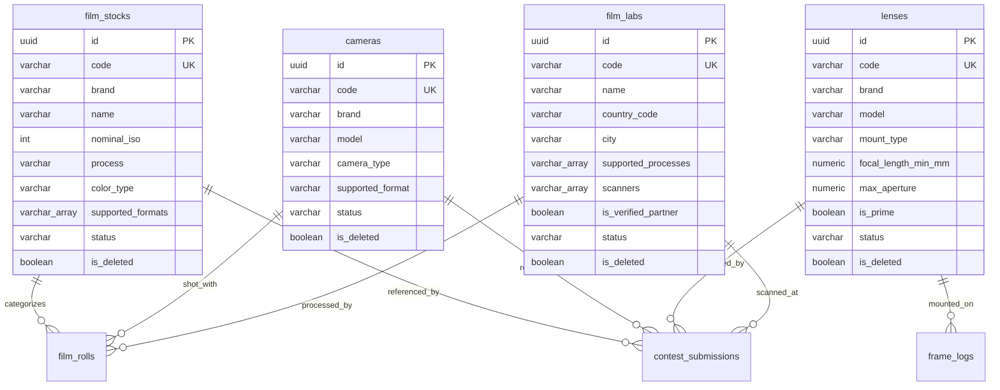
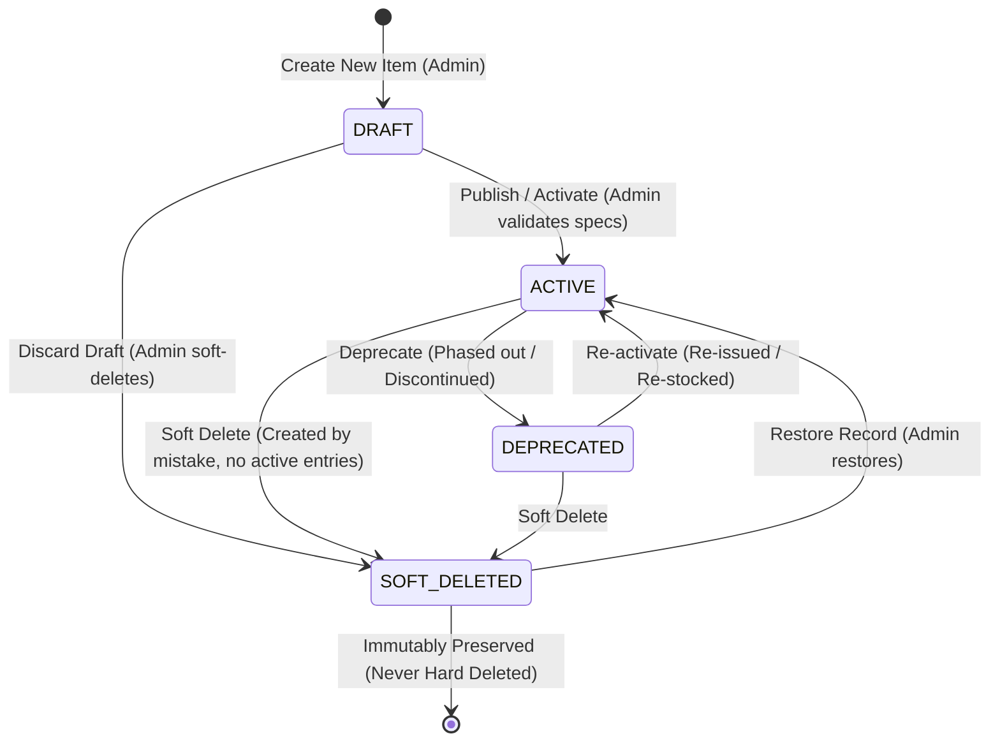

# Module Spec: 02-analog-master-data.md

> **Module Name**: Analog Photography Master Data Management (Danh mục dữ liệu dùng chung Hệ thống Nhiếp ảnh Phim)  
> **Status**: DRAFT / READY FOR CODE GENERATION  
> **Version**: 1.0.0  
> **Target Audience**: AI Coding Assistants (Cursor, Copilot), Backend Engineers, Frontend/Mobile Engineers  
> **Standard**: AI-First Spec (Explicit schemas, deterministic business logic, exhaustive error codes, Zero ambiguity)

---

## 1. Domain Entities & Database Mapping

Mô-đun quản lý toàn bộ các danh mục tham chiếu vật lý cốt lõi của nhiếp ảnh Analog, bao gồm: **Film Stocks (Loại phim)**, **Cameras (Thân máy ảnh)**, **Lenses (Ống kính)**, và **Film Labs (Phòng tráng & quét phim)**.

Cơ sở dữ liệu đích: **PostgreSQL 15+** với các extension:
- `uuid-ossp` hoặc `pgcrypto` để tự động sinh UUID v4 (`gen_random_uuid()`).
- B-Tree index cho các trường lọc/khóa ngoại, GIN index cho các trường mảng (`ARRAY`), Partial Unique Index cho Soft Delete.



---

### 1.1 Bảng `film_stocks` (Danh mục Phim)
Lưu trữ thông tin chuẩn hóa về các dòng phim âm bản, dương bản, phim điện ảnh và phim đen trắng.

| Field Name | Data Type | Constraints (PK/FK/UQ/Not Null) | Default | Description |
| :--- | :--- | :--- | :--- | :--- |
| `id` | `UUID` | `PRIMARY KEY` | `gen_random_uuid()` | Khóa chính duy nhất của bản ghi |
| `code` | `VARCHAR(50)` | `NOT NULL, UNIQUE` | None | Mã định danh chuẩn (VD: `FILM-KODAK-PORTRA-400`) |
| `brand` | `VARCHAR(100)` | `NOT NULL` | None | Hãng sản xuất (VD: `Kodak`, `Fujifilm`, `Ilford`, `CineStill`, `Foma`) |
| `name` | `VARCHAR(150)` | `NOT NULL` | None | Tên thương mại dòng phim (VD: `Portra 400`, `HP5 Plus`, `Velvia 50`) |
| `nominal_iso` | `INTEGER` | `NOT NULL` | None | Độ nhạy sáng danh định theo tiêu chuẩn ISO (Box Speed) (VD: `100`, `400`, `800`) |
| `process` | `VARCHAR(20)` | `NOT NULL` | None | Quy trình tráng hóa học: `C-41`, `B&W`, `E-6`, `ECN-2` |
| `color_type` | `VARCHAR(30)` | `NOT NULL` | None | Loại phim: `COLOR_NEGATIVE`, `BLACK_AND_WHITE`, `COLOR_SLIDE_POSITIVE`, `MOTION_PICTURE_COLOR` |
| `supported_formats` | `VARCHAR(20)[]` | `NOT NULL` | `ARRAY['135']::VARCHAR[]` | Danh sách các khổ phim thương mại hỗ trợ: `135`, `120`, `4x5`, `8x10`, `110`, `HALF_FRAME` |
| `is_dx_coded` | `BOOLEAN` | `NOT NULL` | `true` | Hỗ trợ mã vạch DX code tự nhận diện ISO trên thân máy |
| `description` | `TEXT` | `NULL` | None | Mô tả đặc tính hạt phim (grain), dải tương phản (latitude) và sắc độ |
| `status` | `VARCHAR(20)` | `NOT NULL` | `'ACTIVE'` | Trạng thái vòng đời: `DRAFT`, `ACTIVE`, `DEPRECATED` |
| `is_deleted` | `BOOLEAN` | `NOT NULL` | `false` | Cờ xóa mềm (Soft Delete flag phục vụ BR-03) |
| `deleted_at` | `TIMESTAMPTZ` | `NULL` | None | Dấu thời gian khi thực hiện xóa mềm |
| `created_at` | `TIMESTAMPTZ` | `NOT NULL` | `CURRENT_TIMESTAMP` | Thời điểm tạo bản ghi |
| `updated_at` | `TIMESTAMPTZ` | `NOT NULL` | `CURRENT_TIMESTAMP` | Thời điểm cập nhật bản ghi gần nhất |
| `created_by` | `UUID` | `NULL, FK(users.id)` | None | ID Quản trị viên khởi tạo |
| `updated_by` | `UUID` | `NULL, FK(users.id)` | None | ID Quản trị viên cập nhật gần nhất |
| `version` | `INTEGER` | `NOT NULL` | `1` | Số phiên bản phục vụ Khóa lạc quan (Optimistic Locking - CR-07) |

#### Indexes:
- `CREATE UNIQUE INDEX uq_film_stocks_brand_name_iso ON film_stocks (LOWER(brand), LOWER(name), nominal_iso) WHERE is_deleted = false;` (Ngăn trùng lặp dữ liệu hoạt động).
- `CREATE INDEX idx_film_stocks_lookup ON film_stocks (brand, process, status) WHERE is_deleted = false;`
- `CREATE INDEX idx_film_stocks_formats ON film_stocks USING GIN (supported_formats);`
- `CREATE INDEX idx_film_stocks_fulltext ON film_stocks USING GIN (to_tsvector('simple', brand || ' ' || name));`

---

### 1.2 Bảng `cameras` (Danh mục Máy ảnh Phim)
Lưu trữ thông tin chuẩn hóa về thân máy ảnh cơ khí và điện tử.

| Field Name | Data Type | Constraints (PK/FK/UQ/Not Null) | Default | Description |
| :--- | :--- | :--- | :--- | :--- |
| `id` | `UUID` | `PRIMARY KEY` | `gen_random_uuid()` | Khóa chính duy nhất của máy ảnh |
| `code` | `VARCHAR(50)` | `NOT NULL, UNIQUE` | None | Mã định danh chuẩn (VD: `CAM-LEICA-M6`, `CAM-HASSELBLAD-500CM`) |
| `brand` | `VARCHAR(100)` | `NOT NULL` | None | Thương hiệu máy ảnh (VD: `Leica`, `Canon`, `Nikon`, `Olympus`, `Pentax`, `Hasselblad`, `Mamiya`) |
| `model` | `VARCHAR(150)` | `NOT NULL` | None | Tên dòng/model máy (VD: `M6 Classic`, `F3 HP`, `OM-1`, `500 C/M`, `RB67 Pro-S`) |
| `camera_type` | `VARCHAR(30)` | `NOT NULL` | None | Cơ chế ngắm/chụp: `SLR`, `RANGEFINDER`, `TLR`, `POINT_AND_SHOOT`, `MEDIUM_FORMAT_SLR`, `MEDIUM_FORMAT_RANGEFINDER`, `LARGE_FORMAT`, `PINHOLE`, `OTHER` |
| `supported_format` | `VARCHAR(20)` | `NOT NULL` | `'135'` | Khổ phim máy sử dụng: `135`, `120`, `4x5`, `8x10`, `110`, `HALF_FRAME` |
| `default_lens_mount`| `VARCHAR(50)` | `NULL` | None | Ngàm ống kính tiêu chuẩn (VD: `Leica M`, `Nikon F`, `Canon FD`, `M42`, `Hasselblad V`, `Fixed`) |
| `has_fixed_lens` | `BOOLEAN` | `NOT NULL` | `false` | Đánh dấu máy ảnh ống kính liền cố định (không tháo rời được) |
| `fixed_lens_specs` | `VARCHAR(150)` | `NULL` | None | Thông số ống kính liền nếu có (VD: `F.Zuiko 38mm f/1.8`, `40mm f/1.7`) |
| `shutter_mechanism`| `VARCHAR(30)` | `NOT NULL` | `'MECHANICAL'` | Cơ chế màn trập: `MECHANICAL`, `ELECTRONIC`, `HYBRID` |
| `production_start_year`| `INTEGER` | `NULL` | None | Năm bắt đầu sản xuất |
| `production_end_year`| `INTEGER` | `NULL` | None | Năm ngừng sản xuất |
| `status` | `VARCHAR(20)` | `NOT NULL` | `'ACTIVE'` | Trạng thái: `DRAFT`, `ACTIVE`, `DEPRECATED` |
| `is_deleted` | `BOOLEAN` | `NOT NULL` | `false` | Cờ xóa mềm (BR-03) |
| `deleted_at` | `TIMESTAMPTZ` | `NULL` | None | Dấu thời gian xóa mềm |
| `created_at` | `TIMESTAMPTZ` | `NOT NULL` | `CURRENT_TIMESTAMP` | Thời điểm tạo |
| `updated_at` | `TIMESTAMPTZ` | `NOT NULL` | `CURRENT_TIMESTAMP` | Thời điểm cập nhật |
| `created_by` | `UUID` | `NULL, FK(users.id)` | None | Admin khởi tạo |
| `updated_by` | `UUID` | `NULL, FK(users.id)` | None | Admin cập nhật |
| `version` | `INTEGER` | `NOT NULL` | `1` | Khóa lạc quan (CR-07) |

#### Indexes:
- `CREATE UNIQUE INDEX uq_cameras_brand_model ON cameras (LOWER(brand), LOWER(model)) WHERE is_deleted = false;`
- `CREATE INDEX idx_cameras_filter ON cameras (brand, camera_type, supported_format, status) WHERE is_deleted = false;`
- `CREATE INDEX idx_cameras_fulltext ON cameras USING GIN (to_tsvector('simple', brand || ' ' || model));`

---

### 1.3 Bảng `lenses` (Danh mục Ống kính Phim)
Lưu trữ thông số kỹ thuật quang học của ống kính tháo rời.

| Field Name | Data Type | Constraints (PK/FK/UQ/Not Null) | Default | Description |
| :--- | :--- | :--- | :--- | :--- |
| `id` | `UUID` | `PRIMARY KEY` | `gen_random_uuid()` | Khóa chính duy nhất của ống kính |
| `code` | `VARCHAR(50)` | `NOT NULL, UNIQUE` | None | Mã định danh chuẩn (VD: `LENS-LEICA-SUMMICRON-35-F2`) |
| `brand` | `VARCHAR(100)` | `NOT NULL` | None | Thương hiệu chế tạo (VD: `Leica`, `Carl Zeiss`, `Voigtländer`, `Canon`, `Nikon`, `Zuiko`) |
| `model` | `VARCHAR(150)` | `NOT NULL` | None | Tên thương mại/model (VD: `Summicron-M 35mm f/2 ASPH`, `Planar T* 50mm f/1.4`) |
| `mount_type` | `VARCHAR(50)` | `NOT NULL` | None | Loại ngàm gắn: `Leica M`, `Nikon F`, `Canon FD`, `M42`, `Pentax K`, `Contax/Yashica`, `Hasselblad V`, `Mamiya 67`, `L39/M39` |
| `focal_length_min_mm`| `NUMERIC(6,2)` | `NOT NULL` | None | Tiêu cự nhỏ nhất (hoặc tiêu cự cố định của lens Prime) tính bằng mm |
| `focal_length_max_mm`| `NUMERIC(6,2)` | `NULL` | None | Tiêu cự lớn nhất tính bằng mm (Chỉ có giá trị nếu là ống Zoom) |
| `is_prime` | `BOOLEAN` | `NOT NULL` | `true` | Đánh dấu ống kính một tiêu cự (Prime) hay ống kính Zoom |
| `max_aperture` | `NUMERIC(3,1)` | `NOT NULL` | None | Khẩu độ tối đa (độ mở lớn nhất, VD: `1.2`, `1.4`, `2.0`, `2.8`) |
| `min_aperture` | `NUMERIC(3,1)` | `NULL` | None | Khẩu độ khép nhỏ nhất (VD: `16.0`, `22.0`, `32.0`) |
| `format_coverage` | `VARCHAR(20)[]` | `NOT NULL` | `ARRAY['135']::VARCHAR[]` | Độ phủ quang học: `135`, `120`, `4x5`, `8x10` |
| `status` | `VARCHAR(20)` | `NOT NULL` | `'ACTIVE'` | Trạng thái: `DRAFT`, `ACTIVE`, `DEPRECATED` |
| `is_deleted` | `BOOLEAN` | `NOT NULL` | `false` | Cờ xóa mềm (BR-03) |
| `deleted_at` | `TIMESTAMPTZ` | `NULL` | None | Dấu thời gian xóa mềm |
| `created_at` | `TIMESTAMPTZ` | `NOT NULL` | `CURRENT_TIMESTAMP` | Thời điểm tạo |
| `updated_at` | `TIMESTAMPTZ` | `NOT NULL` | `CURRENT_TIMESTAMP` | Thời điểm cập nhật |
| `created_by` | `UUID` | `NULL, FK(users.id)` | None | Admin khởi tạo |
| `updated_by` | `UUID` | `NULL, FK(users.id)` | None | Admin cập nhật |
| `version` | `INTEGER` | `NOT NULL` | `1` | Khóa lạc quan (CR-07) |

#### Indexes:
- `CREATE UNIQUE INDEX uq_lenses_brand_model_mount ON lenses (LOWER(brand), LOWER(model), LOWER(mount_type)) WHERE is_deleted = false;`
- `CREATE INDEX idx_lenses_mount_prime ON lenses (mount_type, is_prime, status) WHERE is_deleted = false;`
- `CREATE INDEX idx_lenses_fulltext ON lenses USING GIN (to_tsvector('simple', brand || ' ' || model));`

---

### 1.4 Bảng `film_labs` (Danh bạ Phòng Lab Tráng & Scan Phim)
Lưu trữ thông tin cơ sở hạ tầng phòng thí nghiệm và máy quét phim phục vụ liên kết nguồn gốc hậu kỳ.

| Field Name | Data Type | Constraints (PK/FK/UQ/Not Null) | Default | Description |
| :--- | :--- | :--- | :--- | :--- |
| `id` | `UUID` | `PRIMARY KEY` | `gen_random_uuid()` | Khóa chính duy nhất của phòng Lab |
| `code` | `VARCHAR(50)` | `NOT NULL, UNIQUE` | None | Mã định danh chuẩn (VD: `LAB-VN-LLAB-SG`, `LAB-US-FIND-LAB`) |
| `name` | `VARCHAR(150)` | `NOT NULL` | None | Tên phòng Lab thương mại (VD: `LLab Saigon`, `CropLab`, `The Find Lab`) |
| `country_code` | `VARCHAR(3)` | `NOT NULL` | None | Mã quốc gia theo chuẩn ISO 3166-1 alpha-2 (VD: `VN`, `US`, `JP`, `FR`) |
| `city` | `VARCHAR(100)` | `NOT NULL` | None | Tên thành phố đặt cơ sở (VD: `Ho Chi Minh City`, `Hanoi`, `Tokyo`) |
| `address` | `TEXT` | `NULL` | None | Địa chỉ thực tế chi tiết |
| `website_url` | `VARCHAR(255)` | `NULL` | None | Đường dẫn trang web hoặc mạng xã hội chính thức |
| `email` | `VARCHAR(150)` | `NULL` | None | Địa chỉ hòm thư liên hệ |
| `phone` | `VARCHAR(30)` | `NULL` | None | Số điện thoại liên hệ hotline |
| `supported_processes`| `VARCHAR(20)[]` | `NOT NULL` | None | Các quy trình tráng phục vụ: `ARRAY['C-41', 'B&W', 'E-6', 'ECN-2']` |
| `scanners` | `VARCHAR(50)[]` | `NOT NULL` | None | Các dòng máy quét phim sở hữu: `NORITSU_HS1800`, `FUJI_FRONTIER_SP3000`, `HASSELBLAD_FLEXTIGHT_X5`, `DSLR_SCAN`, `EPSON_V850`, `OTHER` |
| `is_verified_partner`| `BOOLEAN` | `NOT NULL` | `false` | Đánh dấu đối tác phòng Lab đã được Ban tổ chức thẩm định chất lượng |
| `status` | `VARCHAR(20)` | `NOT NULL` | `'ACTIVE'` | Trạng thái: `DRAFT`, `ACTIVE`, `DEPRECATED` |
| `is_deleted` | `BOOLEAN` | `NOT NULL` | `false` | Cờ xóa mềm (BR-03) |
| `deleted_at` | `TIMESTAMPTZ` | `NULL` | None | Dấu thời gian xóa mềm |
| `created_at` | `TIMESTAMPTZ` | `NOT NULL` | `CURRENT_TIMESTAMP` | Thời điểm tạo |
| `updated_at` | `TIMESTAMPTZ` | `NOT NULL` | `CURRENT_TIMESTAMP` | Thời điểm cập nhật |
| `created_by` | `UUID` | `NULL, FK(users.id)` | None | Admin khởi tạo |
| `updated_by` | `UUID` | `NULL, FK(users.id)` | None | Admin cập nhật |
| `version` | `INTEGER` | `NOT NULL` | `1` | Khóa lạc quan (CR-07) |

#### Indexes:
- `CREATE UNIQUE INDEX uq_film_labs_name_city ON film_labs (LOWER(name), LOWER(city), country_code) WHERE is_deleted = false;`
- `CREATE INDEX idx_film_labs_location ON film_labs (country_code, city, is_verified_partner, status) WHERE is_deleted = false;`
- `CREATE INDEX idx_film_labs_processes ON film_labs USING GIN (supported_processes);`
- `CREATE INDEX idx_film_labs_scanners ON film_labs USING GIN (scanners);`

---

## 2. Business Rules & Logic Ràng Buộc

### 2.1 Bảng ánh xạ Quy tắc Nghiệp vụ từ SRS (BR-01 đến BR-25)

| SRS Rule ID | Tên quy tắc & Nội dung liên quan trực tiếp đến Master Data | Cơ chế hiện thực & Ràng buộc Kỹ thuật |
| :--- | :--- | :--- |
| **BR-02** | **Role-Based Access Control (RBAC)**: Chỉ Administrator mới có quyền tạo (C), cập nhật (U), xóa mềm (D) Master Data. Organizer, Judge và Participant chỉ có quyền Đọc (Read-only). | Middleware thẩm định JWT + RBAC decorator (`@RequireRoles('ADMIN')`) trên các mutation endpoints. Các endpoints đọc chỉ yêu cầu xác thực hoặc mở public cho Dropdown nộp bài. |
| **BR-03** | **Bất biến Dữ liệu & Xóa Mềm (Soft Delete)**: Danh mục Master Data tuyệt đối không được xóa vật lý (`HARD DELETE`). Phải chuyển trạng thái sang `is_deleted = true`, `deleted_at = NOW()`, `status = 'DEPRECATED'`. | 1. Chặn câu lệnh `DELETE` thô bằng Database Trigger hoặc ORM Hook.<br>2. Toàn bộ Foreign Keys từ `contest_submissions`, `film_rolls`, `frame_logs` đều dùng `ON DELETE RESTRICT` (ngăn xóa vật lý ở tầng DB engine).<br>3. Bài dự thi lịch sử luôn giữ nguyên vẹn thông tin loại phim, máy ảnh, lab đã chọn. |
| **BR-07** | **Chuẩn hóa thông số ảnh phim**: Đảm bảo tệp ảnh tải lên tương thích với thuộc tính quang học và khổ phim đã khai báo. | Khổ phim (`supported_formats`) trong Master Data ràng buộc danh mục định dạng được phép chọn ở Bước 1 & Bước 2 của Wizard nộp bài. |
| **BR-22** | **5 Trường siêu dữ liệu phim tối thiểu**: Mỗi bài dự thi bắt buộc phải khai báo: `Film Stock`, `Film Format`, `Camera Body`, `Frame Number`, `Developing Lab / Process`. | Mô-đun Master Data cung cấp nguồn dữ liệu chuẩn hóa cho 4/5 trường này. Dữ liệu từ Master Data đảm bảo tính toàn vẹn (Integrity) của báo cáo thống kê chuyên sâu (UC-28). |
| **BR-23** | **Giới hạn vật lý của số thứ tự khung hình (Frame Number)**: Số khung hình không được vượt quá số kiểu tối đa của khổ phim: 135 (max 39), 120 6x4.5 (max 16), 120 6x6 (max 12), 120 6x7 (max 10). | Thuộc tính `supported_format` của Camera và `supported_formats` của Film Stock kết hợp để validate giá trị `frame_number` khi thí sinh khai báo bài thi. |

---

### 2.2 Quy tắc Validate chi tiết (Validation Constraints)

#### 1. Quy tắc dành cho `FilmStock`:
- **Brand**: Độ dài 2 - 100 ký tự. Không chứa ký tự đặc biệt nguy hiểm (`<`, `>`, `{`, `}`).
- **Name**: Độ dài 2 - 150 ký tự.
- **Nominal ISO (Box Speed)**: Bắt buộc là số nguyên dương thuộc dải giá trị chuẩn của film:
  $$\text{ISO} \in \{6, 12, 25, 50, 64, 80, 100, 125, 160, 200, 250, 320, 400, 500, 640, 800, 1000, 1250, 1600, 3200, 6400\}$$
  *(Hoặc $6 \le \text{ISO} \le 12800$ đối với các film thử nghiệm đặc biệt).*
- **Process**: Enum bắt buộc chính xác 4 giá trị:
  - `C-41`: Phim âm bản màu tiêu chuẩn (Color Negative).
  - `B&W`: Phim đen trắng truyền thống (Gelatin Silver).
  - `E-6`: Phim dương bản / phim slide (Color Reversal).
  - `ECN-2`: Phim điện ảnh màu có lớp than remjet (Eastman Color Negative 2).
- **Color Type**: Enum `['COLOR_NEGATIVE', 'BLACK_AND_WHITE', 'COLOR_SLIDE_POSITIVE', 'MOTION_PICTURE_COLOR']`. Ràng buộc chéo: Nếu `process = 'ECN-2'` thì `color_type` bắt buộc là `MOTION_PICTURE_COLOR`. Nếu `process = 'B&W'` thì `color_type` bắt buộc là `BLACK_AND_WHITE`.

#### 2. Quy tắc dành cho `Camera`:
- **Camera Type**: Enum chuẩn: `['SLR', 'RANGEFINDER', 'TLR', 'POINT_AND_SHOOT', 'MEDIUM_FORMAT_SLR', 'MEDIUM_FORMAT_RANGEFINDER', 'LARGE_FORMAT', 'PINHOLE', 'OTHER']`.
- **Supported Format**: Enum `['135', '120', '4x5', '8x10', '110', 'HALF_FRAME']`.
- **Ràng buộc Fixed Lens**: Nếu `has_fixed_lens = true` thì `default_lens_mount` bắt buộc là `Fixed`, và `fixed_lens_specs` bắt buộc không được để trống (Not Null, độ dài tối thiểu 5 ký tự).
- **Năm sản xuất**: Nếu có cả hai, bắt buộc $1850 \le \text{production\_start\_year} \le \text{production\_end\_year} \le \text{CurrentYear} + 1$.

#### 3. Quy tắc dành cho `Lens`:
- **Focal Length**: $4.0 \le \text{focal\_length\_min\_mm} \le 2000.0$.
- **Prime vs Zoom**:
  - Nếu `is_prime = true`: `focal_length_max_mm` phải bằng `null` hoặc bằng đúng `focal_length_min_mm`.
  - Nếu `is_prime = false`: `focal_length_max_mm` bắt buộc NOT NULL và $\text{focal\_length\_max\_mm} > \text{focal\_length\_min\_mm}$.
- **Aperture**: $0.7 \le \text{max\_aperture} \le 32.0$. Nếu có `min_aperture`, bắt buộc $\text{min\_aperture} > \text{max\_aperture}$.

#### 4. Quy tắc dành cho `FilmLab`:
- **Country Code**: Chuẩn ISO 3166-1 alpha-2 gồm 2 chữ cái viết hoa (VD: `VN`, `US`, `JP`, `DE`).
- **Supported Processes**: Mảng không được rỗng (`array_length > 0`), các phần tử chỉ gồm các giá trị thuộc enum Process (`C-41`, `B&W`, `E-6`, `ECN-2`).
- **Scanners**: Mảng không được rỗng, các phần tử hợp lệ gồm:
  - `NORITSU_HS1800` (Máy scan Lab chuyên nghiệp hãng Noritsu)
  - `FUJI_FRONTIER_SP3000` (Máy scan màu ấm đặc trưng Fujifilm Frontier)
  - `HASSELBLAD_FLEXTIGHT_X5` (Máy scan trống ảo cao cấp cho Medium/Large Format)
  - `DSLR_SCAN` (Hệ thống chụp số hóa bằng máy ảnh số và ống kính Macro)
  - `EPSON_V850` (Máy scan phẳng chất lượng cao)
  - `OTHER` (Các loại máy quét khác)

---

### 2.3 Ràng buộc Truy vấn & Hành vi Xóa Mềm (Soft Delete Query Logic)

```sql
-- Trigger mẫu chặn xóa vật lý trên PostgreSQL
CREATE OR REPLACE FUNCTION prevent_hard_delete_master_data()
RETURNS TRIGGER AS $$
BEGIN
    RAISE EXCEPTION 'BR-03 VIOLATION: Hard delete is forbidden on Master Data tables. Use soft-delete (is_deleted = true) instead.'
        USING ERRCODE = '55000';
END;
$$ LANGUAGE plpgsql;

CREATE TRIGGER trg_film_stocks_no_hard_delete
BEFORE DELETE ON film_stocks
FOR EACH ROW EXECUTE FUNCTION prevent_hard_delete_master_data();
```

- **Quy tắc Dropdown Thí sinh nộp bài**: Chỉ lấy dữ liệu sẵn sàng:
  $$\text{SELECT} \quad * \quad \text{FROM} \quad \text{table} \quad \text{WHERE} \quad \text{is\_deleted} = \text{false} \quad \text{AND} \quad \text{status} = \text{'ACTIVE'}$$
- **Quy tắc Hiển thị Bài thi Lịch sử / Kho lưu trữ (Digital Archive - UC-43)**:
  Truy vấn trực tiếp qua ID mà không có mệnh đề `is_deleted = false`. Nếu bản ghi đã bị xóa mềm hoặc `status = 'DEPRECATED'`, UI sẽ gắn cờ cảnh báo mờ `[Legacy / Ngừng lưu hành]` nhưng tuyệt đối không làm gãy giao diện hoặc lỗi `404 Not Found`.

---

## 3. State Machine & Lifecycle

Dữ liệu danh mục Master Data tuân theo vòng đời nghiêm ngặt 4 trạng thái để vừa cho phép Admin soạn thảo, vừa bảo toàn tính ổn định của các bài thi đã nộp.

### 3.1 Sơ đồ Trạng thái (State Diagram)



---

### 3.2 Bảng Chuyển đổi Trạng thái (State Transition Table)

| Current State | Trigger Event | Next State | Role có quyền kích hoạt | Guard Condition (Điều kiện tiên quyết) | Hành vi nghiệp vụ hệ thống |
| :--- | :--- | :--- | :--- | :--- | :--- |
| **None** | `CREATE_DRAFT` | `DRAFT` | `ADMIN` | Payload hợp lệ cú pháp sơ bộ. | Khởi tạo bản ghi với `status = 'DRAFT'`, `is_deleted = false`. Bản ghi chỉ hiển thị trong màn hình Admin. |
| **None** | `CREATE_AND_ACTIVATE` | `ACTIVE` | `ADMIN` | Tất cả trường bắt buộc đầy đủ; Không trùng Partial Unique Index (`is_deleted = false`). | Khởi tạo và kích hoạt ngay, xuất hiện tức thì trong danh sách dropdown của Thí sinh. |
| **DRAFT** | `ACTIVATE` | `ACTIVE` | `ADMIN` | Đạt toàn bộ Validation Constraints mục 2.2. | Chuyển `status = 'ACTIVE'`, cập nhật `updated_at`, `updated_by`. |
| **DRAFT** | `DELETE` | `SOFT_DELETED` | `ADMIN` | Không có ràng buộc phụ thuộc. | Đặt `is_deleted = true`, `deleted_at = NOW()`. |
| **ACTIVE** | `DEPRECATE` | `DEPRECATED` | `ADMIN` | Dòng phim/máy ảnh đã ngừng sản xuất ngoài đời thực, hoặc Lab đóng cửa. | Chuyển `status = 'DEPRECATED'`. **Không** thể chọn cho bài thi mới; nhưng vẫn hiển thị bình thường trên các bài thi cũ. |
| **ACTIVE** | `DELETE` | `SOFT_DELETED` | `ADMIN` | Kiểm tra số lượng bài thi liên kết. | Đặt `is_deleted = true`, `deleted_at = NOW()`. Hệ thống ghi log cảnh báo nếu đã có bài dự thi liên kết. |
| **DEPRECATED** | `REACTIVATE` | `ACTIVE` | `ADMIN` | Hãng phim tái sản xuất hoặc phòng Lab hoạt động trở lại. | Chuyển `status = 'ACTIVE'`, mở lại quyền chọn trên giao diện nộp bài. |
| **SOFT_DELETED** | `RESTORE` | `ACTIVE` | `ADMIN` | Tên/Model không bị trùng lặp với một bản ghi `ACTIVE` khác được tạo sau đó. | Đặt `is_deleted = false`, `deleted_at = NULL`, `status = 'ACTIVE'`. |

---

## 4. Shared API Contracts (Dùng chung cho Web & Mobile)

Tất cả các API được đặt dưới tiền tố: `/api/v1/master-data/*`.  
Chuẩn RESTful, Payload truyền tải bằng JSON UTF-8.

### 4.1 Tiêu chuẩn Headers dùng chung

#### Request Headers:
- `Authorization: Bearer <JWT_ACCESS_TOKEN>` *(Bắt buộc cho các thao tác C-U-D của Admin; Tùy chọn hoặc kiểm tra quyền đọc cho Endpoints GET)*
- `Content-Type: application/json`
- `Accept-Language: vi-VN, vi;q=0.9, en-US;q=0.8, en;q=0.7` *(Đa ngôn ngữ cho câu thông báo)*
- `X-Correlation-ID: <UUID>` *(Dùng để trace log qua các micro-services)*

#### Response Envelopes chuẩn:
```typescript
// Envelope thành công (200 OK / 201 Created)
interface ApiResponse<T> {
  success: true;
  data: T;
  meta?: {
    page?: number;
    limit?: number;
    total?: number;
    total_pages?: number;
  };
}

// Envelope lỗi (4xx / 5xx)
interface ApiErrorResponse {
  success: false;
  error: {
    code: string;       // Mã lỗi chuẩn từ Catalog, VD: ERR_RECORD_NOT_FOUND, MSG002, MSG005
    message: string;    // Thông báo thân thiện theo ngôn ngữ client
    details?: Array<{
      field: string;
      issue: string;
    }>;
  };
}
```

---

### 4.2 Chi tiết API Endpoints: Film Stocks

#### 1. `GET /api/v1/master-data/film-stocks` (Tra cứu danh mục phim)
- **Roles**: All Actors (`ADMIN`, `ORGANIZER`, `JUDGE`, `PARTICIPANT`, Guest).
- **Query Parameters**:
  - `search` (string, optional): Tìm kiếm theo Tên hoặc Hãng phim (VD: `portra`).
  - `brand` (string, optional): Lọc theo hãng (VD: `Kodak`).
  - `process` (enum: `C-41` | `B&W` | `E-6` | `ECN-2`, optional).
  - `format` (enum: `135` | `120` | `4x5` | `8x10`, optional).
  - `status` (enum: `ACTIVE` | `DEPRECATED` | `ALL`, default: `ACTIVE`). Thí sinh chỉ được query `ACTIVE`.
  - `page` (integer, default: 1).
  - `limit` (integer, default: 50, max: 200).

- **Response Payload thành công (HTTP 200)**:
```json
{
  "success": true,
  "data": [
    {
      "id": "7c9e6679-7425-40de-944b-e07fc1f90ae7",
      "code": "FILM-KODAK-PORTRA-400",
      "brand": "Kodak",
      "name": "Portra 400",
      "nominal_iso": 400,
      "process": "C-41",
      "color_type": "COLOR_NEGATIVE",
      "supported_formats": ["135", "120", "4x5", "8x10"],
      "is_dx_coded": true,
      "description": "Dòng phim âm bản màu chuyên nghiệp hạt mịn, tái tạo tone màu da tự nhiên vượt trội.",
      "status": "ACTIVE",
      "created_at": "2026-01-15T08:30:00Z",
      "updated_at": "2026-01-15T08:30:00Z"
    }
  ],
  "meta": {
    "page": 1,
    "limit": 50,
    "total": 1,
    "total_pages": 1
  }
}
```

---

#### 2. `POST /api/v1/master-data/film-stocks` (Thêm mới loại phim)
- **Roles**: `ADMIN` (CR-03, BR-02).
- **Zod Validation Schema (AI Code Generation Contract)**:
```typescript
import { z } from "zod";

export const CreateFilmStockSchema = z.object({
  brand: z.string().trim().min(2, "MSG002: Tên hãng phim tối thiểu 2 ký tự").max(100),
  name: z.string().trim().min(2, "MSG002: Tên dòng phim tối thiểu 2 ký tự").max(150),
  nominal_iso: z.number().int().min(6).max(12800),
  process: z.enum(["C-41", "B&W", "E-6", "ECN-2"]),
  color_type: z.enum([
    "COLOR_NEGATIVE",
    "BLACK_AND_WHITE",
    "COLOR_SLIDE_POSITIVE",
    "MOTION_PICTURE_COLOR",
  ]),
  supported_formats: z.array(z.enum(["135", "120", "4x5", "8x10", "110", "HALF_FRAME"])).nonempty(),
  is_dx_coded: z.boolean().default(true),
  description: z.string().max(2000).optional(),
}).refine((data) => {
  if (data.process === "ECN-2" && data.color_type !== "MOTION_PICTURE_COLOR") return false;
  if (data.process === "B&W" && data.color_type !== "BLACK_AND_WHITE") return false;
  return true;
}, {
  message: "Sự kết hợp giữa quy trình tráng (process) và loại phim (color_type) không hợp lệ.",
  path: ["color_type"]
});
```

- **Request Body mẫu**:
```json
{
  "brand": "Ilford",
  "name": "HP5 Plus",
  "nominal_iso": 400,
  "process": "B&W",
  "color_type": "BLACK_AND_WHITE",
  "supported_formats": ["135", "120", "4x5"],
  "is_dx_coded": true,
  "description": "Phim đen trắng kinh điển với dải phơi sáng rộng, độ tương phản vừa phải."
}
```

- **Response thành công (HTTP 201 Created)**:
```json
{
  "success": true,
  "data": {
    "id": "e4c5b16e-2130-4e12-b9cf-14b438d120ab",
    "code": "FILM-ILFORD-HP5-PLUS-400",
    "brand": "Ilford",
    "name": "HP5 Plus",
    "nominal_iso": 400,
    "process": "B&W",
    "color_type": "BLACK_AND_WHITE",
    "supported_formats": ["135", "120", "4x5"],
    "is_dx_coded": true,
    "description": "Phim đen trắng kinh điển với dải phơi sáng rộng, độ tương phản vừa phải.",
    "status": "ACTIVE",
    "created_at": "2026-10-28T01:15:00Z",
    "updated_at": "2026-10-28T01:15:00Z"
  }
}
```

- **Response Lỗi Trùng Lặp (HTTP 409 Conflict)**:
```json
{
  "success": false,
  "error": {
    "code": "ERR_DUPLICATE_MASTER_DATA",
    "message": "Dòng phim với Hãng, Tên và ISO này đã tồn tại trong hệ thống.",
    "details": [
      {
        "field": "name",
        "issue": "Unique constraint violation: (Ilford, HP5 Plus, 400)"
      }
    ]
  }
}
```

---

#### 3. `DELETE /api/v1/master-data/film-stocks/{id}` (Xóa mềm loại phim)
- **Roles**: `ADMIN` (BR-03).
- **Hành vi**: Không xóa cứng (`DELETE FROM`). Đặt `is_deleted = true`, `deleted_at = NOW()`, `status = 'DEPRECATED'`.
- **Response thành công (HTTP 200 OK)**:
```json
{
  "success": true,
  "data": {
    "id": "e4c5b16e-2130-4e12-b9cf-14b438d120ab",
    "code": "FILM-ILFORD-HP5-PLUS-400",
    "is_deleted": true,
    "deleted_at": "2026-10-28T01:20:00Z",
    "status": "DEPRECATED",
    "message": "Đã thực hiện xóa mềm danh mục phim thành công. Các bài thi lịch sử liên kết vẫn được bảo toàn dữ liệu."
  }
}
```

---

### 4.3 Chi tiết API Endpoints: Cameras

#### 1. `GET /api/v1/master-data/cameras` (Danh sách máy ảnh)
- **Query Parameters**: `search`, `brand`, `camera_type`, `format`, `page`, `limit`.
- **Response HTTP 200**:
```json
{
  "success": true,
  "data": [
    {
      "id": "3b29c5e8-11f4-41d3-8be2-7f97a55c2763",
      "code": "CAM-LEICA-M6",
      "brand": "Leica",
      "model": "M6 Classic",
      "camera_type": "RANGEFINDER",
      "supported_format": "135",
      "default_lens_mount": "Leica M",
      "has_fixed_lens": false,
      "fixed_lens_specs": null,
      "shutter_mechanism": "MECHANICAL",
      "status": "ACTIVE"
    }
  ],
  "meta": { "page": 1, "limit": 50, "total": 1, "total_pages": 1 }
}
```

#### 2. `POST /api/v1/master-data/cameras` (Tạo máy ảnh mới)
- **Roles**: `ADMIN`.
- **Zod Schema**:
```typescript
export const CreateCameraSchema = z.object({
  brand: z.string().trim().min(2).max(100),
  model: z.string().trim().min(2).max(150),
  camera_type: z.enum([
    "SLR", "RANGEFINDER", "TLR", "POINT_AND_SHOOT",
    "MEDIUM_FORMAT_SLR", "MEDIUM_FORMAT_RANGEFINDER",
    "LARGE_FORMAT", "PINHOLE", "OTHER"
  ]),
  supported_format: z.enum(["135", "120", "4x5", "8x10", "110", "HALF_FRAME"]),
  default_lens_mount: z.string().max(50).optional(),
  has_fixed_lens: z.boolean().default(false),
  fixed_lens_specs: z.string().max(150).optional(),
  shutter_mechanism: z.enum(["MECHANICAL", "ELECTRONIC", "HYBRID"]).default("MECHANICAL"),
  production_start_year: z.number().int().min(1850).max(2030).optional(),
  production_end_year: z.number().int().min(1850).max(2030).optional(),
}).refine(data => {
  if (data.has_fixed_lens && !data.fixed_lens_specs) return false;
  return true;
}, {
  message: "Máy ảnh có ống kính liền (fixed lens) bắt buộc phải nhập thông số fixed_lens_specs.",
  path: ["fixed_lens_specs"]
});
```

---

### 4.4 Chi tiết API Endpoints: Lenses

#### 1. `GET /api/v1/master-data/lenses` (Danh mục ống kính)
- **Query Parameters**: `search`, `brand`, `mount_type`, `is_prime`, `page`, `limit`.
- **Response HTTP 200**:
```json
{
  "success": true,
  "data": [
    {
      "id": "1894d0e1-7e62-411a-9694-82a17088b901",
      "code": "LENS-LEICA-SUMMICRON-35-F2",
      "brand": "Leica",
      "model": "Summicron-M 35mm f/2 ASPH",
      "mount_type": "Leica M",
      "focal_length_min_mm": 35.0,
      "focal_length_max_mm": null,
      "is_prime": true,
      "max_aperture": 2.0,
      "min_aperture": 16.0,
      "format_coverage": ["135"],
      "status": "ACTIVE"
    }
  ],
  "meta": { "page": 1, "limit": 50, "total": 1, "total_pages": 1 }
}
```

---

### 4.5 Chi tiết API Endpoints: Film Labs

#### 1. `GET /api/v1/master-data/film-labs` (Danh sách phòng tráng/scan)
- **Query Parameters**: `search`, `country_code`, `city`, `process`, `scanner`, `verified_only`.
- **Response HTTP 200**:
```json
{
  "success": true,
  "data": [
    {
      "id": "9a38f322-86ee-4dcf-862d-05dfbb8e9ec1",
      "code": "LAB-VN-LLAB-SG",
      "name": "LLab Saigon",
      "country_code": "VN",
      "city": "Ho Chi Minh City",
      "address": "Phường Võ Thị Sáu, Quận 3, TP. Hồ Chí Minh",
      "website_url": "https://llab.vn",
      "email": "contact@llab.vn",
      "phone": "+84903123456",
      "supported_processes": ["C-41", "B&W", "E-6", "ECN-2"],
      "scanners": ["NORITSU_HS1800", "FUJI_FRONTIER_SP3000"],
      "is_verified_partner": true,
      "status": "ACTIVE"
    }
  ],
  "meta": { "page": 1, "limit": 50, "total": 1, "total_pages": 1 }
}
```

---

### 4.6 Bảng Mã Lỗi Chi Tiết (Error Code Reference)

| HTTP Status | Error Code | Mô tả ngữ cảnh | Message hiển thị giao diện |
| :--- | :--- | :--- | :--- |
| `400 Bad Request` | `MSG002` / `ERR_VALIDATION_FAILED` | Payload gửi lên thiếu trường bắt buộc hoặc sai định dạng. | `"Trường {field_name} là bắt buộc hoặc không đúng định dạng."` |
| `401 Unauthorized` | `ERR_UNAUTHORIZED` | Token JWT thiếu hoặc hết hạn. | `"Phiên đăng nhập đã hết hạn. Vui lòng đăng nhập lại."` |
| `403 Forbidden` | `MSG005` / `ERR_FORBIDDEN` | Người dùng không phải là `ADMIN` thực hiện mutation. | `"Bạn không có quyền thực hiện thao tác này. (Access Denied)"` |
| `404 Not Found` | `MSG001` / `ERR_RECORD_NOT_FOUND` | Không tìm thấy ID của loại phim/máy/ống kính/lab. | `"Không tìm thấy dữ liệu danh mục yêu cầu."` |
| `409 Conflict` | `ERR_DUPLICATE_MASTER_DATA` | Trùng Unique Constraint (brand + name + specs). | `"Bản ghi danh mục này đã tồn tại trong cơ sở dữ liệu."` |
| `422 Unprocessable`| `ERR_PROCESS_MISMATCH` | Kết hợp sai logic (VD: Cine film nhưng chọn process C-41). | `"Quy trình tráng không phù hợp với phân loại phim."` |
| `500 Internal Error`| `ERR_INTERNAL_SERVER` | Lỗi DB hoặc hệ thống không mong muốn. | `"Hệ thống đang gặp sự cố. Vui lòng thử lại sau."` |

---

## 5. UI/UX Functional Requirements

### 5.1 Luồng Thao Tác (User Journeys)

#### Luồng 1: Administrator Quản trị Danh mục (Web Dashboard)
1. **Truy cập**: Admin đăng nhập, tại Sidebar chọn `Master Data` -> `Film Stocks` (hoặc `Cameras`, `Lenses`, `Film Labs`).
2. **Quan sát tổng quan**:
   - Thẻ thống kê: Tổng số lượng, Số dòng phim C-41, B&W, E-6, ECN-2.
   - Bảng dữ liệu có hỗ trợ Sort (theo Brand, Name, ISO, Status), Quick Filter (Pill tabs: All, C-41, B&W, E-6, ECN-2).
3. **Thêm mới**:
   - Nhấn nút `+ Thêm Film Stock`.
   - Mở Drawer/Modal form nhập thông tin kèm live preview mã Code tự sinh (`FILM-{BRAND}-{NAME}-{ISO}`).
   - Nhấn `Lưu`: Client validate (Zod) -> Gửi request -> Nhận Toast Success (`MSG003` variant: `"Đã thêm dòng phim {name} thành công"`).
4. **Xóa mềm (Soft Delete)**:
   - Nhấn icon Thùng rác tại dòng dữ liệu.
   - Modal xác nhận bật lên kèm cảnh báo:
     > *"Cảnh báo: Hành động này sẽ chuyển trạng thái phim sang 'Ngừng hỗ trợ' (Soft-delete). Dữ liệu lịch sử của các cuộc thi đã kết thúc và cuộn phim đã chụp sẽ không bị ảnh hưởng (BR-03)."*
   - Admin gõ xác nhận hoặc nhấn `Đồng ý Xóa`: Bản ghi chuyển sang trạng thái mờ với nhãn `Đã lưu trữ / Soft Deleted`.

---

#### Luồng 2: Participant Khai báo Thông số khi Nộp bài (Web & Mobile Wizard)
1. **Truy cập**: Thí sinh mở màn hình `Nộp bài thi` (Submit Photograph Wizard - UC-37), tới **Bước 2: Khai báo Siêu dữ liệu Phim**.
2. **Tìm kiếm tự động (Auto-complete Search)**:
   - Tại ô `Loại phim (Film Stock)`: Thí sinh gõ chữ `por...`
   - Dropdown kích hoạt cơ chế Debounce 300ms, hiển thị kết quả có highlight:
     - `Kodak Portra 160 (C-41, ISO 160)`
     - `Kodak Portra 400 (C-41, ISO 400)`
     - `Kodak Portra 800 (C-41, ISO 800)`
   - Khi chọn `Kodak Portra 400`: Hệ thống tự động điền `Process = C-41` và khóa gợi ý ISO danh định là 400 (vẫn cho phép thí sinh chỉnh sửa ISO chụp thực tế nếu chụp Push/Pull).
3. **Tương tự với Máy ảnh & Ống kính**:
   - Chọn máy `Leica M6`: Dropdown ngàm ống kính tự động ưu tiên lọc danh sách ống kính ngàm `Leica M`.
4. **Nhập thủ công khi không có trong danh mục (Fallback Option)**:
   - Nếu tìm không thấy máy ảnh/ống kính cổ hiếm: Dropdown hiển thị lựa chọn cuối cùng: `"+ Không có trong danh mục? Nhập thủ công"`.
   - Cho phép thí sinh nhập chuỗi text tự do; hệ thống gắn cờ `is_custom_metadata = true` để lưu bài thi mà không bị tắc nghẽn luồng.

---

### 5.2 Các Trạng thái Giao diện (UI States Specification)

```
+-----------------------------------------------------------------------------------+
|  [Search: "portra"        ]   [Filter: All Processes v]   [+ Thêm Film Stock]     |
+-----------------------------------------------------------------------------------+
|  BRAND     | NAME       | ISO  | PROCESS | STATUS   | ACTIONS                     |
+------------+------------+------+---------+----------+-----------------------------+
|  Kodak     | Portra 160 | 160  | [C-41]  | [ACTIVE] | [Chỉnh sửa]  [Xóa mềm]      |
|  Kodak     | Portra 400 | 400  | [C-41]  | [ACTIVE] | [Chỉnh sửa]  [Xóa mềm]      |
|  Kodak     | Portra 800 | 800  | [C-41]  | [ACTIVE] | [Chỉnh sửa]  [Xóa mềm]      |
+-----------------------------------------------------------------------------------+
```

#### 1. Skeleton Loading State:
- Khi fetching dữ liệu (`isLoading = true`):
  - Web: Hiển thị 5 hàng bảng với hiệu ứng Shimmer xám động (`bg-slate-200 animate-pulse`).
  - Mobile: Hiển thị 4 thẻ card bo góc với 3 thanh skeleton dài ngắn mô phỏng Brand, Name, Specs.

#### 2. Empty State (Không có dữ liệu):
- Khi không có bản ghi nào hoặc tìm kiếm không khớp:
  - Hiển thị icon cuộn phim rỗng kèm thông điệp chuẩn **MSG001**:
    > *"Không tìm thấy kết quả phù hợp. / No matching records found."*
  - Nút bấm gợi ý: `Xóa bộ lọc` hoặc `Thêm mới bản ghi`.

#### 3. Disabled State:
- Dữ liệu ở trạng thái `DEPRECATED` hoặc `is_deleted = true`:
  - Trong Dropdown người dùng: Hiển thị màu xám mờ (`text-muted`), thuộc tính `disabled`, kèm icon ổ khóa hoặc tooltip: `"Loại phim này đã ngừng hỗ trợ cho các bài thi mới."`
  - Trong Bảng Admin: Dòng bị gạch ngang nhẹ hoặc gắn Badge màu xám `ARCHIVED`.

#### 4. Error & Toast Notifications:
- Validate thất bại tại Form: Hiển thị lỗi inline màu đỏ ngay dưới ô nhập liệu (`border-red-500 text-red-600 text-xs` kèm mã lỗi **MSG002**).
- Lỗi phân quyền: Toast đỏ góc trên bên phải: **MSG005** (`"Bạn không có quyền thực hiện thao tác này."`).
- Thành công: Toast xanh lá: `"Đã cập nhật danh mục thành công."` tự ẩn sau 3000ms.
- Số khung hình vượt giới hạn: Toast/Inline cảnh báo màu cam **MSG010**:
  > *"Số thứ tự khung hình ({frame_no}) vượt quá giới hạn vật lý của khổ phim {format} (BR-23)."*
