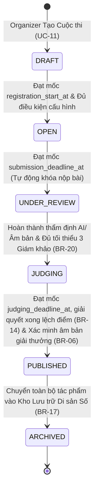
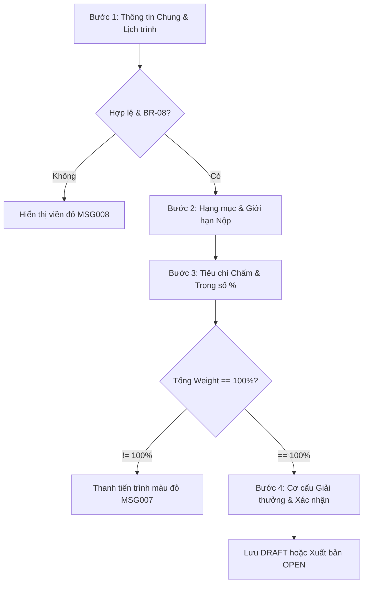

# Module Spec: 03-contest-lifecycle.md

> **Module Name**: Manage Contests & Categories (Quản lý Vòng đời Cuộc thi & Hạng mục)  
> **Status**: READY FOR CODE GENERATION  
> **Version**: 1.0.0  
> **Target Audience**: AI Coding Assistants (Cursor, Copilot), Backend Engineers, Frontend Engineers  
> **Standard**: AI-First Spec (Explicit schemas, deterministic business logic, exhaustive error codes, Zero visual ambiguity, 100% structured Markdown & Mermaid)

---

## 1. Domain Entities & Database Mapping

Hệ thống cơ sở dữ liệu sử dụng **PostgreSQL 16+**. Khóa chính (PK) định dạng `UUID` (`gen_random_uuid()`). Chuẩn đặt tên bảng và cột theo `snake_case`. Thời gian lưu theo chuẩn `TIMESTAMPTZ` (UTC).

### 1.1 Sơ đồ Thực thể Quan hệ (Entity Relationship Diagram)

```mermaid
erDiagram
    users ||--o{ contests : "created_by"
    contests ||--|{ contest_categories : "contains"
    contests ||--o{ contest_awards : "configures"
    contests ||--o{ contest_judges : "appoints"
    contest_categories ||--|{ scoring_criteria : "defines"
    contest_categories ||--o{ contest_judges : "assigned_to"
    contest_categories ||--o{ contest_awards : "allocates"
    users ||--o{ contest_judges : "acts_as_judge"

    contests {
        uuid id PK
        varchar code UK "CON-YYYY-XX"
        varchar name
        varchar slug UK
        text description
        varchar status "DRAFT|OPEN|UNDER_REVIEW|JUDGING|PUBLISHED|ARCHIVED"
        timestamptz registration_start_at
        timestamptz submission_deadline_at
        timestamptz judging_start_at
        timestamptz judging_deadline_at
        timestamptz published_at
        int max_entries_per_user
        int version "Optimistic Locking"
        boolean is_deleted
        uuid created_by FK
        timestamptz created_at
        timestamptz updated_at
    }

    contest_categories {
        uuid id PK
        uuid contest_id FK
        varchar code UK_scoped
        varchar name
        text description
        varchar format_restriction "135|120|4x5|ALL"
        int max_entries_per_participant
        boolean require_negative_proof_upfront
        boolean is_active
        boolean is_deleted
        timestamptz created_at
        timestamptz updated_at
    }

    scoring_criteria {
        uuid id PK
        uuid category_id FK
        varchar code UK_scoped
        varchar name
        text description
        numeric max_score "Default 10.00"
        numeric weight "0.0001 - 1.0000, Sum = 1.0000"
        int sort_order
        boolean is_deleted
        timestamptz created_at
        timestamptz updated_at
    }

    contest_awards {
        uuid id PK
        uuid contest_id FK
        uuid category_id FK "Nullable"
        varchar code
        varchar name
        int rank_order
        bigint prize_value_vnd
        text description
        int quota
        timestamptz created_at
        timestamptz updated_at
    }

    contest_judges {
        uuid id PK
        uuid contest_id FK
        uuid category_id FK
        uuid judge_id FK
        uuid assigned_by FK
        boolean is_active
        timestamptz assigned_at
    }
```

---

### 1.2 Bảng `contests` (Cuộc thi Ảnh Phim)

Lưu trữ thông tin cấu hình cốt lõi, vòng đời và các mốc thời gian tuần tự của cuộc thi.

| Tên trường (Column) | Kiểu dữ liệu | Ràng buộc | Mặc định | Mô tả & Ý nghĩa nghiệp vụ |
| :--- | :--- | :--- | :--- | :--- |
| `id` | `UUID` | `PK`, Not Null | `gen_random_uuid()` | Khóa chính định danh cuộc thi |
| `code` | `VARCHAR(50)` | `UQ`, Not Null | *None* | Mã cuộc thi tự sinh: `CON-YYYY-XX` (CR-05) |
| `name` | `VARCHAR(150)` | Not Null | *None* | Tên gọi chính thức của cuộc thi |
| `slug` | `VARCHAR(180)` | `UQ`, Not Null | *None* | Chuỗi định danh URL thân thiện (URL Slug) |
| `theme` | `VARCHAR(255)` | Nullable | `NULL` | Chủ đề nhiếp ảnh (VD: "Đời thường và Ánh sáng Phim") |
| `description` | `TEXT` | Nullable | `NULL` | Giới thiệu chi tiết thể lệ, mục đích cuộc thi |
| `rules` | `TEXT` | Nullable | `NULL` | Quy chuẩn kỹ thuật và điều khoản pháp lý |
| `cover_image_url` | `TEXT` | Nullable | `NULL` | URL ảnh banner quảng bá cuộc thi trên CDN |
| `status` | `VARCHAR(30)` | Not Null | `'DRAFT'` | ENUM: `DRAFT`, `OPEN`, `UNDER_REVIEW`, `JUDGING`, `PUBLISHED`, `ARCHIVED` |
| `registration_start_at` | `TIMESTAMPTZ` | Not Null | *None* | Mốc bắt đầu mở đăng ký tham gia |
| `submission_deadline_at` | `TIMESTAMPTZ` | Not Null | *None* | Hạn chót nhận bài thi (BR-08: tự động khóa cổng) |
| `judging_start_at` | `TIMESTAMPTZ` | Not Null | *None* | Mốc bắt đầu mở vòng chấm điểm ẩn danh |
| `judging_deadline_at` | `TIMESTAMPTZ` | Not Null | *None* | Hạn chót giám khảo hoàn thành và khóa bảng điểm |
| `published_at` | `TIMESTAMPTZ` | Nullable | `NULL` | Thời điểm công bố kết quả chính thức (BR-16) |
| `max_entries_per_user` | `INT` | Not Null | `5` | Tổng số tác phẩm tối đa một thí sinh được gửi toàn cuộc thi |
| `version` | `INT` | Not Null | `1` | Cơ chế Khóa lạc quan (Optimistic Locking - CR-07) |
| `created_by` | `UUID` | Not Null, FK | *None* | Khóa ngoại tham chiếu `users(id)` (Contest Organizer) |
| `is_deleted` | `BOOLEAN` | Not Null | `FALSE` | Cờ xóa mềm theo BR-03 |
| `created_at` | `TIMESTAMPTZ` | Not Null | `NOW()` | Thời điểm khởi tạo bản ghi |
| `updated_at` | `TIMESTAMPTZ` | Not Null | `NOW()` | Thời điểm cập nhật bản ghi gần nhất |

> **Chỉ mục (Indexes & Constraints):**
> - `CREATE UNIQUE INDEX idx_contests_code ON contests(code) WHERE is_deleted = FALSE;`
> - `CREATE UNIQUE INDEX idx_contests_slug ON contests(slug) WHERE is_deleted = FALSE;`
> - `CREATE INDEX idx_contests_status ON contests(status) WHERE is_deleted = FALSE;`
> - `CREATE INDEX idx_contests_created_by ON contests(created_by);`
> - `CONSTRAINT check_contest_schedule CHECK (registration_start_at < submission_deadline_at AND submission_deadline_at < judging_start_at AND judging_start_at < judging_deadline_at);`

---

### 1.3 Bảng `contest_categories` (Hạng mục / Bảng thi)

Phân chia cuộc thi thành các hạng mục đặc thù của nhiếp ảnh phim (VD: Ảnh Đen Trắng 35mm, Phong cảnh Medium Format 120, Thử nghiệm Large Format).

| Tên trường (Column) | Kiểu dữ liệu | Ràng buộc | Mặc định | Mô tả & Ý nghĩa nghiệp vụ |
| :--- | :--- | :--- | :--- | :--- |
| `id` | `UUID` | `PK`, Not Null | `gen_random_uuid()` | Khóa chính hạng mục |
| `contest_id` | `UUID` | `FK`, Not Null | *None* | Tham chiếu `contests(id)` ON DELETE CASCADE |
| `code` | `VARCHAR(50)` | Not Null | *None* | Mã hạng mục (VD: `CAT-STREET-35`) |
| `name` | `VARCHAR(100)` | Not Null | *None* | Tên hạng mục (VD: "Nhiếp ảnh Đường phố 35mm") |
| `description` | `TEXT` | Nullable | `NULL` | Diễn giải phong cách, định hướng hạng mục |
| `format_restriction` | `VARCHAR(50)` | Not Null | `'ALL'` | ENUM: `135`, `120`, `4x5`, `ALL` (Giới hạn khổ phim nộp) |
| `max_entries_per_participant` | `INT` | Not Null | `3` | Số bài tối đa 1 thí sinh được nộp vào bảng này |
| `require_negative_proof_upfront` | `BOOLEAN` | Not Null | `FALSE` | `TRUE`: Nộp âm bản ngay; `FALSE`: Chỉ nộp khi vào Chung kết (BR-06) |
| `is_active` | `BOOLEAN` | Not Null | `TRUE` | Trạng thái kích hoạt hạng mục |
| `is_deleted` | `BOOLEAN` | Not Null | `FALSE` | Cờ xóa mềm theo BR-03 |
| `created_at` | `TIMESTAMPTZ` | Not Null | `NOW()` | Thời gian tạo |
| `updated_at` | `TIMESTAMPTZ` | Not Null | `NOW()` | Thời gian cập nhật |

> **Chỉ mục (Indexes):**
> - `CREATE UNIQUE INDEX uq_categories_contest_name ON contest_categories(contest_id, name) WHERE is_deleted = FALSE;`
> - `CREATE INDEX idx_categories_contest_id ON contest_categories(contest_id);`

---

### 1.4 Bảng `scoring_criteria` (Tiêu chí Chấm điểm & Trọng số)

Quản lý thang điểm thành phần và tỷ trọng đánh giá cho từng hạng mục.

| Tên trường (Column) | Kiểu dữ liệu | Ràng buộc | Mặc định | Mô tả & Ý nghĩa nghiệp vụ |
| :--- | :--- | :--- | :--- | :--- |
| `id` | `UUID` | `PK`, Not Null | `gen_random_uuid()` | Khóa chính tiêu chí |
| `category_id` | `UUID` | `FK`, Not Null | *None* | Tham chiếu `contest_categories(id)` ON DELETE CASCADE |
| `code` | `VARCHAR(50)` | Not Null | *None* | Mã tiêu chí (VD: `COMPOSITION`, `LIGHT_EXPOSURE`) |
| `name` | `VARCHAR(150)` | Not Null | *None* | Tên tiêu chí (VD: "Bố cục & Tính sáng tạo") |
| `description` | `TEXT` | Nullable | `NULL` | Hướng dẫn giám khảo cách chấm tiêu chí này |
| `max_score` | `NUMERIC(5,2)` | Not Null | `10.00` | Điểm tối đa của tiêu chí (Thang điểm 10.00) |
| `weight` | `NUMERIC(5,4)` | Not Null | *None* | Trọng số phần trăm ($0.0001 \le weight \le 1.0000$) |
| `sort_order` | `INT` | Not Null | `0` | Thứ tự hiển thị trên phiếu chấm |
| `is_deleted` | `BOOLEAN` | Not Null | `FALSE` | Cờ xóa mềm |
| `created_at` | `TIMESTAMPTZ` | Not Null | `NOW()` | Thời gian tạo |
| `updated_at` | `TIMESTAMPTZ` | Not Null | `NOW()` | Thời gian cập nhật |

> **Ràng buộc chuẩn hóa (BR-15):**
> - `CHECK (weight > 0 AND weight <= 1.0000)`
> - Tổng trọng số của tất cả tiêu chí thuộc cùng 1 `category_id` bắt buộc: $\sum weight = 1.0000$ (100%).

---

### 1.5 Bảng `contest_judges` (Phân công Giám khảo)

Bảng gán trách nhiệm chấm điểm giữa Giám khảo chuyên môn và Hạng mục cuộc thi.

| Tên trường (Column) | Kiểu dữ liệu | Ràng buộc | Mặc định | Mô tả & Ý nghĩa nghiệp vụ |
| :--- | :--- | :--- | :--- | :--- |
| `id` | `UUID` | `PK`, Not Null | `gen_random_uuid()` | Khóa chính phân công |
| `contest_id` | `UUID` | `FK`, Not Null | *None* | Tham chiếu `contests(id)` ON DELETE CASCADE |
| `category_id` | `UUID` | `FK`, Not Null | *None* | Tham chiếu `contest_categories(id)` ON DELETE CASCADE |
| `judge_id` | `UUID` | `FK`, Not Null | *None* | Tham chiếu `users(id)` có role `JUDGE` |
| `assigned_by` | `UUID` | `FK`, Not Null | *None* | Tham chiếu `users(id)` (Organizer phân công) |
| `is_active` | `BOOLEAN` | Not Null | `TRUE` | Cờ hiệu lực phân công |
| `assigned_at` | `TIMESTAMPTZ` | Not Null | `NOW()` | Thời điểm gán |

> **Chỉ mục:**
> - `CREATE UNIQUE INDEX uq_contest_category_judge ON contest_judges(category_id, judge_id) WHERE is_active = TRUE;`

---

## 2. Business Rules & Logic Ràng Buộc

### 2.1 Bảng Ánh xạ Quy tắc Nghiệp vụ

| Mã BR | Tên Quy tắc | Diễn giải Ràng buộc Kỹ thuật | Xử lý Vi phạm |
| :--- | :--- | :--- | :--- |
| **BR-02** | Phân quyền Khởi tạo | Chỉ tài khoản có Role `ORGANIZER` hoặc `ADMIN` mới được tạo và cấu hình cuộc thi. Organizer chỉ có quyền sửa cuộc thi do chính mình tạo ra (`created_by = current_user_id`). | HTTP 403 Forbidden (`MSG005`) |
| **BR-03** | Xóa mềm Dữ liệu | Khi cuộc thi bị xóa, cập nhật `is_deleted = TRUE`. Không xóa vật lý các bản ghi liên quan (hạng mục, tiêu chí, bài thi). | Soft Delete Filter |
| **BR-06** | Yêu cầu Đối chứng Âm bản | Cấu hình tại bảng `contest_categories.require_negative_proof_upfront`. Nếu `TRUE`, thí sinh phải upload âm bản ngay lúc nộp; nếu `FALSE`, chỉ bắt buộc đối với tác phẩm lọt vào Chung kết/Xét giải. | Validate tại Form Nộp bài |
| **BR-08** | Lịch trình Tuần tự Bắt buộc | Bắt buộc tuân thủ thứ tự thời gian: $T_{reg\_start} < T_{sub\_deadline} < T_{judge\_start} < T_{judge\_deadline} < T_{publish}$. Khi $CurrentTime \ge T_{sub\_deadline}$, hệ thống tự động khóa cổng nhận bài và không cho phép thí sinh sửa/nộp mới. | HTTP 400 Bad Request (`MSG008`, `MSG014`) |
| **BR-15** | Chuẩn hóa Trọng số Tiêu chí | Tổng trọng số các tiêu chí chấm trong 1 hạng mục phải bằng đúng $1.0000$ (100%): $\sum_{i=1}^n w_i = 1.0000$. Công thức tính điểm của một giám khảo: $S_{judge} = \sum_{i=1}^n (s_i \times w_i)$. | HTTP 422 Unprocessable (`MSG007`) |
| **BR-16** | Tính Bất biến của Kết quả | Khi cuộc thi chuyển sang trạng thái `PUBLISHED`, toàn bộ điểm số, tiêu chí, giải thưởng và thông tin bài thi chuyển sang chế độ Read-Only vĩnh viễn. Không cho phép bất kỳ ai sửa đổi dữ liệu. | HTTP 403 / DB Trigger Lock |
| **BR-20** | Tối thiểu 3 Giám khảo Quorum | Trước khi cuộc thi chuyển trạng thái sang `JUDGING`, mỗi hạng mục bắt buộc phải có ít nhất 3 giám khảo đang hoạt động (`is_active = TRUE`). | Chặn chuyển trạng thái (`MSG020`) |
| **BR-21** | Ngăn chặn Xung đột Lợi ích | Một người dùng đã được gán làm `Judge` hoặc `Organizer` trong một cuộc thi thì bị hệ thống chặn không cho phép nộp bài thi (làm `Participant`) trong chính cuộc thi đó. Ngược lại, nếu tài khoản đã có bài dự thi, không được phép gán làm Giám khảo. | HTTP 400 Bad Request (`MSG022`) |
| **BR-24** | Khóa Sửa & Rút Bài thi | Thí sinh chỉ được sửa thông số hoặc rút bài khi còn trong hạn nhận bài ($CurrentTime < T_{sub\_deadline}$) và bài thi chưa vào trạng thái đang chấm. | HTTP 403 Forbidden |
| **BR-25** | Trung bình cộng Điểm Cuối | Điểm chung cuộc của bài thi là trung bình cộng điểm của toàn bộ giám khảo được phân công chấm hạng mục đó: $S_{final} = \frac{1}{M}\sum_{k=1}^M S_{judge\_k}$, làm tròn 2 chữ số thập phân. | Auto-calculated in Leaderboard |

---

## 3. State Machine & Lifecycle (Máy Trạng thái Cuộc thi)

Cuộc thi ảnh phim vận hành tuần tự qua 6 trạng thái nghiêm ngặt:



### Bảng Đặc tả Chuyển đổi Trạng thái (State Transition Table)

| Trạng thái nguồn | Trạng thái đích | Tác nhân kích hoạt | Điều kiện Tiên quyết (Guards) | Hành động Hệ thống (Post-actions / Side-effects) |
| :--- | :--- | :--- | :--- | :--- |
| `DRAFT` | `OPEN` | Organizer / Scheduler | - Cấu hình ít nhất 1 Category hợp lệ.<br>- Mỗi Category có $\sum weight = 100\%$ (BR-15).<br>- Lịch trình thời gian hợp lệ (BR-08). | Gửi thông báo tới cộng đồng; mở nút "+ Submit Entry" trên giao diện công chúng. |
| `OPEN` | `UNDER_REVIEW`| System Cron Worker | $CurrentTime \ge submission\_deadline\_at$. | Khóa hoàn toàn API nộp và sửa bài (`MSG014`); đẩy toàn bộ bài thi sang hàng đợi thẩm định AI. |
| `UNDER_REVIEW` | `JUDGING` | Organizer | - Toàn bộ bài thi đã có kết luận thẩm định AI.<br>- Mỗi hạng mục có $\ge 3$ Giám khảo hoạt động (BR-20). | Mở quyền truy cập Lightbox Workspace cho Giám khảo; kích hoạt bộ lọc Ẩn danh kép (BR-12). |
| `JUDGING` | `PUBLISHED` | Organizer | - $100\%$ Giám khảo đã khóa bảng điểm (UC-33).<br>- Không còn bài thi bị cờ lệch điểm `DISCREPANCY_CONFLICT` (BR-14).<br>- Toàn bộ bài trong cơ cấu giải thưởng đã có âm bản hợp lệ (BR-06). | Kích hoạt khóa bất biến (BR-16); tính điểm trung bình (BR-25); công bố bảng vàng; gửi email thông báo thí sinh. |
| `PUBLISHED` | `ARCHIVED` | Organizer / Admin | Cuộc thi kết thúc $\ge 30$ ngày sau khi công bố giải. | Sinh ảnh tối ưu kèm watermark; lưu trữ vĩnh viễn vào Digital Archive (BR-17). |

---

## 4. Shared API Contracts (Hợp đồng API Đa nền tảng)

### 4.1 Tra cứu Danh sách Cuộc thi (`GET /api/v1/contests`)
*   **Method**: `GET`
*   **Path**: `/api/v1/contests`
*   **Auth**: Public (hoặc Bearer JWT để lấy thêm cờ cá nhân hóa)
*   **Query Parameters**:
    *   `status`: `DRAFT` | `OPEN` | `UNDER_REVIEW` | `JUDGING` | `PUBLISHED` | `ARCHIVED`
    *   `search`: Chuỗi tìm kiếm theo tên/chủ đề cuộc thi
    *   `page`: Số trang (mặc định 1)
    *   `limit`: Số bản ghi/trang (mặc định 10, tối đa 50)
*   **Response Payload (200 OK):**
    ```json
    {
      "success": true,
      "code": "SUCCESS",
      "data": {
        "items": [
          {
            "id": "e4b2d380-a65c-4f1b-8521-998811223344",
            "code": "CON-2026-01",
            "name": "Nhiếp ảnh Phim Việt Nam 2026",
            "slug": "nhiep-anh-phim-viet-nam-2026",
            "theme": "Ánh sáng Di sản",
            "status": "OPEN",
            "coverImageUrl": "https://cdn.filmcontest.vn/covers/con-2026-01.jpg",
            "registrationStartAt": "2026-11-01T00:00:00Z",
            "submissionDeadlineAt": "2026-12-01T23:59:59Z",
            "judgingStartAt": "2026-12-05T00:00:00Z",
            "judgingDeadlineAt": "2026-12-20T23:59:59Z",
            "publishedAt": "2026-12-25T10:00:00Z",
            "categoriesCount": 3,
            "submissionsCount": 142
          }
        ],
        "meta": {
          "totalItems": 1,
          "currentPage": 1,
          "totalPages": 1,
          "pageSize": 10
        }
      }
    }
    ```

---

### 4.2 Khởi tạo Cuộc thi Mới (`POST /api/v1/contests`)
*   **Method**: `POST`
*   **Path**: `/api/v1/contests`
*   **Auth**: Bearer JWT (Roles: `ORGANIZER`, `ADMIN`)
*   **Request Payload (4-Step Wizard Data):**
    ```json
    {
      "name": "Hương Sắc Phim Màu 2026",
      "slug": "huong-sac-phim-mau-2026",
      "theme": "Vẻ đẹp Sắc độ Analog",
      "description": "Cuộc thi tôn vinh màu sắc đặc trưng của các dòng phim màu âm bản và dương bản.",
      "rules": "Yêu cầu ảnh chụp bằng máy phim 135 hoặc 120, không can thiệp màu kỹ thuật số.",
      "coverImageUrl": "https://cdn.filmcontest.vn/temp/cover_upload_123.jpg",
      "registrationStartAt": "2026-11-10T00:00:00Z",
      "submissionDeadlineAt": "2026-12-10T23:59:59Z",
      "judgingStartAt": "2026-12-12T00:00:00Z",
      "judgingDeadlineAt": "2026-12-25T23:59:59Z",
      "publishedAt": "2026-12-30T10:00:00Z",
      "maxEntriesPerUser": 5,
      "categories": [
        {
          "code": "CAT-COLOR-135",
          "name": "Màu sắc Đường phố 35mm",
          "formatRestriction": "135",
          "maxEntriesPerParticipant": 3,
          "requireNegativeProofUpfront": false,
          "criteria": [
            { "code": "COMP", "name": "Bố cục & Khoảnh khắc", "weight": 0.4000, "maxScore": 10.00 },
            { "code": "TONE", "name": "Màu sắc & Hạt phim", "weight": 0.3500, "maxScore": 10.00 },
            { "code": "STORY", "name": "Thông điệp tác phẩm", "weight": 0.2500, "maxScore": 10.00 }
          ]
        }
      ],
      "awards": [
        { "code": "FIRST_PRIZE", "name": "Giải Nhất Chung Cuộc", "rankOrder": 1, "prizeValueVnd": 20000000, "quota": 1 },
        { "code": "SECOND_PRIZE", "name": "Giải Nhì", "rankOrder": 2, "prizeValueVnd": 10000000, "quota": 2 }
      ]
    }
    ```
*   **Validation Rules (Zod Schema):**
    ```typescript
    const CreateContestSchema = z.object({
      name: z.string().min(5).max(150),
      slug: z.string().regex(/^[a-z0-9-]+$/),
      registrationStartAt: z.string().datetime(),
      submissionDeadlineAt: z.string().datetime(),
      judgingStartAt: z.string().datetime(),
      judgingDeadlineAt: z.string().datetime(),
      publishedAt: z.string().datetime(),
      categories: z.array(z.object({
        name: z.string().min(3),
        formatRestriction: z.enum(['135', '120', '4x5', 'ALL']),
        maxEntriesPerParticipant: z.number().int().min(1).max(10),
        requireNegativeProofUpfront: z.boolean(),
        criteria: z.array(z.object({
          name: z.string().min(2),
          weight: z.number().min(0.01).max(1.0),
          maxScore: z.number().default(10)
        })).refine(arr => Math.abs(arr.reduce((acc, c) => acc + c.weight, 0) - 1.0) < 0.0001, {
          message: "MSG007: Tổng tỷ trọng các tiêu chí chấm điểm phải bằng đúng 100%."
        })
      })).min(1)
    }).refine(data => {
      const reg = new Date(data.registrationStartAt).getTime();
      const sub = new Date(data.submissionDeadlineAt).getTime();
      const jStart = new Date(data.judgingStartAt).getTime();
      const jEnd = new Date(data.judgingDeadlineAt).getTime();
      const pub = new Date(data.publishedAt).getTime();
      return reg < sub && sub < jStart && jStart < jEnd && jEnd < pub;
    }, {
      message: "MSG008: Lịch trình vi phạm thứ tự: Registration < Submission < Judging Start < Judging End < Publication."
    });
    ```
*   **Response Payload (201 Created):**
    ```json
    {
      "success": true,
      "code": "MSG006",
      "message": "Khởi tạo cuộc thi \"Hương Sắc Phim Màu 2026\" thành công.",
      "data": {
        "id": "c1f7b920-5f2b-4fa8-b21a-45c1a8901234",
        "code": "CON-2026-02",
        "status": "DRAFT",
        "createdAt": "2026-10-30T12:45:00Z"
      }
    }
    ```

---

### 4.3 Phân công Giám khảo vào Hạng mục (`POST /api/v1/contests/{id}/judges`)
*   **Method**: `POST`
*   **Path**: `/api/v1/contests/{id}/judges`
*   **Auth**: Bearer JWT (Organizer)
*   **Request Payload:**
    ```json
    {
      "categoryId": "f12a3456-7890-abcd-ef12-34567890abcd",
      "judgeId": "a9876543-21fe-dcba-0987-654321fedcba"
    }
    ```
*   **Business Logic Check (BR-21):**
    Hệ thống kiểm tra `submissions` thuộc `contest_id` có `participant_id == judgeId` hay không. Nếu có, từ chối và trả về HTTP 400.
*   **Response Payload Vi phạm Xung đột Lợi ích (400 Bad Request):**
    ```json
    {
      "success": false,
      "code": "MSG022",
      "message": "Không thể phân công: Tài khoản này đang có bài dự thi trong cùng cuộc thi (Xung đột lợi ích)."
    }
    ```

---

### 4.4 Chuyển đổi Trạng thái Cuộc thi (`PATCH /api/v1/contests/{id}/status`)
*   **Method**: `PATCH`
*   **Path**: `/api/v1/contests/{id}/status`
*   **Request Payload:**
    ```json
    {
      "targetStatus": "JUDGING",
      "reason": "Hoàn tất kiểm duyệt sơ bộ, mở không gian chấm thi cho Giám khảo."
    }
    ```
*   **Error Response Thiếu Quorum Giám khảo (422 Unprocessable Entity - BR-20):**
    ```json
    {
      "success": false,
      "code": "MSG020_QUORUM_FAIL",
      "message": "Không thể chuyển trạng thái sang JUDGING: Hạng mục 'CAT-COLOR-135' mới chỉ có 2 giám khảo (Yêu cầu tối thiểu 3 giám khảo hoạt động theo BR-20)."
    }
    ```

---

## 5. UI/UX Functional Requirements (Đặc tả Giao diện dạng Chữ)

### 5.1 Luồng Thao tác Tạo Cuộc thi (Create Contest 4-Step Wizard)



### 5.2 Đặc tả Màn hình Chi tiết (Screen Specifications)

#### 1. Màn hình Contest List Dashboard (Ban tổ chức)
*   **Khu vực Header:** Tiêu đề "Quản lý Cuộc thi", Ô tìm kiếm nhanh, Bộ lọc Dropdown Trạng thái (Tất cả, DRAFT, OPEN, UNDER_REVIEW, JUDGING, PUBLISHED), và Nút bấm CTA nổi bật: `+ Khởi tạo Cuộc thi`.
*   **Thẻ Chỉ số Nhanh (KPI Cards):**
    *   Card 1: Tổng số cuộc thi đang quản lý.
    *   Card 2: Cuộc thi đang mở nhận bài (`OPEN`) kèm đồng hồ đếm ngược đến `submission_deadline`.
    *   Card 3: Cuộc thi đang trong giai đoạn chấm (`JUDGING`).
*   **Bảng Dữ liệu Cuộc thi (Data Table):**
    *   Cột: Mã cuộc thi (`code`), Tên cuộc thi, Thời gian nộp bài, Tiến độ bài nộp, Trạng thái (Huy hiệu màu), Thao tác (Xem, Chỉnh sửa, Phân công Giám khảo, Kiểm duyệt bài).

#### 2. Màn hình 4-Step Create Contest Wizard
*   **Bước 1: Thông tin Chung & Lịch trình Thời gian:**
    *   Ô nhập: Tên cuộc thi (Bắt buộc), Chủ đề, Thể lệ chi tiết (Rich-text editor), Banner cuộc thi (Kéo thả ảnh tải trực tiếp lên Cloud Storage).
    *   Bộ chọn Thời gian Tuần tự (Timeline Picker): Thiết lập 5 mốc thời gian. **Client-side Guard:** Khi người dùng chọn mốc sau sớm hơn mốc trước, ô nhập lập tức báo đỏ kèm thông báo lỗi `MSG008`.
*   **Bước 2: Cấu hình Hạng mục (Categories):**
    *   Cho phép bấm `+ Thêm Bảng thi`. Mỗi bảng thi gồm: Tên bảng, Giới hạn khổ phim (Dropdown: 35mm, 120, Large Format, Không giới hạn), Số bài tối đa/thí sinh (Input số: 1 - 10), Checkbox "Bắt buộc nộp ảnh âm bản ngay từ vòng đăng ký" (BR-06).
*   **Bước 3: Tiêu chí Chấm điểm & Trọng số % (Scoring Criteria):**
    *   Mỗi tiêu chí gồm: Tên tiêu chí, Mô tả thang điểm, Tỷ trọng %.
    *   **Thước đo Trọng số Thời gian thực (Live Weight Calculator):** Hiển thị thanh tiến trình tổng:
        *   Nếu $\sum < 100\%$: Thanh màu vàng cảnh báo, hiển thị "Còn thiếu $\{100 - current\}\%". Nút "Tiếp tục" bị vô hiệu hóa.
        *   Nếu $\sum > 100\%$: Thanh màu đỏ rực, hiển thị lỗi `MSG007`: "Vượt quá tỷ trọng tối đa!".
        *   Nếu $\sum == 100\%$: Thanh chuyển màu xanh lá cây rực rỡ, mở khóa nút chuyển sang Bước 4.
*   **Bước 4: Cơ cấu Giải thưởng & Tổng kết:**
    *   Định nghĩa giải thưởng: Tên giải (Giải Nhất, Nhì, Ba, Khuyến khích), Số lượng giải, Giá trị giải thưởng (VND).
    *   Nút bấm cuối cùng: "Lưu bản nháp" (DRAFT) hoặc "Mở nhận bài ngay" (OPEN).
