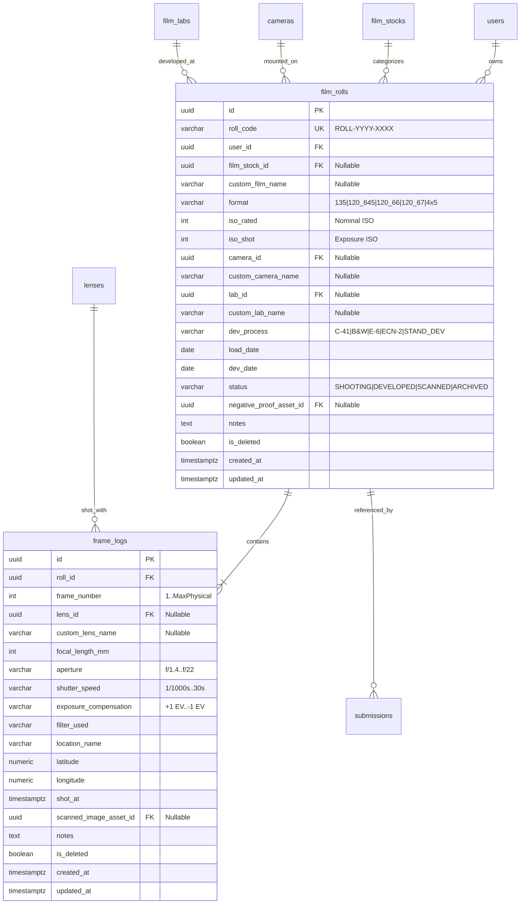
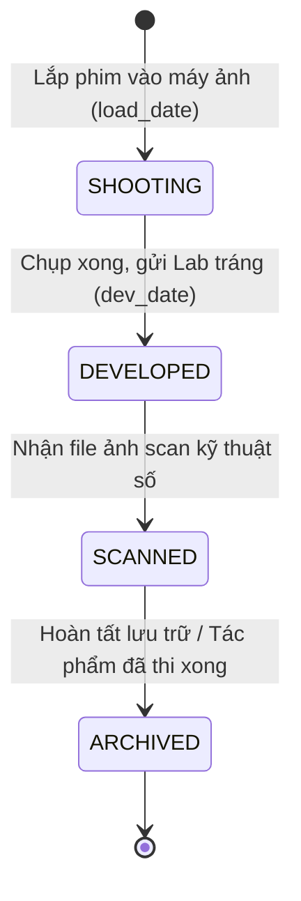
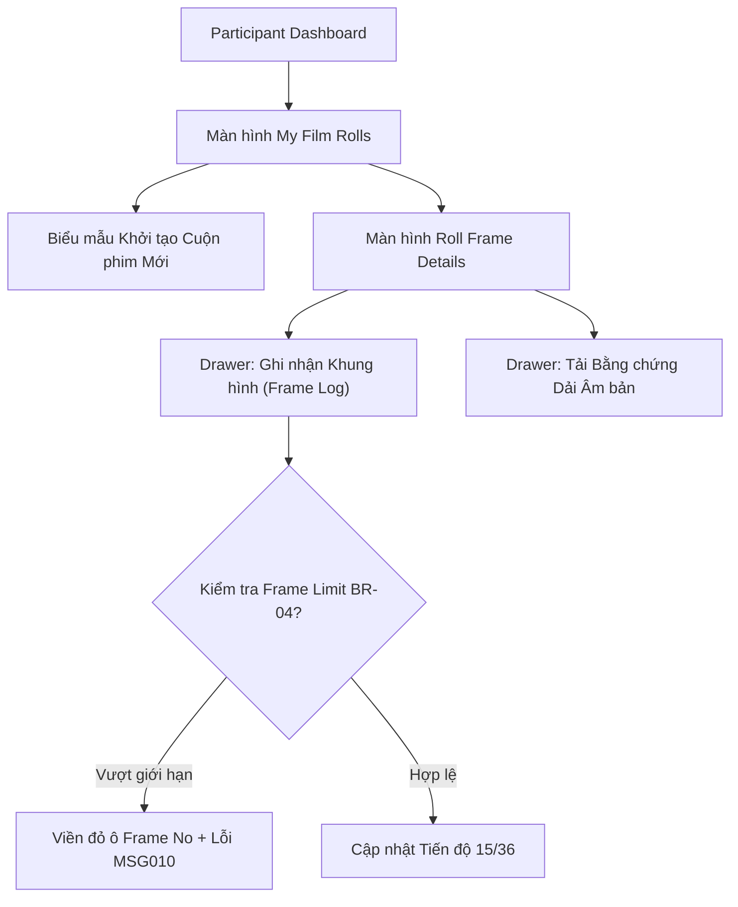

# Module Spec: 04-film-logbook.md

> **Module Name**: Personal Film Roll & Frame Logbook (Quản lý Sổ tay Cuộn phim & Khung hình Cá nhân)  
> **Status**: READY FOR CODE GENERATION  
> **Version**: 1.0.0  
> **Target Audience**: AI Coding Assistants (Cursor, Copilot), Backend Engineers, Mobile (Flutter) & Web (Next.js) Engineers  
> **Standard**: AI-First Spec (Explicit schemas, deterministic business logic, exhaustive error codes, Zero visual ambiguity, 100% structured Markdown & Mermaid)

---

## 1. Domain Entities & Database Mapping

Hệ thống lưu trữ trên **PostgreSQL 16+**. Khóa chính (PK) định dạng `UUID` sinh bằng `gen_random_uuid()`. Toàn bộ tên bảng và cột theo chuẩn `snake_case`. Mọi trường mốc thời gian lưu trữ theo `TIMESTAMPTZ` (UTC).

### 1.1 Sơ đồ Thực thể Quan hệ (Entity Relationship Diagram)



---

### 1.2 Bảng `film_rolls` (Sổ tay Cuộn phim)

Lưu trữ thông tin tổng quát của từng cuộn phim vật lý do nhiếp ảnh gia sở hữu và sử dụng.

| Tên trường (Column) | Kiểu dữ liệu | Ràng buộc | Mặc định | Mô tả & Ý nghĩa nghiệp vụ |
| :--- | :--- | :--- | :--- | :--- |
| `id` | `UUID` | `PK`, Not Null | `gen_random_uuid()` | Khóa chính định danh cuộn phim |
| `roll_code` | `VARCHAR(50)` | `UQ`, Not Null | *None* | Mã cuộn phim tự sinh: `ROLL-YYYY-XXXX` (CR-05) |
| `user_id` | `UUID` | `FK`, Not Null | *None* | Tham chiếu `users(id)` (Chủ sở hữu cuộn phim) |
| `film_stock_id` | `UUID` | `FK`, Nullable | `NULL` | Tham chiếu `film_stocks(id)` từ Master Data |
| `custom_film_name` | `VARCHAR(150)` | Nullable | `NULL` | Tên phim nhập tay nếu dùng phim ngoại bảng |
| `format` | `VARCHAR(30)` | Not Null | `'135'` | ENUM: `135`, `120_645`, `120_66`, `120_67`, `4x5` |
| `iso_rated` | `INT` | Not Null, Check | *None* | ISO danh định của cuộn phim (Check $> 0$) |
| `iso_shot` | `INT` | Not Null, Check | *None* | ISO thực tế khi chụp (Hỗ trợ tính Push/Pull) |
| `camera_id` | `UUID` | `FK`, Nullable | `NULL` | Tham chiếu `cameras(id)` từ Master Data |
| `custom_camera_name`| `VARCHAR(150)` | Nullable | `NULL` | Tên thân máy nhập tay |
| `lab_id` | `UUID` | `FK`, Nullable | `NULL` | Tham chiếu `film_labs(id)` (Phòng Lab tráng) |
| `custom_lab_name` | `VARCHAR(150)` | Nullable | `NULL` | Tên Lab tự nhập hoặc "Tự tráng tại nhà" |
| `dev_process` | `VARCHAR(30)` | Not Null | `'C-41'` | ENUM: `C-41`, `B&W`, `E-6`, `ECN-2`, `STAND_DEV` |
| `load_date` | `DATE` | Not Null | *None* | Ngày lắp cuộn phim vào máy ảnh |
| `dev_date` | `DATE` | Nullable | `NULL` | Ngày mang tráng tại Lab |
| `status` | `VARCHAR(30)` | Not Null | `'SHOOTING'` | ENUM: `SHOOTING`, `DEVELOPED`, `SCANNED`, `ARCHIVED` |
| `negative_proof_asset_id` | `UUID` | Nullable | `NULL` | Khóa ngoại tham chiếu file ảnh chụp dải âm bản |
| `notes` | `TEXT` | Nullable | `NULL` | Ghi chú cá nhân về cuộn phim |
| `is_deleted` | `BOOLEAN` | Not Null | `FALSE` | Cờ xóa mềm theo BR-03 |
| `created_at` | `TIMESTAMPTZ` | Not Null | `NOW()` | Thời điểm tạo bản ghi |
| `updated_at` | `TIMESTAMPTZ` | Not Null | `NOW()` | Thời điểm cập nhật gần nhất |

> **Chỉ mục (Indexes):**
> - `CREATE UNIQUE INDEX uq_film_rolls_roll_code ON film_rolls(roll_code) WHERE is_deleted = FALSE;`
> - `CREATE INDEX idx_film_rolls_user_id ON film_rolls(user_id) WHERE is_deleted = FALSE;`
> - `CREATE INDEX idx_film_rolls_status ON film_rolls(status);`

---

### 1.3 Bảng `frame_logs` (Nhật ký Khung hình Chi tiết)

Ghi chép siêu dữ liệu vật lý và phơi sáng thủ công cho từng khung hình chụp trong cuộn phim.

| Tên trường (Column) | Kiểu dữ liệu | Ràng buộc | Mặc định | Mô tả & Ý nghĩa nghiệp vụ |
| :--- | :--- | :--- | :--- | :--- |
| `id` | `UUID` | `PK`, Not Null | `gen_random_uuid()` | Khóa chính khung hình |
| `roll_id` | `UUID` | `FK`, Not Null | *None* | Tham chiếu `film_rolls(id)` ON DELETE CASCADE |
| `frame_number` | `INT` | Not Null, Check | *None* | Số thứ tự khung hình (Check $> 0$) |
| `lens_id` | `UUID` | `FK`, Nullable | `NULL` | Tham chiếu `lenses(id)` từ Master Data |
| `custom_lens_name` | `VARCHAR(150)` | Nullable | `NULL` | Tên ống kính nhập tay (VD: "Zuiko 50mm f/1.4") |
| `focal_length_mm` | `INT` | Nullable | `NULL` | Tiêu cự ống kính sử dụng (mm) |
| `aperture` | `VARCHAR(15)` | Nullable | `NULL` | Khẩu độ chụp (VD: `'f/1.4'`, `'f/2.8'`, `'f/8'`) |
| `shutter_speed` | `VARCHAR(20)` | Nullable | `NULL` | Tốc độ màn trập (VD: `'1/1000s'`, `'1/250s'`, `'2s'`) |
| `exposure_compensation` | `VARCHAR(10)` | Nullable | `NULL` | Bù trừ sáng (VD: `'+1 EV'`, `'-0.5 EV'`) |
| `filter_used` | `VARCHAR(50)` | Nullable | `NULL` | Kính lọc màu/quang học (VD: `'Kính lọc vàng K2'`) |
| `location_name` | `VARCHAR(255)` | Nullable | `NULL` | Địa điểm chụp (VD: "Phố cổ Hội An") |
| `latitude` | `NUMERIC(10,7)` | Nullable | `NULL` | Tọa độ vĩ độ GPS ghi nhận từ Mobile |
| `longitude` | `NUMERIC(10,7)` | Nullable | `NULL` | Tọa độ kinh độ GPS ghi nhận từ Mobile |
| `shot_at` | `TIMESTAMPTZ` | Nullable | `NULL` | Thời điểm thực hiện bấm máy |
| `scanned_image_asset_id` | `UUID` | Nullable | `NULL` | Link bản scan kỹ thuật số của frame này |
| `notes` | `TEXT` | Nullable | `NULL` | Cảm xúc, ghi chú ánh sáng, bối cảnh |
| `is_deleted` | `BOOLEAN` | Not Null | `FALSE` | Cờ xóa mềm theo BR-03 |
| `created_at` | `TIMESTAMPTZ` | Not Null | `NOW()` | Thời gian tạo |
| `updated_at` | `TIMESTAMPTZ` | Not Null | `NOW()` | Thời gian cập nhật |

> **Chỉ mục & Ràng buộc Duy nhất:**
> - `CREATE UNIQUE INDEX uq_roll_frame_number ON frame_logs(roll_id, frame_number) WHERE is_deleted = FALSE;`
> - `CREATE INDEX idx_frame_logs_roll_id ON frame_logs(roll_id);`

---

## 2. Business Rules & Logic Ràng Buộc

### 2.1 Bảng Ánh xạ Quy tắc Nghiệp vụ

| Mã BR | Tên Quy tắc | Diễn giải Ràng buộc Kỹ thuật | Xử lý Vi phạm |
| :--- | :--- | :--- | :--- |
| **BR-01** | Quyền Sở hữu Bản ghi | Chỉ tài khoản sở hữu cuộn phim (`user_id = current_user_id`) mới có quyền Xem, Sửa, Thêm Frame, Xóa hoặc trích xuất cuộn phim nộp bài. | HTTP 403 Forbidden (`MSG005`) |
| **BR-03** | Xóa mềm Dữ liệu | Khi người dùng xóa cuộn phim hoặc frame, cập nhật `is_deleted = TRUE`. Nếu cuộn phim hoặc frame đã được liên kết với một bài thi trong cuộc thi (`submissions`), hệ thống từ chối xóa để đảm bảo toàn vẹn dữ liệu cuộc thi. | HTTP 400 Bad Request |
| **BR-04** | Giới hạn Vật lý của Khung hình | Số thứ tự khung hình `frame_number` không được vượt quá số lượng khung tối đa của khổ phim vật lý: Khổ `135` (tối đa 39), `120_645` (tối đa 16), `120_66` (tối đa 12), `120_67` (tối đa 10), `4x5` (tối đa 1). | HTTP 422 Unprocessable (`MSG010`) |
| **BR-05** | Chống Nộp Trùng Frame | Một cặp (`roll_id`, `frame_number`) chỉ được phép nộp tối đa 1 lần trong cùng 1 cuộc thi. Logbook cung cấp cờ kiểm tra nhanh để đánh dấu frame nào đã dự thi. | HTTP 400 Bad Request (`MSG012`) |
| **BR-22** | Khai báo Tối thiểu 5 Thông số | Khi cuộn phim hoặc frame được trích xuất nộp bài thi, bắt buộc phải có đầy đủ: Film Stock, Khổ phim (Format), Máy ảnh (Camera), Số Frame, và Phòng Lab/Quy trình tráng. | Validate tại Form Nộp bài |
| **BR-23** | Tính toán Push/Pull ISO | Hệ thống tự động so khớp `iso_shot` và `iso_rated` để ghi nhận giá trị bù trừ tráng: $\Delta EV = \log_2\left(\frac{iso\_shot}{iso\_rated}\right)$. Nếu $\Delta EV \ne 0$, tự động gắn nhãn Push hoặc Pull. | Tự động sinh nhãn hiển thị |

### 2.2 Bảng Tra cứu Giới hạn Khung hình Vật lý (Physical Frame Limit Matrix)

| Mã Khổ phim (`format`) | Quy cách Vật lý | Số Frame Tiêu chuẩn | Giới hạn Frame Tối đa Cho phép | Mã Lỗi Vi phạm |
| :--- | :--- | :---: | :---: | :--- |
| `135` | 35mm Standard Film | 36 frames | **39** frames | `MSG010`: Vượt quá giới hạn 39 frames cho phim 135. |
| `120_645` | Medium Format 6x4.5 cm | 15 / 16 frames | **16** frames | `MSG010`: Vượt quá giới hạn 16 frames cho khổ 6x4.5. |
| `120_66` | Medium Format 6x6 cm | 12 frames | **12** frames | `MSG010`: Vượt quá giới hạn 12 frames cho khổ 6x6. |
| `120_67` | Medium Format 6x7 cm | 10 frames | **10** frames | `MSG010`: Vượt quá giới hạn 10 frames cho khổ 6x7. |
| `4x5` | Large Format Sheet Film | 1 sheet / holder | **1** frame | `MSG010`: Khổ 4x5 Large Format chỉ ghi 1 tấm duy nhất. |

---

## 3. State Machine & Lifecycle (Vòng đời Cuộn phim)

Cuộn phim cá nhân được quản lý qua 4 trạng thái tuyến tính:



### Bảng Chuyển đổi Trạng thái

| Trạng thái nguồn | Trạng thái đích | Tác nhân | Điều kiện Tiên quyết | Tác động Hệ thống |
| :--- | :--- | :--- | :--- | :--- |
| `SHOOTING` | `DEVELOPED` | Participant | Có ít nhất 1 frame được log; nhập ngày tráng `dev_date`. | Khóa không cho phép thêm frame mới nếu đã chốt cuộn. |
| `DEVELOPED` | `SCANNED` | Participant | Tải lên ít nhất 1 file scan hoặc link ảnh scan. | Mở tính năng nộp nhanh các frame vào Cuộc thi (UC-37). |
| `SCANNED` | `ARCHIVED` | Participant | Người dùng hoàn tất quá trình sử dụng cuộn phim. | Chuyển cuộn phim vào kho lưu trữ cá nhân lâu dài. |

---

## 4. Shared API Contracts (Hợp đồng API Đa nền tảng Web & Mobile)

### 4.1 Danh sách Cuộn phim của Tôi (`GET /api/v1/film-rolls`)
*   **Method**: `GET`
*   **Path**: `/api/v1/film-rolls`
*   **Auth**: Bearer JWT (Role `PARTICIPANT`)
*   **Query Parameters**:
    *   `status`: `SHOOTING` | `DEVELOPED` | `SCANNED` | `ARCHIVED`
    *   `format`: `135` | `120_645` | `120_66` | `120_67` | `4x5`
    *   `page`: Số trang (mặc định 1)
    *   `limit`: Số bản ghi/trang (mặc định 10)
*   **Response Payload (200 OK):**
    ```json
    {
      "success": true,
      "code": "SUCCESS",
      "data": {
        "items": [
          {
            "id": "b182f7c0-1234-4567-89ab-cdef01234567",
            "rollCode": "ROLL-2026-0042",
            "filmStock": {
              "id": "a1111111-2222-3333-4444-555555555555",
              "name": "Kodak Portra 400",
              "brand": "Kodak"
            },
            "format": "135",
            "isoRated": 400,
            "isoShot": 800,
            "pushPullEv": "+1 EV (Push 1 stop)",
            "camera": {
              "id": "c2222222-3333-4444-5555-666666666666",
              "name": "Leica M6"
            },
            "status": "SHOOTING",
            "loggedFramesCount": 14,
            "maxFrames": 36,
            "loadDate": "2026-10-25",
            "createdAt": "2026-10-25T08:30:00Z"
          }
        ],
        "meta": {
          "totalItems": 1,
          "currentPage": 1,
          "totalPages": 1,
          "pageSize": 10
        }
      }
    }
    ```

---

### 4.2 Tạo Mới Cuộn phim (`POST /api/v1/film-rolls`)
*   **Method**: `POST`
*   **Path**: `/api/v1/film-rolls`
*   **Auth**: Bearer JWT (Participant)
*   **Request Payload:**
    ```json
    {
      "filmStockId": "a1111111-2222-3333-4444-555555555555",
      "format": "135",
      "isoRated": 400,
      "isoShot": 800,
      "cameraId": "c2222222-3333-4444-5555-666666666666",
      "labId": "d3333333-4444-5555-6666-777777777777",
      "devProcess": "C-41",
      "loadDate": "2026-10-30",
      "notes": "Cuộn phim chụp chuyến đi Đà Lạt mùa thu."
    }
    ```
*   **Validation Rules (Zod Schema):**
    ```typescript
    const CreateFilmRollSchema = z.object({
      filmStockId: z.string().uuid().optional(),
      customFilmName: z.string().max(150).optional(),
      format: z.enum(['135', '120_645', '120_66', '120_67', '4x5']),
      isoRated: z.number().int().min(6).max(25600),
      isoShot: z.number().int().min(6).max(25600),
      cameraId: z.string().uuid().optional(),
      customCameraName: z.string().max(150).optional(),
      devProcess: z.enum(['C-41', 'B&W', 'E-6', 'ECN-2', 'STAND_DEV']).default('C-41'),
      loadDate: z.string().regex(/^\d{4}-\d{2}-\d{2}$/)
    }).refine(data => data.filmStockId || data.customFilmName, {
      message: "Phải chọn loại phim từ danh mục hoặc nhập tên phim."
    });
    ```
*   **Response Payload (201 Created):**
    ```json
    {
      "success": true,
      "code": "MSG009",
      "message": "Đã lưu thông tin cuộn phim \"ROLL-2026-0043\" vào sổ tay cá nhân.",
      "data": {
        "id": "e5555555-6666-7777-8888-999999999999",
        "rollCode": "ROLL-2026-0043",
        "status": "SHOOTING"
      }
    }
    ```

---

### 4.3 Ghi Nhật ký Khung hình Mới (`POST /api/v1/film-rolls/{rollId}/frames`)
*   **Method**: `POST`
*   **Path**: `/api/v1/film-rolls/{rollId}/frames`
*   **Auth**: Bearer JWT (Participant)
*   **Request Payload:**
    ```json
    {
      "frameNumber": 15,
      "lensId": "f7777777-8888-9999-0000-111111111111",
      "aperture": "f/2.8",
      "shutterSpeed": "1/250s",
      "exposureCompensation": "+0.5 EV",
      "filterUsed": "Kính lọc UV",
      "locationName": "Quảng trường Lâm Viên, Đà Lạt",
      "latitude": 11.9404192,
      "longitude": 108.4378031,
      "shotAt": "2026-10-30T10:15:00Z",
      "notes": "Ánh sáng ngược ban mai rọi qua hàng thông."
    }
    ```
*   **Response Payload Vi phạm Giới hạn Khung hình (422 Unprocessable Entity - BR-04):**
    ```json
    {
      "success": false,
      "code": "MSG010",
      "message": "Số thứ tự khung hình (40) vượt quá giới hạn vật lý của khổ phim 135 (Tối đa 39 frames)."
    }
    ```
*   **Response Payload Thành công (201 Created):**
    ```json
    {
      "success": true,
      "code": "SUCCESS",
      "data": {
        "id": "a8888888-9999-0000-1111-222222222222",
        "frameNumber": 15,
        "rollId": "e5555555-6666-7777-8888-999999999999",
        "createdAt": "2026-10-30T10:15:30Z"
      }
    }
    ```

---

## 5. UI/UX Functional Requirements (Đặc tả Giao diện Dạng Chữ)

### 5.1 Kiến trúc Giao diện Sổ tay Cuộn phim (Film Logbook Navigation)



### 5.2 Đặc tả Màn hình Chi tiết (Screen Specifications)

#### 1. Màn hình "My Film Rolls" (Danh sách Cuộn phim Cá nhân)
*   **Bố cục (Layout):** Thẻ Card dạng Grid (trên Web) và Danh sách Card trực quan (trên Mobile Flutter).
*   **Nội dung Thẻ Cuộn phim (Film Roll Card):**
    *   Huy hiệu Mã cuộn: `ROLL-2026-0042` (Chữ nổi bật).
    *   Tên phim & ISO: "Kodak Portra 400" kèm nhãn Push/Pull nếu có: `Shot @ 800 (+1 EV)`.
    *   Khổ phim: Tag màu sắc (VD: `35mm`, `120`, `4x5`).
    *   Thanh Tiến độ Khung hình (Progress Bar): Hiển thị tỷ lệ `14/36 frames`, thanh tiến trình chạy theo tỷ lệ phần trăm đã chụp.
    *   Huy hiệu Trạng thái Vòng đời: `SHOOTING` (Xanh lục), `DEVELOPED` (Cam), `SCANNED` (Lam).
    *   Nút CTA góc dưới: `+ Ghi Frame` và `Xem chi tiết`.

#### 2. Màn hình "Roll Frame Details" (Dải Khung hình Cuộn phim)
*   **Phần Header Cuộn phim:**
    *   Tóm tắt thiết bị: Máy ảnh Leica M6, Ống kính mặc định, Ngày lắp phim: 25/10/2026.
    *   Nút bấm: `+ Thêm Khung hình mới` và `Đính kèm Contact Sheet / Dải âm bản`.
*   **Dải Cuộn phim Mô phỏng Văn bản (Visual Film Strip in Text):**
    *   Liệt kê các Frame theo thứ tự tăng dần từ Frame 01 đến 36.
    *   Mỗi ô đại diện cho 1 Frame: Hiển thị số thứ tự `#12`, Thông số phơi sáng (`50mm • f/2.8 • 1/250s`), Ảnh thumbnail scan thu nhỏ (nếu đã tải lên).
    *   Khung hình đã nộp vào cuộc thi có thêm huy hiệu: `Đã nộp: CON-2026-01` (ngăn nộp trùng theo BR-05).

#### 3. Biểu mẫu Ghi nhận Khung hình (Log Frame Drawer / Modal)
*   **Ô nhập Số thứ tự Khung hình (Frame Number):**
    *   Tự động gợi ý số tiếp theo (VD: Nếu cuộn đang có 14 frame, tự động điền `15`).
    *   **Kiểm tra Ràng buộc Vật lý Tức thời (Real-time Validation BR-04):** Khi người dùng nhập số `40` cho cuộn 135, viền ô nhập ngay lập tức chuyển màu đỏ rực, hiển thị thông báo lỗi `MSG010`: "Số thứ tự khung hình (40) vượt quá giới hạn vật lý của khổ phim 135 (Tối đa 39)." Nút "Lưu Khung hình" bị khóa hoàn toàn (disabled).
*   **Bộ chọn Thông số Phơi sáng (Exposure Wheel Pickers):**
    *   Khẩu độ: Bánh xe cuộn chọn nhanh các khẩu tiêu chuẩn: `f/1.2`, `f/1.4`, `f/2`, `f/2.8`, `f/4`, `f/5.6`, `f/8`, `f/11`, `f/16`, `f/22`.
    *   Tốc độ màn trập: Bánh xe cuộn: `B`, `1s`, `1/2s`, `1/4s`, `1/8s`, `1/15s`, `1/30s`, `1/60s`, `1/125s`, `1/250s`, `1/500s`, `1/1000s`.
*   **Tọa độ & Vị trí (Mobile One-Tap GPS):**
    *   Nút bấm "Lấy vị trí hiện tại": Tự động kích hoạt GPS thiết bị để điền kinh độ, vĩ độ và tên địa danh qua Geocoding API.

### 5.3 Đồng bộ Ngoại tuyến trên Ứng dụng Di động (Mobile Offline-First Architecture)

1.  **Lưu trữ Cục bộ (Local SQLite / Hive):** Thí sinh khi chụp ảnh ngoài vùng phủ sóng Internet có thể mở Mobile App ghi nhận thông số cuộn phim và khung hình hoàn toàn bình thường.
2.  **Hàng đợi Đồng bộ (Sync Queue):** Mọi thao tác tạo/sửa frame khi offline được xếp vào hàng đợi cục bộ với cờ `is_synced = FALSE`.
3.  **Tự động Đồng bộ (Auto Sync):** Khi thiết bị kết nối lại Internet, background worker tự động đẩy các bản ghi lên REST API `/api/v1/film-rolls/{rollId}/frames`, cập nhật cờ `is_synced = TRUE` và thông báo toast thành công `MSG009`.
