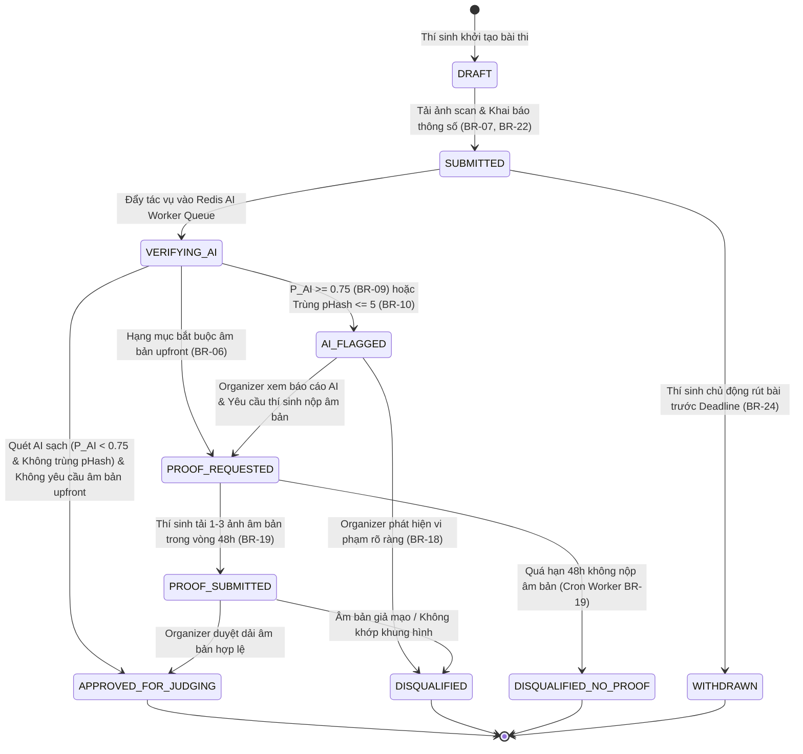
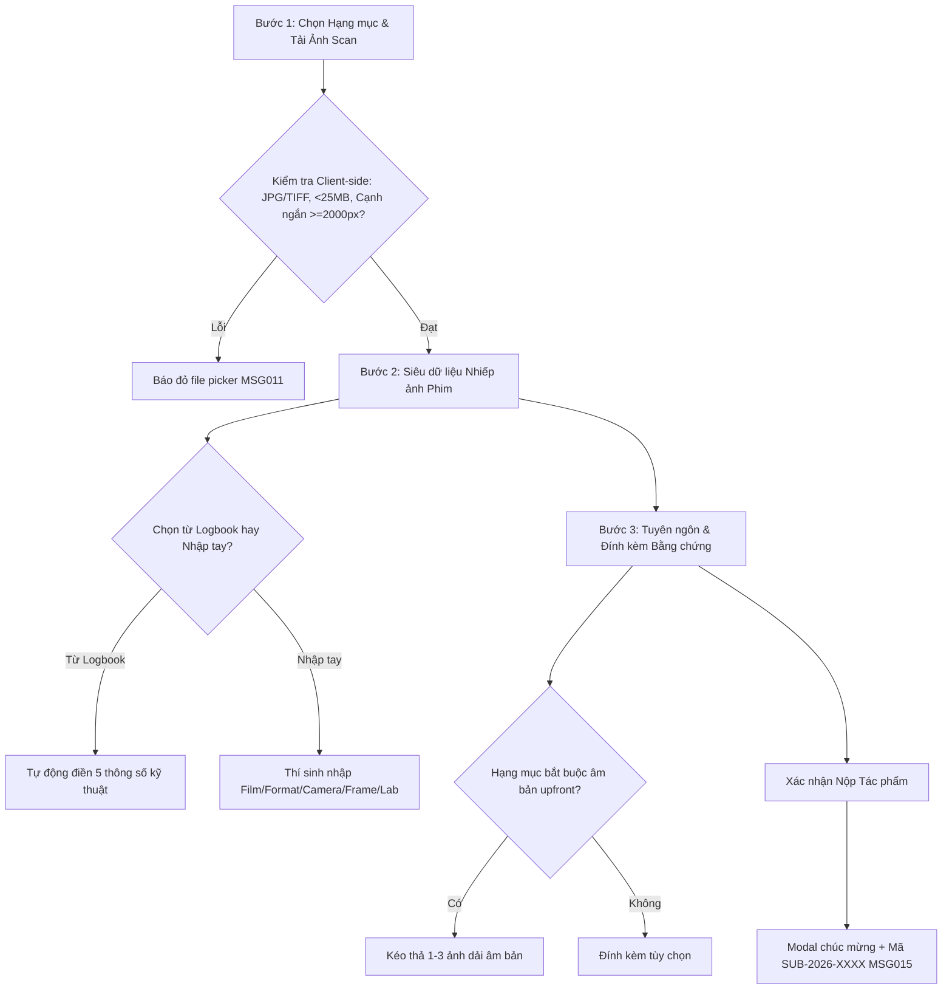

# Module Spec: 05-submission-and-proof.md

> **Module Name**: Contest Submission & Negative Proof Verification (Nộp Bài Dự Thi & Xác Thực Bằng Chứng Âm Bản)  
> **Status**: READY FOR CODE GENERATION  
> **Version**: 1.0.0  
> **Target Audience**: AI Coding Assistants (Cursor, Copilot), Backend Engineers, Frontend & Mobile Engineers  
> **Standard**: AI-First Spec (Explicit schemas, deterministic business logic, exhaustive error codes, Zero visual ambiguity, 100% structured Markdown & Mermaid)

---

## 1. Domain Entities & Database Mapping

Hệ thống sử dụng cơ sở dữ liệu **PostgreSQL 16+**. Khóa chính (PK) định dạng `UUID` sinh bằng `gen_random_uuid()`. Chuẩn đặt tên bảng và cột theo `snake_case`. Thời gian lưu theo `TIMESTAMPTZ` (UTC).

### 1.1 Sơ đồ Thực thể Quan hệ (Entity Relationship Diagram)

```mermaid
erDiagram
    users ||--o{ submissions : "submits"
    contests ||--o{ submissions : "receives"
    contest_categories ||--o{ submissions : "classified_in"
    film_rolls ||--o{ submissions : "originated_from"
    submissions ||--|| submission_film_metadata : "describes"
    submissions ||--o{ submission_proofs : "proves_with"
    submissions ||--o{ submission_moderation_logs : "audited_by"
    users ||--o{ submission_moderation_logs : "moderated_by"

    submissions {
        uuid id PK
        varchar submission_code UK "SUB-YYYY-XXXX"
        uuid contest_id FK
        uuid category_id FK
        uuid participant_id FK
        uuid roll_id FK "Nullable"
        int frame_number "Nullable"
        varchar title
        text artist_statement
        uuid original_image_asset_id FK "Private S3/R2"
        uuid watermarked_preview_asset_id FK "Public CDN"
        uuid thumbnail_asset_id FK "Public CDN"
        bigint file_size_bytes "Max 25MB"
        int width_px
        int height_px "Min Short Edge 2000px"
        varchar mime_type "image/jpeg|image/tiff"
        varchar status "SUBMITTED|VERIFYING_AI|AI_FLAGGED|PROOF_REQUESTED|PROOF_SUBMITTED|APPROVED_FOR_JUDGING|DISQUALIFIED|DISQUALIFIED_NO_PROOF|WITHDRAWN"
        timestamptz proof_requested_at "48h Start"
        timestamptz proof_deadline_at "48h Deadline"
        timestamptz submitted_at
        int version "Optimistic Locking"
        boolean is_deleted
        timestamptz created_at
        timestamptz updated_at
    }

    submission_film_metadata {
        uuid id PK
        uuid submission_id FK UK
        varchar film_brand
        varchar film_stock
        varchar film_format "135|120|4x5"
        int iso_rated
        int iso_shot
        varchar camera_body
        varchar lens
        int focal_length_mm
        varchar aperture
        varchar shutter_speed
        varchar dev_lab_name
        varchar dev_chemistry
        varchar scanner_model
        timestamptz created_at
    }

    submission_proofs {
        uuid id PK
        uuid submission_id FK
        jsonb proof_asset_ids "1-3 Negative Strip Images"
        varchar proof_type "NEGATIVE_STRIP|CONTACT_SHEET"
        text participant_note
        timestamptz uploaded_at
        uuid reviewed_by FK "Nullable"
        varchar review_status "PENDING|VALID|INVALID"
        text review_note
        timestamptz reviewed_at
    }

    submission_moderation_logs {
        uuid id PK
        uuid submission_id FK
        uuid moderator_id FK
        varchar action "REQUEST_PROOF|APPROVE_FOR_JUDGING|DISQUALIFY|OVERRIDE_AI_FLAG"
        text reason "Mandatory Reason BR-18"
        varchar previous_status
        varchar new_status
        timestamptz created_at
    }
```

---

### 1.2 Bảng `submissions` (Bài dự thi Nhiếp ảnh Phim)

Lưu trữ thông tin định danh bài thi, tệp ảnh số hóa độ phân giải cao và trạng thái kiểm duyệt xuyên suốt vòng đời.

| Tên trường (Column) | Kiểu dữ liệu | Ràng buộc | Mặc định | Mô tả & Ý nghĩa nghiệp vụ |
| :--- | :--- | :--- | :--- | :--- |
| `id` | `UUID` | `PK`, Not Null | `gen_random_uuid()` | Khóa chính bài dự thi |
| `submission_code` | `VARCHAR(50)` | `UQ`, Not Null | *None* | Mã bài thi tự sinh: `SUB-YYYY-XXXX` (CR-05) |
| `contest_id` | `UUID` | `FK`, Not Null | *None* | Tham chiếu `contests(id)` ON DELETE RESTRICT |
| `category_id` | `UUID` | `FK`, Not Null | *None* | Tham chiếu `contest_categories(id)` |
| `participant_id` | `UUID` | `FK`, Not Null | *None* | Tham chiếu `users(id)` (Thí sinh nộp bài) |
| `roll_id` | `UUID` | `FK`, Nullable | `NULL` | Tham chiếu `film_rolls(id)` nếu chọn từ Logbook |
| `frame_number` | `INT` | Nullable | `NULL` | Số thứ tự frame trong cuộn phim |
| `title` | `VARCHAR(255)` | Not Null | *None* | Tên tác phẩm ảnh (Không để trống) |
| `artist_statement` | `TEXT` | Nullable | `NULL` | Tuyên ngôn nghệ thuật / Bối cảnh sáng tác |
| `original_image_asset_id` | `UUID` | Not Null | *None* | ID file ảnh scan gốc lưu ở Private Bucket |
| `watermarked_preview_asset_id` | `UUID` | Nullable | `NULL` | ID ảnh preview có watermark phục vụ triển lãm |
| `thumbnail_asset_id` | `UUID` | Nullable | `NULL` | ID ảnh thumbnail WebP phân giải thấp |
| `file_size_bytes` | `BIGINT` | Not Null, Check | *None* | Dung lượng file (Check $\le 26,214,400$ bytes = 25MB) |
| `width_px` | `INT` | Not Null, Check | *None* | Chiều rộng ảnh (pixels, Check $> 0$) |
| `height_px` | `INT` | Not Null, Check | *None* | Chiều cao ảnh (pixels, Check $> 0$) |
| `mime_type` | `VARCHAR(50)` | Not Null | *None* | Định dạng file (`image/jpeg`, `image/tiff`) |
| `status` | `VARCHAR(40)` | Not Null | `'SUBMITTED'` | Trạng thái bài thi (Xem mục 3) |
| `proof_requested_at`| `TIMESTAMPTZ` | Nullable | `NULL` | Thời điểm BTC gửi yêu cầu âm bản (Bắt đầu 48h) |
| `proof_deadline_at` | `TIMESTAMPTZ` | Nullable | `NULL` | Hạn chót nộp âm bản (proof_requested_at + 48h) |
| `submitted_at` | `TIMESTAMPTZ` | Not Null | `NOW()` | Thời điểm nộp bài chính thức |
| `version` | `INT` | Not Null | `1` | Khóa lạc quan (Optimistic Locking - CR-07) |
| `is_deleted` | `BOOLEAN` | Not Null | `FALSE` | Cờ xóa mềm theo BR-03 |
| `created_at` | `TIMESTAMPTZ` | Not Null | `NOW()` | Thời gian tạo |
| `updated_at` | `TIMESTAMPTZ` | Not Null | `NOW()` | Thời gian cập nhật |

> **Chỉ mục & Ràng buộc Tính duy nhất (BR-05):**
> - `CREATE UNIQUE INDEX uq_submissions_code ON submissions(submission_code) WHERE is_deleted = FALSE;`
> - `CREATE UNIQUE INDEX uq_submissions_roll_frame ON submissions(contest_id, roll_id, frame_number) WHERE is_deleted = FALSE AND roll_id IS NOT NULL AND status NOT IN ('WITHDRAWN', 'DISQUALIFIED');`
> - `CREATE INDEX idx_submissions_contest_cat ON submissions(contest_id, category_id);`
> - `CREATE INDEX idx_submissions_participant ON submissions(participant_id);`
> - `CREATE INDEX idx_submissions_status ON submissions(status);`
> - `CONSTRAINT check_short_edge CHECK (LEAST(width_px, height_px) >= 2000);`

---

### 1.3 Bảng `submission_film_metadata` (Siêu dữ liệu Kỹ thuật Phim)

Quan hệ 1-1 với `submissions`, lưu trữ đầy đủ 5 tham số bắt buộc của bức ảnh phim (BR-22).

| Tên trường (Column) | Kiểu dữ liệu | Ràng buộc | Mô tả & Ý nghĩa nghiệp vụ |
| :--- | :--- | :--- | :--- |
| `id` | `UUID` | `PK`, Not Null | Khóa chính metadata |
| `submission_id` | `UUID` | `UQ`, `FK`, Not Null | Tham chiếu `submissions(id)` ON DELETE CASCADE |
| `film_brand` | `VARCHAR(100)` | Not Null | Hãng phim (VD: "Kodak", "Ilford", "Fujifilm") |
| `film_stock` | `VARCHAR(150)` | Not Null | Loại phim (VD: "Portra 400", "Tri-X 400", "Gold 200") |
| `film_format` | `VARCHAR(50)` | Not Null | Khổ phim vật lý (`135`, `120`, `4x5`) |
| `iso_rated` | `INT` | Not Null, Check | ISO danh định ghi trên vỏ hộp phim ($> 0$) |
| `iso_shot` | `INT` | Not Null, Check | ISO thực tế thiết lập trên máy ảnh ($> 0$) |
| `camera_body` | `VARCHAR(150)` | Not Null | Thân máy chụp (VD: "Leica M6", "Canon AE-1") |
| `lens` | `VARCHAR(150)` | Nullable | Ống kính quang học (VD: "Summicron 50mm f/2") |
| `focal_length_mm` | `INT` | Nullable | Tiêu cự quang học (mm) |
| `aperture` | `VARCHAR(20)` | Nullable | Khẩu độ mở ống kính (VD: "f/2.8") |
| `shutter_speed` | `VARCHAR(20)` | Nullable | Tốc độ màn trập (VD: "1/500s") |
| `dev_lab_name` | `VARCHAR(150)` | Nullable | Tên phòng Lab tráng phim hoặc "Home Dev" |
| `dev_chemistry` | `VARCHAR(50)` | Nullable | Hóa chất tráng (VD: "D-76", "Rodinal", "C-41 Standard") |
| `scanner_model` | `VARCHAR(150)` | Nullable | Dòng máy quét phim (VD: "Noritsu HS-1800", "Frontier SP3000") |
| `created_at` | `TIMESTAMPTZ` | Not Null | Thời điểm tạo bản ghi |

---

### 1.4 Bảng `submission_proofs` (Bằng chứng Ảnh Dải Phim Âm Bản)

Lưu trữ hình ảnh chụp dải phim âm bản (Negative Strip) hoặc tờ tiếp xúc (Contact Sheet) để chứng minh tính chân thực của bức ảnh phim vật lý (BR-06).

| Tên trường (Column) | Kiểu dữ liệu | Ràng buộc | Mặc định | Mô tả & Ý nghĩa nghiệp vụ |
| :--- | :--- | :--- | :--- | :--- |
| `id` | `UUID` | `PK`, Not Null | `gen_random_uuid()` | Khóa chính bản ghi bằng chứng |
| `submission_id` | `UUID` | `FK`, Not Null | *None* | Tham chiếu `submissions(id)` ON DELETE CASCADE |
| `proof_asset_ids` | `JSONB` | Not Null | `'[]'::jsonb` | Mảng chứa 1 - 3 UUID trỏ tới file ảnh âm bản |
| `proof_type` | `VARCHAR(30)` | Not Null | `'NEGATIVE_STRIP'` | ENUM: `NEGATIVE_STRIP`, `CONTACT_SHEET` |
| `participant_note` | `TEXT` | Nullable | `NULL` | Lời chú thích của thí sinh về dải âm bản |
| `uploaded_at` | `TIMESTAMPTZ` | Not Null | `NOW()` | Thời điểm upload bằng chứng |
| `reviewed_by` | `UUID` | `FK`, Nullable | `NULL` | Tham chiếu `users(id)` (Organizer thẩm định) |
| `review_status` | `VARCHAR(30)` | Not Null | `'PENDING'` | ENUM: `PENDING`, `VALID`, `INVALID` |
| `review_note` | `TEXT` | Nullable | `NULL` | Lời nhận xét đánh giá âm bản của Organizer |
| `reviewed_at` | `TIMESTAMPTZ` | Nullable | `NULL` | Thời điểm hoàn thành thẩm định âm bản |

---

### 1.5 Bảng `submission_moderation_logs` (Nhật ký Vết Kiểm duyệt)

Lưu vết toàn bộ các quyết định hành chính nhạy cảm của Ban tổ chức đối với bài thi (BR-18).

| Tên trường (Column) | Kiểu dữ liệu | Ràng buộc | Mô tả & Ý nghĩa nghiệp vụ |
| :--- | :--- | :--- | :--- |
| `id` | `UUID` | `PK`, Not Null | Khóa chính audit log |
| `submission_id` | `UUID` | `FK`, Not Null | Tham chiếu `submissions(id)` |
| `moderator_id` | `UUID` | `FK`, Not Null | Tham chiếu `users(id)` (Organizer thực hiện) |
| `action` | `VARCHAR(50)` | Not Null | ENUM: `REQUEST_PROOF`, `APPROVE_FOR_JUDGING`, `DISQUALIFY`, `OVERRIDE_AI_FLAG` |
| `reason` | `TEXT` | Not Null | **Bắt buộc nhập lý do chi tiết** theo quy tắc BR-18 |
| `previous_status` | `VARCHAR(40)` | Not Null | Trạng thái trước khi thao tác |
| `new_status` | `VARCHAR(40)` | Not Null | Trạng thái mới được cập nhật |
| `created_at` | `TIMESTAMPTZ` | Not Null | Thời điểm ghi nhận thao tác |

---

## 2. Business Rules & Logic Ràng Buộc

### 2.1 Bảng Ánh xạ Quy tắc Nghiệp vụ

| Mã BR | Tên Quy tắc | Diễn giải Ràng buộc Kỹ thuật | Xử lý Vi phạm |
| :--- | :--- | :--- | :--- |
| **BR-03** | Xóa mềm Bản ghi | Cập nhật `is_deleted = TRUE` khi người dùng xóa bài thi. Tuyệt đối không xóa cứng khỏi cơ sở dữ liệu. | Soft Delete Filter |
| **BR-05** | Chống Nộp Trùng Khung hình | Kiểm tra bộ ba `(contest_id, roll_id, frame_number)`. Nếu cặp cuộn phim và số khung hình này đã tồn tại trong cuộc thi ở trạng thái hợp lệ, từ chối nộp bài mới. | HTTP 400 Bad Request (`MSG012`) |
| **BR-06** | Bắt buộc Âm bản Xét Giải | Tác phẩm lọt vào vòng Chung kết hoặc xét Giải bắt buộc phải có bản ghi `submission_proofs` với `review_status = 'VALID'`. Nếu BTC bấm công bố giải mà bài chưa có âm bản hợp lệ, hệ thống chặn lại. | Chặn Công bố (`MSG026`) |
| **BR-07** | Tiêu chuẩn Kỹ thuật File Ảnh | Tệp ảnh scan tải lên bắt buộc phải là định dạng JPEG hoặc TIFF; dung lượng tối đa 25MB (26,214,400 bytes); cạnh ngắn nhất tối thiểu 2000px; không chứa chữ ký cá nhân (Watermark). | HTTP 400 Bad Request (`MSG011`) |
| **BR-08** | Khóa Cổng Theo Thời hạn | Thí sinh chỉ được nộp bài hoặc chỉnh sửa bài thi khi $CurrentTime < submission\_deadline\_at$. Khi quá hạn, toàn bộ thao tác nộp mới hoặc sửa bài bị từ chối. | HTTP 400 Bad Request (`MSG014`) |
| **BR-18** | Bắt buộc Nhập Lý do Kiểm duyệt | Mọi thao tác: Yêu cầu âm bản (`REQUEST_PROOF`), Loại bài (`DISQUALIFY`), Gỡ cờ AI (`OVERRIDE_AI_FLAG`) bắt buộc phải truyền trường `reason` tối thiểu 10 ký tự và ghi tự động vào `submission_moderation_logs`. | HTTP 422 Unprocessable (`MSG021`) |
| **BR-19** | Đồng hồ Đếm ngược 48 Giờ | Khi bài thi chuyển sang `PROOF_REQUESTED`, hệ thống lưu `proof_requested_at = NOW()` và tính `proof_deadline_at = NOW() + INTERVAL '48 hours'`. Một cron worker chạy ngầm định kỳ: Nếu $NOW() > proof\_deadline\_at$ và thí sinh chưa nộp âm bản, tự động chuyển trạng thái bài thi sang `DISQUALIFIED_NO_PROOF`. | Tự động Loại bài Quá hạn |
| **BR-21** | Chặn Xung đột Lợi ích | Người dùng đã được gán vai trò Judge hoặc Organizer trong một cuộc thi thì bị hệ thống chặn không cho phép nộp bài thi vào chính cuộc thi đó. | HTTP 403 Forbidden (`MSG022`) |
| **BR-22** | 5 Tham số Kỹ thuật Bắt buộc | Mọi bài thi hợp lệ bắt buộc khai báo tối thiểu: (1) Film Stock, (2) Khổ phim Format, (3) Thân máy Camera, (4) Số Frame, (5) Phòng Lab/Quy trình tráng. | HTTP 422 Unprocessable |
| **BR-24** | Quy định Sửa & Rút bài | Thí sinh chỉ được phép chỉnh sửa metadata hoặc rút bài (`WITHDRAWN`) khi $CurrentTime < submission\_deadline\_at$ và bài thi chưa chuyển sang vòng chấm điểm (`JUDGING`). | HTTP 403 Forbidden |

---

## 3. State Machine & Lifecycle (Vòng đời Bài dự thi)



---

## 4. Shared API Contracts (Hợp đồng API Đa nền tảng Web & Mobile)

### 4.1 Yêu cầu Presigned URL Tải Ảnh Scan (`POST /api/v1/submissions/presigned-url`)
*   **Method**: `POST`
*   **Path**: `/api/v1/submissions/presigned-url`
*   **Auth**: Bearer JWT (Role `PARTICIPANT`)
*   **Request Payload:**
    ```json
    {
      "contestId": "e4b2d380-a65c-4f1b-8521-998811223344",
      "fileName": "street_life_hanoi_scan.tiff",
      "fileSizeBytes": 18450100,
      "mimeType": "image/tiff"
    }
    ```
*   **Validation:** Kiểm tra `fileSizeBytes <= 26214400` (25MB) và `mimeType IN ('image/jpeg', 'image/tiff')`. Nếu sai trả HTTP 400 (`MSG011`).
*   **Response Payload (200 OK):**
    ```json
    {
      "success": true,
      "code": "SUCCESS",
      "data": {
        "assetId": "9f8e7d6c-5b4a-3210-fedc-ba9876543210",
        "uploadUrl": "https://r2.cloudflarestorage.com/filmcontest-private/submissions/raw/9f8e7d6c.tiff?X-Amz-Signature=...",
        "storageKey": "submissions/raw/9f8e7d6c.tiff",
        "expiresInSeconds": 900
      }
    }
    ```

---

### 4.2 Nộp Tác phẩm Dự thi (`POST /api/v1/submissions`)
*   **Method**: `POST`
*   **Path**: `/api/v1/submissions`
*   **Auth**: Bearer JWT (Role `PARTICIPANT`)
*   **Request Payload (Submit Wizard Data):**
    ```json
    {
      "contestId": "e4b2d380-a65c-4f1b-8521-998811223344",
      "categoryId": "f12a3456-7890-abcd-ef12-34567890abcd",
      "rollId": "b182f7c0-1234-4567-89ab-cdef01234567",
      "frameNumber": 14,
      "title": "Gánh Hàng Rong Phố Cổ",
      "artistStatement": "Bức ảnh ghi lại khoảnh khắc bình minh trên phố Tạ Hiện, chụp bằng phim Kodak Tri-X 400 phơi sáng chuẩn.",
      "originalImageAssetId": "9f8e7d6c-5b4a-3210-fedc-ba9876543210",
      "fileSizeBytes": 18450100,
      "widthPx": 4500,
      "heightPx": 3000,
      "mimeType": "image/tiff",
      "metadata": {
        "filmBrand": "Kodak",
        "filmStock": "Tri-X 400",
        "filmFormat": "135",
        "isoRated": 400,
        "isoShot": 400,
        "cameraBody": "Leica M6",
        "lens": "Summicron 35mm f/2",
        "devLabName": "LLab Hanoi",
        "devChemistry": "D-76",
        "scannerModel": "Noritsu HS-1800"
      }
    }
    ```
*   **Response Payload Vi phạm Trùng Frame (400 Bad Request - BR-05):**
    ```json
    {
      "success": false,
      "code": "MSG012",
      "message": "Khung hình số 14 thuộc cuộn phim này đã được nộp trong cuộc thi."
    }
    ```
*   **Response Payload Nộp Thành công (201 Created):**
    ```json
    {
      "success": true,
      "code": "MSG015",
      "message": "Nộp tác phẩm thành công! Mã bài dự thi của bạn là SUB-2026-0089.",
      "data": {
        "id": "7a6b5c4d-3e2f-1a0b-9c8d-7e6f5a4b3c2d",
        "submissionCode": "SUB-2026-0089",
        "status": "SUBMITTED",
        "submittedAt": "2026-10-30T12:47:00Z"
      }
    }
    ```

---

### 4.3 Ban tổ chức Yêu cầu Bổ sung Âm bản (`POST /api/v1/submissions/{id}/request-proof`)
*   **Method**: `POST`
*   **Path**: `/api/v1/submissions/{id}/request-proof`
*   **Auth**: Bearer JWT (Role `ORGANIZER`)
*   **Request Payload:**
    ```json
    {
      "reason": "Ảnh scan có độ tương phản bất thường, yêu cầu đối chiếu dải phim âm bản gốc và viền mã vạch."
    }
    ```
*   **Response Payload (200 OK):**
    ```json
    {
      "success": true,
      "code": "MSG018",
      "message": "Đã gửi yêu cầu bổ sung ảnh chụp phim âm bản cho thí sinh (Hạn chót: 48 giờ).",
      "data": {
        "submissionId": "7a6b5c4d-3e2f-1a0b-9c8d-7e6f5a4b3c2d",
        "status": "PROOF_REQUESTED",
        "proofRequestedAt": "2026-10-30T12:48:00Z",
        "proofDeadlineAt": "2026-11-01T12:48:00Z"
      }
    }
    ```

---

### 4.4 Thí sinh Tải Bằng chứng Dải Âm bản (`POST /api/v1/submissions/{id}/proof`)
*   **Method**: `POST`
*   **Path**: `/api/v1/submissions/{id}/proof`
*   **Auth**: Bearer JWT (Role `PARTICIPANT`)
*   **Request Payload:**
    ```json
    {
      "proofAssetIds": [
        "11112222-3333-4444-5555-666677778888",
        "22223333-4444-5555-6666-777788889999"
      ],
      "proofType": "NEGATIVE_STRIP",
      "participantNote": "Ảnh chụp dải âm bản 6 frame trên bàn sáng, nhìn rõ mã Kodak 400TX và số frame 14."
    }
    ```
*   **Response Payload Quá hạn 48h (400 Bad Request - BR-19):**
    ```json
    {
      "success": false,
      "code": "MSG019_EXPIRED",
      "message": "Đã quá hạn 48 giờ nộp ảnh đối chứng âm bản. Bài thi đã bị loại theo quy định BR-19."
    }
    ```
*   **Response Payload Thành công (201 Created):**
    ```json
    {
      "success": true,
      "code": "MSG019",
      "message": "Tải lên ảnh chụp dải phim âm bản đối chứng thành công.",
      "data": {
        "submissionId": "7a6b5c4d-3e2f-1a0b-9c8d-7e6f5a4b3c2d",
        "status": "PROOF_SUBMITTED"
      }
    }
    ```

---

### 4.5 Ban tổ chức Kiểm duyệt Bài thi (`POST /api/v1/submissions/{id}/moderate`)
*   **Method**: `POST`
*   **Path**: `/api/v1/submissions/{id}/moderate`
*   **Auth**: Bearer JWT (Role `ORGANIZER`)
*   **Request Payload:**
    ```json
    {
      "action": "APPROVE_FOR_JUDGING",
      "reason": "Đã đối chiếu dải âm bản gốc, viền mã vạch Kodak 400TX khớp 100% với khung hình scan số 14."
    }
    ```
*   **Response Payload Thiếu Lý do (422 Unprocessable Entity - BR-18):**
    ```json
    {
      "success": false,
      "code": "MSG021",
      "message": "Vui lòng nhập lý do cụ thể trước khi phê duyệt hoặc loại tác phẩm dự thi (Tối thiểu 10 ký tự)."
    }
    ```

---

## 5. UI/UX Functional Requirements (Đặc tả Giao diện Dạng Chữ)

### 5.1 Quy trình Nộp Bài thi 3 Bước (Submission 3-Step Wizard)



### 5.2 Đặc tả Màn hình Chi tiết (Screen Specifications)

#### 1. Màn hình "Submit Photograph Wizard" (Web & Mobile)
*   **Bước 1: Tải Ảnh Scan & Xác thực Kích thước:**
    *   Vùng thả ảnh (Drag & Drop Zone): Kéo thả ảnh trực tiếp.
    *   **Client-side Validator tức thời:** Sử dụng HTML5 FileReader / Image Object để đọc trước kích thước ảnh:
        *   Nếu dung lượng $> 25MB$ hoặc cạnh ngắn $< 2000px$: Lập tức hiện viền đỏ, hiển thị toast lỗi `MSG011`.
        *   Nếu hợp lệ: Tải thẳng lên S3/R2 bằng Presigned URL và hiển thị thanh tiến trình tải lên $0\% \to 100\%$.
*   **Bước 2: Khai báo Siêu dữ liệu Nhiếp ảnh Phim:**
    *   Thẻ chuyển đổi (Tab Switcher): `[Trích xuất từ Sổ tay Cuộn phim]` hoặc `[Nhập mới thủ công]`.
    *   Nếu chọn từ Logbook: Mở danh sách các Frame còn trống (chưa nộp trong cuộc thi này). Khi chọn 1 Frame, toàn bộ 5 trường: Film Stock, Khổ phim, Máy ảnh, Số frame, Lab tráng tự động điền sẵn và khóa chỉnh sửa để chống sai lệch.
    *   Nếu nhập mới thủ công: Điền 5 trường bắt buộc (đánh dấu sao đỏ `*`). Autocomplete hỗ trợ tìm nhanh từ Master Data.
*   **Bước 3: Tuyên ngôn Tác phẩm & Đính kèm Bằng chứng:**
    *   Ô nhập Tên tác phẩm (`title`) bắt buộc.
    *   Ô nhập Bối cảnh sáng tác (`artistStatement`) tùy chọn.
    *   Khu vực Upload Ảnh Dải Phim Âm Bản: Bắt buộc nếu Hạng mục yêu cầu upfront (BR-06).

#### 2. Màn hình "Upload Negative Proof" (Tải Bằng chứng kèm Đồng hồ 48 Giờ)
*   **Banner Cảnh báo Khẩn cấp (Countdown Banner):**
    *   Hiển thị đồng hồ đếm ngược thời gian thực dạng `HH:mm:ss` (Ví dụ: `Còn lại 36 giờ 14 phút 20 giây`).
    *   Màu sắc động:
        *   Thời gian $> 12h$: Banner màu xanh lục nhạt.
        *   Thời gian từ $6h - 12h$: Banner chuyển màu vàng cảnh báo.
        *   Thời gian $< 6h$: Banner chuyển màu đỏ rực nhấp nháy, hiển thị: "Sắp hết hạn nộp âm bản! Bài thi sẽ tự động bị loại khi đồng hồ về 0."
        *   Khi hết giờ: Đồng hồ hiển thị `00:00:00`, nút upload bị khóa hoàn toàn (disabled) và màn hình hiển thị thông báo `MSG019_EXPIRED`.
*   **Vùng Tải Ảnh Âm Bản (Proof Upload Area):**
    *   Cho phép chọn 1 đến 3 ảnh chụp rõ nét dải phim âm bản trên bàn sáng (Light table), phải nhìn rõ viền rebate edge chứa mã vạch phim và số thứ tự frame.

#### 3. Màn hình "Submission Moderation Panel" (Ban tổ chức Thẩm định)
*   **Chế độ Đối chiếu Song song (Side-by-side Lightbox Comparison):**
    *   Nửa màn hình bên trái: Ảnh scan độ phân giải cao do thí sinh nộp.
    *   Nửa màn hình bên phải: Ảnh chụp dải phim âm bản đối chứng (Negative Strip).
    *   Công cụ đồng bộ Zoom & Pan: Khi Organizer phóng to hoặc rê chuột trên ảnh scan, khung soi trên dải âm bản tự động di chuyển tương ứng để so sánh chi tiết hạt phim và bố cục.
*   **Bảng Điều khiển Quyết định (Action Bar):**
    *   Nút `Phê duyệt (Approve)`: Mở modal xác nhận duyệt bài vào vòng chấm.
    *   Nút `Yêu cầu Bổ sung Âm bản (Request Proof)`: Kích hoạt hạn chót 48 giờ.
    *   Nút `Loại bài (Disqualify)`: Mở form bắt buộc nhập lý do (BR-18) với cảnh báo: "Hành động này sẽ ghi vết vào Nhật ký Kiểm toán và gửi email thông báo tới thí sinh."
