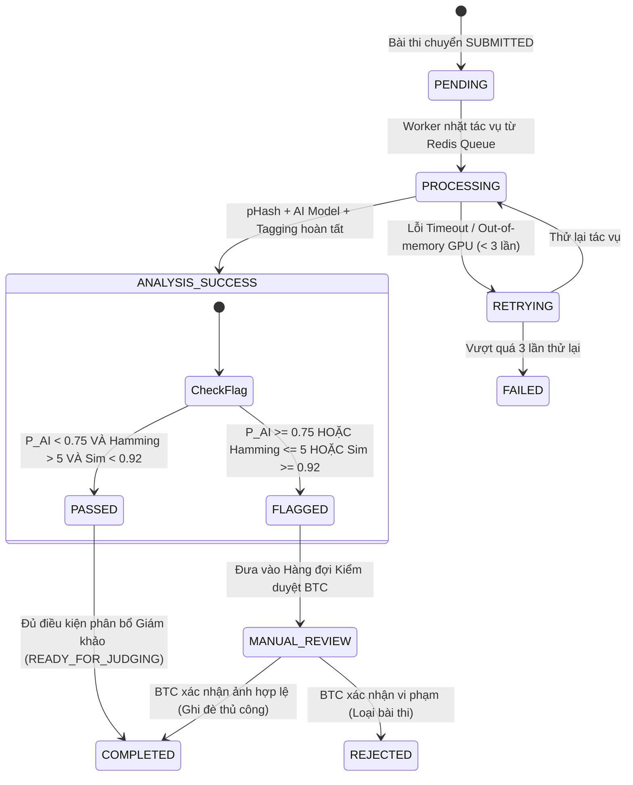

# Module Spec: 06 - AI Verification & Automated Screening (Thẩm định & Giám định Trí tuệ Nhân tạo)

## 1. Domain Entities & Database Mapping

### 1.1 Bảng `ai_verification_jobs` (Hàng đợi tác vụ kiểm tra AI)
Lưu trữ thông tin và trạng thái xử lý của từng job quét AI cho mỗi bài dự thi (`submission`).

| Tên trường (Column) | Kiểu dữ liệu (Data Type) | Ràng buộc (Constraints) | Ý nghĩa / Ghi chú |
| :--- | :--- | :--- | :--- |
| `id` | `UUID` | `PRIMARY KEY`, Default `gen_random_uuid()` | Khóa chính của job |
| `submission_id` | `UUID` | `NOT NULL`, `FOREIGN KEY REFERENCES submissions(id) ON DELETE CASCADE` | Mã bài nộp cần thẩm định |
| `status` | `VARCHAR(30)` | `NOT NULL`, `DEFAULT 'PENDING'` | ENUM: `PENDING`, `PROCESSING`, `COMPLETED`, `FAILED`, `RETRYING` |
| `attempt_count` | `INT` | `NOT NULL`, `DEFAULT 0` | Số lần thử lại tối đa (Max Retry: 3) |
| `error_message` | `TEXT` | `NULL` | Chi tiết mã lỗi hoặc exception nếu xử lý thất bại |
| `started_at` | `TIMESTAMPTZ` | `NULL` | Thời điểm bắt đầu chạy job |
| `completed_at` | `TIMESTAMPTZ` | `NULL` | Thời điểm hoàn thành xong toàn bộ tác vụ AI |
| `created_at` | `TIMESTAMPTZ` | `NOT NULL`, `DEFAULT NOW()` | Thời gian tạo tác vụ |

- **Chỉ mục (Indexes):**
  - `idx_ai_jobs_submission_id` ON (`submission_id`)
  - `idx_ai_jobs_status` ON (`status`)

---

### 1.2 Bảng `submission_ai_analyses` (Kết quả phân tích AI chi tiết)
Chứa các chỉ số đo lường quang học, điểm phán đoán AI-generated, băm thị giác (pHash) và vector đặc trưng.

| Tên trường (Column) | Kiểu dữ liệu (Data Type) | Ràng buộc (Constraints) | Ý nghĩa / Ghi chú |
| :--- | :--- | :--- | :--- |
| `id` | `UUID` | `PRIMARY KEY`, Default `gen_random_uuid()` | Khóa chính kết quả phân tích |
| `submission_id` | `UUID` | `NOT NULL`, `UNIQUE`, `FOREIGN KEY REFERENCES submissions(id) ON DELETE CASCADE` | 1-1 với bài nộp |
| `phash_hex` | `VARCHAR(16)` | `NOT NULL` | Khóa chuỗi Perceptual Hash 64-bit dạng Hex (16 ký tự) |
| `feature_vector` | `vector(512)` | `NULL` | Vector nhúng đặc trưng thị giác (CLIP/ResNet50) phục vụ so khớp pgvector |
| `ai_generated_probability` | `DECIMAL(5,4)` | `NOT NULL`, `CHECK (ai_generated_probability >= 0 AND ai_generated_probability <= 1)` | Xác suất ảnh được tạo bởi AI ($P_{AI} \in [0.0000, 1.0000]$) |
| `is_ai_flagged` | `BOOLEAN` | `NOT NULL`, `DEFAULT FALSE` | Cờ cảnh báo vi phạm AI ($P_{AI} \ge 0.75$) |
| `duplicate_suspect_id` | `UUID` | `NULL`, `FOREIGN KEY REFERENCES submissions(id) ON DELETE SET NULL` | ID bài thi bị nghi ngờ trùng lặp gần nhất |
| `duplicate_similarity_score` | `DECIMAL(5,4)` | `NULL` | Điểm số tương đồng cao nhất (Cosine Similarity hoặc $1 - \frac{\text{Hamming}}{64}$) |
| `film_grain_score` | `DECIMAL(5,4)` | `NULL` | Điểm đánh giá mật độ và cấu trúc hạt grain analog (Laplacian Variance / Frequency analysis) |
| `predicted_tags` | `JSONB` | `NOT NULL`, `DEFAULT '[]'::jsonb` | Danh sách 5 tags tự động nhận diện từ Vision Model |
| `raw_metadata_extracted` | `JSONB` | `NOT NULL`, `DEFAULT '{}'::jsonb` | Metadata Exif/IPTC trích xuất từ file scan gốc |
| `created_at` | `TIMESTAMPTZ` | `NOT NULL`, `DEFAULT NOW()` | Thời điểm phân tích |

- **Chỉ mục (Indexes):**
  - `idx_ai_analyses_phash` ON (`phash_hex`)
  - `idx_ai_analyses_vector` USING hnsw (`feature_vector` vector_cosine_ops)
  - `idx_ai_analyses_flagged` ON (`is_ai_flagged`) WHERE `is_ai_flagged` IS TRUE

---

## 2. Business Rules & Logic Ràng Buộc

| Mã Rule | Tên quy định | Chi tiết logic kỹ thuật & Điều kiện kiểm tra hợp lệ |
| :--- | :--- | :--- |
| **BR-09** | **Phát hiện ảnh tạo bởi AI (AI-Generated Detection)** | • Tác vụ AI Worker phân tích ảnh scan độ phân giải đầy đủ thông qua mô hình Deep Learning (EfficientNet/ViT Fine-tuned detector).<br>• Nếu xác suất $P_{AI} \ge 0.75$ (75%):<br>  - Tự động gán nhãn `AI_FLAGGED_HIGH_RISK` cho bài thi.<br>  - Trạng thái thẩm định chuyển thành `FLAGGED`.<br>  - **Chặn tuyệt đối** không phân bổ bài nộp này vào danh sách chấm của Ban Giám Khảo.<br>  - Đưa vào hàng đợi xác minh thủ công (Manual Review Queue) dành cho Trưởng BTC (Organizer Lead). |
| **BR-10** | **Phát hiện trùng lặp tác phẩm (Duplicate / Near-duplicate Detection)** | • Tính toán mã băm tri giác **pHash 64-bit** dựa trên biến đổi cosine rời rạc (DCT) trên ảnh grayscale $32 \times 32$.<br>• So sánh khoảng cách Hamming ($d_H$) giữa bài thi mới và toàn bộ bài thi đã nộp trong cùng cuộc thi hoặc các kỳ trước:<br>  - Nếu $d_H \le 5$ bit: Đánh dấu cờ `DUPLICATE_SUSPECT`.<br>• Đồng thời tính Cosine Distance trên `feature_vector` (CLIP 512-dim) qua `pgvector`:<br>  - Nếu $\text{Similarity} \ge 92\%$ ($0.92$): Đánh dấu cờ `DUPLICATE_SUSPECT`.<br>• Ghi nhận `duplicate_suspect_id` trỏ tới bài thi trùng nguyên bản. |
| **BR-11** | **Tự động gán thẻ phân loại nội dung (Auto-Tagging)** | • Trích xuất đặc trưng hình ảnh và phân lớp đa nhãn (Multi-label classification).<br>• Trả về chính xác **Top 5 thẻ** có độ tin cậy (Confidence Score) cao nhất trong các nhóm: *Chân dung (Portrait), Đường phố (Streetlife), Phong cảnh (Landscape), Đời thường (Documentary), Kiến trúc (Architecture), Đen trắng (Monochrome), Macro...*<br>• Thí sinh và Giám khảo có thể xem tags này để tra cứu/lọc dữ liệu trong kho lưu trữ (Digital Archive). |
| **BR-12** | **Xác thực cấu trúc hạt Analog & Bất đồng bộ hóa (Worker QoS)** | • Phân tích biến sai Fourier/Laplace để kiểm tra sự tồn tại của hạt grain đặc trưng phim (phục vụ đối chứng khi nghi ngờ ảnh số được chèn texture giả lập).<br>• Mọi thao tác xử lý AI phải chạy hoàn toàn **bất đồng bộ (Asynchronous Background Worker)** qua hàng đợi Redis Queue / Celery / BullMQ.<br>• Phải trả kết quả hoặc timeout trong vòng tối đa **120 giây** tính từ khi bài thi kích hoạt sự kiện `SUBMITTED`. |

---

## 3. State Machine & Lifecycle

### 3.1 Quy trình vòng đời thẩm định AI (AI Verification Lifecycle)



### 3.2 Ma trận phân quyền kích hoạt (Access Control)
- **Hệ thống (System / AI Worker):** Tự động kích hoạt chuyển trạng thái từ `PENDING` $\to$ `PROCESSING` $\to$ `PASSED` / `FLAGGED`.
- **Ban tổ chức (Contest Organizer / Admin):** Có quyền duyệt gỡ cờ (`Override PASSED`), loại bài thi (`REJECTED`), hoặc yêu cầu quét lại (`Trigger Re-scan`).
- **Thí sinh & Giám khảo:** Quyền chỉ đọc (Read-only); không được thay đổi kết quả AI.

---

## 4. Shared API Contracts (Dùng chung cho Web & Mobile)

### 4.1 Endpoint 1: Kích hoạt quét AI thủ công (Re-scan / Trigger)
Dành cho Ban tổ chức khi cần kiểm tra lại bài thi nghi vấn.

- **URL:** `POST /api/v1/organizer/submissions/{submissionId}/ai-scan`
- **Headers:** `Authorization: Bearer <JWT_ORGANIZER>`
- **Request Payload:**
```json
{
  "forceRecheck": true,
  "priority": "HIGH"
}
```
- **Response Payload (202 Accepted):**
```json
{
  "success": true,
  "message": "AI verification job enqueued successfully.",
  "data": {
    "jobId": "e2b3c4d5-6789-4abc-9def-0123456789ab",
    "submissionId": "f1a2b3c4-1111-2222-3333-444455556666",
    "status": "PENDING",
    "estimatedTimeSeconds": 15
  }
}
```

---

### 4.2 Endpoint 2: Lấy kết quả phân tích AI chi tiết (Get AI Audit Details)
Dùng cho màn hình Admin/Organizer Review bài nộp.

- **URL:** `GET /api/v1/organizer/submissions/{submissionId}/ai-analysis`
- **Headers:** `Authorization: Bearer <JWT_ORGANIZER>`
- **Response Payload Thành công (200 OK):**
```json
{
  "success": true,
  "data": {
    "submissionId": "f1a2b3c4-1111-2222-3333-444455556666",
    "status": "FLAGGED",
    "isAiFlagged": true,
    "aiGeneratedProbability": 0.8845,
    "phashHex": "d8e3b2a19c4f7082",
    "duplicateCheck": {
      "isSuspect": true,
      "suspectSubmissionId": "99aa88bb-4444-5555-6666-777788889999",
      "hammingDistance": 3,
      "similarityScore": 0.9531
    },
    "grainAnalysis": {
      "filmGrainScore": 0.3200,
      "assessment": "WEAK_ANALOG_TEXTURE"
    },
    "predictedTags": [
      { "tag": "Streetlife", "confidence": 0.94 },
      { "tag": "Monochrome", "confidence": 0.89 },
      { "tag": "Architecture", "confidence": 0.76 },
      { "tag": "Shadow", "confidence": 0.68 },
      { "tag": "Urban", "confidence": 0.61 }
    ],
    "flagReasons": [
      "AI-Generated probability exceeds 75% threshold (88.45%)",
      "Near-duplicate found with submission #FPC-42 (Hamming distance = 3)"
    ],
    "analyzedAt": "2026-10-27T16:20:00Z"
  }
}
```

- **Response Payload Lỗi (404 Not Found / 422 Unprocessed):**
```json
{
  "success": false,
  "errorCode": "AI_JOB_NOT_FOUND_OR_PENDING",
  "message": "Kết quả AI chưa sẵn sàng hoặc đang trong hàng đợi xử lý.",
  "errors": []
}
```

---

## 5. UI/UX Functional Requirements

### 5.1 Luồng thao tác người dùng (User Flows)
1. **Phía Thí sinh (Web & Mobile):**
   - Sau khi ấn nộp bài, màn hình bài nộp hiển thị huy hiệu trạng thái: *"Hệ thống đang thẩm định kỹ thuật..."* kèm icon loading xoay nhẹ.
   - Thí sinh không nhìn thấy chi tiết điểm $P_{AI}$ hay mã hash để tránh hành vi chỉnh sửa vượt rào kỹ thuật (Black-box security).
2. **Phía Ban tổ chức (Organizer Web Portal):**
   - Truy cập tab **"Thẩm định bài thi (Verification Queue)"**.
   - Có bộ lọc nhanh: `Tất cả`, `Đã duyệt tự động (Passed)`, `Nghi vấn AI (AI Flagged)`, `Nghi vấn trùng lặp (Duplicate Suspect)`.
   - Khi nhấp vào bài nộp bị gắn cờ: Mở **Modal Đối chứng 2 cột (Side-by-side View)**:
     - *Cột trái:* Tác phẩm hiện tại kèm biểu đồ phân bổ xác suất AI và radar hạt grain.
     - *Cột phải:* Ảnh đối chứng trùng lặp (nếu vi phạm $d_H \le 5$) kèm nút xem file âm bản (Negative sheet).
   - Nút hành động: `Chấp nhận bài thi (Ghi đè)`, `Yêu cầu bổ sung Contact Sheet`, `Loại bài thi (Disqualify)`.

### 5.2 Trạng thái hiển thị & Xử lý sự cố (States & Fallback Handling)
- **Loading State:** Khi ảnh đang quét, hiển thị thanh tiến trình giả lập (Skeleton loader) kèm thông báo xử lý tối đa 60 giây.
- **WebSocket / SSE:** Nhận thông báo thời gian thực ngay khi AI Worker hoàn thành để cập nhật giao diện mà không cần F5 trình duyệt.
- **Fault Tolerance:** Trường hợp GPU worker bị lỗi (OOM hoặc mất kết nối mạng), hệ thống tự động đưa bài nộp vào trạng thái `PENDING_RETRY` và bắn notification tới Kỹ thuật viên hệ thống, tuyệt đối không làm đơ giao diện thí sinh.
