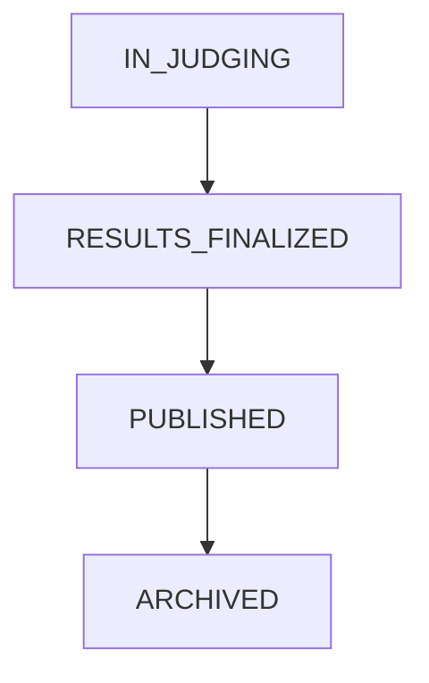
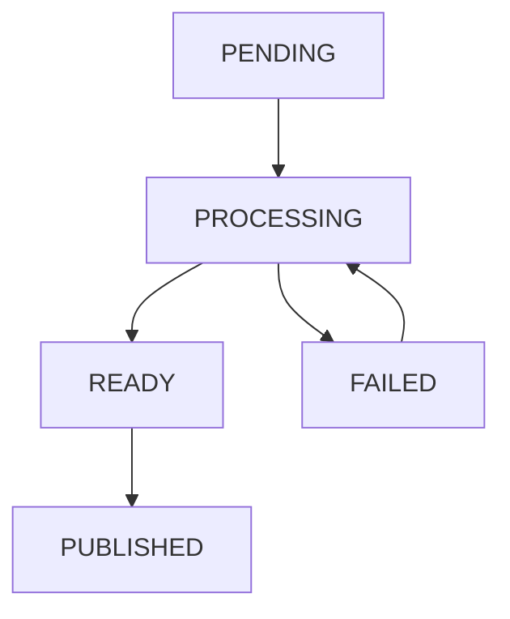

# Module Spec: Archive & Exhibition

## 1. Domain Entities & Database Mapping
### 1.1. Mô tả chức năng

Module Archive & Exhibition chịu trách nhiệm lưu trữ kết quả cuộc thi sau khi công bố, bảo vệ dữ liệu điểm số và giải thưởng, tạo ảnh triển lãm có watermark và cung cấp chức năng tìm kiếm tác phẩm.

Theo SRS, module phải tuân thủ BR-16 và BR-17:

- BR-16: Sau khi cuộc thi chuyển sang trạng thái `PUBLISHED`, điểm số, thứ hạng giải thưởng và thông tin bài thi đạt giải trở thành Read-Only.
- BR-17: Mỗi tác phẩm trong Digital Archive phải có hai bản ảnh: Master trong Private Bucket và bản công khai đã tối ưu, có thông tin bản quyền.
- Hệ thống tự động lưu trữ tác phẩm đạt giải và vào chung kết, kèm metadata kỹ thuật và lời bình giám khảo.
- Hỗ trợ tìm kiếm theo cuộc thi, năm tổ chức, giải thưởng, loại phim, máy ảnh, khổ phim và thẻ chủ đề AI.

### 1.2. Các bảng cơ sở dữ liệu hiện có

Các bảng sau đã được khai báo trong `apps/api/src/db/schema.ts`.

| Table | Primary Key | Foreign Key | Chức năng |
|---|---|---|---|
| `users` | `id` | Không | Thông tin người dùng và tác giả |
| `contests` | `id` | `created_by → users.id` | Thông tin và trạng thái cuộc thi |
| `categories` | `id` | `contest_id → contests.id` | Hạng mục cuộc thi |
| `submissions` | `id` | `contest_id`, `category_id`, `participant_id` | Thông tin bài dự thi |
| `film_metadata` | `id` | `submission_id → submissions.id` | Thông số kỹ thuật phim |
| `film_rolls` | `id` | `user_id → users.id` | Thông tin cuộn phim |
| `scoring_criteria` | `id` | `category_id → categories.id` | Tiêu chí và trọng số chấm điểm |

### 1.3. Các trường dữ liệu quan trọng

**Bảng `contests`**

| Field | Data Type | Constraint |
|---|---|---|
| `id` | UUID | PRIMARY KEY |
| `name` | VARCHAR(150) | NOT NULL |
| `status` | VARCHAR(20) | NOT NULL, DEFAULT 'draft' |
| `created_by` | UUID | NOT NULL, FOREIGN KEY |
| `start_at` | TIMESTAMPTZ | NULL |
| `end_at` | TIMESTAMPTZ | NULL |

**Bảng `submissions`**

| Field | Data Type | Constraint |
|---|---|---|
| `id` | UUID | PRIMARY KEY |
| `contest_id` | UUID | NOT NULL, FOREIGN KEY |
| `category_id` | UUID | NOT NULL, FOREIGN KEY |
| `participant_id` | UUID | NOT NULL, FOREIGN KEY |
| `title` | VARCHAR(255) | NOT NULL, không được rỗng |
| `image_original_path` | TEXT | NOT NULL, không được rỗng |
| `image_preview_path` | TEXT | NULL |
| `negative_proof_path` | TEXT | NULL |
| `status` | VARCHAR(30) | NOT NULL, DEFAULT 'PENDING_AI' |

Trạng thái bài dự thi hiện được giới hạn bởi CHECK constraint:

`PENDING_AI`, `FLAGGED`, `APPROVED`, `DISQUALIFIED`.

**Bảng `film_metadata`**

| Field | Data Type | Constraint |
|---|---|---|
| `id` | UUID | PRIMARY KEY |
| `submission_id` | UUID | NOT NULL, UNIQUE, FOREIGN KEY |
| `film_brand` | VARCHAR(100) | NOT NULL |
| `film_stock` | VARCHAR(150) | NOT NULL |
| `film_format` | VARCHAR(50) | NOT NULL |
| `iso_rated` | INTEGER | NOT NULL, CHECK > 0 |
| `iso_shot` | INTEGER | NOT NULL, CHECK > 0 |
| `camera_body` | VARCHAR(150) | NOT NULL |
| `lens` | VARCHAR(150) | NULL |
| `dev_lab_name` | VARCHAR(150) | NULL |

### 1.4. Các bảng đề xuất bổ sung

Các bảng dưới đây chưa xuất hiện trong schema hiện tại và cần thống nhất với nhóm trước khi triển khai.

| Proposed Table | Chức năng |
|---|---|
| `judging_scores` | Lưu điểm số và nhận xét của giám khảo |
| `awards` | Lưu giải thưởng và thứ hạng |
| `exhibition_images` | Lưu thông tin ảnh Master, WebP và watermark |

**Đề xuất cấu trúc bảng `exhibition_images`:**

| Field | Data Type | Constraint |
|---|---|---|
| `id` | UUID | PRIMARY KEY |
| `submission_id` | UUID | NOT NULL, UNIQUE, FOREIGN KEY |
| `master_key` | TEXT | NOT NULL |
| `webp_key` | TEXT | NULL |
| `watermark_applied` | BOOLEAN | NOT NULL, DEFAULT FALSE |
| `status` | VARCHAR(20) | NOT NULL |
| `created_at` | TIMESTAMPTZ | NOT NULL |

### 1.5. Database Constraints

- Mỗi ảnh triển lãm phải liên kết với một bài dự thi hợp lệ.
- `film_metadata.submission_id` có ràng buộc UNIQUE, đảm bảo mỗi bài dự thi có tối đa một bản ghi metadata.
- `film_metadata.iso_rated` và `iso_shot` phải lớn hơn 0.
- `submissions.title` và `image_original_path` không được rỗng.
- Khi cuộc thi chuyển sang `PUBLISHED`, hệ thống phải từ chối mọi yêu cầu sửa điểm số, thứ hạng và thông tin bài thi đạt giải.
- Ảnh Master phải được bảo vệ trong Private Bucket; ảnh công khai phải có watermark.
- Các bảng lưu trữ kết quả cần tuân thủ nguyên tắc Soft Delete theo BR-03.
- Cần bổ sung cơ chế khóa kết quả ở tầng backend; schema hiện tại chưa thể hiện đầy đủ cơ chế này.
## 2. Business Rules & Logic Ràng Buộc
### 2.1. Các Business Rules liên quan

Module Archive & Exhibition phải tuân thủ các quy tắc nghiệp vụ được quy định trong SRS.

| Rule ID | Tên quy tắc | Nội dung |
|---|---|---|
| BR-02 | Role-Based Access Control | Người dùng chỉ được truy cập chức năng phù hợp với vai trò và quyền hạn |
| BR-03 | Soft Delete | Dữ liệu quan trọng không bị xóa vật lý mà chuyển sang Inactive hoặc Archived |
| BR-06 | Negative Proof Verification | Tác phẩm vào chung kết hoặc đạt giải phải có bằng chứng âm bản đã được xác minh |
| BR-16 | Result Immutability | Sau khi cuộc thi chuyển sang PUBLISHED, điểm số, thứ hạng và thông tin bài thi đạt giải không được chỉnh sửa |
| BR-17 | Archive Image Protection | Mỗi tác phẩm lưu trữ phải có bản Master bảo mật và bản hiển thị công khai có thông tin bản quyền |

### 2.2. BR-16: Result Immutability

**Mục đích:** Đảm bảo kết quả cuộc thi không bị thay đổi sau khi công bố chính thức.

**Business Logic:**

1. Organizer thực hiện công bố kết quả cuộc thi.
2. Hệ thống kiểm tra các điều kiện công bố:
   - Giám khảo đã hoàn thành và khóa điểm.
   - Tác phẩm đạt giải đã được xác minh bằng chứng âm bản hợp lệ.
3. Hệ thống chuyển trạng thái cuộc thi sang `PUBLISHED`.
4. Toàn bộ điểm số, thứ hạng và thông tin bài thi đạt giải chuyển sang Read-Only.
5. Mọi yêu cầu chỉnh sửa những dữ liệu đã khóa phải bị từ chối ở backend.

**Validation Constraints:**

- Chỉ người có quyền công bố kết quả mới được thực hiện thao tác.
- Cuộc thi phải đáp ứng đầy đủ điều kiện công bố.
- Không cho phép cập nhật điểm số khi cuộc thi đã `PUBLISHED`.
- Không cho phép thay đổi thứ hạng hoặc giải thưởng sau khi công bố.
- Không cho phép sửa thông tin bài thi đạt giải đã khóa.

**Ví dụ:**

Cuộc thi A đã công bố kết quả. Giám khảo muốn thay đổi điểm một tác phẩm từ 8.5 thành 9.0.

Hệ thống phải từ chối yêu cầu vì kết quả đã được khóa theo BR-16.

### 2.3. BR-17: Archive Image Protection

**Mục đích:** Bảo vệ ảnh gốc và cung cấp ảnh triển lãm công khai có bản quyền.

**Business Logic:**

1. Hệ thống xác định các tác phẩm đạt giải hoặc vào chung kết cần đưa vào Digital Archive.
2. Lưu giữ ảnh Master độ phân giải cao trong Private Bucket.
3. Tạo ảnh hiển thị WebP đã tối ưu dung lượng và độ phân giải.
4. Đóng watermark chứa thông tin bản quyền cuộc thi.
5. Lưu thông tin ảnh triển lãm và metadata kỹ thuật.
6. Chỉ cung cấp ảnh công khai đã xử lý cho người xem thông thường.

**Validation Constraints:**

- Tác phẩm phải đủ điều kiện được đưa vào Digital Archive.
- File ảnh Master phải tồn tại.
- Ảnh Master không được truy cập công khai.
- Ảnh hiển thị phải được xử lý và có thông tin bản quyền trước khi công bố.
- Nếu quá trình tạo ảnh thất bại, không được đánh dấu ảnh là sẵn sàng triển lãm.

**Ví dụ:**

Một tác phẩm đạt giải được đưa vào triển lãm.

Hệ thống giữ ảnh gốc trong Cloudflare R2 Private Bucket, đồng thời tạo ảnh WebP có watermark để người xem truy cập.

### 2.4. Faceted Search – Tìm kiếm và lọc chéo

**Mục đích:** Cho phép người dùng tìm kiếm tác phẩm trong Digital Archive theo nhiều tiêu chí.

**Các bộ lọc:**

- Cuộc thi (Contest).
- Năm tổ chức (Year).
- Giải thưởng (Award).
- Loại phim (Film Stock): Kodak Portra, Ilford HP5 Plus, Cinestill,...
- Máy ảnh (Camera).
- Khổ phim (Film Format): 35mm, 120, 4x5,...
- Thẻ chủ đề AI (AI Topic Tags).

**Business Logic:**

1. Người dùng truy cập Digital Archive.
2. Hệ thống hiển thị danh sách tác phẩm công khai.
3. Người dùng lựa chọn một hoặc nhiều bộ lọc.
4. Backend truy vấn dữ liệu phù hợp.
5. Hệ thống trả về danh sách kết quả và metadata tương ứng.

**Validation Constraints:**

- Chỉ hiển thị tác phẩm được phép công khai.
- Năm tổ chức phải là giá trị hợp lệ.
- Các bộ lọc không hợp lệ phải được xử lý bằng thông báo lỗi phù hợp.
- Không trả về đường dẫn ảnh Master hoặc dữ liệu riêng tư.
- Khi không có kết quả phù hợp, trả về danh sách rỗng.

### 2.5. Error Handling

| Error Code (đề xuất) | HTTP Status | Mô tả |
|---|---|---|
| `FORBIDDEN` | 403 | Người dùng không có quyền thực hiện |
| `RESULTS_LOCKED` | 409 | Kết quả đã công bố và không được chỉnh sửa |
| `INVALID_CONTEST_STATE` | 409 | Trạng thái cuộc thi không hợp lệ |
| `PROOF_NOT_VERIFIED` | 409 | Bằng chứng âm bản chưa được xác minh |
| `MASTER_IMAGE_NOT_FOUND` | 404 | Không tìm thấy ảnh Master |
| `IMAGE_PROCESSING_FAILED` | 500 | Xử lý ảnh triển lãm thất bại |
| `INVALID_FILTER` | 400 | Tham số tìm kiếm không hợp lệ |

Các mã lỗi trên là đề xuất cho API, cần thống nhất với chuẩn xử lý lỗi của backend nhóm.

### 2.6. Các yêu cầu bảo mật

- Áp dụng JWT Authentication và RBAC cho các API quản lý.
- Không cung cấp trực tiếp ảnh Master cho người dùng công khai.
- Sử dụng Signed URL có thời hạn khi cần truy cập tài nguyên riêng tư.
- Kiểm tra quyền tại backend, không chỉ ẩn nút chỉnh sửa ở giao diện.
- Bảo đảm dữ liệu kết quả đã công bố không bị thay đổi thông qua các API khác.
## 3. State Machine & Lifecycle
### 3.1. Contest Results Lifecycle

Mô tả vòng đời công bố kết quả cuộc thi và khóa dữ liệu theo BR-16.

**State Diagram:**



**Giải thích các trạng thái:**

| State | Description |
|---|---|
| `IN_JUDGING` | Giám khảo đang thực hiện chấm điểm |
| `RESULTS_FINALIZED` | Điểm số và kết quả đã được tổng hợp, xác nhận |
| `PUBLISHED` | Kết quả được công bố chính thức, toàn bộ điểm số và giải thưởng bị khóa |
| `ARCHIVED` | Kết quả được lưu trữ để tra cứu lâu dài |

**Transition Rules:**

1. `IN_JUDGING → RESULTS_FINALIZED`
   - Các giám khảo đã hoàn thành và khóa điểm.
   - Các vấn đề liên quan đến kết quả đã được giải quyết.
   - Organizer xác nhận kết quả cuối cùng.

2. `RESULTS_FINALIZED → PUBLISHED`
   - Organizer thực hiện chức năng Publish Official Results.
   - Tất cả tác phẩm đạt giải đã được xác minh bằng chứng âm bản hợp lệ theo BR-06.
   - Hệ thống công bố kết quả và hiển thị danh tính tác giả.
   - Toàn bộ điểm số, thứ hạng và thông tin tác phẩm đạt giải chuyển sang Read-Only theo BR-16.

3. `PUBLISHED → ARCHIVED`
   - Hệ thống đưa các tác phẩm đạt giải và vào chung kết vào Digital Archive.
   - Dữ liệu kết quả vẫn ở trạng thái Read-Only.
   - Các tác phẩm được chuẩn bị để hiển thị trong triển lãm trực tuyến.

**Lưu ý:** `RESULTS_FINALIZED` và `ARCHIVED` là trạng thái đề xuất để mô tả vòng đời. SRS xác định rõ trạng thái `PUBLISHED` nhưng không bắt buộc hai trạng thái này phải là giá trị của `contests.status`.

### 3.2. Exhibition Image Lifecycle

Mô tả quá trình xử lý và công bố ảnh triển lãm theo BR-17.

**State Diagram:**



**Giải thích các trạng thái:**

| State | Description |
|---|---|
| `PENDING` | Ảnh đang chờ xử lý |
| `PROCESSING` | Hệ thống đang tạo ảnh WebP và đóng watermark |
| `READY` | Ảnh đã được xử lý thành công |
| `FAILED` | Quá trình xử lý ảnh thất bại |
| `PUBLISHED` | Ảnh đã được công khai trong Digital Archive |

**Transition Rules:**

1. `PENDING → PROCESSING`
   - Hệ thống xác định tác phẩm đủ điều kiện lưu trữ.
   - Ảnh Master tồn tại trong Private Bucket.
   - Archive Image Processor bắt đầu xử lý ảnh.

2. `PROCESSING → READY`
   - Hệ thống tạo ảnh WebP thành công.
   - Watermark bản quyền đã được áp dụng.
   - Ảnh Master vẫn được bảo vệ trong Private Bucket.

3. `PROCESSING → FAILED`
   - Quá trình chuyển đổi ảnh hoặc đóng watermark gặp lỗi.
   - Hệ thống ghi nhận trạng thái thất bại.
   - Không công khai ảnh chưa xử lý hoàn tất.

4. `FAILED → PROCESSING`
   - Hệ thống hoặc người quản lý có quyền yêu cầu xử lý lại ảnh.

5. `READY → PUBLISHED`
   - Ảnh đủ điều kiện được đưa vào triển lãm.
   - Hệ thống cho phép người dùng xem ảnh WebP có watermark.

Các trạng thái xử lý ảnh trên là thiết kế đề xuất, chưa được khai báo trong database hiện tại.

### 3.3. Roles & Permissions

| Action | Admin | Organizer | Judge | Participant | Guest |
|---|---|---|---|---|---|
| Xem triển lãm công khai | Yes | Yes | Yes | Yes | Yes |
| Tìm kiếm và lọc ảnh | Yes | Yes | Yes | Yes | Yes |
| Công bố kết quả | Theo quyền được cấp | Yes | No | No | No |
| Quản lý nội dung triển lãm | Theo quyền được cấp | Yes | No | No | No |
| Xem kết quả đã công bố | Yes | Yes | Yes | Yes | Yes |
| Sửa kết quả sau PUBLISHED | No | No | No | No | No |

**Authorization Rules:**

- Organizer có quyền công bố kết quả và quản lý triển lãm thuộc cuộc thi được phân công.
- Admin thực hiện chức năng quản trị theo quyền được cấp.
- Judge, Participant và Guest chỉ được xem nội dung đã công khai.
- Không vai trò nào được chỉnh sửa kết quả đã khóa theo BR-16.
- Backend phải kiểm tra quyền trước khi cho phép chuyển đổi trạng thái.

### 3.4. Lifecycle Validation

Trước khi chuyển đổi trạng thái, hệ thống phải kiểm tra:

- Trạng thái hiện tại có cho phép chuyển đổi hay không.
- Người thực hiện có quyền tương ứng hay không.
- Các điều kiện nghiệp vụ đã được đáp ứng hay chưa.
- Kết quả đã công bố có đang bị yêu cầu chỉnh sửa trái BR-16 hay không.
- Ảnh WebP và watermark đã được tạo thành công trước khi công khai hay chưa.

Nếu không đáp ứng điều kiện, hệ thống từ chối thao tác và trả về mã lỗi phù hợp.
## 4. Shared API Contracts
### 4.1. API Overview

Module Archive & Exhibition cung cấp các RESTful API dùng chung cho Web và Mobile.

Base URL: `/api/v1`

| Method | Endpoint | Chức năng | Quyền truy cập |
|---|---|---|---|
| POST | `/contests/:contestId/publish-results` | Công bố kết quả và khóa dữ liệu | Organizer |
| POST | `/contests/:contestId/archive` | Khởi tạo lưu trữ tác phẩm | Organizer |
| GET | `/contests/:contestId/results` | Xem kết quả cuộc thi đã công bố | Public |
| GET | `/exhibitions` | Danh sách ảnh triển lãm và tìm kiếm | Public |
| GET | `/exhibitions/:id` | Xem chi tiết tác phẩm | Public |
| POST | `/exhibitions/:id/process` | Xử lý ảnh WebP và watermark | Organizer |
| GET | `/exhibitions/:id/status` | Xem trạng thái xử lý ảnh | Organizer |

Các API quản lý yêu cầu JWT Access Token và kiểm tra quyền RBAC tại backend.

### 4.2. Publish Official Results

**Endpoint:**

`POST /api/v1/contests/:contestId/publish-results`

**Mục đích:** Công bố kết quả chính thức và khóa dữ liệu theo BR-16.

**Authorization:** Organizer được phân quyền quản lý cuộc thi.

**Request Payload:**

```json
{
  "confirm": true
}
```

**Validation Rules:**

- `contestId` phải là UUID hợp lệ.
- `confirm` phải bằng `true`.
- Người dùng phải có quyền công bố kết quả.
- Tất cả giám khảo phải hoàn thành và khóa điểm.
- Tác phẩm đạt giải phải có Negative Proof đã xác minh theo BR-06.
- Không được công bố lại theo cách làm thay đổi kết quả đã khóa.

**Response Success – 200 OK:**

```json
{
  "success": true,
  "data": {
    "contestId": "550e8400-e29b-41d4-a716-446655440000",
    "status": "PUBLISHED",
    "resultsLocked": true,
    "message": "Official results published successfully"
  }
}
```

**Response Error – 409 Conflict:**

```json
{
  "success": false,
  "error": {
    "code": "INVALID_CONTEST_STATE",
    "message": "Contest is not ready to publish results"
  }
}
```

### 4.3. Archive Contest Results

**Endpoint:**

`POST /api/v1/contests/:contestId/archive`

**Mục đích:** Khởi tạo lưu trữ tác phẩm đạt giải và vào chung kết trong Digital Archive.

**Authorization:** Organizer được phân quyền.

**Request Payload:**

```json
{
  "includeFinalists": true,
  "generateWebp": true,
  "applyWatermark": true
}
```

**Validation Rules:**

- Cuộc thi phải có trạng thái `PUBLISHED`.
- Người gọi phải có quyền quản lý cuộc thi.
- Chỉ đưa các tác phẩm đủ điều kiện vào kho lưu trữ.
- Ảnh Master phải tồn tại trong Private Bucket.
- Không tạo bản ghi lưu trữ trùng cho cùng một tác phẩm.
- Không thay đổi dữ liệu kết quả đã khóa.

**Response Success – 202 Accepted:**

```json
{
  "success": true,
  "data": {
    "contestId": "550e8400-e29b-41d4-a716-446655440000",
    "archiveStatus": "PROCESSING",
    "message": "Archive processing started"
  }
}
```

**Response Error – 409 Conflict:**

```json
{
  "success": false,
  "error": {
    "code": "CONTEST_NOT_PUBLISHED",
    "message": "Contest results must be published first"
  }
}
```

### 4.4. Get Published Contest Results

**Endpoint:**

`GET /api/v1/contests/:contestId/results`

**Mục đích:** Trả về kết quả chính thức của cuộc thi.

**Request:** Không có JSON body.

**Validation Rules:**

- `contestId` phải hợp lệ.
- Chỉ trả về kết quả được phép công khai.
- Không cho phép sửa dữ liệu thông qua API này.

**Response Success – 200 OK:**

```json
{
  "success": true,
  "data": {
    "contestId": "550e8400-e29b-41d4-a716-446655440000",
    "status": "PUBLISHED",
    "resultsLocked": true,
    "winners": [
      {
        "submissionId": "650e8400-e29b-41d4-a716-446655440001",
        "title": "Sunset",
        "award": "First Prize",
        "finalScore": 9.5
      }
    ]
  }
}
```

### 4.5. Get Exhibition Gallery – Faceted Search

**Endpoint:**

`GET /api/v1/exhibitions`

**Mục đích:** Hiển thị và tìm kiếm tác phẩm triển lãm theo nhiều bộ lọc.

**Query Parameters:**

| Parameter | Data Type | Validation | Description |
|---|---|---|---|
| `contestId` | UUID | UUID hợp lệ | Lọc theo cuộc thi |
| `year` | Integer | Năm hợp lệ | Năm tổ chức |
| `award` | String | Giá trị hợp lệ | Giải thưởng |
| `filmStock` | String | Tối đa 150 ký tự | Loại phim |
| `camera` | String | Tối đa 150 ký tự | Máy ảnh |
| `filmFormat` | String | Tối đa 50 ký tự | Khổ phim |
| `aiTag` | String | Giá trị hợp lệ | Thẻ chủ đề AI |
| `page` | Integer | >= 1 | Trang hiện tại |
| `limit` | Integer | 1–100 | Số kết quả mỗi trang |

**Request Example:**

```http
GET /api/v1/exhibitions?filmStock=Portra&filmFormat=35mm&year=2026&page=1&limit=10
```

**Validation Rules:**

- Các bộ lọc có thể sử dụng riêng lẻ hoặc kết hợp.
- Chỉ trả về tác phẩm đã công khai.
- Không trả về đường dẫn Master hoặc Negative Proof.
- Khi không có tác phẩm phù hợp, trả về mảng rỗng.
- Phải hỗ trợ phân trang để tránh tải quá nhiều ảnh cùng lúc.

**Response Success – 200 OK:**

```json
{
  "success": true,
  "data": [
    {
      "id": "750e8400-e29b-41d4-a716-446655440002",
      "title": "Sunset",
      "filmStock": "Kodak Portra 400",
      "camera": "Canon AE-1",
      "filmFormat": "35mm",
      "year": 2026,
      "award": "First Prize",
      "imageUrl": "https://example.com/exhibition/sunset.webp"
    }
  ],
  "pagination": {
    "page": 1,
    "limit": 10,
    "total": 1,
    "totalPages": 1
  }
}
```

### 4.6. Get Exhibition Detail

**Endpoint:**

`GET /api/v1/exhibitions/:id`

**Mục đích:** Xem chi tiết một tác phẩm triển lãm.

**Request:** Không có JSON body.

**Validation Rules:**

- `id` phải là UUID hợp lệ.
- Tác phẩm phải tồn tại và được công khai.
- Chỉ trả về URL ảnh WebP có watermark.
- Không tiết lộ khóa truy cập Private Bucket.

**Response Success – 200 OK:**

```json
{
  "success": true,
  "data": {
    "id": "750e8400-e29b-41d4-a716-446655440002",
    "title": "Sunset",
    "author": "Nguyen Van A",
    "filmStock": "Kodak Portra 400",
    "iso": 400,
    "camera": "Canon AE-1",
    "lens": "50mm f/1.8",
    "filmFormat": "35mm",
    "lab": "Film Lab",
    "award": "First Prize",
    "imageUrl": "https://example.com/exhibition/sunset.webp",
    "watermarked": true
  }
}
```

**Response Error – 404 Not Found:**

```json
{
  "success": false,
  "error": {
    "code": "EXHIBITION_NOT_FOUND",
    "message": "Exhibition image not found"
  }
}
```

### 4.7. Process Exhibition Image

**Endpoint:**

`POST /api/v1/exhibitions/:id/process`

**Mục đích:** Yêu cầu tạo ảnh WebP và đóng watermark theo BR-17.

**Authorization:** Organizer được phân quyền.

**Request Payload:**

```json
{
  "generateWebp": true,
  "applyWatermark": true
}
```

**Validation Rules:**

- Tác phẩm phải đủ điều kiện triển lãm.
- Ảnh Master phải tồn tại.
- Không cho phép bỏ qua watermark.
- Không được làm thay đổi ảnh Master.
- Phải xử lý an toàn khi yêu cầu được gửi lặp lại.

**Response Success – 202 Accepted:**

```json
{
  "success": true,
  "data": {
    "exhibitionId": "750e8400-e29b-41d4-a716-446655440002",
    "status": "PROCESSING",
    "message": "Image processing started"
  }
}
```

### 4.8. Get Exhibition Processing Status

**Endpoint:**

`GET /api/v1/exhibitions/:id/status`

**Mục đích:** Kiểm tra tiến trình xử lý ảnh triển lãm.

**Authorization:** Organizer được phân quyền.

**Response Success – 200 OK:**

```json
{
  "success": true,
  "data": {
    "exhibitionId": "750e8400-e29b-41d4-a716-446655440002",
    "status": "READY",
    "watermarked": true
  }
}
```

**Processing Status (đề xuất):**

- `PENDING`: Chờ xử lý.
- `PROCESSING`: Đang xử lý.
- `READY`: Hoàn thành.
- `FAILED`: Xử lý thất bại.
- `PUBLISHED`: Đã công khai.

### 4.9. Common Error Responses

Các API sử dụng cấu trúc lỗi thống nhất.

**Response Format:**

```json
{
  "error": "Error message description"
}
```

| HTTP Status | Error Code | Description |
|---|---|---|
| 400 | `VALIDATION_ERROR` | Dữ liệu không hợp lệ |
| 401 | `UNAUTHORIZED` | Chưa xác thực |
| 403 | `FORBIDDEN` | Không có quyền |
| 404 | `NOT_FOUND` | Không tìm thấy tài nguyên |
| 409 | `RESULTS_LOCKED` | Kết quả đã bị khóa |
| 409 | `INVALID_CONTEST_STATE` | Trạng thái cuộc thi không hợp lệ |
| 409 | `PROOF_NOT_VERIFIED` | Chưa xác minh bằng chứng âm bản |
| 500 | `IMAGE_PROCESSING_FAILED` | Xử lý ảnh thất bại |

### 4.10. Security Requirements

- Sử dụng JWT Access Token cho các API yêu cầu xác thực.
- Áp dụng RBAC để kiểm tra quyền Admin và Organizer.
- Không cho phép sửa kết quả đã công bố theo BR-16.
- Ảnh Master và Negative Proof phải được bảo vệ trong Private Storage.
- Sử dụng Signed URL có thời hạn khi cần truy cập ảnh riêng tư.
- API công khai chỉ trả về ảnh WebP có watermark và metadata được phép hiển thị.
- Web và Mobile phải sử dụng chung cấu trúc Request/Response.
## 5. UI/UX Functional Requirements
### 5.1. UI/UX Overview

Module Archive & Exhibition cung cấp giao diện quản lý kho lưu trữ số và triển lãm ảnh trực tuyến, hỗ trợ cả Web và Mobile.

**Mục tiêu:**

- Cho phép người dùng xem các tác phẩm đạt giải và vào chung kết.
- Hiển thị ảnh WebP có watermark bản quyền.
- Hỗ trợ tìm kiếm và lọc tác phẩm theo nhiều tiêu chí.
- Cho phép Organizer quản lý nội dung triển lãm.
- Đảm bảo kết quả đã công bố không thể chỉnh sửa theo BR-16.
- Đảm bảo ảnh Master được bảo vệ theo BR-17.

### 5.2. Digital Archive & Exhibition Gallery

**Actors:** Guest, Participant, Judge, Organizer, Admin.

**User Flow:**

1. Người dùng truy cập mục `Digital Archive` trên thanh điều hướng.
2. Hệ thống gửi yêu cầu lấy danh sách tác phẩm triển lãm.
3. Hiển thị các tác phẩm dưới dạng lưới ảnh (Gallery Grid).
4. Người dùng có thể chọn bộ lọc để tìm kiếm tác phẩm.
5. Người dùng nhấn vào một tác phẩm để xem thông tin chi tiết.
6. Hệ thống hiển thị ảnh WebP có watermark cùng metadata kỹ thuật.
7. Người dùng có thể quay lại danh sách hoặc tiếp tục tìm kiếm.

**Displayed Data:**

- Ảnh WebP có watermark.
- Tên tác phẩm.
- Tên tác giả (sau khi công bố kết quả).
- Tên cuộc thi.
- Năm tổ chức.
- Giải thưởng (nếu có).
- Film Stock.
- Camera.
- Lens.
- Film Format.
- ISO.
- Film Lab.
- Lời bình giám khảo được phép công khai (nếu có).

**UI Components:**

- Gallery Grid.
- Search Bar.
- Filter Panel.
- Exhibition Image Card.
- Image Detail View.
- Pagination.
- Loading Indicator.

### 5.3. Faceted Search Interface

**Mục đích:** Cho phép người dùng lọc chéo tác phẩm theo nhiều tiêu chí.

**Filter Options:**

| Filter | UI Component | Description |
|---|---|---|
| Contest | Dropdown | Lọc theo cuộc thi |
| Year | Dropdown | Lọc theo năm tổ chức |
| Award | Dropdown | Lọc theo giải thưởng |
| Film Stock | Dropdown/Search | Kodak Portra, Ilford HP5 Plus, Cinestill,... |
| Camera | Dropdown/Search | Lọc theo máy ảnh |
| Film Format | Dropdown | 35mm, 120, 4x5,... |
| AI Topic Tag | Multi-select | Lọc theo thẻ chủ đề AI |

**User Flow:**

1. Người dùng mở trang Digital Archive.
2. Chọn một hoặc nhiều bộ lọc.
3. Hệ thống gửi các tham số lọc đến API.
4. Backend trả về danh sách tác phẩm phù hợp.
5. Giao diện cập nhật danh sách ảnh.
6. Người dùng có thể nhấn `Clear Filters` để xóa toàn bộ bộ lọc.

**Validation:**

- Chỉ gửi các giá trị bộ lọc hợp lệ.
- Các bộ lọc có thể kết hợp với nhau.
- Không hiển thị tác phẩm chưa được công khai.
- Nếu không có kết quả, hiển thị thông báo phù hợp.

### 5.4. Exhibition Image Detail

**Mục đích:** Hiển thị thông tin chi tiết của một tác phẩm triển lãm.

**User Flow:**

1. Người dùng chọn một ảnh trong Gallery.
2. Hệ thống gọi API lấy thông tin chi tiết.
3. Hiển thị ảnh WebP có watermark.
4. Hiển thị tên tác phẩm, tác giả và metadata.
5. Người dùng quay lại Gallery.

**Displayed Data:**

- Tên tác phẩm.
- Ảnh triển lãm.
- Tác giả.
- Cuộc thi và năm tổ chức.
- Giải thưởng.
- Film Stock.
- Film Format.
- Camera và Lens.
- ISO.
- Film Lab.
- Lời bình giám khảo được phép công khai.

**Security Requirements:**

- Không hiển thị đường dẫn ảnh Master.
- Không cho phép truy cập trực tiếp Private Bucket.
- Chỉ sử dụng ảnh công khai đã được xử lý theo BR-17.

### 5.5. Archive Management Interface

**Actors:** Organizer và Admin theo quyền được cấp.

**Mục đích:** Quản lý tác phẩm trong Digital Archive.

**User Flow:**

1. Organizer đăng nhập hệ thống.
2. Truy cập mục `Archive Management`.
3. Chọn cuộc thi đã công bố kết quả.
4. Hệ thống hiển thị các tác phẩm đạt giải và vào chung kết.
5. Organizer kiểm tra trạng thái xử lý ảnh.
6. Hệ thống tự động tạo ảnh WebP và đóng watermark.
7. Organizer có thể xem trạng thái xử lý và yêu cầu Retry nếu thất bại.
8. Tác phẩm đã sẵn sàng được hiển thị trong triển lãm.

**Displayed Data:**

- Tên cuộc thi.
- Tên tác phẩm.
- Trạng thái xử lý ảnh.
- Trạng thái watermark.
- Thời gian xử lý.
- Thông báo lỗi (nếu có).

**Actions:**

- View Archive.
- View Processing Status.
- Retry Failed Processing.
- View Exhibition Preview.

Các thao tác quản lý và Retry là đề xuất UI để hỗ trợ chức năng xử lý ảnh của hệ thống.

### 5.6. Published Results – Read-Only Interface

**Mục đích:** Hiển thị kết quả cuộc thi đã công bố và ngăn chỉnh sửa dữ liệu.

**User Flow:**

1. Người dùng truy cập trang kết quả cuộc thi.
2. Hệ thống kiểm tra trạng thái cuộc thi.
3. Nếu trạng thái là `PUBLISHED`, hiển thị bảng xếp hạng và giải thưởng chính thức.
4. Các chức năng chỉnh sửa điểm số, thứ hạng và thông tin bài thi đạt giải bị vô hiệu hóa.
5. Người dùng chỉ được xem dữ liệu đã công bố.

**Displayed Data:**

- Tên cuộc thi.
- Danh sách tác phẩm đạt giải.
- Tên tác giả.
- Điểm số cuối cùng.
- Thứ hạng.
- Giải thưởng.
- Trạng thái `PUBLISHED`.

**Business Rule:** BR-16 – Result Immutability.

### 5.7. Loading, Empty & Error States

| State | UI Behavior |
|---|---|
| Loading | Hiển thị Skeleton hoặc Loading Spinner |
| Empty | Hiển thị "Không tìm thấy tác phẩm phù hợp" |
| Error | Hiển thị thông báo lỗi và nút Retry |
| Unauthorized | Hiển thị "Bạn không có quyền truy cập" |
| Image Processing | Hiển thị trạng thái đang xử lý |
| Processing Failed | Hiển thị lỗi xử lý và Retry cho người có quyền |
| Results Locked | Hiển thị kết quả ở chế độ Read-Only |

**Error Handling:**

- Khi API thất bại, hiển thị thông báo dễ hiểu.
- Khi ảnh không tải được, hiển thị ảnh thay thế.
- Khi không có kết quả tìm kiếm, hiển thị Empty State.
- Khi kết nối mạng bị gián đoạn, cho phép người dùng thử lại.
- Khi người dùng không có quyền, không hiển thị thao tác quản lý.

### 5.8. Web UI Requirements

**Platform:** ReactJS / Next.js.

**Yêu cầu giao diện:**

- Sử dụng Dark Mode mặc định cho không gian triển lãm theo SRS.
- Hiển thị Gallery dạng lưới.
- Hỗ trợ bộ lọc bên trái hoặc phía trên.
- Cho phép mở trang xem chi tiết ảnh.
- Tương thích với Chrome, Firefox, Safari và Edge.
- Hỗ trợ màn hình Desktop và Tablet.
- Có Loading, Empty và Error States.

### 5.9. Mobile UI Requirements

**Platform:** Flutter (iOS và Android).

**Yêu cầu giao diện:**

- Giao diện thích ứng với kích thước màn hình điện thoại.
- Hiển thị ảnh theo lưới có thể cuộn.
- Bộ lọc có thể mở bằng Bottom Sheet hoặc Filter Screen.
- Hỗ trợ thao tác chạm để xem chi tiết tác phẩm.
- Tối ưu dung lượng ảnh khi tải qua mạng di động.
- Có Loading, Empty và Error States.
- Sử dụng chung API với Web.

### 5.10. UI/UX Acceptance Criteria

Module được xem là đáp ứng yêu cầu giao diện khi:

- Người dùng có thể xem danh sách tác phẩm triển lãm công khai.
- Người dùng có thể xem chi tiết ảnh và metadata.
- Bộ lọc hoạt động độc lập hoặc kết hợp.
- Ảnh công khai sử dụng WebP có watermark.
- Không làm lộ đường dẫn ảnh Master.
- Kết quả đã công bố hiển thị ở chế độ Read-Only.
- Organizer có thể theo dõi trạng thái xử lý ảnh.
- Giao diện xử lý được Loading, Empty và Error States.
- Web và Mobile sử dụng chung API.
- Giao diện đáp ứng phân quyền theo BR-02.