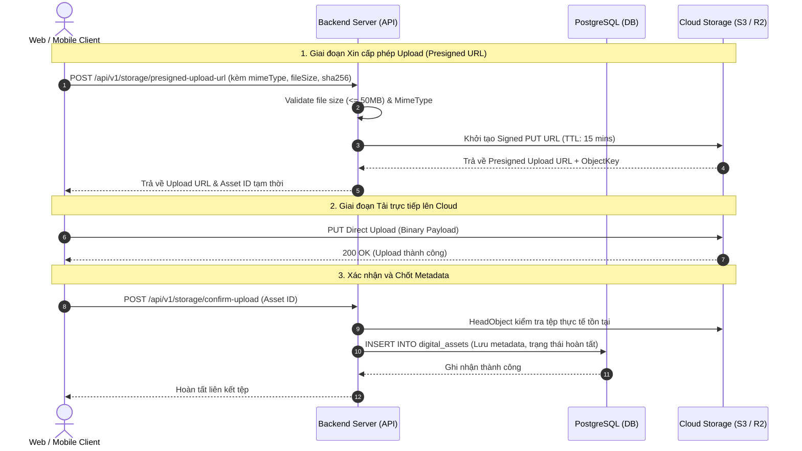

# Module Spec: 10 - Database Schema & Cloud Storage (Cơ sở Dữ liệu & Lưu trữ Đám mây)

## 1. Domain Entities & Database Mapping

Hệ thống sử dụng cơ sở dữ liệu quan hệ **PostgreSQL 16+** kết hợp tiện ích mở rộng **`pgvector`** để quản lý vector nhúng và tìm kiếm tương đồng hình ảnh.

### 1.1 Khởi tạo tiện ích & ENUM types

```sql
CREATE EXTENSION IF NOT EXISTS "uuid-ossp";
CREATE EXTENSION IF NOT EXISTS "pgvector";

-- Định nghĩa các kiểu ENUM dùng chung
CREATE TYPE user_role AS ENUM ('ADMIN', 'ORGANIZER', 'JUDGE', 'PARTICIPANT');
CREATE TYPE contest_status AS ENUM ('DRAFT', 'UPCOMING', 'OPEN', 'JUDGING', 'COMPLETED', 'ARCHIVED');
CREATE TYPE submission_status AS ENUM ('DRAFT', 'SUBMITTED', 'VERIFYING', 'FLAGGED', 'APPROVED', 'REJECTED');
CREATE TYPE storage_provider AS ENUM ('CLOUDFLARE_R2', 'AWS_S3', 'CLOUDINARY');
CREATE TYPE asset_type AS ENUM ('ORIGINAL_SCAN', 'NEGATIVE_PROOF', 'CONTACT_SHEET', 'THUMBNAIL_WEBP', 'WATERMARKED_PREVIEW');
```

---

### 1.2 Bảng `digital_assets` (Quản lý tệp đa phương tiện & Cloud Storage)
Chịu trách nhiệm lưu trữ vị trí thực tế của các tệp ảnh số, ảnh âm bản và bản nén phân phối CDN.

| Tên trường (Column) | Kiểu dữ liệu (Data Type) | Ràng buộc (Constraints) | Ý nghĩa / Ghi chú |
| :--- | :--- | :--- | :--- |
| `id` | `UUID` | `PRIMARY KEY`, Default `gen_random_uuid()` | Khóa chính của asset |
| `storage_provider` | `storage_provider` | `NOT NULL`, `DEFAULT 'CLOUDFLARE_R2'` | Nhà cung cấp lưu trữ đám mây |
| `bucket_name` | `VARCHAR(100)` | `NOT NULL` | Tên S3/R2 Bucket chứa tệp |
| `object_key` | `VARCHAR(512)` | `NOT NULL`, `UNIQUE` | Đường dẫn/Key duy nhất trong bucket |
| `asset_type` | `asset_type` | `NOT NULL` | Phân loại tệp (ảnh scan gốc, âm bản, thumb...) |
| `mime_type` | `VARCHAR(50)` | `NOT NULL` | VD: `image/tiff`, `image/jpeg`, `image/webp` |
| `file_size_bytes` | `BIGINT` | `NOT NULL`, `CHECK (file_size_bytes > 0)` | Kích thước tệp tính theo bytes |
| `sha256_hash` | `CHAR(64)` | `NOT NULL` | Mã băm toàn vẹn tệp để kiểm tra tính nguyên gốc |
| `width_px` | `INT` | `NULL` | Chiều rộng ảnh (pixels) |
| `height_px` | `INT` | `NULL` | Chiều cao ảnh (pixels) |
| `is_encrypted` | `BOOLEAN` | `NOT NULL`, `DEFAULT FALSE` | Đánh dấu ảnh gốc được mã hóa lưu trữ an toàn |
| `created_at` | `TIMESTAMPTZ` | `NOT NULL`, `DEFAULT NOW()` | Thời gian tải lên |

- **Chỉ mục (Indexes):**
  - `idx_digital_assets_sha256` ON (`sha256_hash`)
  - `idx_digital_assets_object_key` ON (`object_key`)

---

### 1.3 Bảng `submissions` & Tích hợp Vector Đặc Trưng
Bảng hạt nhân lưu trữ bài dự thi và vector đặc trưng để tìm kiếm ảnh tương tự với `pgvector`.

```sql
CREATE TABLE submissions (
    id UUID PRIMARY KEY DEFAULT gen_random_uuid(),
    contest_id UUID NOT NULL REFERENCES contests(id) ON DELETE CASCADE,
    participant_id UUID NOT NULL REFERENCES users(id) ON DELETE RESTRICT,
    title VARCHAR(255) NOT NULL,
    description TEXT,
    
    -- Khóa ngoại liên kết tài nguyên ảnh
    original_asset_id UUID NOT NULL REFERENCES digital_assets(id),
    negative_proof_asset_id UUID REFERENCES digital_assets(id),
    thumbnail_asset_id UUID REFERENCES digital_assets(id),
    
    -- Thông số kỹ thuật phim (Analog Metadata)
    film_stock_id UUID NOT NULL REFERENCES master_film_stocks(id),
    camera_model VARCHAR(100) NOT NULL,
    lens_model VARCHAR(100),
    iso_used INT NOT NULL,
    frame_number INT,
    lab_name VARCHAR(150),
    
    -- Điểm số và trạng thái
    status submission_status NOT NULL DEFAULT 'DRAFT',
    final_score DECIMAL(5,2) DEFAULT NULL,
    
    -- Tích hợp Vector Embedding 512 chiều (CLIP / ResNet)
    image_embedding vector(512),
    
    created_at TIMESTAMPTZ NOT NULL DEFAULT NOW(),
    updated_at TIMESTAMPTZ NOT NULL DEFAULT NOW()
);

-- Chỉ mục tìm kiếm vector láng giềng gần nhất (HNSW Index for Cosine Distance)
CREATE INDEX idx_submissions_image_embedding 
ON submissions 
USING hnsw (image_embedding vector_cosine_ops)
WITH (m = 16, ef_construction = 64);
```

---

## 2. Business Rules & Logic Ràng Buộc

| Mã Rule | Tên quy định | Chi tiết logic kỹ thuật & Điều kiện kiểm tra hợp lệ |
| :--- | :--- | :--- |
| **BR-20** | **Kiểm soát Truy cập & URL có thời hạn (Signed / Presigned URLs)** | • **Tuyệt đối không public bucket** ảnh scan gốc (`ORIGINAL_SCAN`) và ảnh âm bản (`NEGATIVE_PROOF`).<br>• Mọi hành động upload từ Web / Mobile App đều phải thông qua **Presigned Upload URL** được máy chủ cấp phát (có hiệu lực trong **15 phút**).<br>• Khi Giám khảo chấm bài, hệ thống cấp phát **Signed Download URL** có hiệu lực tối đa **60 phút**.<br>• Chỉ các ảnh thumbnail và ảnh triển lãm thuộc `Digital Archive` sau khi kết thúc giải mới được phân phối công khai qua CDN. |
| **BR-21** | **Ràng buộc Toàn vẹn Tệp & Giới hạn Kích thước** | • Kích thước tệp tải lên tối đa: **50 MB** đối với ảnh scan (`TIFF`, `JPEG high-quality`) và **20 MB** đối với ảnh âm bản đối chứng.<br>• Phải kiểm tra trùng mã băm `sha256_hash` trên bảng `digital_assets`: Nếu cùng một thí sinh nộp lại tệp byte-to-byte giống hệt, chặn ngay từ khâu tiền xử lý.<br>• Bắt buộc xác minh Content-Type chuẩn thông qua Magic Bytes trên máy chủ sau khi client upload hoàn tất. |
| **BR-22** | **Tối ưu Hóa Truy vấn Vector & Tìm kiếm Tương đồng (Similarity Threshold)** | • Khi truy vấn tìm bài thi tương đồng trong cùng một cuộc thi:<br>  ```sql
  SELECT id, title, 1 - (image_embedding <=> query_vector) AS similarity
  FROM submissions
  WHERE contest_id = :contestId AND id != :currentId
  ORDER BY image_embedding <=> query_vector ASC
  LIMIT 5;
  ```<br>• Sử dụng metric Cosine (`<=>`). Nếu độ tương đồng $> 0.90$, gắn cờ cảnh báo nghi vấn sao chép. |

---

## 3. State Machine & Lifecycle (Vòng đời Tệp & Quá trình Cấp URL)



---

## 4. Shared API Contracts (Dùng chung cho Web & Mobile)

### 4.1 Endpoint 1: Yêu cầu cấp Presigned URL để Upload
- **URL:** `POST /api/v1/storage/presigned-upload`
- **Headers:** `Authorization: Bearer <JWT_TOKEN>`, `Content-Type: application/json`
- **Request Payload:**
```json
{
  "assetType": "ORIGINAL_SCAN",
  "fileName": "rolleiflex_kodak_portra400_01.jpg",
  "mimeType": "image/jpeg",
  "fileSizeBytes": 18452100,
  "sha256": "e3b0c44298fc1c149afbf4c8996fb92427ae41e4649b934ca495991b7852b855"
}
```
- **Response Payload Thành công (201 Created):**
```json
{
  "success": true,
  "data": {
    "assetId": "b1111111-2222-3333-4444-555566667777",
    "uploadUrl": "https://fpc-storage.r2.cloudflarestorage.com/submissions/2026/orig/b111...jpg?X-Amz-Signature=...",
    "objectKey": "submissions/2026/orig/b111...jpg",
    "expiresInSeconds": 900
  }
}
```

---

### 4.2 Endpoint 2: Xác nhận Upload thành công (Confirm Upload)
- **URL:** `POST /api/v1/storage/confirm-upload`
- **Headers:** `Authorization: Bearer <JWT_TOKEN>`
- **Request Payload:**
```json
{
  "assetId": "b1111111-2222-3333-4444-555566667777"
}
```
- **Response Payload (200 OK):**
```json
{
  "success": true,
  "message": "Asset đã được xác minh trên Cloud Storage và kích hoạt thành công.",
  "data": {
    "assetId": "b1111111-2222-3333-4444-555566667777",
    "status": "READY"
  }
}
```

---

### 4.3 Endpoint 3: Lấy Signed Download URL xem ảnh an toàn
- **URL:** `GET /api/v1/storage/assets/{assetId}/signed-url`
- **Headers:** `Authorization: Bearer <JWT_TOKEN>`
- **Response Payload (200 OK):**
```json
{
  "success": true,
  "data": {
    "assetId": "b1111111-2222-3333-4444-555566667777",
    "signedUrl": "https://fpc-cdn.filmcontest.org/private/b111...jpg?token=eyJh...",
    "expiresAt": "2026-10-28T00:30:00Z"
  }
}
```

---

## 5. UI/UX Functional Requirements

### 5.1 Luồng thao tác Direct-to-Cloud Upload
1. Thí sinh chọn tệp ảnh từ máy tính hoặc camera cuộn phim trên điện thoại (Mobile App).
2. Client tự động tính toán mã SHA-256 nhanh (hoặc đọc kích thước tệp/định dạng) trước khi gửi request xin URL.
3. Client thực hiện gửi thẳng luồng nhị phân (Binary Stream) lên Cloudflare R2 / AWS S3 qua **Presigned URL** (giúp máy chủ API không bị nghẽn I/O khi nhận đồng thời nhiều tệp dung lượng lớn).
4. Thanh tiến trình (Upload Progress Bar) hiển thị tỉ lệ phần trăm chính xác ($0\% \to 100\%$) cùng vận tốc tải (MB/s).
5. Khi hoàn tất, client tự động kích hoạt `confirm-upload` để chuyển sang bước điền thông số phim.

### 5.2 Xử lý gián đoạn và Lỗi mạng (Resilience)
- **Hỗ trợ Chunked / Multipart Upload:** Khi dung lượng ảnh scan vượt quá 30 MB, client tự động chia nhỏ thành các chunk 5 MB để nếu mất kết nối giữa chừng có thể tiếp tục tải lại phần bị thiếu mà không phải nộp lại từ đầu.
- **Trạng thái Timeout:** Nếu quá thời hạn 15 phút của Presigned URL mà client chưa hoàn thành, giao diện thông báo *"Phiên tải lên hết hạn, đang tự động gia hạn đường truyền..."* và tự lấy token mới trong suốt với người dùng.
