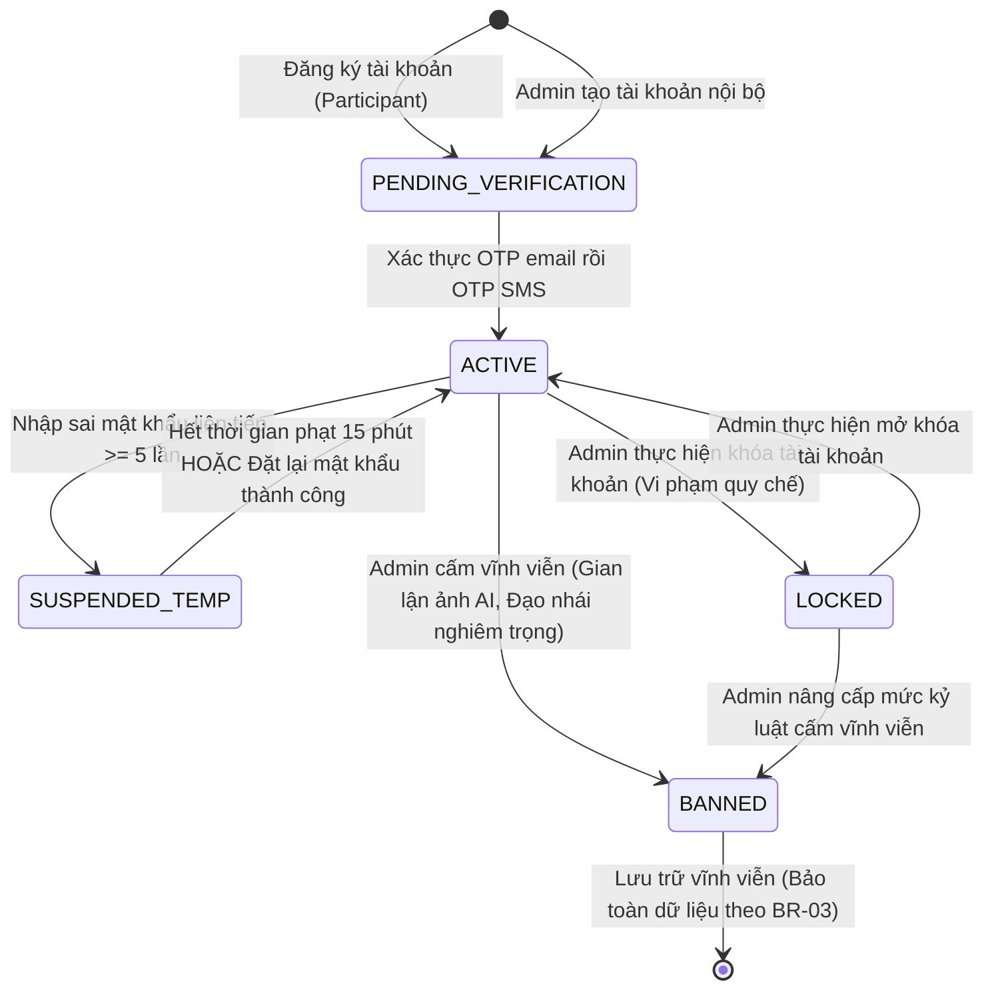
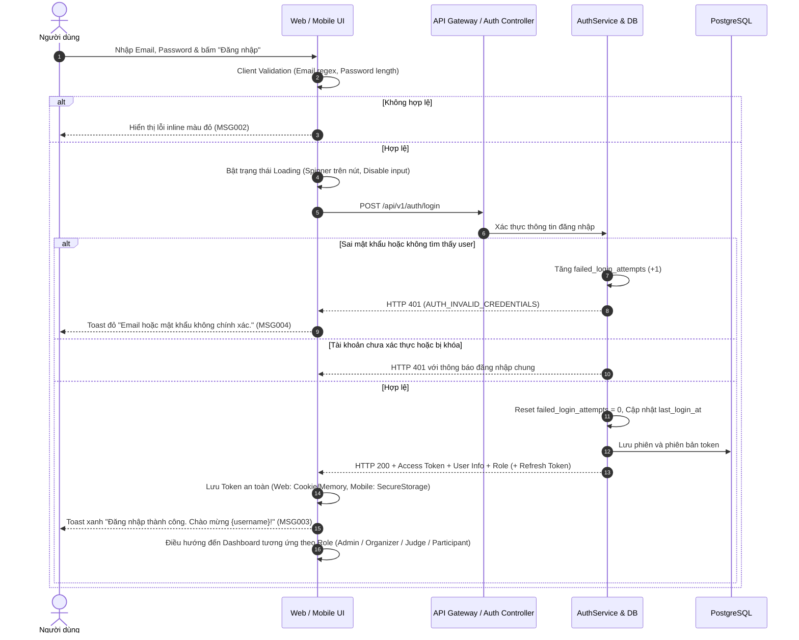

# Module Spec: 01-auth-and-rbac.md

## Phạm vi theo SRS hiện hành

**UC-01–05, BR-01/02/04.** Participant tự đăng ký bằng email duy nhất và mật khẩu; email phải được xác minh trước khi đăng nhập. Số điện thoại tùy chọn. Admin tạo tài khoản nội bộ hoặc gán một trong bốn vai trò cố định. Giữ JWT access/refresh, logout, reset qua email, khóa tài khoản và kiểm tra quyền tài nguyên.

Backend dùng `POST /auth/register`, `/auth/verify-email`, `/auth/resend-verification`, `/auth/login`, `/auth/logout`, `/auth/forgot-password` và `/auth/reset-password` dưới `/api/v1`. Xác minh email thành công trả `data.status: ACTIVE`. Các tài khoản cũ được miễn xác minh theo cờ hiện có. Web và Mobile có bước nhập mã sau đăng ký. Nếu đăng nhập đúng mật khẩu khi email chưa xác minh, người dùng có thể nhập mã cũ hoặc chủ động yêu cầu gửi lại. API đọc quyền từ ma trận cố định; bảng grant cũ được giữ để bảo toàn dữ liệu. Web và Mobile yêu cầu khôi phục qua email. Liên kết mở màn đặt lại mật khẩu trên Web.

UC-05 dùng `PATCH /api/v1/users/{id}/role` với mã `ADMIN`, `ORGANIZER`, `JUDGE` hoặc `PARTICIPANT`. Admin gán vai trò cho tài khoản khác. API thay các liên kết vai trò trong transaction, thu hồi phiên và ghi audit khi có thay đổi.

## Thiết kế trước lần cập nhật SRS

> Tham chiếu lịch sử để truy vết thiết kế và các hợp đồng cũ. Yêu cầu nghiệp vụ hiện hành nằm trong [SRS](../srs.md) và mục trên.

## Phạm vi nghiệm thu và trạng thái hiện tại

Backend đã đăng ký các API UC-01–05. Migration bổ sung phiên bản đăng nhập, định danh và thách thức xác thực, hồ sơ, audit tài khoản, cấu hình grant và định danh phiên. Nhà cung cấp email/SMS thật và luồng đăng ký trên Web/Mobile cần nghiệm thu riêng. SRS [BR-01](../srs.md#61-business-rules) yêu cầu email và số điện thoại đã xác thực. Luồng chọn xác thực email trước và chỉ gửi SMS sau khi email hợp lệ.

Máy chủ dùng PostgreSQL để kiểm tra phiên và quyền. Tài khoản có từ trước migration vẫn đăng nhập được và có thể bổ sung định danh qua route gửi lại xác thực. Khôi phục mật khẩu chỉ gửi link sau khi email đã xác thực. Kiểm thử thu hồi phiên gồm khóa/mở khóa, logout đồng thời với refresh, đổi/reset mật khẩu và thay đổi quyền role.

## 1. Domain Entities & Database Mapping

Các bảng trong mục này mô tả mô hình thiết kế. Mã hiện dùng `users` cho tài khoản, `users.profile` cho thông tin hồ sơ, `user_roles` cho vai trò, `account_challenges` cho mã xác thực và `account_audit_logs` cho vết quản trị. Đối chiếu với [schema Drizzle](../../apps/api/src/db/schema.ts).

Hệ thống cơ sở dữ liệu sử dụng **PostgreSQL 16+** (hỗ trợ native `UUIDv7` hoặc extension `pgcrypto`/`uuid-ossp`). Toàn bộ khóa chính (PK) được định dạng `UUID` nhằm đảm bảo tính phân tán và bảo mật ID. Thời gian được lưu trữ theo chuẩn `TIMESTAMPTZ` (UTC). Quy ước đặt tên bảng và cột theo chuẩn `snake_case`.

---

### 1.1 Bảng `roles`
Bảng danh mục định nghĩa 4 vai trò tác nhân cốt lõi trong toàn bộ hệ thống FilmContest-AI.
- **Table Name**: `roles`
- **Mô tả**: Lưu trữ danh mục vai trò (`ADMIN`, `ORGANIZER`, `JUDGE`, `PARTICIPANT`).

| Field Name | Data Type | Constraint | Default | Description |
| :--- | :--- | :--- | :--- | :--- |
| `id` | `UUID` | PK, Not Null | `gen_random_uuid()` | Khóa chính định danh vai trò |
| `code` | `VARCHAR(50)` | UQ, Not Null | *None* | Mã định danh vai trò: `ADMIN`, `ORGANIZER`, `JUDGE`, `PARTICIPANT` |
| `name` | `VARCHAR(100)` | Not Null | *None* | Tên hiển thị của vai trò (Quản trị viên, Ban tổ chức, Giám khảo, Thí sinh) |
| `description` | `TEXT` | Nullable | `NULL` | Mô tả chi tiết phạm vi trách nhiệm của vai trò |
| `is_system` | `BOOLEAN` | Not Null | `TRUE` | Cờ bảo vệ: `TRUE` nếu là vai trò hệ thống không được phép xóa |
| `created_at` | `TIMESTAMPTZ` | Not Null | `CURRENT_TIMESTAMP` | Thời điểm tạo bản ghi |
| `updated_at` | `TIMESTAMPTZ` | Not Null | `CURRENT_TIMESTAMP` | Thời điểm cập nhật bản ghi gần nhất |

---

### 1.2 Bảng `permissions`
Quản lý các đặc quyền truy cập chi tiết (granular permissions) theo mô hình Resource-Action.
- **Table Name**: `permissions`
- **Mô tả**: Danh mục quyền hạn chi tiết gắn với từng module và hành động trong hệ thống.

| Field Name | Data Type | Constraint | Default | Description |
| :--- | :--- | :--- | :--- | :--- |
| `id` | `UUID` | PK, Not Null | `gen_random_uuid()` | Khóa chính định danh quyền hạn |
| `code` | `VARCHAR(100)` | UQ, Not Null | *None* | Mã quyền duy nhất (VD: `users:read`, `contests:create`, `evaluations:submit`) |
| `resource` | `VARCHAR(50)` | Not Null | *None* | Tên tài nguyên (`auth`, `users`, `roles`, `master_data`, `contests`, `submissions`, `evaluations`, `archive`, `ai_engine`, `audit_logs`) |
| `action` | `VARCHAR(50)` | Not Null | *None* | Thao tác (`create`, `read`, `update`, `delete`, `approve`, `execute`, `lock`) |
| `description` | `VARCHAR(255)` | Not Null | *None* | Diễn giải chức năng nghiệp vụ của quyền |
| `created_at` | `TIMESTAMPTZ` | Not Null | `CURRENT_TIMESTAMP` | Thời điểm tạo bản ghi |

---

### 1.3 Bảng `role_permissions`
Bảng liên kết Nhiều - Nhiều (N-N) giữa Vai trò và Quyền hạn.
- **Table Name**: `role_permissions`
- **Mô tả**: Gán tập hợp các đặc quyền chi tiết cho từng vai trò cụ thể.

| Field Name | Data Type | Constraint | Default | Description |
| :--- | :--- | :--- | :--- | :--- |
| `role_id` | `UUID` | PK, FK, Not Null | *None* | Khóa ngoại tham chiếu `roles(id)` ON DELETE CASCADE |
| `permission_id` | `UUID` | PK, FK, Not Null | *None* | Khóa ngoại tham chiếu `permissions(id)` ON DELETE CASCADE |
| `assigned_at` | `TIMESTAMPTZ` | Not Null | `CURRENT_TIMESTAMP` | Thời điểm gán quyền |

> **Chỉ mục (Indexes)**:
> - `CREATE INDEX idx_role_permissions_role_id ON role_permissions(role_id);`
> - `CREATE INDEX idx_role_permissions_permission_id ON role_permissions(permission_id);`

---

### 1.4 Bảng `accounts`
Thực thể định danh trung tâm cho toàn bộ người dùng đăng nhập vào hệ thống FilmContest-AI.
- **Table Name**: `accounts`
- **Mô tả**: Lưu thông tin đăng nhập, trạng thái tài khoản và thông tin phục vụ cơ chế JWT Token Invalidation (`token_version`).

| Field Name | Data Type | Constraint | Default | Description |
| :--- | :--- | :--- | :--- | :--- |
| `id` | `UUID` | PK, Not Null | `gen_random_uuid()` | Khóa chính định danh tài khoản người dùng |
| `email` | `VARCHAR(255)` | UQ, Not Null | *None* | Địa chỉ email đăng nhập (chuẩn RFC 5322, viết thường - lowercase) |
| `phone_number` | `VARCHAR(20)` | UQ, Nullable | `NULL` | Số điện thoại liên hệ (chuẩn E.164, bắt buộc 10 số tại VN) |
| `password_hash` | `VARCHAR(255)` | Not Null | *None* | Mật khẩu băm an toàn (Argon2id hoặc BCrypt với cost factor >= 12) |
| `role_id` | `UUID` | FK, Not Null | *None* | Khóa ngoại tham chiếu `roles(id)` ON DELETE RESTRICT |
| `status` | `VARCHAR(30)` | Not Null | `'PENDING_VERIFICATION'` | Trạng thái: `PENDING_VERIFICATION`, `ACTIVE`, `SUSPENDED_TEMP`, `LOCKED`, `BANNED` |
| `token_version` | `INTEGER` | Not Null | `1` | Phiên bản Token. Tự động tăng (+1) khi đổi mật khẩu, đổi quyền hoặc bị khóa (BR-04) |
| `failed_login_attempts`| `SMALLINT` | Not Null | `0` | Số lần đăng nhập sai liên tiếp (Reset về 0 khi đăng nhập thành công) |
| `locked_until` | `TIMESTAMPTZ` | Nullable | `NULL` | Thời điểm hết hạn khóa tạm thời do nhập sai mật khẩu quá 5 lần |
| `email_verified_at`| `TIMESTAMPTZ` | Nullable | `NULL` | Thời điểm xác thực email thành công |
| `phone_verified_at`| `TIMESTAMPTZ` | Nullable | `NULL` | Thời điểm xác thực số điện thoại |
| `last_login_at` | `TIMESTAMPTZ` | Nullable | `NULL` | Thời điểm đăng nhập thành công gần nhất |
| `last_login_ip` | `VARCHAR(45)` | Nullable | `NULL` | Địa chỉ IP đăng nhập gần nhất (Hỗ trợ IPv4 và IPv6) |
| `created_at` | `TIMESTAMPTZ` | Not Null | `CURRENT_TIMESTAMP` | Thời điểm khởi tạo tài khoản |
| `updated_at` | `TIMESTAMPTZ` | Not Null | `CURRENT_TIMESTAMP` | Thời điểm cập nhật tài khoản gần nhất |
| `deleted_at` | `TIMESTAMPTZ` | Nullable | `NULL` | Thời điểm xóa mềm tài khoản (Soft delete theo quy tắc BR-03) |

> **Chỉ mục (Indexes)**:
> - `CREATE UNIQUE INDEX uq_accounts_email_active ON accounts(LOWER(email)) WHERE deleted_at IS NULL;`
> - `CREATE UNIQUE INDEX uq_accounts_phone_active ON accounts(phone_number) WHERE deleted_at IS NULL AND phone_number IS NOT NULL;`
> - `CREATE INDEX idx_accounts_role_id ON accounts(role_id);`
> - `CREATE INDEX idx_accounts_status ON accounts(status);`

---

### 1.5 Bảng `participant_profiles`
Lưu trữ thông tin chuyên biệt cho đối tượng Thí sinh / Nhiếp ảnh gia phim.
- **Table Name**: `participant_profiles`
- **Mô tả**: Mở rộng thông tin cá nhân nghệ thuật, phong cách chụp và portfolio ảnh phim (Quan hệ 1-1 với `accounts`).

| Field Name | Data Type | Constraint | Default | Description |
| :--- | :--- | :--- | :--- | :--- |
| `id` | `UUID` | PK, Not Null | `gen_random_uuid()` | Khóa chính hồ sơ thí sinh |
| `account_id` | `UUID` | UQ, FK, Not Null | *None* | Khóa ngoại tham chiếu `accounts(id)` ON DELETE CASCADE |
| `full_name` | `VARCHAR(150)` | Not Null | *None* | Họ và tên thật của thí sinh |
| `display_name` | `VARCHAR(100)` | Nullable | `NULL` | Nghệ danh / Tên hiển thị công khai trên Portfolio |
| `avatar_url` | `VARCHAR(500)` | Nullable | `NULL` | Đường dẫn CDN ảnh đại diện |
| `bio` | `TEXT` | Nullable | `NULL` | Giới thiệu ngắn về phong cách chụp ảnh phim / Tuyên ngôn nghệ thuật |
| `experience_level` | `VARCHAR(50)` | Not Null | `'AMATEUR'` | Trình độ: `NOVICE`, `AMATEUR`, `ENTHUSIAST`, `PROFESSIONAL` |
| `primary_film_format`| `VARCHAR(50)` | Nullable | `'35MM'` | Khổ phim sở trường: `35MM`, `120_MEDIUM_FORMAT`, `LARGE_FORMAT`, `MULTIPLE` |
| `favorite_film_stocks`| `JSONB` | Nullable | `'[]'::jsonb` | Mảng danh sách tên film stock ưa chuộng (VD: `["Kodak Portra 400", "Ilford HP5+"]`) |
| `portfolio_website`| `VARCHAR(255)` | Nullable | `NULL` | Đường dẫn trang web portfolio cá nhân |
| `instagram_handle` | `VARCHAR(100)` | Nullable | `NULL` | Tên tài khoản Instagram cá nhân |
| `address_country` | `VARCHAR(100)` | Not Null | `'Vietnam'` | Quốc gia cư trú |
| `address_city` | `VARCHAR(100)` | Nullable | `NULL` | Tỉnh / Thành phố cư trú |
| `created_at` | `TIMESTAMPTZ` | Not Null | `CURRENT_TIMESTAMP` | Thời điểm tạo hồ sơ |
| `updated_at` | `TIMESTAMPTZ` | Not Null | `CURRENT_TIMESTAMP` | Thời điểm cập nhật hồ sơ gần nhất |

---

### 1.6 Bảng `refresh_tokens` (Quản trị phiên & Token Rotation)
- **Table Name**: `refresh_tokens`
- **Mô tả**: Lưu trữ token làm mới phiên đăng nhập nhằm kiểm soát vòng đời phiên, phát hiện hành vi tái sử dụng token trái phép (Token Reuse Detection) và hỗ trợ thu hồi tức thì theo BR-04.

| Field Name | Data Type | Constraint | Default | Description |
| :--- | :--- | :--- | :--- | :--- |
| `id` | `UUID` | PK, Not Null | `gen_random_uuid()` | Khóa chính bản ghi phiên làm mới |
| `account_id` | `UUID` | FK, Not Null | *None* | Khóa ngoại tham chiếu `accounts(id)` ON DELETE CASCADE |
| `token_hash` | `VARCHAR(255)` | UQ, Not Null | *None* | Chuỗi băm SHA-256 của Refresh Token |
| `device_fingerprint` | `VARCHAR(255)` | Nullable | `NULL` | Dấu vân tay thiết bị (Browser / Mobile Device ID) |
| `user_agent` | `TEXT` | Nullable | `NULL` | Thông tin trình duyệt / hệ điều hành của client |
| `ip_address` | `VARCHAR(45)` | Nullable | `NULL` | Địa chỉ IP khởi tạo phiên |
| `expires_at` | `TIMESTAMPTZ` | Not Null | *None* | Thời điểm hết hạn (7 ngày kể từ lúc cấp) |
| `revoked_at` | `TIMESTAMPTZ` | Nullable | `NULL` | Thời điểm bị thu hồi (Do logout hoặc tài khoản bị khóa) |
| `replaced_by_token_id`| `UUID` | FK, Nullable | `NULL` | ID của refresh token mới thay thế (Cơ chế Token Rotation) |
| `created_at` | `TIMESTAMPTZ` | Not Null | `CURRENT_TIMESTAMP` | Thời điểm phát hành |

> **Chỉ mục (Indexes)**:
> - `CREATE INDEX idx_refresh_tokens_account_id ON refresh_tokens(account_id);`
> - `CREATE UNIQUE INDEX uq_refresh_tokens_token_hash ON refresh_tokens(token_hash);`

---

## 2. Business Rules & Logic Ràng Buộc

### 2.1 Trích xuất Business Rules từ SRS
Hệ thống xác thực và phân quyền RBAC kế thừa và tuân thủ chặt chẽ các quy định từ tài liệu SRS:

- **BR-01 (Định danh duy nhất)**: Mỗi người dùng (Admin, Organizer, Judge, Participant) chỉ sở hữu duy nhất một tài khoản định danh qua Email chuẩn RFC và Số điện thoại đã xác thực. Tuyệt đối không cho phép tạo nhiều tài khoản cùng một địa chỉ email hoặc cùng số điện thoại đang hoạt động.
- **BR-02 (Nguyên tắc Phân quyền RBAC)**: Người dùng chỉ được phép truy cập màn hình, menu và API tương ứng với Vai trò (`Role`) và Đặc quyền (`Permission`) đã được cấp phát. Tầng API Gateway / Backend Middleware bắt buộc kiểm tra phân quyền độc lập trên từng endpoint.
- **BR-03 (Bảo toàn dữ liệu - Soft Delete)**: Dữ liệu quan trọng (bao gồm tài khoản người dùng, nhật ký cuộn phim, lịch sử chấm điểm) không bao giờ bị xóa vật lý (`DELETE`) khỏi cơ sở dữ liệu mà chỉ chuyển trạng thái sang `LOCKED`, `BANNED` hoặc cập nhật trường `deleted_at`.
- **BR-04 (Thu hồi phiên tức thì khi khóa tài khoản)**: Phiên đăng nhập của Giám khảo, Quản trị viên và toàn bộ người dùng được bảo vệ bằng JWT. Khi một tài khoản bị khóa (`LOCKED`), cấm (`BANNED`), đổi mật khẩu hoặc điều chỉnh quyền:
  1. Tăng `users.token_version` và thu hồi refresh token hoạt động trong cùng transaction PostgreSQL.
  2. Middleware đối chiếu phiên bản JWT, phiên còn hiệu lực và trạng thái tài khoản với PostgreSQL. Request mới dùng token cũ bị từ chối ngay sau khi transaction commit.
- **BR-21 (Kiểm soát Xung đột lợi ích - Conflict of Interest)**: Một tài khoản đã được phân công vai trò `JUDGE` hoặc `ORGANIZER` trong một cuộc thi cụ thể sẽ bị hệ thống chặn tự động không cho phép đăng ký làm `PARTICIPANT` (nộp bài dự thi) trong chính cuộc thi đó.

---

### 2.2 Bảng Ma trận Phân quyền (RBAC Permission Matrix)

Ma trận bên dưới mô tả quyền đích theo SRS. Danh mục chỉnh được qua API áp dụng cho các route đã có trong [permission policy](../../apps/api/src/services/permission-policy.ts). Quyền luôn bị giới hạn bởi Actor và phạm vi tài nguyên.

| Tài nguyên (Resource) | Quyền hạn (Permission Code) | Admin | Organizer | Judge | Participant | Điều kiện ràng buộc & Ghi chú |
| :--- | :--- | :---: | :---: | :---: | :---: | :--- |
| **Authentication** | `auth:register` | ✗ | ✗ | ✗ | ✓ | Public endpoint chỉ dành cho Thí sinh tự do |
| | `auth:login` | ✓ | ✓ | ✓ | ✓ | Cả 4 Actor đăng nhập qua cổng tương ứng |
| | `auth:refresh` | ✓ | ✓ | ✓ | ✓ | Đổi Access Token mới khi Refresh Token còn hạn |
| | `auth:logout` | ✓ | ✓ | ✓ | ✓ | Thu hồi Refresh Token hiện hành |
| | `auth:recover_password` | ✓ | ✓ | ✓ | ✓ | Gửi liên kết đặt lại mật khẩu qua email |
| **User Profile** | `users:read_own_profile` | ✓ | ✓ | ✓ | ✓ | Đọc thông tin tài khoản và hồ sơ của chính mình |
| | `users:update_own_profile`| ✓ | ✓ | ✓ | ✓ | Cập nhật hồ sơ cá nhân và đổi avatar |
| | `users:change_password` | ✓ | ✓ | ✓ | ✓ | Đổi mật khẩu (yêu cầu mật khẩu cũ chính xác) |
| **User Management** | `users:read_all` | ✓ | ✗ | ✗ | ✗ | Xem danh sách toàn bộ người dùng và lọc theo role |
| | `users:create_internal` | ✓ | ✗ | ✗ | ✗ | Khởi tạo tài khoản Organizer, Judge, Admin nội bộ |
| | `users:lock_unlock` | ✓ | ✗ | ✗ | ✗ | Khóa / Mở khóa tài khoản (Kích hoạt BR-04) |
| | `users:soft_delete` | ✓ | ✗ | ✗ | ✗ | Đánh dấu xóa mềm tài khoản (BR-03) |
| **Role & RBAC** | `roles:manage` | ✓ | ✗ | ✗ | ✗ | Tạo, sửa vai trò và ma trận quyền hạn |
| **Master Data** | `master_data:create_update`| ✓ | ✗ | ✗ | ✗ | Quản lý danh mục Film Stock, Camera, Lens, Lab |
| | `master_data:read` | ✓ | ✓ | ✓ | ✓ | Đọc danh mục phục vụ chọn nhanh khi nộp bài |
| **Contest** | `contests:create_update` | ✗ | ✓ | ✗ | ✗ | Khởi tạo, cập nhật cấu hình cuộc thi (UC-11, UC-12) |
| | `contests:read_all` | ✓ | ✓ | ✓ | ✓ | Xem thông tin cuộc thi và thể lệ mở |
| | `contests:register` | ✗ | ✗ | ✗ | ✓ | Đăng ký tham gia cuộc thi (Kiểm tra chặn BR-21) |
| **Analog Logbook** | `film_logs:manage_own` | ✗ | ✗ | ✗ | ✓ | Tạo cuộn phim và ghi chú frame 1-36 (Chỉ tác giả) |
| **Submission** | `submissions:submit_entry` | ✗ | ✗ | ✗ | ✓ | Nộp ảnh scan kèm siêu dữ liệu kỹ thuật phim |
| | `submissions:upload_proof` | ✗ | ✗ | ✗ | ✓ | Tải ảnh dải phim âm bản đối chứng (BR-06, BR-19) |
| | `submissions:moderate_all` | ✗ | ✓ | ✗ | ✗ | Duyệt bài, Yêu cầu âm bản, Loại bài (BR-18) |
| | `submissions:blind_view` | ✗ | ✗ | ✓ | ✗ | Xem ảnh ở chế độ ẩn danh kép (Ẩn 100% PII - BR-12) |
| **Judging / Score**| `evaluations:score_entry` | ✗ | ✗ | ✓ | ✗ | Chấm điểm độc lập theo trọng số tiêu chí (BR-15) |
| | `evaluations:lock_sheet` | ✗ | ✗ | ✓ | ✗ | Khóa bảng điểm cá nhân vòng thi (BR-13) |
| | `evaluations:discrepancy` | ✗ | ✓ | ✗ | ✗ | Điều phối bài thi có độ lệch điểm > 30% (BR-14) |
| **AI Verification** | `ai:configure_thresholds` | ✓ | ✗ | ✗ | ✗ | Cấu hình ngưỡng xác suất $P_{AI}$ và pHash (UC-09) |
| | `ai:view_scan_reports` | ✓ | ✓ | ✗ | ✗ | Xem báo cáo nghi vấn ảnh AI và ảnh trùng lặp |
| **Audit Logs** | `audit_logs:read` | ✓ | ✗ | ✗ | ✗ | Tra cứu lịch sử thao tác nhạy cảm hệ thống (CR-04) |

---

### 2.3 Ràng buộc Xác thực Dữ liệu (Validation Constraints)

#### 1. Chính sách Mật khẩu (Password Policy)
- **Độ dài**: Tối thiểu 8 ký tự, tối đa 128 ký tự.
- **Quy tắc ký tự bắt buộc**:
  - Tối thiểu 1 chữ cái viết hoa (`A-Z`).
  - Tối thiểu 1 chữ cái viết thường (`a-z`).
  - Tối thiểu 1 chữ số (`0-9`).
  - Tối thiểu 1 ký tự đặc biệt (`!@#$%^&*()_+\-=\[\]{};':"\\|,.<>\/?`).
- **Ràng buộc an toàn**. Khi tạo tài khoản, mật khẩu không được chứa tiền tố email dài từ ba ký tự. Kiểm tra danh sách mật khẩu phổ biến và chuỗi tên người dùng vẫn là phần tăng cường chưa triển khai.

#### 2. Chuẩn hóa Email & Số điện thoại

- Email được cắt khoảng trắng, chuyển chữ thường rồi kiểm tra định dạng.
- Số điện thoại chấp nhận E.164 hoặc dạng nội địa Việt Nam 10 chữ số. Backend chuẩn hóa sang E.164 và giữ duy nhất số đã xác thực.

#### 3. Quy chuẩn Token JWT (JSON Web Token)

- Access token dùng HS256, hiệu lực 15 phút. Payload có `id`, `role`, `tokenVersion`, `sessionId`, `iat` và `exp`. Quyền hiện hành được đọc từ Backend.
- Refresh token là chuỗi ngẫu nhiên 48 byte dạng base64url, hiệu lực 7 ngày. Backend lưu SHA-256. Refresh thu hồi token đã dùng và cấp cặp mới trong cùng phiên. Dùng lại token đã thu hồi trả HTTP 401.
- JWT trước migration thiếu phiên bản được đọc như phiên bản 0 cho đến khi hết hạn hoặc tài khoản bị thu hồi phiên.
- Client lưu token trong vùng lưu trữ phù hợp, ví dụ Flutter Secure Storage trên thiết bị.

#### 4. Quy tắc Chặn Đăng nhập vét cạn (Brute-force Lockout)

Sau 5 lần nhập sai liên tiếp, Backend khóa đăng nhập 15 phút và thu hồi phiên. API dùng chung thông báo HTTP 401 cho các trường hợp đăng nhập bị từ chối. Đăng nhập thành công, mở khóa hoặc đặt lại mật khẩu xóa bộ đếm tương ứng.

---

## 3. State Machine & Lifecycle

### 3.1 Sơ đồ Chuyển đổi Trạng thái Tài khoản (Mermaid Diagram)

---

### 3.2 Bảng Đặc tả Chuyển đổi Trạng thái (State Transition Table)

| Current State | Event / Trigger Action | Next State | Allowed Actor | Guard Condition (Điều kiện tiên quyết) | Side Effects (Xử lý hệ thống & Hiệu ứng phụ) |
| :--- | :--- | :--- | :--- | :--- | :--- |
| `[*]` (None) | `REGISTER_SUBMIT` | `PENDING_VERIFICATION` | Guest (Public) | Email & SĐT chưa tồn tại (BR-01). Mật khẩu đạt Password Policy. | Tạo bản ghi `accounts` và `participant_profiles`. Sinh mã xác thực OTP gửi qua email. |
| `[*]` (None) | `ADMIN_CREATE_USER` | `PENDING_VERIFICATION` | Administrator | Actor có quyền `users:create_internal`. Role được gán hợp lệ (`ORGANIZER`, `JUDGE`, `ADMIN`). | Admin nhập mật khẩu tạm thời. Backend tạo tài khoản và gửi OTP email xác thực. |
| `PENDING_VERIFICATION` | Xác thực email rồi điện thoại | `ACTIVE` | Chủ tài khoản | Mỗi OTP khớp, còn hạn và chưa dùng. | Ghi thời điểm xác thực theo kênh. Cho phép đăng nhập sau OTP điện thoại. |
| `ACTIVE` | `LOGIN_FAILED_5_TIMES` | `SUSPENDED_TEMP` | System (Automated) | `failed_login_attempts >= 5`. | Đặt `locked_until` trong 15 phút và thu hồi phiên. |
| `SUSPENDED_TEMP` | `LOCKOUT_EXPIRED` | `ACTIVE` | System (Automated) | `NOW() > accounts.locked_until`. | Reset `failed_login_attempts = 0`, `locked_until = NULL`. |
| `SUSPENDED_TEMP` | `RESET_PASSWORD_SUCCESS`| `ACTIVE` | Guest / Owner | Xác minh liên kết khôi phục mật khẩu thành công qua email. | Cập nhật mật khẩu mới, tăng `token_version` + 1, thu hồi các phiên cũ. |
| `ACTIVE` | `ADMIN_LOCK_ACCOUNT` | `LOCKED` | Administrator | Actor có quyền `users:lock_unlock`. Không được tự khóa chính mình. Lý do khóa bắt buộc nhập >= 10 ký tự. | Tăng `token_version` + 1. Đặt `revoked_at = NOW()` cho toàn bộ refresh token. Middleware đọc trạng thái phiên và phiên bản token trong PostgreSQL (BR-04). Ghi AuditLog. |
| `LOCKED` | `ADMIN_UNLOCK_ACCOUNT` | `ACTIVE` | Administrator | Actor có quyền `users:lock_unlock`. Bắt buộc nhập lý do mở khóa. | Chuyển `status = 'ACTIVE'`, reset `failed_login_attempts = 0`. Ghi AuditLog. |
| `ACTIVE` hoặc `LOCKED` | `ADMIN_BAN_ACCOUNT` | `BANNED` | Administrator | Actor có quyền `users:lock_unlock`. Bắt buộc có biên bản xử lý vi phạm nghiêm trọng (Ảnh AI / Đạo nhái). | Khóa vĩnh viễn, tăng `token_version` + 1, hủy toàn bộ token. Ghi AuditLog. |

---

## 4. Shared API Contracts (Dùng chung cho Web & Mobile)

Các route dưới đây đã được đăng ký. Request JSON dùng `Content-Type: application/json`. Phản hồi dùng envelope `{ code, message, data }`. Các route riêng tư dùng Bearer access token. Xem schema trong [OpenAPI](../openapi.yaml).

| Method và path dưới `/api/v1` | Đầu vào và điều kiện | Dữ liệu trả về |
| --- | --- | --- |
| `POST /auth/register` | Public. `fullName`, `email`, `phoneNumber`, `password`. Backend gán Participant. | `201`, `{ user, status: "PENDING_VERIFICATION", deliveryStatus }`. |
| `POST /auth/verify-email` | Public. `email`, `code` sáu chữ số. Xác thực email rồi mới gửi SMS. | `200`, `{ status: "PENDING_VERIFICATION", deliveryStatus }`. |
| `POST /auth/verify-phone` | Public. `email`, `code` sáu chữ số. Yêu cầu email đã xác thực. | `200`, `{ status: "ACTIVE" }`. Client gọi login để lấy phiên. |
| `POST /auth/resend-verification` | Public. `email` và `password`. Có thể gửi `phoneNumber` nếu điện thoại chưa xác thực, kể cả khi bổ sung định danh cho tài khoản cũ. Gửi lại kênh đang chờ. | `200`, `{ deliveryStatus }`. |
| `POST /auth/login` | Public. `email`, `password`. Tài khoản mới phải xác thực đủ hai kênh. | `200`, `{ user, accessToken, refreshToken }`. |
| `POST /auth/refresh` | Public. `refreshToken` hiện hành. Refresh token dùng một lần. | `200`, `{ accessToken, refreshToken }`. |
| `POST /auth/logout` | Public. `refreshToken` của phiên cần đăng xuất. Có thể gọi lại. | `200`, `data: null`. Phiên tương ứng bị thu hồi. |
| `POST /auth/forgot-password` | Public. `email`. Tài khoản hoạt động có email đã xác thực mới nhận link. | `200` với cùng nội dung cho mọi email hợp lệ. |
| `POST /auth/reset-password` | Public. `token`, `newPassword`, `confirmPassword`. Token một lần trong 15 phút. | `200`, `data: null`. Sau khi reset, đăng nhập lại. |
| `GET /auth/me`, `GET /users/me` | Bearer, quyền `users:read_own_profile`. Hai đường dẫn dùng chung handler. | `200`, `{ user }` gồm thông tin tài khoản, ảnh đại diện, định danh đã xác thực và `profile`. |
| `PUT /users/me/profile` | Bearer, quyền `users:update_own_profile`. Nhận các trường cập nhật gồm `fullName`, `avatarUrl`, `displayName`, `bio`, `experienceLevel`, `primaryFilmFormat`, `favoriteFilmStocks`, `portfolioWebsite`, `instagramHandle`, `addressCity`. | `200`, `{ updatedAt }`. Dùng GET /me để đọc hồ sơ mới. |
| `PATCH /users/me/password` | Bearer, quyền `users:change_password`. `currentPassword`, `newPassword`. | `200`, `data: null`. Thu hồi toàn bộ phiên, gồm phiên hiện tại. |
| `GET /users` | Admin có quyền `users:read_all`. Lọc theo `search`, `role`, `status`; phân trang `page`, `limit`. | `200`, `{ items, page, limit, totalRecords, totalPages }`. |
| `POST /users` | Admin có quyền `users:create_internal`. `fullName`, `email`, `phoneNumber`, `role` (ADMIN/ORGANIZER/JUDGE), `temporaryPassword`. | `201`, thông tin tài khoản, `status: "PENDING_VERIFICATION"` và `deliveryStatus`. Gửi mã kích hoạt qua email. |
| `PATCH /users/{id}/status` | Admin có quyền `users:lock_unlock`. `status` ACTIVE/LOCKED/BANNED và `reason` 10–500 ký tự. | `200`, các trạng thái trước/sau, phiên bản token, số phiên bị thu hồi và giờ cập nhật. |
| `GET /rbac/roles` | Admin. | Bốn role, mỗi mục gồm `role`, `availablePermissions`, `permissions`. |
| `PUT /rbac/roles/{role}/permissions` | Admin. `{ permissions: string[] }` thay danh sách grant của role. Chỉ nhận quyền trong `availablePermissions`. | `200`, `{ role, permissions }`. Ghi vết và thu hồi phiên của thành viên role khi quyền thay đổi. |

- `deliveryStatus` là `ACCEPTED` khi nhà cung cấp nhận yêu cầu gửi, hoặc `RETRY_REQUIRED` khi cần gửi lại. Backend lưu tiến độ xác thực qua lỗi nhà cung cấp.
- Đăng ký và tài khoản nội bộ yêu cầu mật khẩu từ 8 đến 128 ký tự với chữ hoa, chữ thường, chữ số và ký tự đặc biệt. Số điện thoại lưu dạng E.164. OTP email hiệu lực 15 phút và chỉ lưu dạng băm có khóa. OTP SMS do Twilio Verify gửi và kiểm tra, với thời hạn kiểm tra tối đa 10 phút ở Backend. Mỗi yêu cầu hỗ trợ tối đa 5 lần thử, gửi lại cách nhau ít nhất 60 giây.
- `400` áp dụng cho đầu vào sai hoặc mã không hợp lệ, `401` cho phiên không hợp lệ, `403` cho thiếu quyền và `409` cho xung đột định danh/trạng thái. Backend giữ thông điệp đăng nhập thất bại chung.
- `GET /auth/portfolio` phục vụ bộ sưu tập bài thi của Participant trong [Module 08](08-archive-and-exhibition.md).

## 5. UI/UX Functional Requirements

### 5.1 Luồng Thao tác Người dùng (User Journey Flows)

#### 1. Luồng Đăng nhập (Web & Mobile Login Flow)

#### 2. Luồng Tự động Làm mới Phiên (Silent Refresh Token Flow)
- **Tác vụ nền**: Client cài đặt HTTP Interceptor (sử dụng Axios Interceptor trên Web hoặc Dio Interceptor trên Flutter Mobile).
- **Cơ chế xử lý**:
  1. Khi một API nghiệp vụ (ví dụ `/api/v1/contests`) trả `HTTP 401 Unauthorized` khi access token không hợp lệ.
  2. Interceptor tạm giữ (hold) request vừa bị lỗi và đưa vào một hàng đợi đợi (`requestQueue`).
  3. Interceptor kiểm tra cờ `isRefreshing`:
     - Nếu cờ đang `false`: Đặt `isRefreshing = true`, lập tức gọi ngầm API `POST /api/v1/auth/refresh`.
     - Nếu cờ đang `true`: Cho request chờ Promise giải quyết.
  4. Nếu API refresh trả về `HTTP 200 OK` (Cấp Access Token mới):
     - Lưu Access Token mới vào bộ nhớ.
     - Lấy lại các request trong `requestQueue`, gắn header `Authorization: Bearer <newAccessToken>` và thực thi lại.
     - Đặt lại `isRefreshing = false`.
  5. Nếu API refresh trả về `HTTP 401/403` (Refresh Token đã hết hạn 7 ngày hoặc bị thu hồi theo BR-04):
     - Xóa toàn bộ token lưu trữ cục bộ.
     - Điều hướng người dùng về màn hình Login kèm thông báo: *"Phiên làm việc đã hết hạn. Vui lòng đăng nhập lại."*

---

### 5.2 Trạng thái Giao diện (UI States Specification)

| Loại màn hình / Thành phần | Trạng thái (UI State) | Hành vi và Đặc tả Trực quan |
| :--- | :--- | :--- |
| **Form Đăng nhập / Đăng ký** | **Default / Empty State** | Các trường input trống, hiển thị placeholder rõ ràng (`nguyen.van.a@example.com`, `••••••••`). Nút "Đăng nhập" ở trạng thái sẵn sàng. Giao diện Dark-mode nền `#121212`, viền input `#2E2E2E`. |
| | **Validation Error State** | Viền ô input đổi sang màu đỏ cảnh báo (`#EF4444`). Hiển thị văn bản lỗi trực tiếp (Inline text) ngay dưới ô nhập liệu với kích thước chữ `12px`, icon chấm than đỏ. |
| | **Submitting / Disabled State** | Toàn bộ các ô input và nút bấm bị khóa (`disabled = true`, con trỏ `not-allowed`, opacity `0.6`). Trên nút chính hiển thị icon quay tròn (**Circular Loading Spinner**) kèm chữ *"Đang xác thực..."*. Ngăn chặn triệt để hành vi click đúp (double-click submit). |
| **Bảng Quản lý Tài khoản (Admin)** | **Skeleton Loading State** | Khi đang tải dữ liệu danh sách người dùng (`GET /api/v1/users`), hiển thị bảng Skeleton Shimmer animation (hiệu ứng bóng xám chuyển động nhẹ trên 5 hàng dữ liệu) với các cột: Avatar tròn, Khối chữ Họ tên, Badge Vai trò, Cột Thao tác. Không để màn hình trắng. |
| | **Empty Data State** | Khi danh sách tìm kiếm không có kết quả: Hiển thị minh họa hộp trống tinh tế (Empty Box Icon), tiêu đề *"Không tìm thấy tài khoản phù hợp"*, mô tả *"Thử thay đổi từ khóa tìm kiếm hoặc bộ lọc vai trò."* (MSG001). Nút bấm phụ: *"Xóa bộ lọc"*. |
| | **Modal Khóa Tài khoản** | Nút bấm hành động mang tông màu nguy hiểm (Đỏ cam `#DC2626`). Bắt buộc trường `Textarea` nhập lý do (có bộ đếm ký tự `0/500`, tối thiểu 10 ký tự mới sáng nút xác nhận). Hiển thị cảnh báo trực quan: *"Cảnh báo: Tài khoản này sẽ bị thu hồi toàn bộ phiên đăng nhập lập tức (BR-04)."* |
| **Thông báo Hệ thống (Toasts & Alerts)**| **Toast Thông báo Lỗi** | Xuất hiện ở góc trên bên phải (Web) hoặc phía trên cùng màn hình (Mobile), thời gian tự biến mất 4000ms. Nền tối viền đỏ `#991B1B`, icon lỗi, hiển thị mã lỗi và thông điệp chuẩn (VD: `[MSG004] Email hoặc mật khẩu không chính xác`). |
| | **Toast Thành công** | Nền tối viền xanh ngọc `#065F46`, icon checkmark xanh lá cây, tự biến mất sau 3000ms (VD: `[MSG003] Đăng nhập thành công`). |
| **Dark-mode Chuyên dụng** | **Hiển thị nhất quán** | Toàn bộ module Auth & Hồ sơ áp dụng bảng màu tối chuẩn studio nhiếp ảnh (Dark theme background `#0F172A`, surface `#1E293B`, primary gold/amber `#F59E0B` hoặc film orange `#EA580C`) để đồng nhất với không gian chấm thi Lightbox của Giám khảo. |
