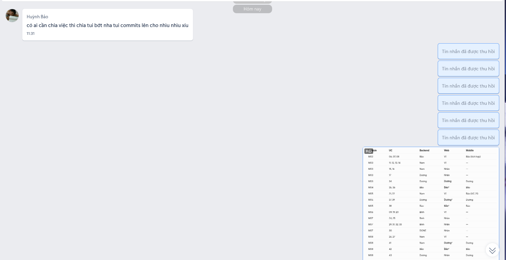
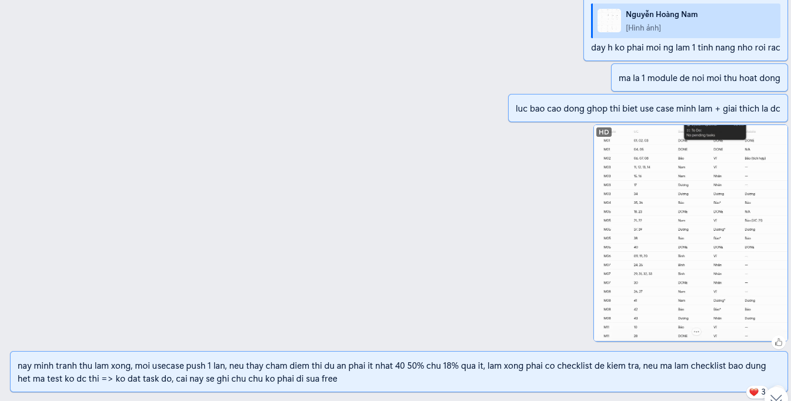

# CINEGEN — Báo cáo tiến độ và checklist nghiệm thu nhóm

**Ngày cập nhật:** 26/11/2026 · Sprint 5

## 1. Tiến độ toàn nhóm

| Phạm vi | DONE | PARTIAL | TODO |
| --- | ---: | ---: | ---: |
| Backend | 22/43 (51,2%) | 16 | 5 |
| Toàn luồng | 8/43 (18,6%) | 34 | 1 |

DONE Backend không đồng nghĩa DONE toàn luồng. Số liệu lấy từ 43 hàng nghiệm thu bên dưới; chưa phải kết quả giảng viên xác nhận.

| FR | Nhóm chức năng theo SRS | Backend đạt | Toàn luồng đạt |
| --- | --- | ---: | ---: |
| FR-01 | Xác thực và quản lý người dùng | 5/5 | 5/5 |
| FR-02 | Danh mục ảnh phim | 0/3 | 0/3 |
| FR-03 | Lập kế hoạch và đăng ký | 6/8 | 0/8 |
| FR-04 | Cuộn phim và frame | 0/2 | 0/2 |
| FR-05 | Nộp và kiểm duyệt ảnh | 5/8 | 3/8 |
| FR-06 | AI hỗ trợ thẩm định | 0/3 | 0/3 |
| FR-07 | Chấm thi ẩn danh | 2/7 | 0/7 |
| FR-08 | Kết quả và kho lưu trữ | 3/5 | 0/5 |
| FR-09 | Thống kê và báo cáo | 1/1 | 0/1 |
| FR-10 | Nhật ký hệ thống | 0/1 | 0/1 |

## 2. Báo cáo đóng góp 6 thành viên

Module Owner chịu trách nhiệm theo dõi và nghiệm thu module, không mặc định là người viết toàn bộ code. Phân công Sprint 5 lấy từ `sprints.md`; công việc thực tế của Nam có hồ sơ commit, các thành viên khác ghi nhận theo trạng thái task lịch sử, chưa xác minh tác giả commit hoặc nghiệm thu riêng.

| Thành viên | Module Owner | Backend/AI được giao (UC) | Web được giao (UC) | Mobile được giao (UC) | Sprint 5 DONE / tổng task |
| --- | --- | --- | --- | --- | ---: |
| Nam Nguyễn | M01, M03, M09 | 11, 12, 13, 14, 15, 16, 21, 22, 26, 27, 41 | — | — | 8/9 |
| Hà Đức Bình | M06, M10 | 09, 19, 20, 24, 25, 29, 31, 32, 33, 28 (AI/VERIFY) | — | — | 0/6 |
| Vĩ Nguyễn | Web Admin/Organizer | Hoàn thành 16/23 module Web được giao. |
| Phạm Tiến Thành Nhân | M07, M08 | — | 15, 16, 17, 24, 25, 29, 30, 31, 32, 33, 43 | — | 3/6 |
| Dương Nguyễn | M05 | 17, 34, 37, 39, 43 | 34, 37, 39, 41 | 34, 37, 39, 41, 43 | 0/12 |
| Huỳnh Trần Gia Bảo | M02, M04 | 06, 07, 08, 10, 35, 36, 38, 42 | 35, 36, 38, 42 | 06, 07, 08, 21, 35, 36, 38, 42 | 0/13 |

* Web có dấu `*` trong bảng nghiệm thu cần đối chiếu phạm vi SRS; Mobile INT chỉ tích hợp. UC-01–03 là phần chung; UC-04–05 do Nam thực hiện theo xác nhận trưởng nhóm. Cả năm UC đã nghiệm thu, không cộng lặp vào tổng dự án. FPC-133 là task cả nhóm, không tính vào mẫu số cá nhân.

### Ghi nhận nhóm chức năng xác thực và quản trị

| UC | Người thực hiện | Kết quả toàn luồng |
| --- | --- | --- |
| UC-01, UC-02, UC-03 | Cả nhóm phối hợp triển khai và tích hợp | DONE |
| UC-04, UC-05 | Nam Nguyễn — quản trị tài khoản và vai trò (Backend + Web Admin; Mobile N/A) | DONE |

Phân định UC-01–05 theo xác nhận cập nhật của trưởng nhóm ngày 26/11/2026; hồ sơ commit cá nhân của Nam vẫn lưu riêng. Không cộng lặp UC chung vào tổng dự án.

### Ghi nhận điều phối và trách nhiệm Sprint 5 — 26/11/2026

**Nguyên tắc trách nhiệm:** Mỗi thành viên chịu trách nhiệm thực hiện, cập nhật tiến độ và báo cáo blocker của phần việc được giao. Trường hợp không thực hiện hoặc không cập nhật dù đã được phân công và nhắc nhở, cần ghi nhận riêng theo cá nhân và bằng chứng; không mặc định quy phần việc đó thành lỗi triển khai của trưởng nhóm. Trưởng nhóm vẫn chịu trách nhiệm điều phối, theo dõi, hỗ trợ xử lý blocker và nghiệm thu chung. Không kết luận cá nhân vi phạm chỉ vì chưa có dữ liệu cập nhật trong tài liệu này.

## 3. Checklist theo Module Owner và từng UC

Cột Backend/Web/Mobile là người phụ trách theo Sprint 5; riêng UC đã nghiệm thu dùng hồ sơ lịch sử nếu có. `—` không có task Mobile trong kế hoạch; `N/A` không áp dụng; `*` cần xác nhận phạm vi Web; `INT` chỉ tích hợp. Trạng thái sản phẩm và người phụ trách là hai thông tin khác nhau.

### M01 Authentication & RBAC — Owner: Nam

| UC | Chức năng | Backend / Web / Mobile | Backend đạt | Toàn luồng | GV đạt | GV chưa đạt |
| --- | --- | --- | --- | --- | --- | --- |
| UC-11 | Create / Duplicate Contest | Tạo cuộc thi với năm mốc hợp lệ. Sao chép hạng mục, tiêu chí, vòng, thể lệ và giải sang DRAFT có lịch mới. Kiểm tra bản sao trống đăng ký, bài, điểm và kết quả. (SRS §3, BR-08) | PARTIAL (Backend DONE) |  |  | Backend đã kiểm thử ngày 2026-11-26 bằng organizer-usecases.integration.test.ts. |
| UC-12 | Update Contest Configuration | Sửa thông tin, hạn nộp và thể lệ khi cuộc thi chưa đóng. Từ chối lịch sai thứ tự: mở đăng ký, hạn nộp, bắt đầu chấm, kết thúc chấm, công bố. (BR-08) | PARTIAL (Backend DONE) |  |  | Backend đã kiểm thử ngày 2026-11-26 bằng organizer-usecases.integration.test.ts. |
| UC-13 | Manage Contest Categories | Organizer thêm, sửa, kích hoạt/vô hiệu hóa hạng mục. Kiểm tra Participant chỉ đăng ký được hạng mục hợp lệ. (SRS §2.2–3) | PARTIAL (Backend DONE) |  |  | Backend đã kiểm thử ngày 2026-11-26 bằng organizer-usecases.integration.test.ts. |
| UC-14 | Configure Judging Criteria | Lưu tiêu chí và trọng số theo hạng mục. Chấp nhận tổng đúng 100% và báo MSG007 khi tổng sai. (BR-15) | PARTIAL (Backend DONE) |  |  | Backend đã kiểm thử ngày 2026-11-26 bằng organizer-usecases.integration.test.ts. |
| UC-15 | Manage Judging Rounds | Cấu hình một hoặc nhiều vòng chấm, thời hạn từng vòng và số bài đi tiếp. Mở lại để kiểm tra cấu hình đã lưu. (SRS §2.2, BR-14) | PARTIAL (Backend DONE) |  |  | Backend đã kiểm thử ngày 2026-11-26 bằng organizer-usecases.integration.test.ts. |
| UC-16 | Assign Judges to Categories | Phân công theo hạng mục/vòng, bảo đảm ít nhất một Judge hoạt động. Thử tài khoản có xung đột với vai trò Participant trong cùng cuộc thi. (BR-20/21) | PARTIAL (Backend DONE) |  |  | Backend đã kiểm thử ngày 2026-11-26 bằng organizer-usecases.integration.test.ts. |
| UC-17 | View Participant Registrations | Tìm và lọc đăng ký theo cuộc thi, hạng mục và trạng thái nộp. Kiểm tra phạm vi quyền Organizer. (SRS §2.2–3, CR-03) | PARTIAL (Backend DONE) |  |  | Backend đã kiểm thử ngày 2026-11-26 bằng contest-registration.test.ts (FPC-087). |
| UC-34 | Browse & Register for Contests | Tìm cuộc thi đang mở, xem và chấp nhận thể lệ, đăng ký hạng mục hợp lệ. Thử đăng ký trùng, ngoài hạn và xung đột vai trò. (SRS §3, BR-08/21) | PARTIAL (Backend DONE, Web DONE, Mobile DONE) |  |  | Backend đã kiểm thử bằng contest-registration.test.ts; Web & Mobile hoàn thành đăng ký và lưu trạng thái (FPC-087, FPC-088, FPC-089). |

| UC | Tiêu chí PASS | Còn cần nghiệm thu |
| --- | --- | --- |
| UC-01 | Đăng ký Participant bằng email duy nhất, xác minh email rồi đăng nhập bằng JWT. Từ chối email trùng và token phiên đã đăng xuất. (BR-01/04) | — |
| UC-02 | Yêu cầu khôi phục qua email, mở liên kết và đặt mật khẩu mới. Kiểm tra mật khẩu cũ bị từ chối. (SRS §2.2) | — |
| UC-03 | Xem và sửa hồ sơ, ảnh đại diện, mật khẩu của chính mình. Tải lại để kiểm tra dữ liệu đã lưu. (SRS §2.2, CR-01/03) | — |
| UC-04 | Admin tạo, xem, khóa và mở khóa tài khoản. API bảo vệ từ chối tài khoản bị khóa. Kiểm tra phiên cũ vẫn bị thu hồi sau mở khóa. (BR-02/04, M01) | — |
| UC-05 | Admin gán một trong 4 vai trò cố định. Kiểm tra quyền mới trên màn hình và API, kể cả thu hồi phiên cũ khi đổi vai trò. (BR-02, CR-03, M01) | — |

### M02 Analog Master Data — Owner: Bảo

| UC | Chức năng | Backend / Web / Mobile | Backend đạt | Toàn luồng | GV đạt | GV chưa đạt |
| --- | --- | --- | --- | --- | --- | --- |
| UC-06 | Manage Film Stock Catalog | Bảo / Vĩ / Bảo (INT) | TODO | PARTIAL | | |
| UC-07 | Manage Camera & Lens Catalog | Bảo / Vĩ / Bảo (INT) | TODO | PARTIAL | | |
| UC-08 | Manage Film Lab Directory | Bảo / Vĩ / Bảo (INT) | TODO | PARTIAL | | |

| UC | Tiêu chí PASS | Còn cần nghiệm thu |
| --- | --- | --- |
| UC-06 | Admin tạo/sửa Film Stock với hãng, tên, ISO và loại phim. Vô hiệu hóa vẫn giữ dữ liệu lịch sử. (BR-02/03) | Web quản trị đã có. Cần Backend CRUD/tra cứu và nghiệm thu tích hợp. |
| UC-07 | Admin tạo/sửa và tra cứu thân máy, ống kính. Kiểm tra dữ liệu dùng được khi khai báo thông số ảnh. (BR-02/22) | Web quản trị đã có. Cần Backend CRUD/tra cứu và nghiệm thu tích hợp. |
| UC-08 | Admin tạo/sửa và tra cứu Lab tráng/quét phim. Kiểm tra Lab chọn được trong metadata. (BR-02/22) | Web quản trị đã có. Cần Backend CRUD/tra cứu và nghiệm thu tích hợp. |

### M03 Contest Lifecycle — Owner: Nam

| UC | Chức năng | Backend / Web / Mobile | Backend đạt | Toàn luồng | GV đạt | GV chưa đạt |
| --- | --- | --- | --- | --- | --- | --- |
| UC-11 | Create / Duplicate Contest | Nam / Vĩ / — | DONE | PARTIAL | | |
| UC-12 | Update Contest Configuration | Nam / Vĩ / — | DONE | PARTIAL | | |
| UC-13 | Manage Contest Categories | Nam / Vĩ / — | DONE | PARTIAL | | |
| UC-14 | Configure Judging Criteria | Nam / Vĩ / — | DONE | PARTIAL | | |
| UC-15 | Manage Judging Rounds | Nam / Nhân / — | DONE | DONE | | |
| UC-16 | Assign Judges to Categories | Nam / Nhân / — | DONE | DONE | | |
| UC-17 | View Participant Registrations | Dương / Nhân / — | TODO | DONE | | |
| UC-34 | Browse & Register for Contests | Dương / Dương / Dương | PARTIAL | PARTIAL | | |

| UC | Tiêu chí PASS | Còn cần nghiệm thu |
| --- | --- | --- |
| UC-11 | Tạo cuộc thi với năm mốc hợp lệ. Sao chép hạng mục, tiêu chí, vòng, thể lệ và giải sang DRAFT có lịch mới. Kiểm tra bản sao trống đăng ký, bài, điểm và kết quả. (SRS §3, BR-08) | Backend E1/E2 đạt. Web đã tích hợp cấu hình, còn nghiệm thu toàn luồng tạo/sao chép. |
| UC-12 | Sửa thông tin, hạn nộp và thể lệ khi cuộc thi chưa đóng. Từ chối lịch sai thứ tự: mở đăng ký, hạn nộp, bắt đầu chấm, kết thúc chấm, công bố. (BR-08) | Backend E1 đạt. Còn nghiệm thu luồng sửa trên Web. |
| UC-13 | Organizer thêm, sửa, kích hoạt/vô hiệu hóa hạng mục. Kiểm tra Participant chỉ đăng ký được hạng mục hợp lệ. (SRS §2.2–3) | Backend quản lý hạng mục đạt E1. Đăng ký Participant còn phụ thuộc UC-34. |
| UC-14 | Lưu tiêu chí và trọng số theo hạng mục. Chấp nhận tổng đúng 100% và báo MSG007 khi tổng sai. (BR-15) | Backend trọng số và rollback đạt E1. Còn nghiệm thu Web với dữ liệu thật. |
| UC-15 | Cấu hình một hoặc nhiều vòng chấm, thời hạn từng vòng và số bài đi tiếp. Mở lại để kiểm tra cấu hình đã lưu. (SRS §2.2, BR-14) | Backend vòng chấm đạt E1. Còn nghiệm thu giao diện cấu hình vòng. |
| UC-16 | Phân công theo hạng mục/vòng, bảo đảm ít nhất một Judge hoạt động. Thử tài khoản có xung đột với vai trò Participant trong cùng cuộc thi. (BR-20/21) | Backend phân công đạt E1. Còn nối và nghiệm thu Web theo hạng mục/vòng. |
| UC-17 | Tìm và lọc đăng ký theo cuộc thi, hạng mục và trạng thái nộp. Kiểm tra phạm vi quyền Organizer. (SRS §2.2–3, CR-03) | Thiếu schema/API đăng ký để nghiệm thu danh sách Organizer. |
| UC-34 | Tìm cuộc thi đang mở, xem và chấp nhận thể lệ, đăng ký hạng mục hợp lệ. Thử đăng ký trùng, ngoài hạn và xung đột vai trò. (SRS §3, BR-08/21) | Có giao diện duyệt cuộc thi. Thiếu schema/API đăng ký hạng mục. |

### M04 Film Logbook — Owner: Bảo

| UC | Chức năng | Backend / Web / Mobile | Backend đạt | Toàn luồng | GV đạt | GV chưa đạt |
| --- | --- | --- | --- | --- | --- | --- |
| UC-35 | Manage Film Roll Log | Bảo / Bảo* / Bảo | PARTIAL | PARTIAL | | |
| UC-36 | Manage Frame Metadata | Bảo / Bảo* / Bảo | PARTIAL | PARTIAL | | |

| UC | Tiêu chí PASS | Còn cần nghiệm thu |
| --- | --- | --- |
| UC-35 | Tạo và quản lý cuộn của mình với tên phim, khổ, ISO, máy, ngày lắp và Lab. Kiểm tra tài khoản khác bị chặn truy cập. (SRS §2.2–3, CR-03) | Có bảng Film Roll. Còn API và luồng Logbook theo SRS. |
| UC-36 | Lưu ống kính, địa điểm, phơi sáng nếu có. Từ chối số frame không nguyên dương hoặc trùng trong cuộn; chấp nhận số hợp lệ theo BR-23. (SRS §2.2, BR-23) | Thiếu schema/API Frame và liên kết frame chuẩn hóa. |

### M05 Submission & Proof — Owner: Dương

| UC | Chức năng | Backend / Web / Mobile | Backend đạt | Toàn luồng | GV đạt | GV chưa đạt |
| --- | --- | --- | --- | --- | --- | --- |
| UC-18 | View Submission Queue | Nam / Vĩ / — | DONE | DONE | | |
| UC-21 | Request Negative / Contact Sheet Proof | Nam / Vĩ / Bảo (INT) | DONE | PARTIAL | | |
| UC-22 | Verify & Approve Submission | Nam / Vĩ / — | DONE | PARTIAL | | |
| UC-23 | Disqualify / Reject Submission | Nam / Vĩ / — | DONE | DONE | | |
| UC-37 | Submit Film Photograph | Dương / Dương* / Dương | PARTIAL | PARTIAL | | |
| UC-38 | Upload Negative / Contact Sheet Proof | Bảo / Bảo* / Bảo | PARTIAL | PARTIAL | | |
| UC-39 | Edit / Withdraw Submission | Dương / Dương* / Dương | TODO | PARTIAL | | |
| UC-40 | Track Submission Status | Nam hỗ trợ; chủ API chưa xác minh / Chưa xác minh / Dương | DONE | DONE | | |

| UC | Tiêu chí PASS | Còn cần nghiệm thu |
| --- | --- | --- |
| UC-18 | Mở hàng đợi cuộc thi thuộc quyền. Đối chiếu danh sách bài, trạng thái kiểm duyệt và nhãn cảnh báo AI. (SRS §2.2, CR-03) | — |
| UC-21 | Organizer gửi yêu cầu âm bản hoặc contact sheet với hạn do mình đặt. Kiểm tra thí sinh thấy hạn đúng và Organizer xử lý thủ công khi quá hạn. (BR-06/19) | Backend thông báo, deadline và SMTP thật đạt E1/E3. Còn nghiệm thu màn Participant. |
| UC-22 | Duyệt bài đạt chuẩn kỹ thuật vào danh sách chấm. Thử bài yêu cầu đối chứng và xác nhận hệ thống chỉ cho duyệt sau xác minh. (BR-06/07/09) | Backend chặn duyệt trước xác minh proof đạt E1. Còn nghiệm thu toàn luồng. |
| UC-23 | Organizer loại bài vi phạm. Thiếu lý do thì bị chặn; khi thành công kiểm tra trạng thái và AuditLog. (BR-18, CR-04) | — |
| UC-37 | Nộp ảnh đúng chuẩn, đủ metadata/tuyên ngôn, gắn đăng ký và cuộn/frame thuộc quyền. Thử quá hạn, quá số bài, trùng cuộn/frame và thiếu đối chứng bắt buộc. (BR-05–08/22–24) | Còn đăng ký hạng mục và liên kết Roll/Frame theo SRS. |
| UC-38 | Tải âm bản hoặc contact sheet cho bài của mình. Kiểm tra Organizer có quyền xem đúng bằng chứng. Quá hạn do Organizer xử lý thủ công. (BR-06/19, CR-03) | Còn nghiệm thu API upload proof và giao diện với tệp thật. |
| UC-39 | Sửa thông số hoặc rút bài khi còn hạn và chưa vào chấm. Thử cả hai điều kiện chặn. Nếu thay ảnh, bài trở lại kiểm duyệt. (SRS §3, BR-08/24) | Chưa có route Backend sửa/rút bài, còn tích hợp client theo BR-08/24. |
| UC-40 | Mở và làm mới bài của mình sau thay đổi kiểm duyệt. Đối chiếu trạng thái mới với dữ liệu lưu và thử truy cập bài người khác. (SRS §2.2–3, CR-03) | — |

### M06 AI Verification — Owner: Bình

| UC | Chức năng | Backend / Web / Mobile | Backend đạt | Toàn luồng | GV đạt | GV chưa đạt |
| --- | --- | --- | --- | --- | --- | --- |
| UC-26 | Approve & Publish Results | Công bố thứ hạng và giải từ vòng cuối đã chốt với đủ đối chứng theo thể lệ. Làm tròn hai chữ số, ghi lý do khi đồng điểm và thử sửa sau công bố. (BR-06/16/25) | PARTIAL (Backend DONE) |  |  | Backend đã kiểm thử ngày 2026-11-26 bằng organizer-usecases.integration.test.ts. |
| UC-27 | Manage Digital Archive & Exhibition | Chọn tác phẩm đưa vào triển lãm. Kiểm tra bản công khai tối ưu có bản quyền và bản gốc độ phân giải cao vẫn riêng tư. (BR-17) | PARTIAL (Backend DONE) |  |  | Backend đã kiểm thử ngày 2026-11-26 bằng organizer-usecases.integration.test.ts. |
| UC-41 | View Contest Results & Judge Feedback | Participant xem kết quả chung cuộc, điểm trung bình và nhận xét cho bài của mình sau công bố. Thử truy cập phản hồi của tài khoản khác. (SRS §2.2–3, CR-03) | PARTIAL (Backend DONE, Mobile DONE) |  |  | Backend đã kiểm thử ngày 2026-11-26; Mobile hoàn thành Bảng vàng vinh danh (FPC-100/FPC-120). |
| UC-42 | Manage Personal Film Portfolio | Mở portfolio cá nhân và đối chiếu tác phẩm với lịch sử nộp bài, kết quả tương ứng. Kiểm tra phạm vi tài khoản. (SRS §2.2–3, CR-03) | PARTIAL (Backend DONE, Mobile DONE) |  |  | Backend đã kiểm thử bằng portfolio.test.ts; Mobile hoàn thành màn hình Portfolio & Giải thưởng cá nhân (FPC-101/FPC-123). |
| UC-43 | Explore Digital Archive & Gallery | Khách xem kho ảnh đã công bố và lọc theo phim, máy, năm. Kiểm tra bài chưa công bố và ảnh gốc được bảo vệ. (SRS §2.2–3, BR-17) | PARTIAL |  |  |  |

| UC | Tiêu chí PASS | Còn cần nghiệm thu |
| --- | --- | --- |
| UC-09 | Admin cấu hình ngưỡng cảnh báo ảnh tạo sinh và tương đồng. Dùng ảnh đại diện kiểm tra kết quả hai phía của ngưỡng. (BR-09/10) | Cần xác nhận các ca PASS theo tiêu chí. |
| UC-19 | Organizer kích hoạt quét từng bài và hàng loạt. Kiểm tra xử lý nền cho trùng ảnh, ảnh AI và gợi ý thẻ. (BR-09–11, SRS §5) | Cần xác nhận các ca PASS theo tiêu chí. |
| UC-20 | Xem điểm AI, điểm tương đồng và ảnh khớp theo quyền. Đối chiếu ảnh thi với bằng chứng cạnh nhau. Organizer quyết định và ghi lý do khi gỡ cờ. (BR-09/10/18) | Cần xác nhận các ca PASS theo tiêu chí. |

### M07 Blind Judging — Owner: Nhân

| UC | Chức năng | Backend / Web / Mobile | Backend đạt | Toàn luồng | GV đạt | GV chưa đạt |
| --- | --- | --- | --- | --- | --- | --- |
| UC-24 | Monitor Judging Progress | Bình / Nhân / — | DONE | DONE | | |
| UC-25 | Finalize Judging Round | Bình / Nhân / — | PARTIAL | DONE | | |
| UC-29 | View Assigned Submissions | Bình / Nhân / — | PARTIAL | DONE | | |
| UC-30 | Inspect High-Res Image & Film Metadata | DONE (chủ API chưa xác minh) / Nhân / — | DONE | DONE | | |
| UC-31 | Score & Comment on Submission | Bình / Nhân / — | PARTIAL | DONE | | |
| UC-32 | Update Evaluation Score | Bình / Nhân / — | PARTIAL | DONE | | |
| UC-33 | Lock & Confirm Final Evaluations | Bình / Nhân / — | PARTIAL | DONE | | |

| UC | Tiêu chí PASS | Còn cần nghiệm thu |
| --- | --- | --- |
| UC-24 | Theo từng vòng và Judge, đối chiếu số bài được giao, số bài đã chấm và trạng thái xác nhận điểm. (SRS §2.2) | Backend owner và tiến độ riêng từng vòng đạt E1. Còn nghiệm thu Web. |
| UC-25 | Thử chốt khi còn phiếu bắt buộc chưa xác nhận. Khi đủ, khóa vòng, xếp theo điểm trung bình có trọng số và chọn đúng số bài đi tiếp. (BR-14/25) | Chốt/chuyển vòng, transaction và tách công bố đạt E1. Còn xác nhận đồng điểm tại ranh giới đi tiếp. |
| UC-29 | Judge chỉ thấy bài được giao. Kiểm tra cả UI lẫn phản hồi API đều ẩn tên, email, avatar, ID và dữ liệu định danh tác giả. (BR-12, CR-03) | Cần xác nhận các ca PASS theo tiêu chí. |
| UC-30 | Judge phóng to ảnh scan độ phân giải cao và xem metadata chụp/tráng/scan. Kiểm tra ảnh và dữ liệu giữ ẩn danh. (SRS §2.2–3, BR-12) | Cần xác nhận các ca PASS theo tiêu chí. |
| UC-31 | Chấm theo từng tiêu chí và lưu nhận xét. Đối chiếu tổng điểm có trọng số. Thử xem điểm/nhận xét của Judge khác trước khi vòng kết thúc. (BR-13/15) | Cần xác nhận các ca PASS theo tiêu chí. |
| UC-32 | Sửa điểm và nhận xét trước khi khóa, kiểm tra lưu vết cập nhật. Thử sửa lại sau khóa và xác nhận bị từ chối. (SRS §2.2, CR-04) | Cần xác nhận các ca PASS theo tiêu chí. |
| UC-33 | Judge xác nhận hoàn tất và khóa phiếu cá nhân cho vòng được giao. Kiểm tra trạng thái đã khóa và chặn thay đổi tiếp theo. (SRS §2.2–3) | Cần xác nhận các ca PASS theo tiêu chí. |

### M08 Archive & Exhibition — Owner: Nhân

| UC | Chức năng | Backend / Web / Mobile | Backend đạt | Toàn luồng | GV đạt | GV chưa đạt |
| --- | --- | --- | --- | --- | --- | --- |
| UC-26 | Approve & Publish Results | Nam / Vĩ / — | DONE | PARTIAL | | |
| UC-27 | Manage Digital Archive & Exhibition | Nam / Vĩ / — | DONE | PARTIAL | | |
| UC-41 | View Contest Results & Judge Feedback | Nam / Dương* / Dương | DONE | PARTIAL | | |
| UC-42 | Manage Personal Film Portfolio | Bảo / Bảo* / Bảo | PARTIAL | PARTIAL | | |
| UC-43 | Explore Digital Archive & Gallery | Dương / Nhân / Dương | PARTIAL | PARTIAL | | |

| UC | Tiêu chí PASS | Còn cần nghiệm thu |
| --- | --- | --- |
| UC-26 | Công bố thứ hạng và giải từ vòng cuối đã chốt với đủ đối chứng theo thể lệ. Làm tròn hai chữ số, ghi lý do khi đồng điểm và thử sửa sau công bố. (BR-06/16/25) | Backend công bố, snapshot và điều kiện proof đạt E1/E2. Còn ca đồng điểm và nghiệm thu giao diện. |
| UC-27 | Chọn tác phẩm đưa vào triển lãm. Kiểm tra bản công khai tối ưu có bản quyền và bản gốc độ phân giải cao vẫn riêng tư. (BR-17) | Backend preview WebP, bảo vệ master và xóa mềm đạt E1/E2. Còn nghiệm thu Web. |
| UC-41 | Participant xem kết quả chung cuộc, điểm trung bình và nhận xét cho bài của mình sau công bố. Thử truy cập phản hồi của tài khoản khác. (SRS §2.2–3, CR-03) | Backend điểm và feedback đúng Participant đạt E1/E2. Còn nghiệm thu client. |
| UC-42 | Mở portfolio cá nhân và đối chiếu tác phẩm với lịch sử nộp bài, kết quả tương ứng. Kiểm tra phạm vi tài khoản. (SRS §2.2–3, CR-03) | Cần xác nhận các ca PASS theo tiêu chí. |
| UC-43 | Khách xem kho ảnh đã công bố và lọc theo phim, máy, năm. Kiểm tra bài chưa công bố và ảnh gốc được bảo vệ. (SRS §2.2–3, BR-17) | Cần xác nhận các ca PASS theo tiêu chí. |

### M09 Shared API Contracts — Owner: Nam

Không có UC riêng. Nghiệm thu kỹ thuật tại mục 4.

### M10 Database Schema & Cloud Storage — Owner: Bình

Không có UC riêng. Nghiệm thu kỹ thuật tại mục 4.

### M11 Cross-Cutting Services — Owner: Vĩ

| UC | Chức năng | Backend / Web / Mobile | Backend đạt | Toàn luồng | GV đạt | GV chưa đạt |
| --- | --- | --- | --- | --- | --- | --- |
| UC-10 | View System Audit Logs | Bảo / Vĩ / — | PARTIAL | PARTIAL | | |
| UC-28 | Export Contest Analytics Report | DONE; Bình (AI/VERIFY) / Vĩ / — | DONE | PARTIAL | | |

| UC | Tiêu chí PASS | Còn cần nghiệm thu |
| --- | --- | --- |
| UC-10 | Admin tra cứu nhật ký thao tác nhạy cảm. Kiểm tra người thực hiện, thời điểm, hành động, dữ liệu cũ/mới và lý do. (BR-18, CR-04) | Audit ghi dùng chung đã có. Thiếu API/UI tra cứu và kiểm tra quyền đọc UC-10. |
| UC-28 | Organizer xem thống kê DB theo cuộc thi/hạng mục và xuất báo cáo. Kiểm tra AI chỉ nhận số liệu tổng hợp không định danh và số liệu/xuất vẫn dùng được khi AI lỗi. (SRS §3) | Backend đã nghiệm thu theo hồ sơ trước. Còn Web xuất báo cáo và nhà cung cấp AI thật. |

## 4. Nghiệm thu kỹ thuật và AI

| Task | Owner / người thực hiện | Trạng thái | Còn lại |
| --- | --- | --- | --- |
| FPC-129 | Bình | TODO | Ảnh thật, AI Analytics, worker và xử lý lỗi; chưa có Precision/Recall/F1/Accuracy. |
| FPC-130 | Nam | TODO | Ma trận API contract, quyền, validation và tích hợp client. |
| FPC-131 | Bình | TODO | Schema, registration/frame, migration, storage cloud, concurrency. |
| FPC-132 | Nam | IN REVIEW | Email/proof/retry/audit có E1/E3; còn client, audit đọc và ca đồng điểm. |
| FPC-134 | Nam | IN REVIEW | Seed/smoke có E2; còn registration/frame. |
| FPC-133 | Cả nhóm | TODO | Nghiệm thu 43 UC và 5 core flows. |

### Bằng chứng kiểm thử

| Mã | Bằng chứng | Kết quả gần nhất |
| --- | --- | --- |
| E1 | [Integration Backend và audit](../../apps/api/tests/organizer-usecases.integration.test.ts) | 16 test, 120 assertions đạt. Ca gửi SMTP thật chạy riêng. |
| E2 | [Seed và API smoke test](../../apps/api/tests/acceptance-seed.integration.test.ts) | 9 test, 91 assertions đạt. Registration/Frame chưa thể nghiệm thu. |
| E3 | SMTP thật và luồng tự gửi | Email proof đã xác nhận trong hộp thư test. Worker tự xử lý request proof và retry, không cần lệnh gửi. |

39 test API hiện có, TypeScript API/Web, kiểm tra migration và diff đã đạt. E1/E2 bao phủ các ca ghi trong checklist, chưa xác nhận toàn bộ tổ hợp lỗi và concurrency. Những UC DONE từ trước giữ theo hồ sơ nghiệm thu nhóm.

Chi tiết ca kiểm thử kỹ thuật Nam: [nam-nguyen-evidence.md](nam-nguyen-evidence.md).

## 5. Kết quả kiểm tra của giảng viên

Chỉ cộng 43 hàng UC ở mục 3. Các mục kỹ thuật không cộng thêm vào tổng UC.

| Đạt | Chưa đạt | Chưa kiểm tra | Tổng |
| --- | --- | --- | --- |
| | | | 43 |

| Nội dung | Ghi nhận |
| --- | --- |
| Nhận xét và yêu cầu bổ sung | |
| Kết luận nghiệm thu | |
| Ngày kiểm tra | |
| Chữ ký giảng viên | |
