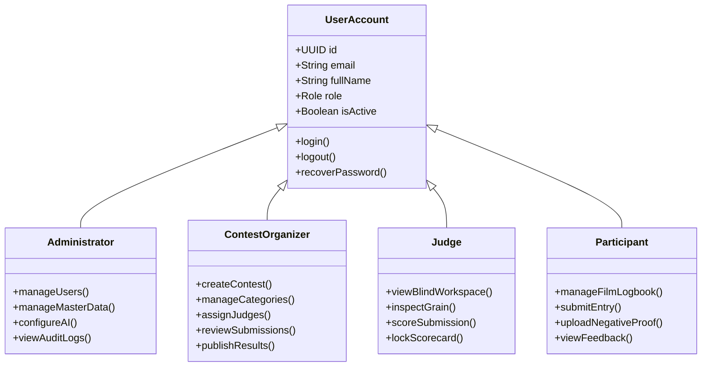
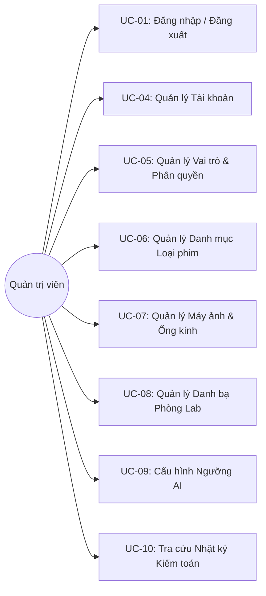
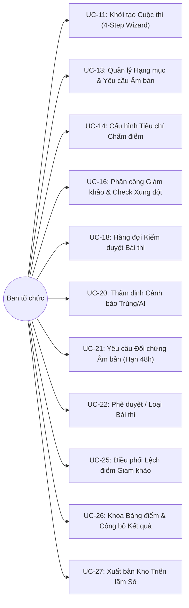
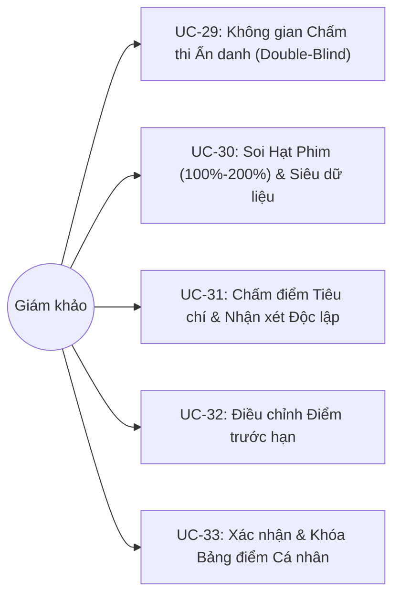
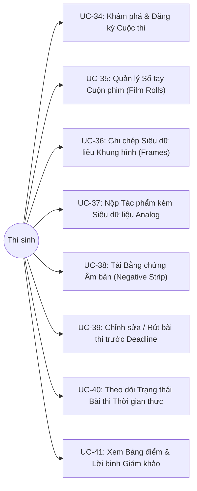
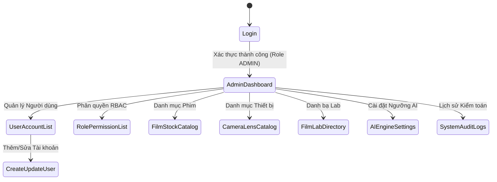
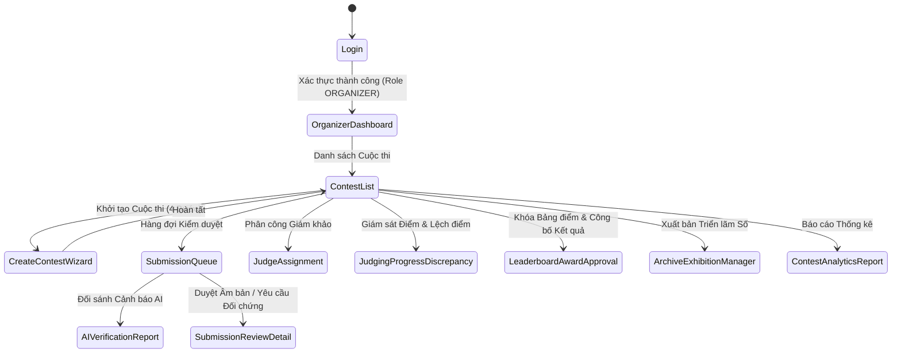
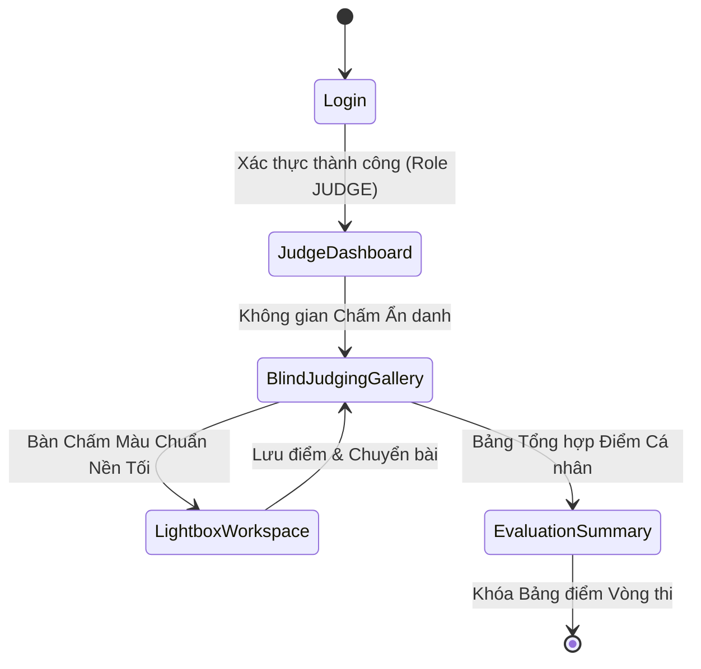
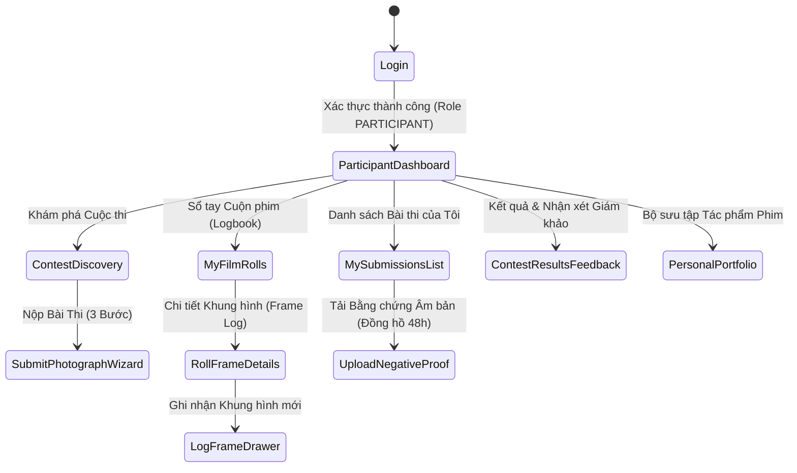

# Software Requirements Specification (SRS) - AI-First Master Specification

> **Project Name**: AI-powered Film Photography Contest Management Platform (**FilmContest-AI**)  
> **Document Code**: SRS-FC-2026-V1  
> **Status**: APPROVED / MASTER AI-FIRST SPECIFICATION  
> **Target Audience**: AI Agents / Autonomous Coding Engines, Fullstack Architects, QA Automation Engineers  
> **Standard**: AI-First Spec (Explicit schemas, deterministic business logic, exhaustive error codes, Zero visual image ambiguity, 100% structured Markdown & Mermaid)

---

## 1. Product Overview (Tổng quan sản phẩm)

Nền tảng Quản lý Cuộc thi Nhiếp ảnh Phim tích hợp Trí tuệ Nhân tạo (**FilmContest-AI**) là hệ thống Web và Mobile toàn diện được thiết kế nhằm số hóa, chuẩn hóa và tối ưu hóa toàn bộ quy trình vận hành các cuộc thi nhiếp ảnh phim (Analog Photography), từ lập kế hoạch, đăng ký, nộp bài kèm siêu dữ liệu cuộn phim, thẩm định bằng AI, chấm thi ẩn danh đến lưu trữ triển lãm số.

### 1.1. Operational Environment (Môi trường vận hành)

*   **Web Application**: Ứng dụng Web đa nền tảng (Chrome, Edge, Safari, Firefox) xây dựng trên Next.js (React), tối ưu cho Ban tổ chức (Contest Organizer), Giám khảo chuyên môn (Judge), Quản trị viên (Administrator), Thí sinh (Participant) và Khách công chúng (Public Visitor). Mặc định kích hoạt Dark Mode tại không gian chấm thi và triển lãm nhằm bảo toàn cảm nhận màu sắc và sắc độ tương phản quang học của ảnh phim.
*   **Mobile Application**: Ứng dụng Mobile trên nền Flutter (hỗ trợ iOS và Android), tối ưu hóa thao tác ghi chép nhật ký cuộn phim ngoài hiện trường (Film Roll & Frame Logbook), hoạt động ngoại tuyến (Offline-First Cache) và chụp tải ảnh dải phim âm bản (Negative Strip Proof).
*   **Connectivity**: Yêu cầu kết nối mạng băng thông ổn định để tải ảnh scan chất lượng cao (định dạng JPG/TIFF dung lượng tối đa 25MB) và đồng bộ kết quả chấm điểm thời gian thực.
*   **Infrastructure**: Triển khai trên hạ tầng đám mây container hóa qua Docker, cơ sở dữ liệu quan hệ **PostgreSQL 16+** tích hợp extension **`pgvector`** (lưu trữ vector nhúng thị giác CLIP/ResNet), **Redis** (hàng đợi xử lý tác vụ bất đồng bộ AI Worker) và **Cloud Object Storage** (Cloudflare R2 / AWS S3) sử dụng cơ chế Presigned URLs.

### 1.2. Anticipated Users (Đối tượng người dùng dự kiến)

| Nhóm người dùng | Vai trò (System Role) | Mô tả trách nhiệm chính |
| :--- | :--- | :--- |
| **Quản trị viên** | `ADMIN` | Cấu hình tham số hệ thống, quản lý tài khoản người dùng, phân quyền RBAC, duy trì Master Data (Film Stock, Camera, Lens, Film Lab), giám sát Audit Logs và cài đặt ngưỡng AI. |
| **Ban tổ chức** | `ORGANIZER` | Khởi tạo cuộc thi (4-Step Wizard), cấu hình hạng mục, tiêu chí chấm và giải thưởng, phân công giám khảo, kiểm duyệt bài thi dựa trên cảnh báo AI, yêu cầu đối chứng âm bản, điều phối lệch điểm và công bố kết quả. |
| **Giám khảo** | `JUDGE` | Đánh giá tác phẩm trong không gian chấm thi ẩn danh tuyệt đối (Double-Blind), xem ảnh phóng đại kiểm tra hạt phim (Film Grain), chấm điểm theo trọng số tiêu chí, viết nhận xét chuyên môn và khóa bảng điểm. |
| **Thí sinh** | `PARTICIPANT` | Quản lý hồ sơ nghệ thuật cá nhân, ghi nhật ký cuộn phim và khung hình (Logbook), nộp ảnh scan dự thi kèm siêu dữ liệu, tải ảnh âm bản đối chứng khi có yêu cầu và theo dõi trạng thái bài thi. |
| **Khách tham quan**| `PUBLIC_VISITOR` | Khám phá phòng triển lãm trực tuyến, lọc tác phẩm theo loại phim/máy ảnh/năm tổ chức, xem tác phẩm đạt giải có đóng dấu bản quyền. |

### 1.3. Constraints & Assumptions (Ràng buộc & Giả định)

*   **Ràng buộc vật lý Ảnh Phim**: Mọi bài thi hợp lệ bắt buộc phải khai báo siêu dữ liệu vật lý gồm 5 thông số tối thiểu: Hãng & Loại phim (Film Stock), Khổ phim (Format), Thân máy (Camera Body), Số thứ tự khung hình (Frame Number), và Phòng Lab tráng/Quy trình tráng (BR-22). Các bài lọt vào Chung kết hoặc xét Giải bắt buộc phải có ảnh chụp dải phim âm bản gốc (Negative Strip) hoặc Contact Sheet đã được duyệt hợp lệ (BR-06).
*   **Phạm vi Trí tuệ Nhân tạo (AI Scope)**: AI đóng vai trò công cụ thẩm định sơ bộ tự động (phát hiện ảnh trùng lặp qua pHash/Hamming distance, phát hiện ảnh tạo sinh bởi AI qua mạng nơ-ron phân loại xác suất $P_{AI}$, tự động gán nhãn thị giác). AI không có quyền tự ý loại bài thi; mọi quyết định loại bài thi thuộc thẩm quyền của Ban tổ chức sau khi đối chiếu thủ công âm bản và phải lưu lý do vào Audit Log (BR-18).
*   **Bảo mật Chấm thi Ẩn danh kép (Double-Blind Judging)**: Giám khảo tuyệt đối không được tiếp cận bất kỳ thông tin định danh nào của thí sinh (Tên, Email, Ảnh đại diện, Nickname) ở cả tầng Giao diện lẫn tầng DTO Backend API (BR-12). Các giám khảo chấm độc lập, không xem được điểm và lời bình của nhau cho đến khi vòng chấm kết thúc (BR-13).

### 1.4. Dependencies (Phụ thuộc hệ thống)

*   Dịch vụ Lưu trữ Đám mây (Cloudflare R2 / AWS S3) hỗ trợ Presigned URLs.
*   Dịch vụ AI Worker tính toán Perceptual Hash (pHash) 64-bit và mô hình thị giác phân tích xác suất ảnh AI.
*   Dịch vụ Thông báo (SMTP Email Gateway / Firebase Cloud Messaging FCM).

---

## 2. User Requirements (Yêu cầu người dùng)

### 2.1. System Actors & Authorization Matrix

### 2.2. Use Case Catalog (43 Ca sử dụng cốt lõi)

Hệ thống quản lý 43 Use Cases cốt lõi được cấu trúc và định danh chính xác như sau:

| ID | Tên Use Case | Tác nhân chính (Actors) | Mô tả chi tiết nghiệp vụ |
| :--- | :--- | :--- | :--- |
| **UC-01** | Login / Logout | All Actors | Xác thực thông tin đăng nhập, cấp phát JWT token cặp (Access/Refresh Token), thu hồi token khi đăng xuất. |
| **UC-02** | Recover Password | All Actors | Gửi liên kết xác thực đặt lại mật khẩu bảo mật qua Email đã xác minh. |
| **UC-03** | View & Update Profile | All Actors | Xem và chỉnh sửa thông tin cá nhân, ảnh đại diện, tiểu sử nghệ thuật. |
| **UC-04** | Manage User Accounts | Admin | Tạo tài khoản nội bộ, tìm kiếm, khóa/mở khóa tài khoản người dùng theo BR-04. |
| **UC-05** | Manage Roles & Permissions | Admin | Thiết lập vai trò hệ thống và ma trận phân quyền chi tiết (RBAC). |
| **UC-06** | Manage Film Stock Catalog | Admin | Thêm mới, tra cứu, chỉnh sửa và vô hiệu hóa danh mục loại phim (Film Stocks). |
| **UC-07** | Manage Camera & Lens Catalog| Admin | Quản lý danh mục thiết bị thân máy ảnh phim và ống kính quang học. |
| **UC-08** | Manage Film Lab Directory | Admin | Quản lý danh bạ phòng Lab tráng & quét phim, đánh dấu đối tác xác minh (Verified Lab). |
| **UC-09** | Configure AI Thresholds | Admin | Thiết lập ngưỡng cảnh báo ảnh AI ($P_{AI} \ge 0.75$) và ngưỡng khoảng cách pHash trùng lặp. |
| **UC-10** | View System Audit Logs | Admin | Tra cứu nhật ký vết kiểm toán toàn hệ thống (User ID, IP, Action, Old/New Values, Reason). |
| **UC-11** | Create Contest | Organizer | Khởi tạo cuộc thi ảnh phim mới thông qua 4-Step Wizard. |
| **UC-12** | Update Contest Configuration | Organizer | Chỉnh sửa thông số, điều lệ cuộc thi trước khi cổng nhận bài đóng (BR-08). |
| **UC-13** | Manage Contest Categories | Organizer | Định nghĩa các bảng thi, giới hạn số bài nộp và cấu hình yêu cầu âm bản (BR-06). |
| **UC-14** | Configure Judging Criteria | Organizer | Thiết lập bộ tiêu chí chấm điểm và chuẩn hóa tổng trọng số bằng đúng 100% (BR-15). |
| **UC-15** | Manage Judging Rounds | Organizer | Cấu hình vòng chấm (Sơ loại, Bán kết, Chung kết) và số lượng tác phẩm đi tiếp. |
| **UC-16** | Assign Judges to Categories | Organizer | Phân công tối thiểu 3 giám khảo/hạng mục (BR-20) kèm kiểm tra xung đột lợi ích (BR-21). |
| **UC-17** | View Participant Registrations| Organizer | Xem danh sách thí sinh đã đăng ký và theo dõi số lượng bài nộp. |
| **UC-18** | View Submission Queue | Organizer | Theo dõi danh sách bài nộp, lọc theo mức độ rủi ro AI (Clean, Warning, High Risk). |
| **UC-19** | Trigger AI Verification Scan | Organizer | Kích hoạt quét AI thủ công hoặc chạy hàng loạt qua Redis Worker Queue. |
| **UC-20** | Review AI Flagged Submissions | Organizer | Đối sánh trực quan ảnh trùng lặp (side-by-side) hoặc xem bản đồ nhiệt nghi vấn AI tạo sinh. |
| **UC-21** | Request Negative Proof | Organizer | Gửi yêu cầu bắt buộc nộp ảnh dải âm bản trong thời hạn 48 giờ (BR-19). |
| **UC-22** | Verify & Approve Submission | Organizer | Phê duyệt bài thi đạt chuẩn để chuyển sang danh sách chấm thi chính thức. |
| **UC-23** | Disqualify / Reject Submission| Organizer | Loại bài thi vi phạm quy chế kèm lý do bắt buộc và ghi vết vào Audit Log (BR-18). |
| **UC-24** | Monitor Judging Progress | Organizer | Giám sát tiến độ chấm điểm của từng giám khảo theo thời gian thực. |
| **UC-25** | Resolve Score Discrepancy | Organizer | Điều phối và giải quyết xung đột khi độ lệch điểm vượt quá 30% (BR-14). |
| **UC-26** | Approve & Publish Results | Organizer | Khóa bất biến bảng điểm (BR-16), gắn cơ cấu giải thưởng và công bố kết quả. |
| **UC-27** | Manage Digital Archive | Organizer | Xuất bản tác phẩm vào Kho lưu trữ số và Triển lãm trực tuyến (BR-17). |
| **UC-28** | Export Contest Analytics | Organizer | Xuất báo cáo thống kê xu hướng phim, máy ảnh, phòng Lab và tỷ lệ cảnh báo AI. |
| **UC-29** | View Assigned Submissions | Judge | Xem danh sách tác phẩm được giao chấm trong không gian ẩn danh hoàn toàn (BR-12). |
| **UC-30** | Inspect High-Res & Grain | Judge | Soi chi tiết cấu trúc hạt phim (100%-200%) và đọc siêu dữ liệu kỹ thuật analog. |
| **UC-31** | Score & Comment on Submission | Judge | Chấm điểm theo thang điểm thành phần và ghi nhận xét độc lập (BR-13). |
| **UC-32** | Update Evaluation Score | Judge | Điều chỉnh lại điểm số khi vòng chấm chưa bị đóng/khóa. |
| **UC-33** | Lock & Confirm Scorecard | Judge | Xác nhận hoàn thành chấm và khóa bảng điểm cá nhân của vòng thi. |
| **UC-34** | Browse & Register Contests | Participant | Tra cứu thông tin cuộc thi đang mở nhận bài và đăng ký tham gia. |
| **UC-35** | Manage Film Roll Log | Participant | Tạo và quản lý sổ tay các cuộn phim cá nhân (Mã cuộn, Loại phim, ISO, Thân máy). |
| **UC-36** | Manage Frame Metadata | Participant | Ghi chép thông số từng khung hình (Khẩu độ, Tốc độ, Ống kính, Địa điểm chụp). |
| **UC-37** | Submit Film Photograph | Participant | Nộp ảnh scan kỹ thuật số, liên kết thông số Logbook và thông điệp tác phẩm (BR-07). |
| **UC-38** | Upload Negative Proof | Participant | Tải ảnh chụp dải phim âm bản gốc có viền rebate edge đối chứng (BR-06, BR-19). |
| **UC-39** | Edit / Withdraw Submission | Participant | Cập nhật hoặc rút bài thi khi còn trong thời hạn nộp bài (BR-08, BR-24). |
| **UC-40** | Track Submission Status | Participant | Theo dõi trạng thái thẩm định bài thi theo thời gian thực. |
| **UC-41** | View Results & Feedback | Participant | Xem thứ hạng chung cuộc, bảng điểm chi tiết và lời bình từ giám khảo. |
| **UC-42** | Manage Personal Portfolio | Participant | Lưu trữ và trưng bày bộ sưu tập tác phẩm ảnh phim cá nhân đã dự thi. |
| **UC-43** | Explore Digital Archive | All Actors | Khám phá phòng triển lãm công chúng, tìm kiếm và lọc tác phẩm theo loại phim/thiết bị. |

### 2.3. Use Case Diagrams (Chuyển đổi hình ảnh sang Mermaid)

#### 1. Administrator & System Governance Use Cases

#### 2. Contest Organizer Management Use Cases

#### 3. Judge Blind Evaluation Use Cases

#### 4. Participant Film Workflow Use Cases

---

## 3. System Functional Architecture & Screen Flows (Đặc tả Chức năng & Luồng Màn hình dạng Chữ)

### 3.1. Administrator Screen Flow & Descriptions

#### Luồng Chuyển màn hình Quản trị viên (Admin Screen Navigation)

#### Bảng Mô tả Màn hình Quản trị viên
| Mã màn hình | Tên màn hình | Chức năng chi tiết |
| :--- | :--- | :--- |
| **SCR-ADM-01** | Admin Dashboard | Hiển thị thẻ thống kê KPI: Tổng tài khoản, cuộc thi đang chạy, tác phẩm lưu trữ, trạng thái hàng đợi AI Worker. |
| **SCR-ADM-02** | User Account List | Danh sách người dùng hệ thống kèm bộ lọc Vai trò, Trạng thái (Active/Locked), tìm kiếm theo Email/Tên. |
| **SCR-ADM-03** | Create/Update User Form | Form tạo tài khoản nội bộ (Admin/Organizer) hoặc cập nhật trạng thái người dùng. |
| **SCR-ADM-04** | Role & Permission Matrix | Bảng ma trận trực quan gán quyền theo Resource-Action cho 4 vai trò. |
| **SCR-ADM-05** | Master Data: Film Stocks | Bảng dữ liệu loại phim (Hãng, Tên, ISO danh định, Quy trình tráng, Khổ hỗ trợ) kèm thao tác CRUD. |
| **SCR-ADM-06** | Master Data: Cameras & Lenses | Bảng quản lý thân máy và ống kính chuẩn phục vụ autocomplete khi nộp bài. |
| **SCR-ADM-07** | Master Data: Film Labs | Danh bạ phòng Lab tráng/scan kèm địa chỉ, dịch vụ tráng và cờ đối tác tin cậy (Verified Partner). |
| **SCR-ADM-08** | AI Engine Settings | Cấu hình ngưỡng xác suất ảnh AI ($P_{AI}$ Alert) và khoảng cách Hamming phát hiện ảnh trùng lặp. |
| **SCR-ADM-09** | System Audit Logs | Bảng tra cứu lịch sử thay đổi nhạy cảm (User, Action, Entity, Old Value, New Value, Reason). |

### 3.2. Contest Organizer Screen Flow & Descriptions

#### Luồng Chuyển màn hình Ban tổ chức (Organizer Screen Navigation)

#### Bảng Mô tả Màn hình Ban tổ chức
| Mã màn hình | Tên màn hình | Chức năng chi tiết |
| :--- | :--- | :--- |
| **SCR-ORG-01** | Organizer Dashboard | Bảng điều khiển tiến độ: Số thí sinh đăng ký, bài thi đã nộp, bài bị gắn cờ AI, tiến độ chấm thi. |
| **SCR-ORG-02** | Contest List | Bảng quản lý các cuộc thi (Draft, Open, Verifying, Judging, Published, Archived) kèm bộ lọc trạng thái. |
| **SCR-ORG-03** | Create Contest Wizard | Quy trình 4 bước: (1) Thông tin chung & Lịch trình -> (2) Hạng mục & Giới hạn nộp -> (3) Tiêu chí & Trọng số -> (4) Cơ cấu Giải thưởng. |
| **SCR-ORG-04** | Submission Queue | Hàng đợi bài nộp kèm lọc trạng thái (Submitted, AI Verified, Proof Requested, Approved, Disqualified). |
| **SCR-ORG-05** | AI Verification Report | Màn hình đối chiếu trực quan 2 ảnh nghi vấn trùng lặp hoặc bản đồ nhiệt xác suất ảnh AI. |
| **SCR-ORG-06** | Submission Review Detail | Soi chi tiết ảnh scan và dải phim âm bản đối chứng, thực hiện phê duyệt hoặc yêu cầu bổ sung âm bản (Hạn 48h). |
| **SCR-ORG-07** | Judge Assignment | Phân công tối thiểu 3 giám khảo vào từng hạng mục, chặn phân công nếu có xung đột lợi ích (BR-21). |
| **SCR-ORG-08** | Judging Progress & Variance | Theo dõi % bài đã chấm và danh sách các bài có độ lệch điểm > 30% cần họp điều phối (BR-14). |
| **SCR-ORG-09** | Leaderboard & Publish | Bảng xếp hạng tự động, kiểm tra điều kiện âm bản trước khi trao giải (BR-06) và chốt khóa bất biến (BR-16). |
| **SCR-ORG-10** | Archive & Exhibition Mgr | Chọn lọc tác phẩm xuất sắc đưa vào phòng triển lãm và cấp watermark số bản quyền (BR-17). |

### 3.3. Judge Screen Flow & Descriptions

#### Luồng Chuyển màn hình Giám khảo (Judge Screen Navigation)

#### Bảng Mô tả Màn hình Giám khảo
| Mã màn hình | Tên màn hình | Chức năng chi tiết |
| :--- | :--- | :--- |
| **SCR-JDG-01** | Judge Dashboard | Hiển thị các cuộc thi và vòng chấm được phân công, hạn chót chấm bài và số lượng bài đã/chưa hoàn thành. |
| **SCR-JDG-02** | Blind Judging Gallery | Lưới hiển thị các bài thi ở chế độ ẩn danh tuyệt đối (chỉ hiện mã bài thi và ảnh scan thu nhỏ). |
| **SCR-JDG-03** | Lightbox Evaluation Workspace | Không gian chấm thi nền tối (#121212), tích hợp zoom 100%-200% soi hạt phim, thanh trượt điểm tiêu chí và ô nhận xét. |
| **SCR-JDG-04** | Evaluation Summary | Bảng đối chiếu toàn bộ điểm số của giám khảo, hỗ trợ sắp xếp theo điểm và nút bấm xác nhận Khóa bảng điểm. |

### 3.4. Participant Screen Flow & Descriptions

#### Luồng Chuyển màn hình Thí sinh (Participant Web & Mobile Navigation)

#### Bảng Mô tả Màn hình Thí sinh
| Mã màn hình | Tên màn hình | Chức năng chi tiết |
| :--- | :--- | :--- |
| **SCR-PAR-01** | Participant Dashboard | Tổng quan bài thi đang nộp, thông báo yêu cầu âm bản và cuộc thi sắp đóng cổng. |
| **SCR-PAR-02** | Contest Discovery | Danh sách cuộc thi mở nhận bài, thể lệ chi tiết và cơ cấu giải thưởng. |
| **SCR-PAR-03** | My Film Rolls | Sổ tay cá nhân lưu trữ cuộn phim (Tên phim, Khổ, ISO, Máy ảnh, Lab tráng). |
| **SCR-PAR-04** | Roll Frame Details | Quản lý từng khung hình (Frame 01 đến 36/16), khẩu độ, tốc độ, ống kính. |
| **SCR-PAR-05** | Submit Photo Wizard | Giao diện nộp bài 3 bước: Tải ảnh scan -> Chọn thông số từ Logbook -> Tuyên ngôn & Đính kèm âm bản. |
| **SCR-PAR-06** | My Submissions List | Bảng theo dõi trạng thái bài thi thời gian thực kèm huy hiệu trạng thái. |
| **SCR-PAR-07** | Upload Negative Proof | Giao diện tải 1-3 ảnh chụp dải phim âm bản kèm đồng hồ đếm ngược 48 giờ (BR-19). |
| **SCR-PAR-08** | Results & Feedback | Xem thứ hạng, bảng điểm chi tiết từng tiêu chí và nhận xét chuyên môn từ hội đồng chấm. |
| **SCR-PAR-09** | Personal Portfolio | Trang trưng bày hồ sơ nghệ thuật ảnh phim cá nhân. |

### 3.5. Screen Authorization Matrix (Ma trận Phân quyền Màn hình)

| Nhóm chức năng / Màn hình | Admin | Organizer | Judge | Participant | Public Visitor |
| :--- | :---: | :---: | :---: | :---: | :---: |
| **Đăng nhập / Đăng xuất / Quên mật khẩu** | ✓ | ✓ | ✓ | ✓ | ✓ |
| **Quản trị Tài khoản & Phân quyền RBAC** | C-R-U-D | R | Không | Không | Không |
| **Quản lý Master Data (Film, Camera, Lab)** | C-R-U-D | R | R | R | Không |
| **Khởi tạo & Cấu hình Cuộc thi** | R | C-R-U-D | Không | R | R |
| **Phân công Giám khảo** | Không | C-R-U-D | Không | Không | Không |
| **Quản lý Sổ tay Cuộn phim (Logbook)** | Không | Không | Không | C-R-U-D (Sở hữu) | Không |
| **Nộp bài thi & Đính kèm Âm bản** | Không | Không | Không | C-R-U-D (Theo hạn) | Không |
| **Kiểm duyệt Bài thi & Thẩm định AI** | R | C-R-U-A | Không | Không | Không |
| **Không gian Chấm thi Ẩn danh (Double-Blind)** | Không | Không | R-U-Lock | Không | Không |
| **Khóa Bảng điểm & Công bố Kết quả** | R | C-R-U-A | Không | R | R |
| **Kho Lưu trữ Số & Phòng Triển lãm** | R | C-R-U-A | R | R | R |

*(Ký hiệu: C = Create, R = Read, U = Update, D = Delete, A = Approve/Verify, Lock = Confirm & Lock)*

---

## 4. Module Specifications Mapping (Chỉ mục Ánh xạ Module Chi tiết)

Toàn bộ các quy tắc kỹ thuật, lược đồ cơ sở dữ liệu và hợp đồng API chi tiết được triển khai tại các tài liệu module:

1.  [`docs/01-auth-and-rbac.md`](file:///home/hnamhocit/Workspace/fullstack/film-contest/docs/01-auth-and-rbac.md): Quản lý Định danh, Phân quyền RBAC, Phiên làm việc JWT & Quản trị Người dùng.
2.  [`docs/02-analog-master-data.md`](file:///home/hnamhocit/Workspace/fullstack/film-contest/docs/02-analog-master-data.md): Quản lý Danh mục Dữ liệu dùng chung Nhiếp ảnh Phim (Film Stocks, Cameras, Lenses, Labs).
3.  [`docs/03-contest-lifecycle.md`](file:///home/hnamhocit/Workspace/fullstack/film-contest/docs/03-contest-lifecycle.md): Vòng đời Cuộc thi, Hạng mục, Bộ tiêu chí Chấm điểm & Cơ cấu Giải thưởng.
4.  [`docs/04-film-logbook.md`](file:///home/hnamhocit/Workspace/fullstack/film-contest/docs/04-film-logbook.md): Sổ tay Quản lý Cuộn phim (Film Rolls) & Siêu dữ liệu Khung hình (Frame Logging).
5.  [`docs/05-submission-and-proof.md`](file:///home/hnamhocit/Workspace/fullstack/film-contest/docs/05-submission-and-proof.md): Quy trình Nộp bài thi, Đối chứng Bằng chứng Âm bản & Kiểm duyệt Ban tổ chức.
6.  [`docs/06-ai-verification.md`](file:///home/hnamhocit/Workspace/fullstack/film-contest/docs/06-ai-verification.md): Thẩm định Trí tuệ Nhân tạo (Phát hiện Trùng lặp pHash, Xác suất Ảnh AI tạo sinh & Gán thẻ).
7.  [`docs/07-blind-judging.md`](file:///home/hnamhocit/Workspace/fullstack/film-contest/docs/07-blind-judging.md): Không gian Chấm thi Ẩn danh kép (Double-Blind), Chấm điểm Tiêu chí & Điều phối Lệch điểm.
8.  [`docs/08-archive-and-exhibition.md`](file:///home/hnamhocit/Workspace/fullstack/film-contest/docs/08-archive-and-exhibition.md): Kho Lưu trữ Di sản Số, Bảo vệ Tác quyền, Đóng dấu Bản quyền & Phòng Triển lãm.
9.  [`docs/09-api-contracts.md`](file:///home/hnamhocit/Workspace/fullstack/film-contest/docs/09-api-contracts.md): Chuẩn hóa Data Transfer Objects (DTO) và Hợp đồng API dùng chung đa nền tảng.
10. [`docs/10-database-and-storage.md`](file:///home/hnamhocit/Workspace/fullstack/film-contest/docs/10-database-and-storage.md): Lược đồ PostgreSQL, Cấu hình pgvector & Quản lý Tệp Lưu trữ Đám mây S3/R2.

---

## 5. Non-Functional Requirements (Yêu cầu Phi chức năng)

### 5.1. External Interfaces (Giao diện Kết nối Ngoài)

*   **5.1.1 User Interface Standards**:
    *   **Dark Mode Chuẩn hóa**: Toàn bộ không gian chấm thi (Lightbox Workspace) và Phòng triển lãm trực tuyến mặc định áp dụng Dark Mode nền xám đen trung tính (`#121212`) nhằm loại bỏ hiện tượng sai lệch sắc độ và tương phản quang học khi giám khảo soi ảnh.
    *   **Phím tắt Chấm thi Nhanh**: Workspace giám khảo hỗ trợ phím mũi tên `←` / `→` để duyệt bài, phím `Z` phóng to 100%-200% soi hạt phim, và phím số `0-9` để nhập điểm nhanh.
*   **5.1.2 Software Interfaces & Cloud Storage**:
    *   **Cloud Object Storage**: Tương thích S3 API (Cloudflare R2 / AWS S3) thông qua Presigned URLs tải lên trực tiếp từ Client, tách biệt vùng lưu trữ riêng tư (Private Bucket cho ảnh scan gốc và ảnh âm bản) và vùng công khai (Public CDN cho thumbnail và ảnh preview có watermark).
    *   **AI Engine Asynchronous Queue**: Giao tiếp bất đồng bộ qua Redis Queue; Worker xử lý tính pHash 64-bit, trích xuất vector CLIP 512 chiều và dự đoán xác suất AI ($P_{AI}$).
    *   **Notification Gateway**: Tích hợp SMTP Email Gateway và Firebase Cloud Messaging (FCM) thông báo tức thời.

### 5.2. Quality Attributes (Thuộc tính Chất lượng Hệ thống)

*   **5.2.1 Maintainability (Khả năng bảo trì)**:
    *   Kiến trúc Modular Monolith cho Core API, phân tách rõ ràng Application Layer, Domain Service Layer và Infrastructure Layer.
    *   Toàn bộ API được kiểm soát chặt chẽ bằng OpenAPI / Swagger schema và Zod Validation.
*   **5.2.2 Usability (Tính khả dụng)**:
    *   Mobile App tối ưu hóa thao tác 1 chạm khi ghi chép thông số cuộn phim ngoài hiện trường; hỗ trợ hoạt động offline và tự động đồng bộ khi có Internet.
*   **5.2.3 Reliability & Fault Tolerance (Độ tin cậy)**:
    *   Đảm bảo độ sẵn sàng (Availability) đạt tối thiểu **99.9%**, đặc biệt trong 24 giờ trước thời điểm đóng cổng nhận bài thi (Submission Deadline).
    *   Bảo vệ giao dịch bằng Database Transactions và khóa lạc quan (Optimistic Locking) tại các nghiệp vụ chốt điểm số, khóa bảng điểm và công bố giải thưởng.
*   **5.2.4 Performance (Hiệu năng)**:
    *   Thời gian phản hồi API nghiệp vụ đọc/ghi < 500ms đối với 95% request.
    *   Tiến trình quét thẩm định AI hoàn tất trong vòng dưới 10 giây trên Background Worker mà không làm nghẽn luồng thao tác của người dùng.
    *   Hỗ trợ tối thiểu 200 người dùng tải ảnh độ phân giải cao đồng thời trong giờ cao điểm đóng cổng cuộc thi.
*   **5.2.5 Security & Blind Guard (Bảo mật)**:
    *   Xác thực bằng Access Token JWT (thời hạn 15 phút) kết hợp Refresh Token (thời hạn 7 ngày, cơ chế Token Rotation).
    *   **Bộ lọc Ẩn danh (Blind Guard Filter)**: Tầng Middleware và DTO Serialization tự động loại bỏ mọi trường định danh (`fullName`, `email`, `avatarUrl`, `userId`) khi phản hồi request từ vai trò Giám khảo (`JUDGE`).

---

## 6. Requirement Appendix (Phụ lục Yêu cầu Hệ thống)

### 6.1. Danh mục Quy tắc Nghiệp vụ (Business Rules Catalog: BR-01 đến BR-25)

| Mã BR | Tên Quy tắc | Định nghĩa Chi tiết & Công thức Ràng buộc |
| :--- | :--- | :--- |
| **BR-01** | Unique User Identity | Mỗi người dùng chỉ sở hữu một tài khoản định danh duy nhất qua Email và Số điện thoại đã xác thực. |
| **BR-02** | Role-Based Access Control | Người dùng chỉ được truy cập API và màn hình phù hợp với Role và Permission đã cấp phát. |
| **BR-03** | Soft Delete Only | Dữ liệu cốt lõi (Cuộc thi, Bài dự thi, Cuộn phim, Điểm số) tuyệt đối không xóa cứng khỏi CSDL, chỉ cập nhật cờ `is_deleted = TRUE` hoặc `deleted_at`. |
| **BR-04** | Session & Token Revocation | Khi tài khoản bị khóa (`is_active = FALSE`), toàn bộ Refresh Token hiện hành lập tức bị thu hồi hiệu lực. |
| **BR-05** | Duplicate Frame Prevention | Trong cùng một cuộc thi, một thí sinh không được nộp hai bài trùng cặp `(film_roll_id, frame_number)`. |
| **BR-06** | Mandatory Proof for Awards | Tác phẩm lọt Chung kết hoặc đạt Giải bắt buộc phải có ảnh dải phim âm bản gốc (Negative Proof) được duyệt hợp lệ trước khi công bố giải. |
| **BR-07** | Photo Submission Standards | File ảnh scan phải là JPG/JPEG hoặc TIFF, dung lượng tối đa 25MB, cạnh ngắn $\ge$ 2000px, không chứa chữ ký bản quyền (Watermark) trên ảnh. |
| **BR-08** | Contest Timeline Order | Mốc thời gian bắt buộc: $T_{reg\_start} < T_{sub\_deadline} < T_{judge\_start} < T_{judge\_deadline} < T_{publish}$. Quá $T_{sub\_deadline}$ hệ thống tự động khóa nộp và sửa bài. |
| **BR-09** | AI-Generated Risk Threshold | Nếu xác suất ảnh AI $P_{AI} \ge 0.75$ (75%), bài thi chuyển sang `AI_FLAGGED` và bị giữ lại, không chuyển cho giám khảo cho đến khi BTC xác minh âm bản. |
| **BR-10** | Perceptual Duplicate Flag | Nếu khoảng cách Hamming của pHash giữa 2 bài thi $\le 5$ (hoặc tương đồng vector $\ge 92\%$), hệ thống tự động gắn cờ `DUPLICATE_SUSPECT` và liên kết 2 bài thi. |
| **BR-11** | Automated Vision Tagging | AI tự động gợi ý tối đa 5 thẻ chủ đề (Auto-tags) và cảnh báo nếu nội dung lệch hoàn toàn so với hạng mục đăng ký. |
| **BR-12** | Double-Blind Judging | Giám khảo tuyệt đối không được tiếp cận bất kỳ thông tin nhận diện nào của thí sinh trong suốt quá trình chấm thi. Loại bỏ thông tin tại Backend DTO. |
| **BR-13** | Judge Independence | Giám khảo chấm độc lập, không xem được điểm và lời bình của giám khảo khác cho đến khi vòng chấm kết thúc. |
| **BR-14** | Score Discrepancy Alert | Nếu $\frac{S_{max} - S_{min}}{S_{scale}} > 30\%$, hệ thống gắn cờ `DISCREPANCY_CONFLICT` và yêu cầu Ban tổ chức điều phối trước khi chốt kết quả. |
| **BR-15** | Normalized Criterion Weights| Tổng trọng số tiêu chí chấm của một hạng mục phải bằng đúng 100%: $\sum_{i=1}^n w_i = 1.0000$. Điểm giám khảo: $S_{judge} = \sum_{i=1}^n (s_i \times w_i)$. |
| **BR-16** | Result Immutability | Sau khi cuộc thi chuyển sang trạng thái `PUBLISHED`, toàn bộ điểm số, giải thưởng và thông tin bài thi đạt giải bị khóa bất biến vĩnh viễn (Read-Only). |
| **BR-17** | Dual Digital Asset Storage | Tác phẩm lưu trữ triển lãm phải có 2 bản: Bản gốc phân giải cao lưu trong Private Bucket và Bản hiển thị nén có đóng dấu watermark bản quyền. |
| **BR-18** | Mandatory Reason Audit Log | Mọi quyết định Loại bài thi (Disqualify), Gỡ cờ AI (Override AI Flag) hoặc Chỉnh sửa điểm bắt buộc phải nhập lý do cụ thể và ghi vết vào bảng AuditLog. |
| **BR-19** | 48-Hour Proof Countdown | Khi BTC gửi yêu cầu âm bản (`PROOF_REQUESTED`), thí sinh có 48 giờ để tải lên. Quá hạn, hệ thống tự động chuyển bài thi sang `DISQUALIFIED_NO_PROOF`. |
| **BR-20** | Minimum Judge Quorum | Mỗi hạng mục bắt buộc phải phân công tối thiểu 3 giám khảo hoạt động trước khi có thể mở vòng chấm (`JUDGING`). |
| **BR-21** | Conflict of Interest Guard | Người dùng đã được gán vai trò Judge hoặc Organizer trong một cuộc thi bị hệ thống chặn không cho phép nộp bài thi vào chính cuộc thi đó. |
| **BR-22** | Minimum Analog Metadata | Mỗi bài thi bắt buộc khai báo tối thiểu 5 thông số: Film Stock, Khổ phim (Format), Máy ảnh (Camera), Số thứ tự khung hình (Frame No), và Phòng Lab/Quy trình tráng. |
| **BR-23** | Physical Frame Limits | Số khung hình không được vượt quá giới hạn vật lý: Khổ 135 (tối đa 39), Khổ 120 (6x4.5: tối đa 16; 6x6: tối đa 12; 6x7: tối đa 10). |
| **BR-24** | Submission Modification Lock| Thí sinh chỉ được sửa thông số hoặc rút bài khi còn trong hạn nộp bài ($T < T_{sub\_deadline}$) và bài thi chưa chuyển sang trạng thái chấm. |
| **BR-25** | Final Score Averaging | Điểm chung cuộc của bài thi là trung bình cộng điểm của tất cả giám khảo được phân công: $S_{final} = \frac{1}{M}\sum_{k=1}^M S_{judge\_k}$, làm tròn 2 chữ số thập phân. |

### 6.2. Common Requirements (Yêu cầu Chung: CR-01 đến CR-07)

| Mã CR | Tên yêu cầu chung | Chi tiết triển khai kỹ thuật |
| :--- | :--- | :--- |
| **CR-01** | Data Validation | Kiểm tra hợp lệ dữ liệu toàn diện ở cả Client-side (Zod / Formik) và Server-side (NestJS/Elysia Pipe). |
| **CR-02** | Format Standardization | Email chuẩn RFC 5322; Số điện thoại chuẩn E.164 hoặc 10 số VN; Ngày giờ ISO 8601 UTC; Mã định danh tự sinh chuẩn hóa (`CON-YYYY-XX`, `SUB-YYYY-XXXX`, `ROLL-YYYY-XXXX`). |
| **CR-03** | Authorization & Blind Guard | Mọi Route kiểm tra JWT và RBAC; Tự động kích hoạt bộ lọc loại bỏ thông tin thí sinh đối với vai trò Giám khảo. |
| **CR-04** | Comprehensive Audit Logging | Mọi thao tác Tạo, Sửa, Duyệt, Loại, Chốt điểm trên thực thể nhạy cảm đều lưu vào bảng `audit_logs`. |
| **CR-05** | Unique Code Generation | Tự động sinh mã định danh duy nhất, dễ đọc theo định dạng chuẩn hóa, chống trùng lặp qua Sequence / UUID hashing. |
| **CR-06** | Standard Error Handling | Trả về thông báo lỗi thân thiện theo mã chuẩn hóa, tuyệt đối không làm lộ Stack Trace ra ngoài môi trường Production. |
| **CR-07** | Concurrency Control | Áp dụng cơ chế Khóa lạc quan (Optimistic Locking qua trường `version` INT) khi cập nhật bài thi hoặc tổng hợp bảng xếp hạng. |

### 6.3. Danh mục Mã Thông báo Ứng dụng (Application Messages Catalog: MSG001 đến MSG028)

| Mã MSG | Loại thông báo | Ngữ cảnh xuất hiện | Nội dung chi tiết thông báo |
| :--- | :--- | :--- | :--- |
| **MSG001** | Inline | Search / Filter Empty | Không tìm thấy kết quả phù hợp. / No matching records found. |
| **MSG002** | Inline (Red) | Form Validation | Trường {field_name} là bắt buộc. / The {field_name} field is required. |
| **MSG003** | Toast (Success) | Authentication | Đăng nhập thành công. Chào mừng {username}! |
| **MSG004** | Inline (Red) | Authentication | Email hoặc mật khẩu không chính xác. Vui lòng kiểm tra lại. |
| **MSG005** | Toast (Error) | Permission Denial | Bạn không có quyền thực hiện thao tác này. / Access denied. |
| **MSG006** | Toast (Success) | Contest Setup | Khởi tạo cuộc thi "{contest_name}" thành công. |
| **MSG007** | Inline (Red) | Criteria Validation | Tổng tỷ trọng các tiêu chí chấm điểm phải bằng đúng 100% (Hiện tại: {current_weight}%). |
| **MSG008** | Inline (Red) | Timeline Validation | Lịch trình không hợp lệ: Thời hạn nộp bài phải diễn ra trước thời gian chấm thi. |
| **MSG009** | Toast (Success) | Film Roll Log | Đã lưu thông tin cuộn phim "{roll_code}" vào sổ tay cá nhân. |
| **MSG010** | Inline (Red) | Frame Limit (BR-23) | Số thứ tự khung hình ({frame_no}) vượt quá giới hạn vật lý của khổ phim {format}. |
| **MSG011** | Toast (Error) | File Standard (BR-07) | Tệp ảnh tải lên vượt quá dung lượng tối đa 25MB hoặc độ phân giải thấp hơn 2000px. |
| **MSG012** | Toast (Error) | Duplicate Frame (BR-05)| Khung hình số {frame_no} thuộc cuộn phim này đã được nộp trong cuộc thi. |
| **MSG013** | Toast (Error) | Submission Limit | Bạn đã đạt giới hạn tối đa {max_entries} bài dự thi cho hạng mục này. |
| **MSG014** | Toast (Error) | Deadline Passed (BR-08)| Cổng nhận bài cho cuộc thi này đã chính thức đóng. |
| **MSG015** | Toast (Success) | Submission Success | Nộp tác phẩm thành công! Mã bài dự thi của bạn là {submission_code}. |
| **MSG016** | Toast (Warning) | AI Risk Alert (BR-09) | Cảnh báo AI: Phát hiện xác suất ảnh tạo sinh AI cao ({ai_prob}%). Bài thi đã được chuyển sang hàng đợi kiểm tra âm bản. |
| **MSG017** | Toast (Warning) | Duplicate Suspect (BR-10)| Cảnh báo trùng lặp: Tác phẩm có độ tương đồng {similarity}% với bài dự thi {target_code}. |
| **MSG018** | Toast (Info) | Proof Request (BR-19) | Đã gửi yêu cầu bổ sung ảnh chụp phim âm bản cho thí sinh (Hạn chót: 48 giờ). |
| **MSG019** | Toast (Success) | Proof Upload Success | Tải lên ảnh chụp dải phim âm bản đối chứng thành công. |
| **MSG020** | Toast (Success) | Submission Approved | Đã phê duyệt tác phẩm {submission_code} vào danh sách chấm thi chính thức. |
| **MSG021** | Toast (Error) | Reason Required (BR-18)| Vui lòng nhập lý do cụ thể trước khi loại (Disqualify) tác phẩm dự thi. |
| **MSG022** | Toast (Error) | Conflict (BR-21) | Không thể phân công: Tài khoản này có bài dự thi trong cùng cuộc thi (Xung đột lợi ích). |
| **MSG023** | Toast (Success) | Judging Evaluation | Đã lưu điểm chấm và nhận xét cho tác phẩm {submission_code}. |
| **MSG024** | Toast (Warning) | Variance Alert (BR-14) | Phát hiện độ lệch điểm vượt quá 30% giữa các giám khảo tại tác phẩm {submission_code}. |
| **MSG025** | Toast (Success) | Scorecard Locked | Bạn đã xác nhận và khóa bảng điểm thành công cho vòng thi này. |
| **MSG026** | Toast (Error) | Missing Proof (BR-06) | Không thể công bố giải: Tác phẩm {submission_code} trong nhóm đạt giải chưa được xác minh ảnh âm bản. |
| **MSG027** | Toast (Success) | Contest Published | Công bố kết quả cuộc thi thành công! Toàn bộ bảng điểm đã được khóa bất biến. |
| **MSG028** | Toast (Success) | Archive Published | Đã xuất bản tác phẩm vào Kho lưu trữ số và Phòng triển lãm trực tuyến. |

---

*Hết tài liệu SRS Tổng thể (Master AI-First Specification). Toàn bộ hình ảnh đã được chuyển đổi thành cấu trúc Văn bản, Bảng Markdown và Mermaid Diagrams chuẩn hóa.*
